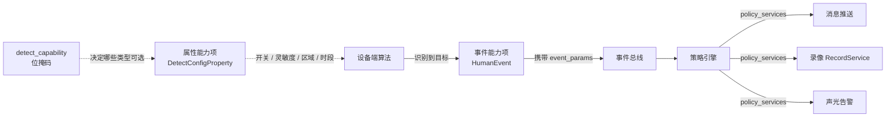

# 事件能力项定义建议（运动 / 人形 / 宠物）

> 适用前提：沿用《物模型定义 v4.0》的四层结构（类目 → 能力模块 → 能力项 → 参数项）+ 策略层
> 讨论范围：侦测类事件（运动、人形、宠物、车辆……）如何建模
> 结论日期：2026-11-04

---

## 一、先把四件事分开

现在最容易出问题的地方，是把下面四个概念混成一个：

| # | 概念 | 本质 | 变化频率 | 归属 |
|---|---|---|---|---|
| 1 | **检测能力** | 这台设备能不能识别"人形" | 静态（出厂） | 属性能力项里的一个位掩码 |
| 2 | **检测配置** | 人形侦测开没开、灵敏度、区域、时段 | 用户改才变 | 属性能力项里的数组参数 |
| 3 | **检测事件** | 10:23:15 门前有个外卖员 | 运行时高频产生 | 事件能力项 |
| 4 | **事件动作** | 推送 / 录像 / 声光 / 联动 | 策略配置 | 策略 |

**关键判断**：只有第 1、2 项是"属性"，第 3 项必须是"事件"。现在平台里 `MotionDetect` 被定义成 prop（0 关闭 / 1 开启）——它其实是第 2 项，名字应该叫 `motion_detect_enable`，而"真的侦测到人了"这件事，目前没有独立的事件定义，这是缺口。



---

## 二、推荐模型

### 2.1 属性能力项：`DetectConfigProperty`（侦测配置）

**一个能力项装下所有检测类型**，不要每类建一个能力项。理由：新增"包裹侦测"时只需要加一个枚举值，不用新建能力项、不用改策略、不用发版 APP 的能力清单。

```json
{
  "identifier": "DetectConfigProperty",
  "name": "侦测配置",
  "cap_type": "prop",
  "params": [
    {
      "identifier": "detect_capability",
      "name": "支持的侦测类型",
      "datatype": { "type": "uint32", "min": 0, "max": 4294967295 },
      "access_mode": 0,
      "unit": "bitmask",
      "remark": "位掩码，见 2.4 枚举表；bit1=运动 bit2=人形 bit3=宠物 bit4=车辆 ..."
    },
    {
      "identifier": "detect_merge_interval",
      "name": "同目标合并间隔",
      "datatype": { "type": "uint16", "min": 0, "max": 3600 },
      "access_mode": 2,
      "unit": "秒",
      "default_value": 30
    },
    {
      "identifier": "detect_items",
      "name": "侦测项列表",
      "datatype": {
        "type": "array",
        "max_length": 8,
        "item": {
          "type": "struct",
          "fields": [
            { "identifier": "detect_type",            "datatype": { "type": "enum", "ref": "DetectType" }, "access_mode": 0 },
            { "identifier": "detect_enable",          "datatype": { "type": "bool" }, "access_mode": 2, "default_value": 0 },
            { "identifier": "detect_sensitivity",     "datatype": { "type": "uint8", "min": 1, "max": 5 }, "access_mode": 2, "default_value": 3 },
            { "identifier": "detect_region_enable",   "datatype": { "type": "bool" }, "access_mode": 2, "default_value": 0 },
            { "identifier": "detect_regions",         "datatype": { "type": "array", "max_length": 4, "item": { "type": "struct", "fields": [
                { "identifier": "x",      "datatype": { "type": "uint8", "min": 0, "max": 100 } },
                { "identifier": "y",      "datatype": { "type": "uint8", "min": 0, "max": 100 } },
                { "identifier": "width",  "datatype": { "type": "uint8", "min": 1, "max": 100 } },
                { "identifier": "height", "datatype": { "type": "uint8", "min": 1, "max": 100 } }
              ] } }, "access_mode": 2 },
            { "identifier": "detect_schedule",        "datatype": { "type": "struct", "ref": "ScheduleList" }, "access_mode": 2 },
            { "identifier": "detect_alarm_sound",     "datatype": { "type": "enum", "ref": "AlarmSound" }, "access_mode": 2, "default_value": 0 }
          ]
        }
      },
      "access_mode": 2
    }
  ]
}
```

设计要点：

- `detect_capability` 是**能力**（只读，设备上报支持哪些类型）；`detect_items` 里的 `detect_enable` 是**配置**（读写）。两者分开，符合 v4.0 的 `xxx_ability` + `xxx_enable` 惯例。
- `detect_type` 只读——APP 不允许给一台只支持人形的设备塞一条"宠物侦测"的配置。
- 时段复用 v4.0 的 `schedule_list` 对象，不另造定时结构。
- 区域用百分比坐标，**必须在文档里写死参考基准**（当前分辨率 / 4:3 还是 16:9），否则多镜头、变焦后区域会飘。

### 2.2 事件能力项：**一类一个事件**

推荐为每种识别结果建**独立的事件能力项**，而不是把类型塞进一个通用事件的参数里。

```json
[
  {
    "identifier": "MotionEvent",
    "event_id": "140001",
    "event_name": "运动侦测",
    "event_source_module": "AlgoModule",
    "event_params": [ /* 见 2.3 */ ]
  },
  {
    "identifier": "HumanEvent",
    "event_id": "140002",
    "event_name": "人形侦测",
    "event_source_module": "AlgoModule",
    "event_params": [ /* 见 2.3 */ ]
  },
  {
    "identifier": "PetEvent",
    "event_id": "140003",
    "event_name": "宠物侦测",
    "event_source_module": "AlgoModule",
    "event_params": [ /* 见 2.3 */ ]
  }
]
```

**为什么不是"一个事件 + detect_type 参数"？**

v4.0 的策略条件目前只有：

```json
"policy_condition": { "logic": 1, "events": ["event_id1"] }
```

条件里只能放 event_id 列表。如果所有类型共用一个 `event_id`，策略就无法表达"只在人形时推送、宠物不推"——只能写一条"全部推送"的策略。要么改策略模型加过滤器，要么按类型拆事件。**按类型拆事件的代价更小**，而且与业界（涂鸦、萤石等）主流的"每类一个事件"一致。

如果坚持单事件模型，则必须在 v4.1 给策略条件补一个 `event_filters`（字段级过滤），这是本次讨论要老板拍板的第一个点，见第七章。

### 2.3 事件参数（`event_params`）

所有侦测事件共用同一套参数项，保证 APP 端一套渲染逻辑：

| identifier | 类型 | 说明 |
|---|---|---|
| `event_time` | uint64 (ms) | 事件产生时间，UTC 毫秒戳 |
| `trigger_id` | string | **一次物理触发的关联 ID**，同一次触发派生的多个事件共用 |
| `detect_type` | enum `DetectType` | 冗余字段，便于单一事件模型时兼容；拆类型后可省略 |
| `confidence` | uint8 (0–100) | 置信度，非 AI 类型可固定 100 |
| `target_count` | uint8 | 本次识别到的目标数 |
| `region_id` | uint8 | 命中哪个人工圈选区域（0 表示全画面） |
| `bbox` | struct{x,y,w,h} | 目标框，百分比坐标；多目标时取最大目标 |
| `snapshot_id` | string | 抓图文件 ID，对应 `LocalSnapshotFileProperty` |
| `clip_id` | string | 录像片段 ID，对应 `LocalRecordFileProperty` |
| `clip_start_time` | uint64 (ms) | 片段起始时间，便于直接回放定位 |
| `clip_duration` | uint16 (s) | 片段时长 |

约束：

- **`trigger_id` 是这次设计的核心**。设备端一次连续触发（人走过门前 5 秒）只应产生 1 条事件；若算法同时给出 motion 和 human，两条事件共用同一个 `trigger_id`，由**消息中心按 trigger_id 去重**，用户只看到一条消息。
- `confidence`、`bbox` 属于可选能力：设备不支持就不上报，APP 按缺失处理，不要填假值。
- 时间统一 UTC 毫秒，与 v4.0 `TimeProperty.timestamp` 一致（顺带修掉 v4.0 里"8 字节毫秒"却给了 10 位秒值的示例错误）。

### 2.4 枚举定义（必须结构化）

v4.0 现在把枚举写在注释里，平台无法渲染、无法校验。以下枚举建议落到《枚举与位掩码常量表》，能力项只引用名称：

**`DetectType`（侦测类型，同时用于位掩码的位序）**

| val | name | 位掩码 | 说明 |
|---|---|---|---|
| 1 | 运动 | 0x01 | 基础像素变化检测，非 AI |
| 2 | 人形 | 0x02 | AI 分类 |
| 3 | 宠物 | 0x04 | AI 分类 |
| 4 | 车辆 | 0x08 | AI 分类 |
| 5 | 包裹 | 0x10 | AI 分类 |
| 6 | 火焰 | 0x20 | AI 分类 |
| 7 | 哭声 | 0x40 | 音频类，走 `AudioModule` |

> 位掩码位的计算规则要写死：**`1 << (detect_type - 1)`**，避免各家自己算。

**`AlarmSound`（联动声光）**

| val | name |
|---|---|
| 0 | 无 |
| 1 | 提示音（短） |
| 2 | 警报声（长） |
| 3 | 自定义语音（引用 `SoundFileProperty`） |

---

## 三、运动 / 人形 / 宠物 的层级关系

这三者不是并列的三兄弟，而是**基础检测 + AI 分类**的关系：

| 层级 | 类型 | 谁产生 | 是否依赖 AI |
|---|---|---|---|
| L0 | 运动 | 像素差分 / PIR | 否，任何设备都有 |
| L1 | 人形 / 宠物 / 车辆 | 本地或云端算法 | 是 |

**合并规则（必须定，否则同一次触发会推三条消息）：**

1. 一次物理触发 → 设备端只上报**置信度最高的那一类**；
2. 优先级：`人形 > 车辆 > 宠物 > 包裹 > 运动`（涉及安全的目标优先）；
3. 若设备无 AI 能力（`detect_capability` 只有 bit1），只上报 `MotionEvent`；
4. 若算法能力可切云端/本地双跑，宁可少报也不要重复报 —— 用 `trigger_id` 兜底去重。

**消息侧的呈现**：客户端"消息"是事件的展示形态，一次触发一条消息，消息体里带 `detect_type` 用来决定文案和图标（"检测到人形" / "检测到宠物"），而不是三个 tab 各一条。

---

## 四、事件 ID 编码

按 v4.0 规则：第 1 位＝事件来源类型（1 设备事件），第 2 位＝模块编号（4 算法模块），后 4 位＝事件序号。

| event_id | 事件 | 说明 |
|---|---|---|
| `140001` | 运动侦测 | 基础检测 |
| `140002` | 人形侦测 | |
| `140003` | 宠物侦测 | |
| `140004` | 车辆侦测 | |
| `140005` | 包裹侦测 | |
| `140006` | 区域入侵 | 区域类，配套 `region_id` |
| `140007` | 越界侦测 | 方向：进 / 出 |
| `140008` | 镜头遮挡 | 非目标类 |
| `140009`–`140099` | 预留 | 新 AI 类型按序分配，不跳号 |

同时提醒 v4.0 的一个隐患：**单模块 4 位序号上限 9999**，且模块编号只有一位（最多 10 个模块）。现在够用，但建议 v5 改成 `模块前缀_序号`（如 `ALGO_0001`），可读且无上限。

---

## 五、策略怎么写

以"人形事件 → 推送 + 录像 30 秒 + 不声光"为例：

```json
{
  "policy_id": "P1001",
  "policy_name": "人形事件推送与录像",
  "policy_type": "event_record",
  "policy_enable": 1,
  "policy_priority": 1,
  "policy_condition": {
    "logic": 1,
    "events": ["140002"]
  },
  "policy_services": [
    {
      "service_key": "MessagePushService",
      "service_param": { "message_type": 1, "title_key": "human_detected" }
    },
    {
      "service_key": "RecordService",
      "service_param": {
        "record_mode": 2,
        "record_duration": 30,
        "pre_record_time": 3
      }
    }
  ]
}
```

**必须补的两条规则**（v4.0 目前没写）：

1. **多策略命中怎么办**：同一事件命中多条策略时，按 `policy_priority` 升序执行；**动作类型互斥**（同一次触发最多 1 次推送、1 段录像），后执行者覆盖前者的同类动作参数。
2. **策略与配置的边界**：`detect_enable` 是配置（关了就不产生事件），策略管的是"产生事件之后做什么"。两者不能互相替代——现在平台里"关掉 MotionDetect 就不推送"其实是策略缺位的临时做法。

---

## 六、和现有平台的落差（迁移映射）

| 现在（`iot-platform-v2` 能力库） | 建议 | 迁移动作 |
|---|---|---|
| `MotionDetect`（prop，0/1）在"设备告警"事件组下 | 改名 `motion_detect_enable`，移入 `DetectConfigProperty.detect_items` | 保留旧标识符 3 个版本做兼容 |
| 事件组 `AlarmEventItem`（evt）里塞 MotionDetect / LowBattery / DeviceOnline 作为**参数** | 每个事件独立成**事件能力项**（`MotionEvent` / `LowBatteryEvent` / `DeviceOnlineEvent`） | 能力库结构需从"事件组+参数"改为"事件能力项+event_params" |
| `capType: prop / svc / evt` | 不变 | 无需改平台 |
| `dataDef.accessMode: r / rw` | 建议补 `w`（只写），与 v4.0 的 0/1/2 对齐 | 平台能力库改枚举 |
| 枚举写在注释 | `enumValues: [{name,val}]` | 需把本文 2.4 的表录进能力库 |

其中第二行影响最大：**能力库现在的"事件"是能力和事件混在一起的**，要拆成"属性（配置）+ 事件（实例）"两套，否则 APP 永远分不清"开关"和"发生了"。

---

## 七、验收要点

| # | 验收项 | 判定 |
|---|---|---|
| 1 | 一次连续人形触发（10 秒） | 只产生 1 条事件，`trigger_id` 唯一 |
| 2 | 同时命中运动与人形 | 只上报 `HumanEvent`（按优先级），或两条同 `trigger_id`，消息层只显示 1 条 |
| 3 | 设备仅支持运动侦测 | `detect_capability` = 0x01，`detect_items` 只允许出现 `detect_type=1` |
| 4 | 关闭人形侦测 | 不再产生 `HumanEvent`，但 `MotionEvent` 依赖配置独立生效 |
| 5 | 关闭侦测但开启策略 | 不产生事件，策略不执行（不能反过来用策略"打开"侦测） |
| 6 | 时段外触发 | 不产生事件，不产生消息 |
| 7 | 抓图 / 录像联动 | 事件里的 `snapshot_id` / `clip_id` 能在文件列表里查到 |
| 8 | 无 AI 设备接入 | 不因缺少 `confidence` / `bbox` 而报错，APP 正常降级 |

---

## 八、待老板拍板

| # | 问题 | 选项 A | 选项 B | 我的建议 |
|---|---|---|---|---|
| 1 | 事件按类型拆，还是单事件 + 类型参数 | 每类一个事件能力项 | 单一 `DetectEvent` + `detect_type` | **A**，因为策略条件目前只能按 event_id 过滤 |
| 2 | 策略条件是否支持字段级过滤 | 支持 `event_filters` | 不支持，靠拆事件解决 | 先 A 方案落，v4.1 再评估加 filters |
| 3 | 检测配置放一个能力项还是每类一个 | `DetectConfigProperty` + 数组 | `HumanDetectProperty` / `PetDetectProperty` … | **数组**，新增类型不改结构 |
| 4 | 事件实例是否入库 | 入库（可查历史事件） | 只走消息，不单独存事件 | **入库**，否则"消息"和"事件"永远对不上 |
| 5 | `detect_type` 是否保留在事件参数里 | 保留（冗余但兼容） | 去掉（完全依赖 event_id） | 保留，便于单一事件模型过渡 |

---

## 附：与本文相关的现有文档

- 《物模型定义 v4.0》§0.1.2 事件定义能力项、§0.2.2 策略对象模板、§1.14 算法能力
- 《香薰机物模型定义》——单品类能力项的参考样例（含"能力项 → 控件"的映射写法）
- `iot-platform-v2` 能力库：现有 capType / dataDef 结构，迁移映射见第六章
