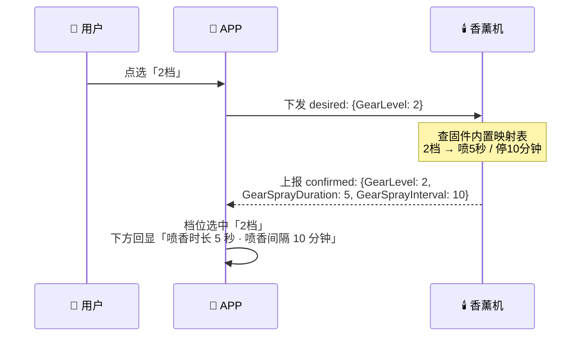
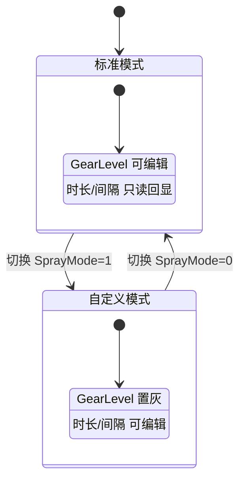

# 香薰机物模型定义

> 产品：香薰机（Aroma Diffuser）
> 设备形态：三方自有ID蓝崮设备（不烧录 License，广播携带 `authType=0x10` + `productId` + `unique_id`）
> 物模型大类：**Device**
> 回调名 `pucConfName` = `Device`，模块名 `IotModule`
>
> 标识符 PascalCase，全局唯一；模块名以 `Module` 结尾。字段结构对齐 `新物模型集合.md` / `能力库.md`。
>
> 已同步至 `新物模型集合.md` §3.1.3 IoT 模块 IotModule（设备端接入格式）。本文档为**完整定义**（含平台能力池 `dataDef` 配置），两者如有出入以本文档为准。

---

## 一、能力项总览

| # | 功能 | 标识符 | capType | dataType | 取值范围 | 默认值 | accessMode |
|---|------|--------|---------|----------|----------|--------|------------|
| 1 | 休眠唤醒控制 | `SprayWakeSwitch` | prop | boolean | 0=休眠 / 1=唤醒 | 1 | rw |
| 2 | 喷口选择 | `NozzleSelect` | prop | enum | 0=混合 / 1=左喷雾口 / 2=右喷雾口 | 0 | rw |
| 3 | 屏显开关 | `ScreenSwitch` | prop | boolean | 0=关闭 / 1=开启 | 1 | rw |
| 4 | 喷雾定时时段 | `SprayTimerSchedule` | prop | **struct** | StartTime / EndTime 两个 int 字段 | —（见待确认 12） | rw |
| 5 | 喷雾模式 | `SprayMode` | prop | enum | 0=标准 / 1=自定义 | 0 | rw |
| 6 | 喷雾档位 | `GearLevel` | prop | enum | 1档 / 2档 / 3档 | 1 | rw |
| 7 | 档位喷香时长 | `GearSprayDuration` | prop | int | 3~20 秒 | 5 | **r** |
| 8 | 档位喷香间隔 | `GearSprayInterval` | prop | int | 3~50 分钟 | 10 | **r** |
| 9 | 左喷口喷香时长 | `LeftSprayDuration` | prop | int | 3~20 秒 | 5 | rw |
| 10 | 左喷口喷香间隔 | `LeftSprayInterval` | prop | int | 3~50 分钟 | 10 | rw |
| 11 | 右喷口喷香时长 | `RightSprayDuration` | prop | int | 3~20 秒 | 5 | rw |
| 12 | 右喷口喷香间隔 | `RightSprayInterval` | prop | int | 3~50 分钟 | 10 | rw |
| 13 | 恢复出厂设置 | `FactoryReset` | **svc** | service | 无入参 | — | — |

> 第 1~12 项归属 `IotModule`；第 13 项 `FactoryReset` **复用既有 `DeviceModule`**（见 `能力库.md` §17），不新造标识符。

> 需求第 4 条「喷雾定时」简化为**单个每日时段**：不带开关、不带星期周期，只有 `StartTime` / `EndTime` 两个边界值。定时始终生效，全天时段（`0~86399`）即等价于不限制。
>
> **第 7/8 项是响应需求第 10 条「选中档位后显示对应喷香时长和喷香间隔」新增的两个只读能力项**：档位 → 参数的映射关系由固件内置，设备在 `GearLevel` 变更后上报这两个值，APP 直接展示、不自己维护映射表。详见 3.6 节。

---

## 二、物模型 JSON

```json
{
  "IotModule": {
    "SprayWakeSwitch":    1,
    "NozzleSelect":       0,
    "ScreenSwitch":       1,
    "SprayTimerSchedule": { "StartTime": 28800, "EndTime": 72000 },
    "SprayMode":          0,
    "GearLevel":          1,
    "GearSprayDuration":  3,
    "GearSprayInterval":  20,
    "LeftSprayDuration":  5,
    "LeftSprayInterval":  10,
    "RightSprayDuration": 5,
    "RightSprayInterval": 10
  },
  "DeviceModule": {
    "FactoryReset": 0
  }
}
```

> `FactoryReset` 为服务类（svc），上述 `0` 仅表示「空闲」这一默认状态，不参与 desired/reported 同步；实际触发走服务调用，见 3.11。

### 字段说明

| 字段 | 说明 |
|------|------|
| SprayWakeSwitch | 整机休眠/唤醒控制<br>0：休眠（停止雾化、关闭屏显与指示灯）<br>1：唤醒（恢复正常工作） |
| NozzleSelect | 雾化喷口选择<br>0：混合（左右喷口同时工作）<br>1：左喷雾口（仅左喷口工作）<br>2：右喷雾口（仅右喷口工作） |
| ScreenSwitch | 屏显开关<br>0：关闭<br>1：开启 |
| SprayTimerSchedule | 喷雾定时时段，**struct（对象）类型**，每日单个时段、无开关、无星期周期<br>`StartTime`：开始时间，int，秒，0~86399（如 28800=08:00）<br>`EndTime`：结束时间，int，秒，0~86399（如 72000=20:00）<br>`{"StartTime":0,"EndTime":86399}` 为全天，即不限制 |
| SprayMode | 喷雾模式<br>0：标准（喷香时长/间隔由档位决定，不可手动改）<br>1：自定义（喷香时长/间隔由用户手动设置） |
| GearLevel | 喷雾档位，仅 `SprayMode=0` 时生效<br>1：1档<br>2：2档<br>3：3档<br>档位 → 时长/间隔映射见第五节 |
| GearSprayDuration | **只读**。当前档位对应的喷香时长，单位秒，由设备上报——`GearLevel` 变更后设备按内置映射表解析并上报 |
| GearSprayInterval | **只读**。当前档位对应的喷香间隔，单位分钟，由设备上报 |
| LeftSprayDuration | 左喷口单次喷香时长，单位秒，3~20 |
| LeftSprayInterval | 左喷口两次喷香之间的停喷间隔，单位分钟，3~50 |
| RightSprayDuration | 右喷口单次喷香时长，单位秒，3~20 |
| RightSprayInterval | 右喷口两次喷香之间的停喷间隔，单位分钟，3~50 |
| FactoryReset | **服务**，恢复出厂设置，无入参。触发后设备清空所有用户配置、`IotModule` 全部属性回到 `defaultVal`，随后自动重启断连 |

---

## 三、能力项 dataDef 明细（平台配置侧）

### 3.1 SprayWakeSwitch

```json
{
  "capType": "prop",
  "name": "休眠唤醒",
  "identifier": "SprayWakeSwitch",
  "dataDef": {
    "dataType": "boolean",
    "accessMode": "rw",
    "trueLabel": "唤醒",
    "falseLabel": "休眠",
    "defaultVal": "1"
  }
}
```

> 渲染：开关（Switch）。选中态需二次确认——进入休眠后设备侧服务不可用。

### 3.2 NozzleSelect

```json
{
  "capType": "prop",
  "name": "喷口选择",
  "identifier": "NozzleSelect",
  "dataDef": {
    "dataType": "enum",
    "accessMode": "rw",
    "enumValues": [
      { "name": "混合",     "val": 0 },
      { "name": "左喷雾口", "val": 1 },
      { "name": "右喷雾口", "val": 2 }
    ],
    "defaultVal": "0"
  }
}
```

> 渲染：枚举 3 项 ≤ 5 → 分段选择器（Segmented Control）。

### 3.3 ScreenSwitch

```json
{
  "capType": "prop",
  "name": "屏显开关",
  "identifier": "ScreenSwitch",
  "dataDef": {
    "dataType": "boolean",
    "accessMode": "rw",
    "trueLabel": "开启",
    "falseLabel": "关闭",
    "defaultVal": "1"
  }
}
```

### 3.4 SprayTimerSchedule

```json
{
  "capType": "prop",
  "name": "喷雾定时时段",
  "identifier": "SprayTimerSchedule",
  "dataDef": {
    "dataType": "struct",
    "accessMode": "rw",
    "fields": [
      {
        "name": "开始时间",
        "identifier": "StartTime",
        "dataType": "int",
        "min": 0, "max": 86399, "step": 1, "unit": "秒",
        "descr": "一天内秒数，如 28800 = 08:00"
      },
      {
        "name": "结束时间",
        "identifier": "EndTime",
        "dataType": "int",
        "min": 0, "max": 86399, "step": 1, "unit": "秒",
        "descr": "一天内秒数，如 72000 = 20:00，需大于 StartTime"
      }
    ]
  }
}
```

**字段说明：**

| 字段 | identifier | 类型 | 说明 |
|------|-----------|------|------|
| 开始时间 | `StartTime` | int | 秒，0~86399（28800 = 08:00） |
| 结束时间 | `EndTime` | int | 秒，0~86399（72000 = 20:00），需大于 `StartTime` |

> `dataType` 用 **struct**（对象）而非 string：字段级可声明名称、范围、单位、描述，平台侧在「结构体型」编辑器里逐字段维护（同 `ScheduledDetect` 的字段定义方式）。设备侧取值也是真实 JSON 对象，不是字符串：
>
> ```json
> "SprayTimerSchedule": { "StartTime": 28800, "EndTime": 72000 }
> ```
>
> 只有一个时段、无开关、无星期周期。设备每天在该时段内按当前 `SprayMode` 的规则喷雾；时段外不喷。
>
> 渲染：**开始时间 / 结束时间两个时间选择器**，复用既有定时组件。APP 按 struct 的两个 int 字段渲染——注意 `int` 的通用渲染规则（`0~86399 step 1` 极差过大 → 数字输入 Stepper）不适用于时间语义，需按字段 identifier 走时间选择器。

### 3.5 SprayMode

```json
{
  "capType": "prop",
  "name": "喷雾模式",
  "identifier": "SprayMode",
  "dataDef": {
    "dataType": "enum",
    "accessMode": "rw",
    "enumValues": [
      { "name": "标准", "val": 0 },
      { "name": "自定义", "val": 1 }
    ],
    "defaultVal": "0"
  }
}
```

> 渲染：分段选择器。

### 3.6 GearLevel + GearSprayDuration / GearSprayInterval ✅ 已定稿

**设计约束**：平台能力池的 `dataType` 支持 `enum` / `int` / `boolean` / `string` / `array` / `struct`，但每种类型只能填**该类型自身的字段集**（enum 只能填 `enumValues`，int 只能填 `min/max/step/unit`…），**没有地方挂任意业务扩展字段**。`GearLevel` 是 enum，它的 `dataDef` 里塞不下「档位 → 时长/间隔」这张映射表。所以映射不放在物模型里，改由**固件内置 + 设备上报**。

**三个能力项各司其职：**

| 能力项 | 职责 | accessMode |
|--------|------|------------|
| `GearLevel` | 用户选档位，下发到设备 | rw |
| `GearSprayDuration` | 设备解析档位后上报的喷香时长，APP 只展示 | **r** |
| `GearSprayInterval` | 设备解析档位后上报的喷香间隔，APP 只展示 | **r** |

```json
{
  "capType": "prop",
  "name": "喷雾档位",
  "identifier": "GearLevel",
  "dataDef": {
    "dataType": "enum",
    "accessMode": "rw",
    "enumValues": [
      { "name": "1档", "val": 1 },
      { "name": "2档", "val": 2 },
      { "name": "3档", "val": 3 }
    ],
    "defaultVal": "1"
  }
}
```

```json
{
  "capType": "prop",
  "name": "档位喷香时长",
  "identifier": "GearSprayDuration",
  "dataDef": {
    "dataType": "int", "accessMode": "r",
    "min": 3, "max": 20, "step": 1, "unit": "秒",
    "defaultVal": "5"
  }
}
```

```json
{
  "capType": "prop",
  "name": "档位喷香间隔",
  "identifier": "GearSprayInterval",
  "dataDef": {
    "dataType": "int", "accessMode": "r",
    "min": 3, "max": 50, "step": 1, "unit": "分钟",
    "defaultVal": "10"
  }
}
```

**时序：**



**APP 渲染**：`GearLevel` 渲染为分段选择器（3 项 ≤ 5），下方跟一行只读说明「喷香时长 X 秒 · 喷香间隔 Y 分钟」，X/Y 取 `GearSprayDuration` / `GearSprayInterval` 的当前值。

**为什么不把映射表放进物模型**（备选方案，若后续平台支持扩展字段可再切）：

| 方案 | 做法 | 评价 |
|------|------|------|
| **A（✅ 已采纳）** | 固件内置映射，`GearSprayDuration` / `GearSprayInterval` 只读上报 | 全部使用平台标准字段，平台零改造；APP 不做本地映射表，符合「以设备实际状态为准」；代价是新增 2 个能力项、固件需上报 |
| B | 参数写进档位枚举文案：`{"name":"1档（喷3秒/停20分钟）","val":1}` | 零新增能力项；但分段选择器段内文案过长，且数值与文案耦合后多语言难做 |
| C | 平台 `dataDef` 加 `gearMapping` 扩展字段 | ~~已废弃~~：平台能力池无自定义字段录入入口，配置页填不进去，APP 也取不到 |

### 3.7 ~ 3.10 喷香时长 / 间隔

```json
{
  "capType": "prop",
  "name": "左喷口喷香时长",
  "identifier": "LeftSprayDuration",
  "dataDef": {
    "dataType": "int", "accessMode": "rw",
    "min": 3, "max": 20, "step": 1, "unit": "秒",
    "defaultVal": "5"
  }
}
```

```json
{
  "capType": "prop",
  "name": "左喷口喷香间隔",
  "identifier": "LeftSprayInterval",
  "dataDef": {
    "dataType": "int", "accessMode": "rw",
    "min": 3, "max": 50, "step": 1, "unit": "分钟",
    "defaultVal": "10"
  }
}
```

`RightSprayDuration` / `RightSprayInterval` 同上，仅名称与标识符替换为「右喷口」。

> 渲染：时长 `3~20 step 1` → 18 个可选值、极差 17 ≤ 100 → **滑动条**；间隔 `3~50 step 1` → 48 个可选值、极差 47 ≤ 100 → **滑动条**。

### 3.11 FactoryReset（归属 DeviceModule）

```json
{
  "capType": "svc",
  "name": "恢复出厂设置",
  "identifier": "FactoryReset",
  "dataDef": {
    "dataType": "service",
    "inputParams": [],
    "outputParams": [
      {
        "name": "操作结果",
        "identifier": "result",
        "dataType": "boolean",
        "trueLabel": "成功",
        "falseLabel": "失败",
        "defaultVal": "1"
      }
    ]
  }
}
```

> 渲染：服务类 → **按钮**（文案「恢复出厂设置」），点击后弹**二次确认框**，确认才调用；执行结果按 `outputParams` 展示。
>
> ⚠️ **必须用 svc 而非 prop**：prop 走设备影子的 desired 暂存（见 `物模型管理04全链路流程.md` §7「属性类写入 desired 暂存，设备上线后自动同步」）。若把恢复出厂定义成 prop，用户在设备离线时误点，指令会暂存到设备上线后**自动执行**——不可逆且用户不知情。服务类则按 §8「设备离线 → 直接拒绝」，符合预期。
>
> ⚠️ 这与 `能力库.md` 现有的 `"FactoryReset": 0  // 0=空闲，1=触发` 写法**不一致**（那边是 prop），需拉齐，见待确认项。

**执行后 APP 侧处理：**

| 步骤 | APP 行为 |
|------|----------|
| 调用前 | 二次确认弹窗，明确告知「所有设置将清除且不可恢复」 |
| 调用中 | 按钮置 Loading，禁止重复点击 |
| 成功 | 设备重启断连。清空本地 `capabilityCache`，重连后按 `defaultVal` 重新渲染面板 |
| 失败 / 离线 | Toast「设备已离线，请稍后重试」，**不做任何暂存** |

---

## 四、控件联动规则

物模型只声明取值，联动需 APP 端按下列矩阵处理（规则来源为 `SprayMode` / `NozzleSelect` 的当前值）。

### 4.1 喷雾模式

| SprayMode | GearLevel | 左右时长 / 间隔 |
|-----------|--------------|-----------------|
| 标准 | 可编辑 | **置灰只读**，其值由设备上报的 `GearSprayDuration` / `GearSprayInterval` 接管 |
| 自定义 | 置灰只读 | 可编辑 |

### 4.2 喷口选择

| NozzleSelect | 左喷口参数 | 右喷口参数 |
|--------------|-----------|-----------|
| 混合 | 可编辑（生效） | 可编辑（生效） |
| 左喷雾口 | 可编辑（生效） | 置灰（不生效） |
| 右喷雾口 | 置灰（不生效） | 可编辑（生效） |

### 4.3 喷雾定时

`SprayTimerSchedule` **无开关、无联动**——开始 / 结束两个时间选择器始终可编辑，不需要任何置灰逻辑。时段外设备不喷雾、时段内按当前 `SprayMode` 规则喷雾。



---

## 五、喷雾档位映射表（待设备规格确认）

| 档位 | 喷香时长 | 喷香间隔 | 建议文案 |
|------|----------|----------|----------|
| 1档 | 3 秒 | 20 分钟 | 轻柔 |
| 2档 | 5 秒 | 10 分钟 | 标准 |
| 3档 | 8 秒 | 5 分钟 | 浓郁 |

> 上表为占位示例。**该映射表不写入物模型**——平台能力池没有自定义字段录入入口，映射关系由**固件内置**，设备解析后通过 `GearSprayDuration` / `GearSprayInterval` 上报。本表仅供固件/产品对齐确认，确认后需同步给固件实现。

---

## 六、待确认项

| # | 事项 | 说明 |
|---|------|------|
| 1 | **休眠后通信是否可用** | `SprayWakeSwitch` 置 0 进入休眠后，若设备断开蓝牙/停止心跳，APP 将无法下发唤醒指令。需确认休眠是「仅停雾化，通信保持」还是「真休眠」；若为真休眠，需定义唤醒方式（物理按键 / 定时 / 广播唤醒）——可复用既有 `WakeupModule.WakeMode`。 |
| 2 | **喷雾档位是否左右独立** | 当前按「档位为全局一套参数，左右喷口共用」定义。若左右喷口在标准模式下各自有档位，需拆成 `LeftGearLevel` / `RightGearLevel`。 |
| 3 | **喷雾档位数量与固件映射表** | 第五节映射表为占位。档位是 3 档还是更多？各档位的时长/间隔取值？需固件方确认——**映射表由固件内置**，确认后 APP 侧无需改动物模型。 |
| 4 | **喷香时长/间隔是否连续取值** | 自定义模式下时长 3~20 秒、间隔 3~50 分钟的取值是连续（step 1）还是离散几档？若为离散值，`dataDef` 需从 `min/max/step` 改为 `enumValues` 枚举，APP 渲染也会从滑动条变成下拉选择。 |
| 5 | **档位只读值的上报时机** | `GearSprayDuration` / `GearSprayInterval` 需在 `GearLevel` 变更后立即上报；设备重启、APP 首次进入面板时是否也全量上报？若不上报，APP 只能吃到 `defaultVal`，显示会与实际档位对不上。 |
| 6 | **定时时段是否需要「关闭」入口** | 已按需求去掉定时开关。那用户想**完全停用定时**时怎么办？当前只能手动把时段拖到全天（00:00~23:59）。若产品希望有明确开关，需补回一个 boolean 能力项；若这个需求不存在，则维持现状。 |
| 7 | **跨零点时段是否支持** | 当前 `StartTime` / `EndTime` 只在 0~86399 内取值，`EndTime` 必须大于 `StartTime`。若用户想设「22:00~次日 06:00」，当前结构表达不了，需明确是不支持、还是改成跨零点语义。 |
| 8 | **休眠与定时的优先级** | 休眠期间命中喷雾定时时段时，设备应保持休眠还是自动唤醒喷雾？需明确优先级。 |
| 9 | **屏显 / 休眠能力项的模块归属** | 当前统一内聚在 `IotModule`，便于三方一次性对接。若平台要求按能力域拆分，建议 `ScreenSwitch` 并入既有 `DisplayModule`、`SprayWakeSwitch` 并入 `DeviceModule`。 |
| 10 | **模块是否需要独立开关** | `IotModule` 是否需要 `AromaSwitch`（香薰总开关）？当前未定义——休眠开关已可承担停机语义，若产品要求「休眠 ≠ 关闭香薰」则需补。 |
| 11 | **`FactoryReset` 的 prop / svc 归属未拉齐** | 香薰机按 **svc** 定义（离线直接拒绝，安全）；但 `能力库.md` §17 写的是 `"FactoryReset": 0` prop 形式，`StorageModule.FormatCard` 同样。而 `物模型管理01ReqAnalysis.md` 又把「格式化存储」归为**服务**——三处口径不一致。需定一个：① 统一改 svc（推荐，需同步改 `能力库.md`/`物模型定义.md`，影响既有产品）；② 保持 prop 不动，香薰机也照抄 prop（**有离线误触发风险**，不建议）；③ 香薰机单独用 svc，与既有定义并存（标识符相同、类型不同，有冲突隐患）。 |
| 12 | **struct 类型没有「默认值」配置入口** | 能力库的 struct 编辑器只有「结构体字段列表」，**没有默认值输入框**（`capability.vue` 里 enum/int/boolean/string 各自有默认值表单项，struct/array 没有）。`SprayTimerSchedule` 改用 struct 后，其默认值（全天 `{"StartTime":0,"EndTime":86399}`）无法在能力库配置。需确认：① 默认值改由**产品侧「功能定义与配置」**的默认值层配置（需确认该页对 struct 是否支持）；② 或默认值由**固件内置**，平台不下发；③ 或退回 `string` 类型以保留默认值入口（代价是丢字段级定义）。 |
| 13 | **香薰机与网关子设备共用 IotModule 的下发范围** | `IotModule` 现同时承载网关下挂子设备传感器字段与香薰机喷雾字段。既有机制是「按设备类型选择性生效，不适用时上报默认值」，但那套是**网关**为子设备代收代发；香薰机是**独立设备**，不挂网关、走三方自有ID蓝牙。需确认：① 设备端 SDK 对独立设备是否复用同一套「按类型选择性生效」逻辑；② 香薰机产品关联能力时是否只需勾选喷雾这 12 个字段（避免下发 15 个传感器字段的默认值）；③ `SubDeviceType` 公共字段对独立设备是否适用。 |

> 已确认：喷香时长 3~20 秒、喷香间隔 3~50 分钟，单位分别为「秒」「分钟」。
>
> 已修正：① 档位 → 时长/间隔的映射不再放物模型（平台能力池无扩展字段入口），改为固件内置 + `GearSprayDuration` / `GearSprayInterval` 只读上报，详见 3.6；② 喷雾定时简化为单个每日时段，去掉开关与星期周期（能力项由 14 项减至 13 项）；③ 模块名由 `AromaModule` 改为 `IotModule`，与网关下挂子设备共用同一模块、按设备类型选择性生效；④ 档位标识符由 `SprayGear` 改为 `GearLevel`（更通用）；两个派生只读项维持 `GearSprayDuration` / `GearSprayInterval` 不改。
>
> 待办：本节标识符与设备端协议 `xfj-ble-protocol(1).md` 存在差异（协议用 `WakeSwitch` / `TimerSchedule`），经确认**物模型自成一套、不与设备端命名对齐**，故不修改。

---

*创建日期: 2026-10-15 | 基于 需求 10 项功能梳理，字段结构对齐 `新物模型集合.md` / `物模型定义.md` / `物模型管理05APP端渲染规则.md`*
