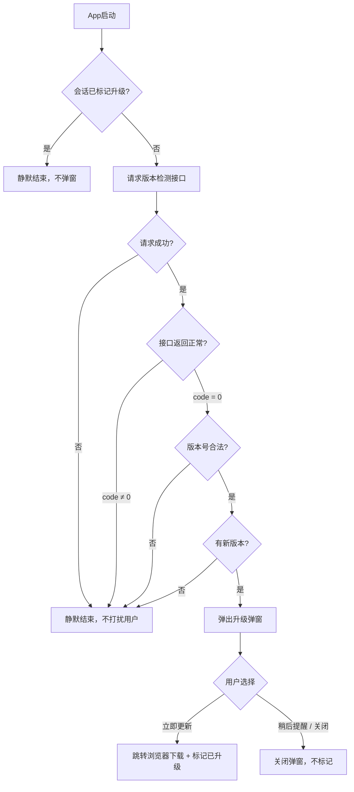
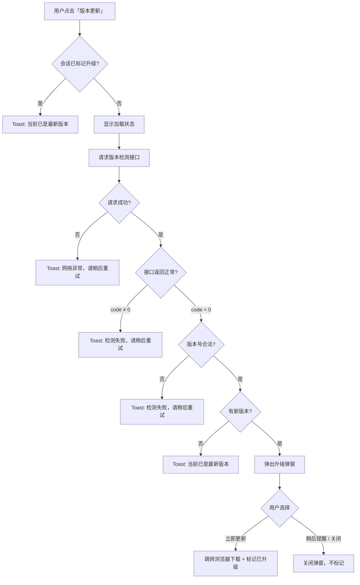
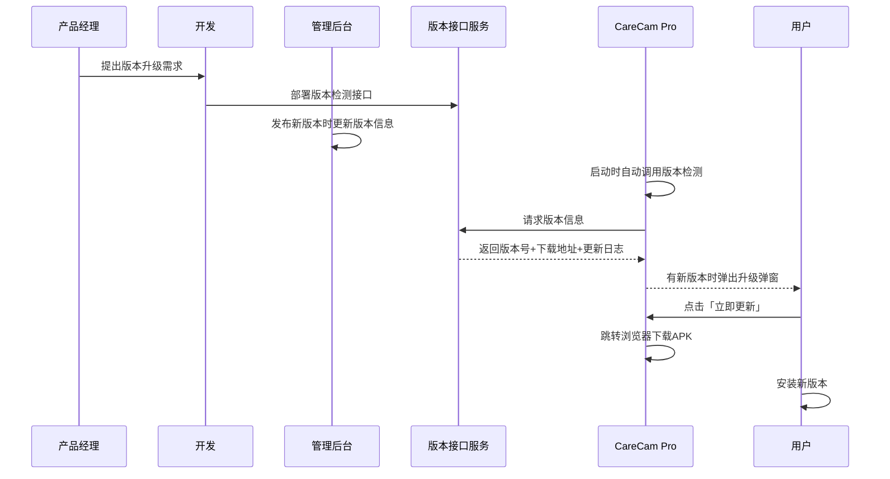
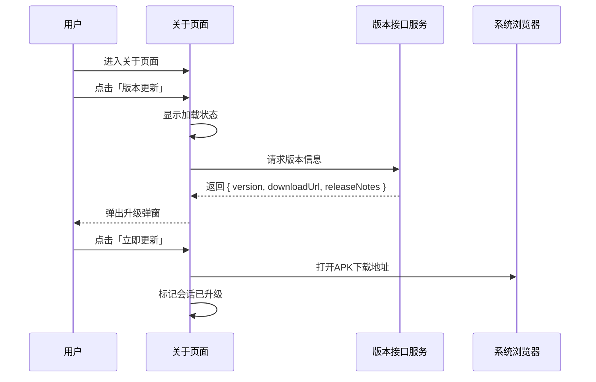

# APP版本检测与升级 — 完整业务 PRD

## 修订记录
| 修订时间 | 修订内容 | 修订人 |
|----------|----------|--------|
| 2026-07-22 | 初稿，融合需求分析、UI设计、运营分析 | PRD生成AI工程师 |

## 一、业务背景

### 业务场景
CareCam Pro 作为 IPC 摄像机配套 App，通过 APK 侧载方式分发给用户。用户无法通过应用商店获取版本更新通知，缺乏升级感知渠道。当 App 修复关键 Bug 或新增功能时，需要让用户及时知晓并完成升级。

### 用户痛点
- 用户不知道有新版本可用，持续使用旧版本（含已知 Bug）
- 缺少版本号展示入口，用户无法确认当前安装版本
- 无主动检查更新的能力

### 产品目标
- 提供自动检测 + 手动检测双通道，确保用户能获取版本更新信息
- 非强制升级，尊重用户选择权，避免打断用户操作
- 每次启动均弹窗提示，点击「立即更新」后标记已升级，同会话内不再弹（便于演示验证）

## 二、名词解释

| 术语 | 说明 |
|------|------|
| 版本号 | 语义化版本格式 `major.minor.patch`（如 `1.2.0`），数值越大版本越新 |
| 强制升级 | 弹窗不可关闭，用户必须升级后才能继续使用 App（本需求不做） |
| 非强制升级 | 用户可选择「立即更新」或「稍后提醒」，关闭后可继续使用 |
| 自动检测 | App 启动时静默请求版本接口，有新版时弹窗提示 |
| 手动检测 | 用户在关于页面主动点击「版本更新」触发检测 |
| 会话已升级标记 | 点击「立即更新」后标记为已升级，同会话内再次检测直接返回「当前已是最新版本」，刷新浏览器后标记重置 |

## 三、业务实体说明

本需求不引入新的业务实体。核心依赖以下数据：

| 数据项 | 说明 |
|--------|------|
| 当前App版本号 | 硬编码于 App 内，格式 `major.minor.patch`（如 `1.0.0`） |
| 服务端版本信息 | 包含最新版本号、下载地址、更新日志、是否强制升级等字段 |
| 会话升级标记 | 内存级标记，同会话内点击「立即更新」后置为 true，浏览器刷新后重置 |

## 四、核心业务流程

### 4.1 启动自动检测流程



### 4.2 手动检测流程



### 4.3 全局时序图



### 4.4 局部队列时序图（手动检测）



## 五、业务规则

### 5.1 版本比较规则

| 规则项 | 说明 |
|--------|------|
| 版本格式 | `major.minor.patch`，点号分隔的数字 |
| 段数范围 | 2段 ~ 4段（如 `1.0`、`1.0.0`、`1.0.0.0`） |
| 比较方式 | 从左到右逐段比较，缺失的段视为 0 |
| 比较示例 | `1.2.0` > `1.1.9`；`2.0` > `1.9.9`；`1.2.0.1` > `1.2.0` |
| 字符串比较 | 禁止直接字符串比较（如 `"1.10.0" > "1.2.0"` 字符串结果为 false，实际应为 true） |

### 5.2 弹窗触发规则

| 条件 | 行为 |
|------|------|
| 有新版本 + 当前会话未标记升级 | 弹出升级弹窗 |
| 有新版本 + 当前会话已标记升级 | 自动检测静默；手动检测 Toast「当前已是最新版本」 |
| 无新版本 | 自动检测静默；手动检测 Toast「当前已是最新版本」 |
| 接口失败 | 自动检测静默；手动检测 Toast 错误提示 |
| 版本号格式非法 | 自动检测静默；手动检测 Toast 错误提示 |

### 5.3 升级标记规则

| 规则项 | 说明 |
|--------|------|
| 标记触发 | 用户点击「立即更新」时 |
| 标记范围 | 当前浏览器会话（刷新后重置） |
| 标记效果 | 同会话内再次检测直接返回「已是最新版本」 |
| 稍后提醒 | 不触发标记，下次启动仍弹窗 |

### 5.4 下载规则

| 场景 | 行为 |
|------|------|
| 正常下载 | 点击「立即更新」→ 系统浏览器打开 APK 下载地址 |
| 下载链接为空 | 弹窗不展示「立即更新」按钮，底部提示「下载链接暂不可用」 |
| 浏览器无法打开 | 弹窗关闭，Toast「已复制下载链接到剪贴板」 |

### 5.5 更新日志展示规则

| 规则项 | 说明 |
|--------|------|
| 最大展示行数 | 5行，超出可滚动（最大高度 120px） |
| 超出 500 字 | 截断展示，提供「查看全部」展开入口 |
| 空更新日志 | 不展示更新日志区域，仅显示标题和按钮 |

## 六、功能架构

```
APP版本检测与升级
├── 启动自动检测（P0）
│   ├── 静默请求版本接口
│   ├── 版本比较
│   └── 有条件弹窗（未标记升级 + 有新版本）
├── 手动检测（P0）
│   ├── 加载态展示
│   ├── 已升级判断（跳过请求）
│   ├── 请求版本接口
│   └── 结果反馈（Toast 或弹窗）
├── 升级弹窗（P0）
│   ├── 版本信息展示（版本号 + 更新日志）
│   ├── 立即更新（跳转浏览器 + 标记已升级）
│   └── 稍后提醒（关闭弹窗，不标记）
└── 关于页面（P1）
    ├── App 信息展示（Logo + 名称 + 版本号）
    ├── 版本更新入口
    └── 法律条款链接（用户协议 + 隐私政策）
```

## 七、详细功能描述

### 7.1 启动自动检测

#### 功能应用场景
用户打开 CareCam Pro App 时，系统自动检查是否有新版本可用，无需用户任何操作。

#### 功能详述

**触发时机**：App 启动完成后自动执行。

**检测流程**：
1. 检查当前会话是否已标记升级，若是则跳过检测（不弹窗）
2. 向服务端发起版本检测请求
3. 请求成功且返回新版本号高于当前版本 → 弹出升级弹窗
4. 请求失败、返回格式异常、版本号非法、无新版本 → 静默结束，用户无感知

**异常处理**：所有异常情况均静默处理，不弹窗、不 Toast，不打断用户正常使用。

### 7.2 手动检测（关于页面「版本更新」）

#### 功能应用场景
用户想知道当前是否有新版本可用，进入关于页面主动点击「版本更新」按钮。

#### 功能详述

**入口**：关于页面 → 「版本更新」菜单项

**检测流程**：
1. 用户点击「版本更新」
2. 按钮显示加载状态（转圈动画）
3. 若当前会话已标记升级 → 结束加载，Toast「当前已是最新版本」
4. 向服务端发起版本检测请求
5. 有新版本 → 结束加载，弹出升级弹窗
6. 无新版本 / 异常 → 结束加载，Toast 相应提示

**反馈文案**：
| 场景 | Toast 文案 |
|------|-----------|
| 已是最新版本 | 「当前已是最新版本」 |
| 网络异常 | 「网络异常，请稍后重试」 |
| 接口异常 | 「检测失败，请稍后重试」 |

### 7.3 升级弹窗

#### 功能应用场景
检测到新版本时，向用户展示版本更新信息，引导用户完成升级。

#### 功能详述

**弹出方式**：居中弹出，圆角卡片，宽度 300px，白色背景，右上角可关闭。

**弹窗内容**（从上到下）：

| 区域 | 元素 | 说明 |
|------|------|------|
| 顶部图标 | App Logo 或升级图标 | 64×64px，圆角 12px，居中 |
| 标题 | 「发现新版本 vX.X.X」 | 16px，深色加粗，居中 |
| 更新日志 | 「更新内容：」标签 + 文本列表 | 13px，灰色，最多 5 行，超出可滚动（max-height 120px） |
| 主按钮 | 「立即更新」 | 全宽，高度 44px，圆角 24px，蓝色（#1A73E8） |
| 次按钮 | 「稍后提醒」 | 12px，灰色文字，居中，padding 12px |

**交互行为**：

| 操作 | 结果 |
|------|------|
| 点击「立即更新」 | 跳转系统浏览器打开 APK 下载地址，关闭弹窗，标记会话已升级 |
| 点击「稍后提醒」 | 关闭弹窗，不标记已升级 |
| 点击右上角 ✕ | 关闭弹窗，等价于「稍后提醒」 |
| 下载链接为空 | 不展示「立即更新」按钮，底部提示「下载链接暂不可用」 |

#### 状态说明

| 状态 | 触发条件 | 展示内容 |
|------|----------|----------|
| 正常态 | 有新版本 + 有下载链接 | 完整弹窗（图标 + 标题 + 更新日志 + 立即更新 + 稍后提醒） |
| 无下载链接态 | 有新版本 + downloadUrl 为空 | 图标 + 标题 + 更新日志 + 提示文案「下载链接暂不可用」 + 稍后提醒 |
| 空更新日志态 | 有新版本 + releaseNotes 为空 | 图标 + 标题 + 按钮（无更新日志区域） |
| 超长更新日志态 | releaseNotes > 500 字 | 截断展示 + 「查看全部」展开入口 |

### 7.4 关于页面

#### 功能应用场景
用户通过「我的」→「关于」进入，查看 App 信息、检查版本更新、查阅法律条款。

#### 功能详述

**页面结构**（从上到下）：

| 区域 | 内容 |
|------|------|
| 页面头部 | 左侧返回箭头 + 标题「关于」，暗色背景 |
| App 信息区 | Logo（72×72px，圆角 16px）+ 名称「CareCam Pro」+ 当前版本号「v1.0.0」 |
| 功能菜单区 | 版本更新（带右箭头）+ 用户协议（带右箭头）+ 隐私政策（带右箭头） |

**交互行为**：

| 操作 | 结果 |
|------|------|
| 点击返回箭头 | 返回上一页（我的页面） |
| 点击「版本更新」 | 触发手动版本检测 |
| 点击「用户协议」 | 跳转系统浏览器打开用户协议链接 |
| 点击「隐私政策」 | 跳转系统浏览器打开隐私政策链接 |

**菜单项样式**：
- 版本更新：左侧绿色图标容器（28×28px，背景 `#F0FDF4`）+ 标签 + 右箭头
- 用户协议：左侧橙色图标容器（28×28px，背景 `#FFF7ED`）+ 标签 + 右箭头
- 隐私政策：左侧蓝色图标容器（28×28px，背景 `#F0F9FF`）+ 标签 + 右箭头

## 八、页面信息架构

```
App 启动
  └── 自动版本检测 → 升级弹窗

我的页面（/me）
  └── 「关于」菜单项
        └── 关于页面（/about）
              ├── 返回 ← 我的页面
              ├── 「版本更新」→ 手动检测 → 升级弹窗 或 Toast
              ├── 「用户协议」→ 外部浏览器
              └── 「隐私政策」→ 外部浏览器

升级弹窗（全局，居中弹出）
  ├── 「立即更新」→ 系统浏览器下载
  ├── 「稍后提醒」→ 关闭
  └── 「✕」→ 关闭
```

**页面跳转关系**：
| 起始页 | 目标页 | 触发操作 |
|--------|--------|----------|
| 我的页面 | 关于页面 | 点击「关于」菜单项 |
| 关于页面 | 我的页面 | 点击返回箭头 |
| 关于页面 | 系统浏览器 | 点击「用户协议」或「隐私政策」 |
| 任意页面 | 系统浏览器 | 升级弹窗中点击「立即更新」 |

## 九、异常说明

### 9.1 网络异常

| 场景 | 检测方式 | 表现 |
|------|----------|------|
| 无网络 | 自动检测 | 静默失败，用户无感知 |
| 无网络 | 手动检测 | 结束加载，Toast「网络异常，请稍后重试」 |
| 请求超时 | 自动检测 | 静默失败，用户无感知 |
| 请求超时 | 手动检测 | 结束加载，Toast「网络异常，请稍后重试」 |
| 弱网/慢速 | 自动检测 | 请求在后台进行，不影响 App 正常使用 |
| 弱网/慢速 | 手动检测 | 按钮持续显示加载状态，直到请求完成或超时 |

### 9.2 接口异常

| 场景 | 检测方式 | 表现 |
|------|----------|------|
| 接口返回 code ≠ 0 | 自动检测 | 静默失败 |
| 接口返回 code ≠ 0 | 手动检测 | Toast「检测失败，请稍后重试」 |
| 接口返回数据格式异常 | 自动检测 | 静默失败 |
| 接口返回数据格式异常 | 手动检测 | Toast「检测失败，请稍后重试」 |
| 服务端版本号格式非法 | 自动/手动 | 静默/Toast，记录日志 |

### 9.3 下载异常

| 场景 | 表现 |
|------|------|
| 新版本无 downloadUrl | 弹窗不展示「立即更新」按钮，底部提示「下载链接暂不可用」 |
| 设备无浏览器 | 弹窗关闭，Toast「已复制下载链接到剪贴板」 |
| 下载链接失效 | 由浏览器自行处理（404/无法访问等），App 不跟进 |

### 9.4 边界条件

| 条件项 | 最小值 | 最大值 | 默认值 | 超限处理 |
|--------|--------|--------|--------|----------|
| 版本号段数 | 2段 | 4段 | 3段 | 逐段比较，缺失段视为 0 |
| 更新日志长度 | 0 | 500字 | — | 超过 500 字截断，提供「查看全部」展开 |
| 弹窗更新日志行数 | 1行 | 5行可见 | — | 超出可滚动，max-height 120px |

## 十、测试要点

### 功能回归

| 编号 | 测试点 | 前置条件 | 操作步骤 | 预期结果 |
|------|--------|----------|----------|----------|
| T-001 | 我的页面关于入口 | 已登录 | 点击「我的」→ 点击「关于」 | 跳转关于页面 |
| T-002 | 关于页面返回 | 在关于页面 | 点击返回箭头 | 返回我的页面 |
| T-003 | 用户协议跳转 | 在关于页面 | 点击「用户协议」 | 系统浏览器打开协议链接 |
| T-004 | 隐私政策跳转 | 在关于页面 | 点击「隐私政策」 | 系统浏览器打开政策链接 |
| T-005 | 我的页面其他功能不受影响 | — | 点击编辑、服务商城、我的服务等 | 各功能正常 |

### 核心场景

| 编号 | 测试点 | 前置条件 | 操作步骤 | 预期结果 |
|------|--------|----------|----------|----------|
| T-101 | 启动自动检测—有新版本 | 服务端版本 > 当前版本，未标记升级 | 刷新浏览器 | 弹出升级弹窗，显示版本号和更新日志 |
| T-102 | 启动自动检测—已是最新 | 当前版本 >= 服务端版本 | 刷新浏览器 | 无弹窗 |
| T-103 | 手动检测—有新版本 | 服务端版本 > 当前版本，未标记升级 | 进入关于页 → 点击「版本更新」 | 加载后弹出升级弹窗 |
| T-104 | 手动检测—已是最新 | 当前版本 >= 服务端版本 | 进入关于页 → 点击「版本更新」 | Toast「当前已是最新版本」 |
| T-105 | 点击立即更新 | 弹窗已展示，有 downloadUrl | 点击「立即更新」 | 跳转浏览器，弹窗关闭，标记已升级 |
| T-106 | 点击稍后提醒 | 弹窗已展示 | 点击「稍后提醒」或右上角 ✕ | 弹窗关闭，不标记已升级 |
| T-107 | 已升级后再次启动 | 已点击过「立即更新」 | 刷新浏览器 | 再次弹窗（标记随刷新重置） |
| T-108 | 同会话内已升级后手动检测 | 同浏览器会话，已点击「立即更新」 | 进入关于页 → 点击「版本更新」 | 不请求接口，直接 Toast「当前已是最新版本」 |
| T-109 | 手动检测按钮加载态 | 未标记升级 | 点击「版本更新」 | 按钮显示加载动画，接口返回后消失 |

### 异常场景

| 编号 | 测试点 | 前置条件 | 操作步骤 | 预期结果 |
|------|--------|----------|----------|----------|
| T-201 | 自动检测—网络异常 | 断开网络 | 刷新浏览器 | 静默失败，无弹窗无提示 |
| T-202 | 手动检测—网络异常 | 断开网络 | 点击「版本更新」 | 结束加载，Toast「网络异常，请稍后重试」 |
| T-203 | 手动检测—接口异常 | Mock 接口返回 code ≠ 0 | 点击「版本更新」 | Toast「检测失败，请稍后重试」 |
| T-204 | 版本号格式非法 | Mock 接口返回 version = "abc" | 刷新浏览器 / 手动检测 | 自动静默；手动 Toast |
| T-205 | 下载链接为空 | Mock 接口返回 downloadUrl = null | 检测到新版本 | 弹窗不展示「立即更新」按钮，底部提示「下载链接暂不可用」 |
| T-206 | 空更新日志 | Mock 接口返回 releaseNotes = "" | 检测到新版本 | 弹窗正常展示，无更新日志区域 |

### 状态切换

| 编号 | 测试点 | 前置条件 | 操作步骤 | 预期结果 |
|------|--------|----------|----------|----------|
| T-301 | 弹窗展示→关闭→再展示 | 未标记升级 | 关闭弹窗 → 手动检测 | 弹窗再次展示 |
| T-302 | 弹窗展示→升级→再检测 | 未标记升级 | 点击立即更新 → 手动检测 | Toast「当前已是最新版本」 |
| T-303 | 页面快速切换 | 在关于页面 | 连续点击返回+进入+版本更新 | 不卡死，不重复弹窗或 Toast |
| T-304 | 浏览器刷新后标记重置 | 已点击立即更新 | 刷新浏览器 | 启动时再次弹窗 |

### 兼容性

| 编号 | 测试点 | 前置条件 | 操作步骤 | 预期结果 |
|------|--------|----------|----------|----------|
| T-401 | Android Chrome | Android 设备，Chrome 浏览器 | 完整走一遍升级流程 | 功能正常，弹窗居中，下载跳转正常 |
| T-402 | 不同屏幕尺寸 | 375×812 容器 | 弹窗展示 | 弹窗 300px 宽度，居中显示 |
| T-403 | 长更新日志 | 500 字以上更新日志 | 弹窗展示 | 日志区域可滚动，不撑破弹窗 |
| T-404 | 横屏模式 | 设备横屏 | 弹窗展示 | 弹窗在可视区域内 |

## 十一、APP埋点与运营数据看板

### 11.1 核心指标

| 序号 | 指标名称 | 指标类型 | 计算方式 | 目标值 | 监控周期 |
|------|----------|----------|----------|--------|----------|
| 1 | 升级弹窗曝光率 | 行为 | 弹窗展示次数 / App启动次数 | ≥ 30%（有新版时） | 日 |
| 2 | 升级转化率 | 业务 | 点击「立即更新」次数 / 弹窗展示次数 | ≥ 40% | 日 |
| 3 | 升级忽略率 | 行为 | 点击「稍后提醒」次数 / 弹窗展示次数 | ≤ 60% | 日 |
| 4 | 手动检测使用率 | 行为 | 手动检测触发次数 / App启动次数 | ≥ 5% | 周 |
| 5 | 版本检测成功率 | 质量 | 检测成功次数 / 检测总次数 | ≥ 99% | 日 |
| 6 | 新版覆盖率 | 业务 | 新版活跃用户数 / 总活跃用户数 | 跟版本节奏 | 周 |

### 11.2 关键埋点事件

| 事件ID | 事件名称 | 触发时机 | 优先级 |
|--------|----------|----------|--------|
| app_version_check_auto | 启动自动检测 | App启动完成后自动发起检测请求 | P0 |
| app_version_check_manual | 手动检测 | 用户点击「版本更新」 | P0 |
| app_upgrade_popup_show | 升级弹窗展示 | 检测到新版本弹窗弹出 | P0 |
| app_upgrade_click_update | 点击立即更新 | 点击「立即更新」 | P0 |
| app_upgrade_click_dismiss | 点击稍后提醒 | 点击「稍后提醒」 | P0 |
| app_version_check_fail | 版本检测失败 | 接口失败或异常 | P1 |
| app_version_is_latest | 已是最新版本 | 检测结果无新版本 | P1 |
| app_upgrade_download_fail | 下载跳转失败 | 无 downloadUrl 或浏览器不可用 | P1 |
| app_about_page_view | 关于页面浏览 | 进入关于页面 | P2 |

### 11.3 数据看板

**看板名称**：APP版本升级监控

**看板布局**：

| 区域 | 内容 |
|------|------|
| 核心指标卡片 | 弹窗曝光率、升级转化率、检测成功率、新版覆盖率（大字 + 环比变化） |
| 升级转化漏斗 | App启动 → 检测到新版 → 弹窗展示 → 立即更新（每步数量和转化率） |
| 趋势图 | 每日升级转化率折线图 |
| 版本分布 | 各版本活跃用户占比饼图 |
| 明细表格 | 日期 × 启动次数 × 检测到新版 × 弹窗展示 × 立即更新 × 稍后提醒 × 检测失败 |

### 11.4 报表需求

| 报表名称 | 类型 | 维度 | 刷新频率 | 接收人 |
|----------|------|------|----------|--------|
| 版本升级日报 | 日报 | 按版本号 × 按天 | 每日 09:00 | 产品经理、运营 |
| 版本覆盖率周报 | 周报 | 按版本号 × 按周 | 每周一 09:00 | 产品经理、技术负责人 |
| 异常告警通知 | 实时 | 按错误类型 | 触发即报 | 技术负责人、值班 |

### 11.5 告警规则

| 告警名称 | 触发条件 | 级别 | 通知方式 |
|----------|----------|------|----------|
| 检测成功率骤降 | 5分钟内成功率 < 95% | P1 | 站内 + 推送 |
| 检测接口不可用 | 连续3分钟成功率 = 0% | P0 | 站内 + 推送 + 邮件 |
| 无下载链接占比高 | has_download_url=false 占比 > 10% | P2 | 站内 |
| 升级转化率异常低 | 当日转化率 < 20% | P2 | 站内 |

---

> **状态：已完成** — 本 PRD 已涵盖全部 5 阶段产出物（需求分析、UI设计、前端开发、运营分析、PRD生成）。
