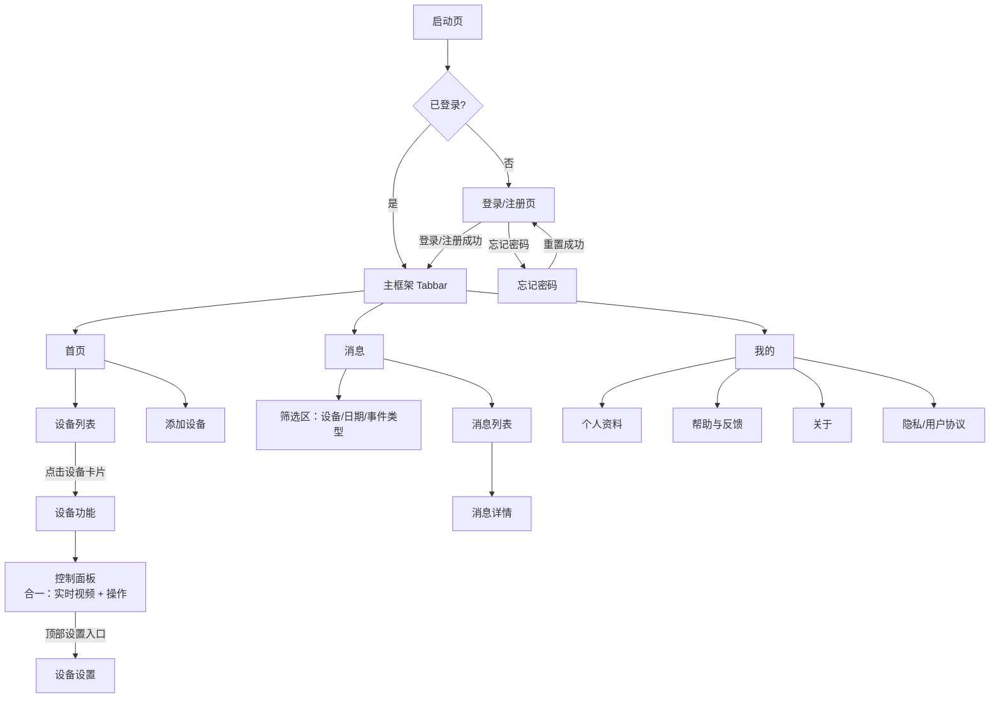

# APP通用需求文档 — UI设计说明

## 修订记录
| 修订时间 | 修订内容 | 修订人 |
|---------|---------|--------|
| 2026-08-17 | 初稿 | UI/UE AI设计师 |

> **核心约定**：本文档只定义**页面信息架构、布局骨架、交互行为、状态**；颜色、字号、间距、图标等**视觉样式一律由 Figma 承载**（Figma 纯视觉分工）。AI 开发时：布局骨架读本文档，视觉细节读 Figma。

---

## 一、页面信息架构（导航地图）

---

## 二、全局布局规范

### 2.1 主框架（Tabbar）
- 底部固定 3 个一级 Tab：**首页 / 消息 / 我的**。
- 一级页显示 Tabbar；二级页（登录、控制面板、设备设置、消息详情、个人资料等）有返回按钮，无 Tabbar。

### 2.2 通用页面骨架
- **顶部栏**：二级页含「返回 + 标题」；一级页含「标题 + 右侧功能入口」。
- **内容区**：业务内容，滚动或固定视情况。
- **底部**：一级页为 Tabbar；操作类页面为固定操作按钮（如「立即开通」）。

### 2.3 状态规范（所有页面统一）
| 状态 | 触发条件 | 展示内容 |
|------|---------|---------|
| 正常态 | 数据加载成功 | 业务内容 |
| 加载态 | 请求未返回 | loading / 骨架屏 |
| 空态 | 列表/内容为空 | 空态占位图 + 引导文案（如「添加设备」） |
| 错误态 | 接口异常 | 错误提示 + 重试按钮 |

---

## 三、各页面布局详述

### 3.1 启动页
| 区域 | 内容 | 交互 |
|------|------|------|
| 品牌区 | Logo / 品牌名 / 启动图 | Figma 承载视觉 |
| 跳转逻辑 | 判断登录态 | 已登录→首页；未登录→登录页 |

**状态**：网络异常时本地态兜底，进入登录页或首页。

### 3.2 登录 / 注册页（三合一）
| 区域 | 内容 | 交互 |
|------|------|------|
| 顶部 | 品牌 / 标题 | — |
| 表单区 | 登录/注册 切换；邮箱、密码、验证码输入框 | 切换登录↔注册 |
| 操作区 | 登录/注册按钮、忘记密码链接 | 提交表单；忘记密码→忘记密码页 |
| 协议区 | 用户协议/隐私协议勾选 | 注册前需勾选 |

**交互**：登录、注册、忘记密码三个能力，建议同页内 Tab/链接切换，避免多页跳转。

**状态**：
| 状态 | 展示 |
|------|------|
| 校验失败 | 表单内联错误提示（邮箱格式/密码错误） |
| 提交中 | 按钮 loading |
| 成功 | Toast 后跳转首页 |

### 3.3 首页（设备列表）
| 区域 | 内容 | 交互 |
|------|------|------|
| 顶部 | 标题 + 家庭/分组切换 + 添加按钮 | 切换家庭；添加设备 |
| 设备列表 | 设备卡片（见 3.5） | 点击卡片进入控制面板 |
| 空态 | 无设备 | 空态 + 添加设备引导 |

**状态**：
| 状态 | 展示 |
|------|------|
| 加载态 | 骨架屏 |
| 空态 | 空态占位 + 添加按钮 |
| 错误态 | 错误提示 + 重试 |

### 3.4 消息页
| 区域 | 内容 | 交互 |
|------|------|------|
| 筛选区 | 设备筛选（单选）、日期筛选（单选）、事件类型筛选 | 组合过滤 |
| 列表区 | 消息列表 | 点击进入详情 |
| 详情 | 消息详情页 | 返回 |

**状态**：
| 状态 | 展示 |
|------|------|
| 空态 | 无消息空态 |
| 加载态 | 骨架屏 |
| 错误态 | 错误提示 + 重试 |

### 3.5 设备卡片（设备功能-模块一）
| 区域 | 内容 | 交互 |
|------|------|------|
| 画面区 | 实时画面/最近截图封面 | 点击进入控制面板 |
| 信息区 | 设备名称、在线状态（在线/离线/休眠）、分享标签 | — |
| 快捷入口 | 回放 / 设置 / 告警（消息红点） | 点击跳转对应功能 |

### 3.6 控制面板（设备功能-模块二，实时视频 + 操作合一）
| 区域 | 内容 | 交互 |
|------|------|------|
| 顶部 | 设备名称 + 返回 + 设置入口 + WIFI 信号 | 设置→设备设置 |
| 画面区 | 实时视频（多目最多 4 屏从上到下） | 点击全屏 |
| 操作区 | 清晰度切换、声音、录制、截图、语音对讲、PTZ、预置位、隐私、一键报警、声光报警、移动追踪、双向留言 | 点击/长按操作 |

**交互**：
- 操作区功能项较多，建议按「高频操作平铺 + 低频操作收纳进「更多」」分层，避免一屏过载。
- 操作项显隐由物模型字段控制（R-602），无对应能力的操作项不显示。

**状态**：
| 状态 | 展示 |
|------|------|
| 加载中 | 画面缓冲 loading |
| 设备离线 | 离线提示 + 返回引导 |
| 断流重连 | 重连提示 |

### 3.7 设备设置（设备功能-模块三）
| 区域 | 内容 | 交互 |
|------|------|------|
| 顶部 | 标题 + 返回 | — |
| 设置列表 | 设备概况、侦测设置、通知设置、画面设置、音频设置、存储设置、云台设置、灯光设置、电池管理 | 点击进入对应子设置页 |
| 操作区 | 一键分享、删除设备 | 分享生成链接；删除二次确认 |

**交互**：
- 设置项为列表分组形式，每组点击进入二级设置页。
- 设置项显隐同样由物模型字段控制。

### 3.8 我的
| 区域 | 内容 | 交互 |
|------|------|------|
| 个人信息区 | 头像、昵称 | 点击进入个人资料 |
| 功能列表 | 个人资料、帮助与反馈、关于、清理缓存、退出登录、注销登录、隐私/用户协议 | 点击进入对应页/弹窗 |

**交互**：
- 退出登录：确认弹窗 → 回登录页。
- 注销登录：二次确认弹窗（高风险）→ 注销。
- 清理缓存：展示缓存大小 → 确认清理 → Toast 反馈。

---

## 四、组件清单

| 组件 | 用途 | 所在区域 |
|------|------|---------|
| NavBar | 顶部栏（返回/标题） | 所有二级页 |
| Tabbar | 底部一级导航 | 主框架 |
| Form / Field | 表单输入 | 登录/注册 |
| Button | 按钮 | 全局 |
| Cell / CellGroup | 列表项 | 我的、设备设置 |
| Popup / Dialog | 弹窗 | 退出/注销确认、协议查看 |
| Toast | 轻提示 | 全局反馈 |
| Empty | 空态 | 列表空态 |
| Loading / Skeleton | 加载态 | 列表、画面 |
| Tag | 标签（分享/状态） | 设备卡片 |
| Switch | 开关 | 设置项 |
| Slider | 滑块 | 录像时长等 |
| Picker / ActionSheet | 选择器 | 筛选、清晰度 |
| Checkbox | 勾选 | 协议、多选 |
| PullRefresh / List | 下拉刷新/上拉加载 | 设备列表、消息列表 |
| Image | 图片 | 卡片封面 |
| 视频播放器 | 实时画面 | 控制面板（SDK 提供） |

---

## 五、关键交互说明

1. **导航层级**：启动页 → 登录页 → 主框架（Tabbar）→ 二级页（返回）。
2. **设备功能入口链路**：首页设备卡片 → 控制面板（合一）→ 顶部设置入口 → 设备设置。
3. **物模型驱动显隐**：设备功能操作项、设置项按物模型字段控制显隐；无能力的项不渲染。
4. **多目设备**：控制面板画面区最多 4 屏，从上到下排列。
5. **状态全覆盖**：所有列表页必须覆盖 加载态/空态/错误态/正常态 四态。
6. **反馈完整**：所有按钮有点击态与 loading；提交成功有 Toast；高危操作（删除/注销）有二次确认。
7. **i18n 预留**：所有文案预留中英文结构。

---

## 六、设计原则

- **一致性**：复用现有 carecam_pro 的页面骨架与组件风格（NavBar、Tabbar、Cell 列表等）。
- **渐进呈现**：控制面板操作区「高频平铺 + 低频收纳」，避免一屏过载。
- **状态覆盖**：每个页面覆盖正常/空/加载/错误四态。
- **交互完整**：弹窗、Toast、跳转均明确描述。
- **APP 优先移动端**：内容限制 375px 宽度基准，自适应常规分辨率。
