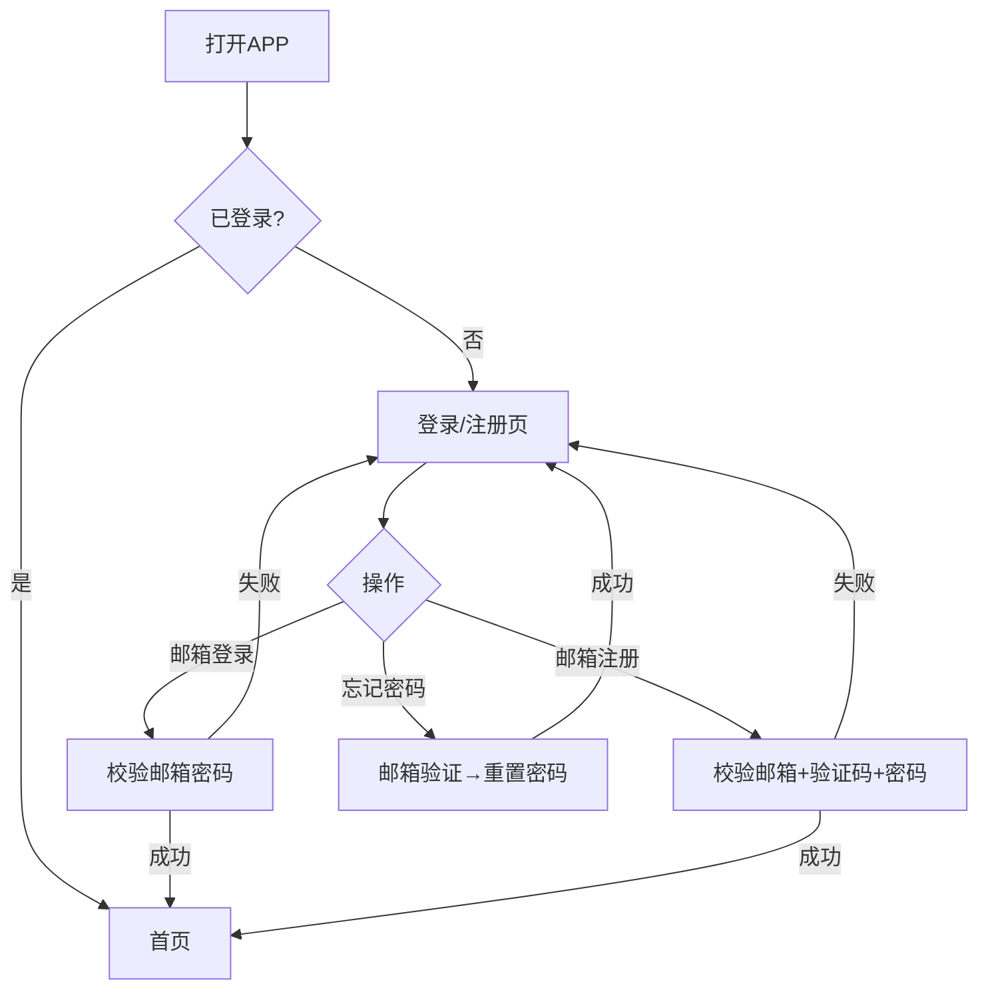
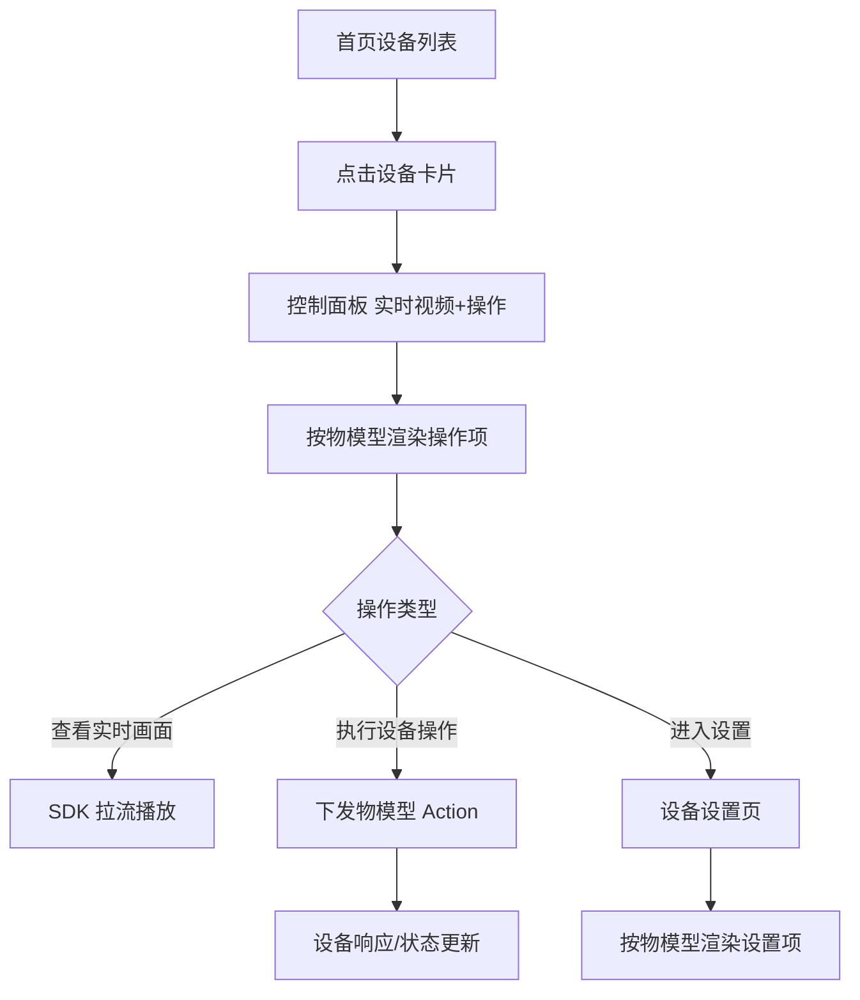
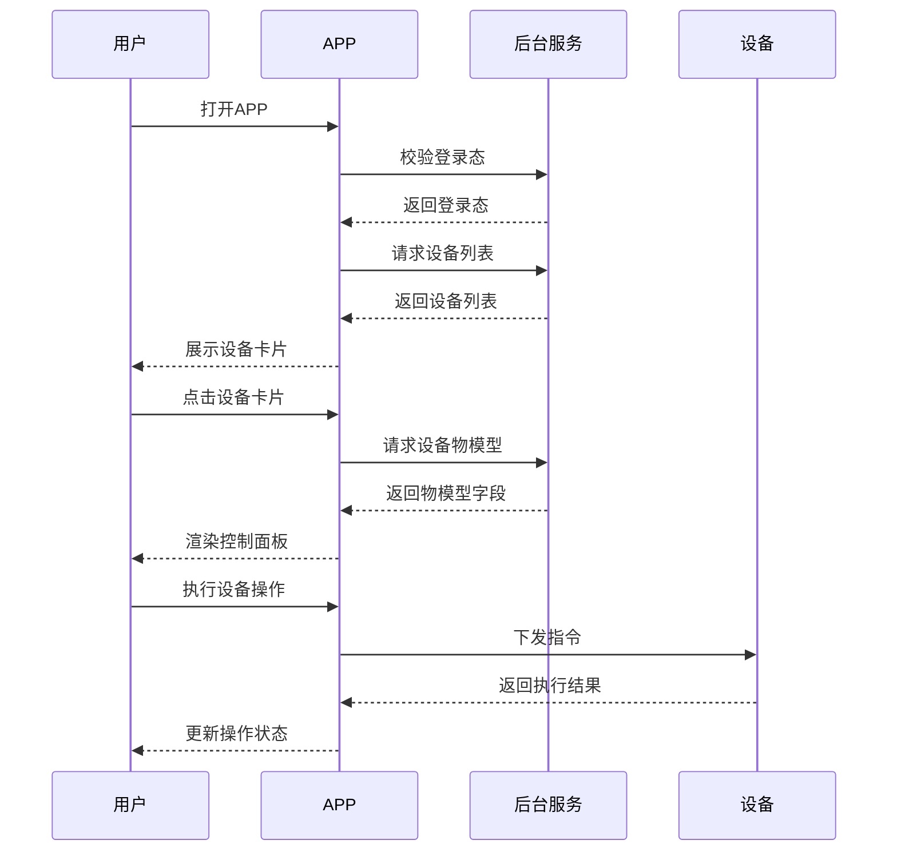
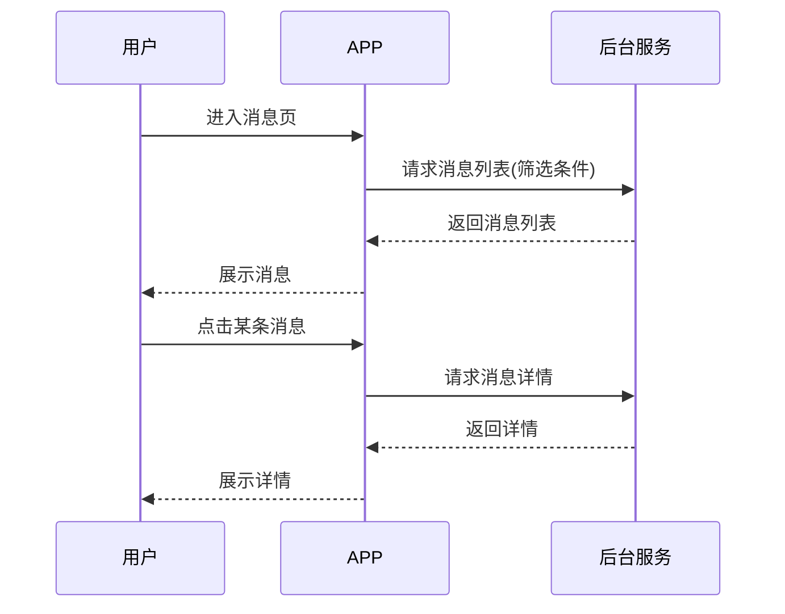
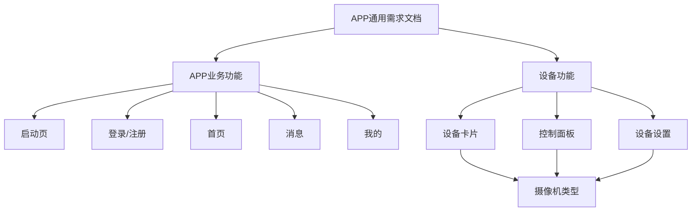
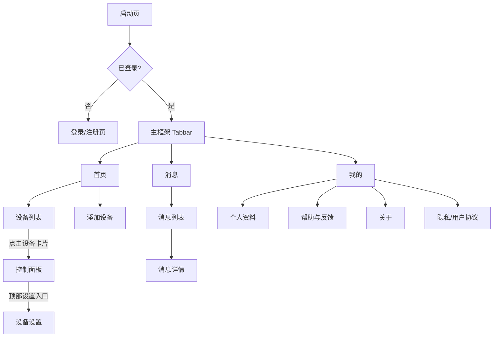

# APP通用需求文档 — 完整业务 PRD

## 修订记录
| 修订时间 | 修订内容 | 修订人 |
|---------|---------|--------|
| 2026-08-17 | 初稿 | PRD生成AI工程师 |

> **文档定位**：本文档是「APP 通用需求文档」，作为 AI 结合客户 Figma 设计稿快速开发 APP 业务层的统一基线。本文档只描述业务与交互行为，视觉样式由 Figma 承载。

---

## 一、业务背景

### 业务场景
- 服务方为 IoT 设备（IPC 监控为核心、全品类扩展）厂商提供定制 APP，B2B2C 模式，服务厂商、运营商及国内外 C 端用户。
- 为不同客户定制 APP，但**所有客户共用同一套后台服务、数据库、SDK**。
- APP 采用三层架构，客户定制**只变更业务层（UI、交互等）**。

### 业务层二分类
业务层进一步分为两类，本文档分别描述：
- **APP业务功能**：APP 完整业务基础功能，所有客户一致、稳定。
- **设备功能**：随接入设备类型扩展，每个设备类型功能不一致，由物模型驱动。

### 用户痛点
- 传统定制开发：每个客户重复开发业务层，效率低、成本高、交付慢。
- 视觉设计（Figma）与行为逻辑（交互/状态/边界）之间缺统一基线，AI 无法稳定复用地产出代码。
- 设备类型众多、功能各异，缺一套「物模型驱动」的统一规则来生成设备操作界面。

### 产品目标
1. 本文档作为 AI 结合 Figma 快速开发业务层的统一基线。
2. 底层能力（后台服务/数据库/SDK）复用，业务层由 AI 按「本文档 + Figma」生成。
3. APP业务功能穷举行为逻辑；设备功能定义「物模型驱动」的通用框架与显隐规则。

---

## 二、名词解释

| 术语 | 说明 |
|------|------|
| 业务层 | APP 的 UI 页面、组件、交互逻辑；客户定制对象 |
| APP业务功能 | 业务层稳定部分：启动页、登录注册、首页、消息、我的 |
| 设备功能 | 业务层可变部分：随设备类型扩展，物模型驱动 |
| 数据层 | 后台服务 + 数据库；所有客户共用、复用 |
| SDK层 | 设备连接、推流、回放、推送等底层能力；所有客户共用、复用 |
| Figma 纯视觉 | Figma 只承载颜色/布局/组件样式/图标，不承载交互/状态/边界 |
| 物模型 | 设备功能属性（Property）/ 动作指令（Action）/ 告警事件（Event）的标准化定义 |
| 物模型驱动 | 设备功能操作项及其显隐由物模型字段控制 |
| 设备类型 | 接入的设备品类，当前仅摄像机 |
| 设备卡片 | 设备功能模块一：设备在列表/详情中的展示卡片 |
| 控制面板 | 设备功能模块二：设备的操作/控制界面（实时视频 + 操作合一） |
| 设备设置 | 设备功能模块三：设备的参数配置界面 |
| 设备状态 | 在线 / 离线 / 休眠 |
| 多目设备 | 单个设备含多个画面（最大 4 屏）的摄像机 |

---

## 三、业务实体说明

| 实体 | 说明 | 关键属性 |
|------|------|---------|
| 用户 | APP 使用者 | 邮箱、密码、昵称、头像 |
| 设备 | 用户绑定的硬件设备 | 设备ID、名称、设备类型、在线状态、分享标记 |
| 设备类型 | 设备品类（摄像机等） | 类型编码、物模型引用 |
| 物模型 | 设备能力定义 | Property（属性）/ Action（动作）/ Event（事件） |
| 消息 | 设备产生的告警/事件消息 | 所属设备、日期、事件类型、内容 |

**实体关系**：
- 用户 1:N 设备（一个用户可绑定多台设备）
- 设备 N:1 设备类型（一台设备属于一种类型）
- 设备类型 1:1 物模型（一种类型对应一份物模型）
- 设备 1:N 消息（一台设备产生多条消息）

---

## 四、核心业务流程

### 4.1 启动与登录流程（流程图）

### 4.2 设备操作流程（流程图，物模型驱动）

### 4.3 全局时序图（用户 → APP → 后台 → 设备）

### 4.4 局部队列时序图（消息查看）

---

## 五、业务规则

| 编号 | 规则 | 说明 |
|------|------|------|
| R01 | 登录态规则 | 未登录只能访问启动页/登录页；登录后才能访问首页/消息/我的/设备功能 |
| R02 | 设备状态枚举 | 在线 / 离线 / 休眠；离线时设备操作不可用或置灰 |
| R03 | 物模型来源 | 设备功能的所有操作项、设置项均来自物模型定义 |
| R04 | 显隐控制 | 操作项、设置项的显隐由物模型字段控制；无对应能力的项不渲染 |
| R05 | 模块归属 | 功能点归入设备卡片/控制面板/设备设置由业务与用户体验决定；物模型类型不硬性约束，可能交叉或重复 |
| R06 | 多目设备 | 控制面板画面区最多 4 屏，从上到下排列 |
| R07 | 消息筛选 | 设备（单选）、日期（单选）、事件类型三条件可组合过滤 |
| R08 | 高危操作确认 | 删除设备、注销登录需二次确认 |
| R09 | 三模块组织 | 每个设备类型统一按设备卡片/控制面板/设备设置三模块组织 |
| R10 | 状态覆盖 | 所有页面必须覆盖正常/空/加载/错误四态 |

---

## 六、功能架构

**模块职责**：
- **启动页**：品牌展示 + 登录态判断。
- **登录/注册**：邮箱登录、邮箱注册、忘记密码。
- **首页**：设备列表展示、添加设备入口。
- **消息**：消息筛选、列表、详情。
- **我的**：个人资料、帮助反馈、关于、清理缓存、退出/注销、协议。
- **设备功能**：物模型驱动，按设备类型扩展，当前摄像机类型。

---

## 七、详细功能描述

### 7.1 启动页

#### 功能应用场景
用户打开 APP 时的首屏，用于品牌展示与登录态判断。

#### 功能详述
- 品牌区：展示品牌 Logo/名称/启动图（视觉由 Figma 承载）。
- 跳转逻辑：已登录 → 首页；未登录 → 登录页。

#### 状态说明
| 状态 | 触发条件 | 展示内容 |
|------|---------|---------|
| 正常态 | 本地登录态校验成功 | 按登录态跳转 |
| 异常态 | 登录态校验失败/无网络 | 进入登录页或本地态兜底 |

### 7.2 登录 / 注册

#### 功能应用场景
用户首次使用或未登录时，进行身份认证。

#### 功能详述
- 登录：输入邮箱 + 密码 → 登录。
- 注册：输入邮箱 + 验证码 + 密码 → 注册。
- 忘记密码：输入邮箱 → 验证 → 重置密码。
- 三能力同页内 Tab/链接切换。

#### 状态说明
| 状态 | 触发条件 | 展示内容 |
|------|---------|---------|
| 正常态 | 表单合法 | 可提交 |
| 校验失败态 | 邮箱格式/密码错误 | 表单内联错误提示 |
| 提交中 | 请求未返回 | 按钮 loading |
| 成功态 | 认证通过 | Toast + 跳转首页 |

#### 交互说明
- 点击登录/注册按钮：提交表单，成功后跳转首页。
- 点击忘记密码：进入忘记密码流程。

### 7.3 首页 — 设备列表

#### 功能应用场景
用户查看已绑定的设备，作为设备功能入口。

#### 功能详述
- 顶部：标题 + 家庭/分组切换 + 添加设备按钮。
- 列表区：设备卡片（见 7.7）。
- 添加设备：点击进入添加/配网流程。

#### 状态说明
| 状态 | 触发条件 | 展示内容 |
|------|---------|---------|
| 正常态 | 有设备 | 设备卡片列表 |
| 加载态 | 请求中 | 骨架屏 |
| 空态 | 无设备 | 空态占位 + 添加引导 |
| 错误态 | 请求失败 | 错误提示 + 重试 |

#### 交互说明
- 点击设备卡片：进入控制面板。
- 点击添加设备：进入添加流程。

### 7.4 消息

#### 功能应用场景
用户查看设备的告警/事件消息。

#### 功能详述
- 筛选区：设备筛选（单选）、日期筛选（单选）、事件类型筛选，可组合。
- 列表区：消息列表。
- 详情：点击消息进入详情页。

#### 状态说明
| 状态 | 触发条件 | 展示内容 |
|------|---------|---------|
| 正常态 | 有消息 | 消息列表 |
| 空态 | 无消息 | 空态提示 |
| 加载态 | 请求中 | 骨架屏 |
| 错误态 | 请求失败 | 错误提示 + 重试 |

#### 交互说明
- 选择筛选条件：即时过滤消息列表。
- 点击消息：进入详情。

### 7.5 我的

#### 功能应用场景
用户管理个人资料与账号设置。

#### 功能详述
- 个人信息区：头像、昵称；点击进入个人资料（查看/修改名称）。
- 功能列表：个人资料、帮助与反馈、关于、清理缓存、退出登录、注销登录、隐私/用户协议。

#### 交互说明
- 退出登录：确认弹窗 → 回登录页。
- 注销登录：二次确认弹窗 → 注销账号。
- 清理缓存：展示缓存大小 → 确认清理 → Toast 反馈。
- 隐私/用户协议：点击查看协议全文。

### 7.6 设备功能 — 通用（物模型驱动）

#### 功能应用场景
所有设备类型共用的一套组织与渲染规则。

#### 功能详述
- 每个设备类型统一按三大模块组织：设备卡片、控制面板、设备设置。
- 操作项、设置项全部来自物模型。
- 操作项、设置项显隐由物模型字段控制（R04）。
- 功能点归属模块由业务与用户体验决定（R05），不按物模型类型硬绑。

### 7.7 设备卡片（设备功能-模块一）

#### 功能详述
| 功能点 | 说明 |
|--------|------|
| 设备名称 | 展示设备名 |
| 在线状态 | 在线 / 离线 / 休眠 |
| 画面封面 | 实时画面或最近截图 |
| 分享标签 | 是否分享设备 |
| 消息红点 | 有新消息提示 |
| 快捷入口 | 回放 / 设置 / 告警 入口 |

#### 交互说明
- 点击卡片 → 进入控制面板。
- 点击快捷入口 → 进入对应功能。

### 7.8 控制面板（设备功能-模块二，实时视频 + 操作合一）

#### 功能详述
| 功能点 | 说明 |
|--------|------|
| 实时画面 | 播放实时流，多目最多 4 屏 |
| 清晰度切换 | 高清 / 标清 / 流畅 |
| 声音开关 | 音频开/关 |
| 录制 | 本地录制 |
| 截图 | 保存当前画面 |
| 语音对讲 | 双向语音 |
| PTZ 控制 | 上下左右转动云台 |
| 预置位 | 最多 6 个，查看/调用 |
| 隐私模式 | 画面遮蔽开关 |
| 一键报警 | 远程触发设备警报 |
| 声光报警 | 设备检测异常时声光告警 |
| 移动追踪 | 云台自动追踪移动目标 |
| 双向留言 | 语音留言/回放 |
| 全屏 | 全屏展示 |
| WIFI 信号 | 无 / 低 / 中 / 高 |

#### 状态说明
| 状态 | 触发条件 | 展示内容 |
|------|---------|---------|
| 加载中 | 拉流中 | 画面缓冲 loading |
| 设备离线 | 设备离线 | 离线提示 + 返回引导 |
| 断流重连 | 推流中断 | 重连提示 |

#### 交互说明
- 操作区高频操作平铺，低频操作收纳进「更多」，避免一屏过载。
- 操作项显隐由物模型字段控制（R04）。
- 顶部设置入口 → 进入设备设置。

### 7.9 设备设置（设备功能-模块三）

#### 功能详述
| 功能点 | 说明 |
|--------|------|
| 设备概况 | 名称 / 型号 / 固件 / OTA |
| 侦测设置 | 移动侦测 / 人形侦测 / AI人形侦测 / 侦测区域 / 灵敏度 |
| 通知设置 | 推送开关 / 告警类型 |
| 画面设置 | 画面翻转 / 日夜模式 / 宽动态 / 画质 |
| 音频设置 | 音量 / 双向语音开关 |
| 存储设置 | SD卡 / 云存储开通 / 格式化 / 循环覆盖 |
| 云台设置 | PTZ 校准 / 巡航 |
| 灯光设置 | 白光灯 / 红外夜视 |
| 电池管理 | 电量 / 工作模式（省电/AOV/常电/智能）/ 录像时长 |
| 一键分享 | 生成分享链接 |
| 删除设备 | 解绑设备 |

#### 交互说明
- 设置项以列表分组形式展示，点击进入二级设置页。
- 设置项显隐由物模型字段控制（R04）。
- 删除设备：二次确认后解绑。

---

## 八、页面信息架构

**页面跳转关系**：
- 一级页（底部导航）：首页 / 消息 / 我的。
- 二级页（返回按钮）：登录/注册、控制面板、设备设置、消息详情、个人资料、帮助与反馈、关于、协议页。

---

## 九、异常说明

| 异常类型 | 页面表现 | 处理 |
|---------|---------|------|
| 网络异常（请求失败） | 各列表页错误态 | 错误提示 + 重试按钮 |
| 网络异常（拉流中断） | 控制面板缓冲/重连 | 重连提示 |
| 数据为空 | 各列表页空态 | 空态占位 + 引导 |
| 未登录 | 访问受限页 | 引导登录 |
| 设备离线 | 控制面板/设置 | 操作项置灰或离线提示 |
| 校验失败（登录/注册） | 表单内联错误 | 提示具体错误 |
| 操作失败（下发指令） | 控制面板 | Toast + 可重试 |
| 物模型字段缺失 | 设备功能 | 对应操作项隐藏（R04） |

---

## 十、测试要点

### 功能回归
| 编号 | 测试点 | 前置条件 | 操作步骤 | 预期结果 |
|------|--------|---------|---------|---------|
| T-001 | 首页→控制面板→设置 跳转链路 | 已登录有设备 | 依次点击 | 跳转正常，返回正常 |
| T-002 | 设备卡片各快捷入口 | 已登录有设备 | 点击回放/设置/告警 | 跳转对应功能 |

### 核心场景
| 编号 | 测试点 | 前置条件 | 操作步骤 | 预期结果 |
|------|--------|---------|---------|---------|
| T-101 | 邮箱登录 | 已有账号 | 输入邮箱密码登录 | 登录成功进首页 |
| T-102 | 邮箱注册 | 无账号 | 输入邮箱验证码密码 | 注册成功进首页 |
| T-103 | 忘记密码 | 已有账号 | 邮箱验证→重置 | 重置成功重新登录 |
| T-104 | 查看设备列表 | 已登录有设备 | 进入首页 | 展示设备卡片 |
| T-105 | 进入控制面板 | 设备在线 | 点击设备卡片 | 展示实时画面+操作 |
| T-106 | 执行设备操作 | 设备在线 | 点击操作项 | 设备响应，状态更新 |
| T-107 | 查看消息详情 | 有消息 | 点击消息 | 展示详情 |
| T-108 | 退出登录 | 已登录 | 我的→退出 | 回登录页 |
| T-109 | 清理缓存 | 已登录 | 我的→清理缓存 | 清理成功 Toast |

### 异常场景
| 编号 | 测试点 | 前置条件 | 操作步骤 | 预期结果 |
|------|--------|---------|---------|---------|
| T-201 | 断网登录 | 无网络 | 提交登录 | Toast 网络异常 |
| T-202 | 设备列表空态 | 无设备 | 进入首页 | 空态+添加引导 |
| T-203 | 消息空态 | 无消息 | 进入消息 | 空态提示 |
| T-204 | 设备离线操作 | 设备离线 | 点击操作项 | 置灰或离线提示 |
| T-205 | 校验失败 | 邮箱格式错误 | 提交注册 | 内联错误提示 |

### 状态切换
| 编号 | 测试点 | 前置条件 | 操作步骤 | 预期结果 |
|------|--------|---------|---------|---------|
| T-301 | 加载→正常 | 进入首页 | 请求列表 | 骨架屏→列表 |
| T-302 | 加载→播放→缓冲 | 进入控制面板 | 拉流 | 画面加载→播放 |
| T-303 | 快速反复进退 | 控制面板 | 连续进退 | 无异常无白屏 |

### 兼容性
| 编号 | 测试点 | 前置条件 | 操作步骤 | 预期结果 |
|------|--------|---------|---------|---------|
| T-401 | 多机型布局 | 不同屏幕 | 浏览各页面 | 布局正常 |
| T-402 | 多目设备 4 屏 | 多目设备 | 进入控制面板 | 4 屏从上到下排列 |

---

## 十一、APP埋点与运营数据看板

> 本节为初步埋点框架，完整埋点方案与公共参数规范由运营阶段（04bp.md）输出。

**核心埋点事件**：
| 事件 | 触发时机 |
|------|---------|
| 启动 | APP 启动 |
| 登录/注册成功 | 认证成功 |
| 首页浏览 | 进入首页 |
| 设备操作 | 控制面板执行操作 |
| 消息查看 | 进入消息详情 |
| 我的功能点击 | 我的页功能入口点击 |

**待运营阶段细化**：公共参数（13 个必选字段）、数据看板布局、报表需求。
