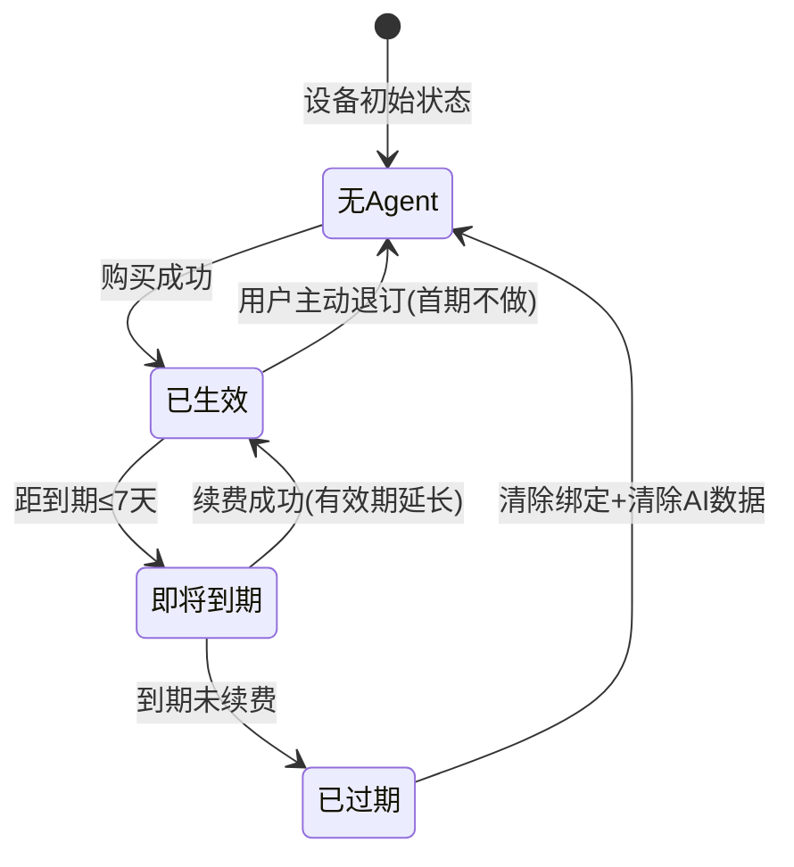

# Agent工厂 — 需求分析文档

## 修订记录

| 修订时间 | 修订内容 | 修订人 |
|----------|----------|--------|
| 2026-08-06 | 初稿 | 需求分析AI工程师 |
| 2026-08-06 | 实现迭代修订 | 前端开发AI工程师 |

---

## 一、业务背景

### 1.1 业务场景

carecam_pro 现有「全能AI」智能服务，通过豆包视觉模型对摄像机画面进行单图分析，输出语义化的 `title + content + focus_list`。全能AI 覆盖4个通用关注类别（儿童守护、包裹送达、厨房守护、动物看护），所有类别共用一个提示词。

现计划建设 **Agent工厂**：将全能AI拆分为多个垂直智能体，每个智能体专注一个领域（宠物看护、家门看护等），拥有专属的检测提示词和日报聚合提示词。用户在设备上购买/订阅 Agent，同一时间每设备仅生效一个。

### 1.2 用户痛点

1. **全能AI不够专**：养宠用户收到的消息包含儿童/厨房等无关内容；注重门口安全的用户收到的宠物消息是噪音
2. **付费意愿弱**：「什么都检测但什么都不精」→ 用户觉得不值得订阅
3. **没有选择权**：用户只能选「开AI」或「不开AI」，无法按需选择不同的智能体
4. **无可扩展性**：新增一个垂直场景（如老人看护）只能往全能AI里硬塞提示词

### 1.3 产品目标

1. Agent 市场：用户可浏览、购买/订阅垂直智能体
2. 每设备单 Agent 激活：一设备同时只有一个生效
3. 提示词差异化：每个 Agent 有专属的**单图分析提示词**和**日报聚合提示词**
4. 退订回退：Agent 到期后设备退回基础侦测（硬件自带的人形/声音检测），不保留AI数据

### 1.4 与现有「智能体管理」的关系

- `智能体管理`（prd_full/智能体管理/）：**运营后台**，用于创建/配置/调试智能体（提示词、模型、工具）
- `Agent工厂`（本文档）：**用户端 APP**，用于浏览/购买/切换智能体

两者关系：运营在后台创建智能体 → 上线到Agent市场 → 用户在APP端购买使用。

---

## 二、名词解释

| 术语 | 说明 |
|------|------|
| Agent（智能体） | 一个垂直AI服务单元，包含名称、描述、价格、单图分析提示词、日报聚合提示词、专属 focus_list |
| 全能AI Agent | 通用智能体，覆盖儿童/包裹/厨房/宠物4个关注类别，即现有全能AI的Agent化版本 |
| 宠物看护 Agent | 垂直智能体，专注宠物行为识别与健康观察 |
| 家门看护 Agent | 垂直智能体，专注门口进出、包裹追踪与安全监测 |
| 单图分析提示词 | 对单张摄像机截图进行视觉分析的 system prompt（现有全能AI提示词即此类） |
| 日报聚合提示词 | 聚合当日多张图片的 content 信息，产出结构化日报的 system prompt（新增能力） |
| Agent 有效期 | 用户购买Agent后从生效到过期的时间段，期间该设备使用该Agent的提示词进行AI分析 |
| 基础侦测 | 不激活任何Agent时设备自带的能力（硬件人形检测、声音检测等），无AI语义分析 |
| 设备-Agent绑定 | 一台设备与一个Agent的购买关系，同一时间一台设备只有一条有效绑定 |

---

## 三、功能范围

### 3.1 功能列表总览

| 序号 | 模块 | 功能 | 优先级 | 说明 |
|------|------|------|--------|------|
| 1 | Agent市场 | Agent列表/详情 | P0 | 浏览可用Agent，含名称/描述/价格/能力展示 |
| 2 | Agent市场 | Agent落地页 | P0 | 每个Agent独立的产品介绍页，展示差异化卖点 |
| 3 | Agent市场 | 购买/订阅Agent | P0 | 月订阅/年订阅，复用现有支付流程 |
| 4 | 我的Agent | 已购Agent列表 | P0 | 按设备展示已购Agent及有效期 |
| 5 | 我的Agent | 切换/激活Agent | P0 | 选择某个Agent作为设备当前生效的智能体 |
| 6 | 我的Agent | 续费Agent | P0 | 到期前续费，到期后只可重新购买 |
| 7 | AI消息检测 | Agent专属提示词分析 | P0 | 使用当前激活Agent的单图分析提示词进行画面分析 |
| 8 | AI日报 | Agent专属日报 | P0 | 使用当前激活Agent的日报聚合提示词生成日报 |
| 9 | AI搜索 | Agent专属搜索 | P1 | 使用当前激活Agent的搜索提示词（首期可复用） |
| 10 | 设备管理 | Agent到期回退 | P0 | 到期后清除Agent绑定，退回基础侦测 |

### 3.2 不做/暂不做的功能（明确边界）

| 功能 | 原因 | 后续计划 |
|------|------|----------|
| 用户自定义提示词 | 已确认不支持 | 不计划 |
| 多Agent同时生效 | 硬件算力限制，同一时间只能跑一个 | 不计划 |
| Agent到期后保留历史数据 | 用户已确认不保留 | 不计划 |
| 猫/狗模式区分 | 用户确认首期不做 | 二期按需 |
| 门铃硬件联动 | 纯摄像头方案 | 二期按需 |
| 免费试用期 | 复用现有付费试用能力 | 二期 |
| 智能体调试（用户端） | 仅运营后台可调试 | 已有 |

---

## 四、场景穷举分析

### 4.1 Agent市场

#### 4.1.1 功能概述
- **功能目的**：用户浏览可用Agent，了解其能力，完成购买/订阅
- **前置条件**：用户已登录，有至少一台已绑定设备

#### 4.1.2 正常场景

| 场景编号 | 场景名称 | 前置条件 | 操作步骤 | 预期结果 |
|----------|----------|----------|----------|----------|
| N-001 | 进入Agent市场 | 设备未购买任何Agent | 设备卡片 → AI入口 → Agent市场 | 展示Agent列表（全能AI/宠物/家门等） |
| N-002 | 查看Agent详情 | — | 点击某个Agent卡片 | 展示Agent名称、能力描述、提示词侧重点、价格（月/年）、示例日报 |
| N-003 | 购买Agent（月订阅） | 设备无生效Agent、用户已绑定支付方式 | 选月订阅 → 确认支付 → 支付成功 | Agent立即生效，返回设备页显示「XX Agent 守护中」 |
| N-004 | 购买Agent（年订阅） | 设备无生效Agent | 选年订阅 → 确认支付 → 支付成功 | Agent生效，有效期365天 |
| N-005 | 已购Agent到期后换购 | 上一个Agent已到期，设备无生效Agent | Agent市场 → 选新Agent → 购买 | 新Agent绑定设备并生效 |

#### 4.1.3 异常场景

| 场景编号 | 异常类型 | 触发条件 | 系统行为 | 用户感知 |
|----------|----------|----------|----------|----------|
| E-001 | 设备已有生效Agent | 设备已有未到期Agent | 点击购买时拦截 | 提示「设备已有生效的XX Agent，到期后可换购」 |
| E-002 | 支付失败 | 余额不足/网络异常 | 订单不创建 | Toast提示失败原因，可重试 |
| E-003 | 无设备 | 账号未绑定任何设备 | 进入Agent市场时拦截 | 引导「请先绑定设备」 |
| E-004 | 数据为空 | Agent列表无数据（后台未上线任何Agent） | — | 空态占位「暂无可用Agent」 |
| E-005 | 支付超时 | 支付接口超时 | 订单状态pending | 提示「支付处理中，请稍后查看」→ 订单列表可查 |

#### 4.1.4 边界条件

| 条件项 | 最小值 | 最大值 | 默认值 | 超限行为 |
|--------|--------|--------|--------|----------|
| 单设备同时生效Agent | — | 1 | — | 已有生效Agent时拦截购买 |
| Agent有效期（月） | 30天 | — | — | 到期自动失效 |
| Agent有效期（年） | 365天 | — | — | 到期自动失效 |
| Agent数量上限 | 1（已启用） | 不限（后台可创建） | — | — |

#### 4.1.5 状态流转



---

### 4.2 Agent落地页

#### 4.2.1 功能概述
- **功能目的**：每个Agent有独立的产品介绍页面，展示差异化能力和示例，引导用户购买
- **入口**：Agent市场列表 → 点击Agent卡片 → 进入该Agent的落地页
- **前置条件**：Agent已在运营后台配置并上架

#### 4.2.2 落地页通用结构

每个Agent落地页包含以下区块（顺序固定）：

| 区块 | 内容 | 说明 |
|------|------|------|
| Hero | Agent名称 + 一句slogan + 主视觉图 | 一眼看懂这是什么 |
| 能力亮点 | 3-4个核心能力卡片（图文） | 告诉用户「能帮我做什么」 |
| 消息示例 | 模拟推送消息截图（2-3条） | 让用户感知「我会收到什么样的通知」 |
| 日报示例 | 模拟日报卡片 | 让用户感知「每天会看到什么」 |
| 价格 + 购买按钮 | 月/年价格 + 购买CTA | 行动转化 |

#### 4.2.3 各Agent落地页差异化内容

**全能AI 落地页：**
| 区块 | 内容 |
|------|------|
| Slogan | 「一机守护全家安全」 |
| 能力亮点 | 儿童看护 / 包裹送达提醒 / 厨房安全 / 宠物活动监测 |
| 消息示例 | 「幼儿在客厅地垫上玩耍」「快递员将包裹放于门口」「老人在厨房灶台前烹饪」 |
| 日报示例 | 全类型事件时间线 + 事件数量统计 |

**宠物看护 落地页：**
| 区块 | 内容 |
|------|------|
| Slogan | 「不在家，也能知道它好不好」 |
| 能力亮点 | 🍽 进食记录：每餐自动记录 / ⚠ 异常预警：呕吐、抓挠、跛行及时发现 / 🏃 活动追踪：玩耍、奔跑、休息全掌握 / 📊 每日报告：宠物的一天一句话总结 |
| 消息示例 | 「金毛犬在厨房食盆旁进食」「灰猫在卫生间使用猫砂盆」「棕色犬在客厅沙发旁呕吐 ⚠」 |
| 日报示例 | 宠物行为分类汇总（进食/排泄/活动/休息/异常）+ 今日整体总结 |

**家门看护 落地页：**
| 区块 | 内容 |
|------|------|
| Slogan | 「门口无小事，一眼看全程」 |
| 能力亮点 | 📦 包裹全追踪：送达→在门口→被取走，全程记录 / 👤 访客分类：快递/外卖/家人/陌生人自动识别 / 🔒 安全监测：异常徘徊、多人聚集及时发现 / 🚪 出入记录：家人进出自动记录 |
| 消息示例 | 「快递员在门口放置包裹」「陌生男子在门口徘徊张望 ⚠」「家人开门进入家中」 |
| 日报示例 | 包裹动态 + 访客记录 + 家人出入 + 安全评估一句总结 |

#### 4.2.4 正常场景

| 场景编号 | 场景名称 | 前置条件 | 操作步骤 | 预期结果 |
|----------|----------|----------|----------|----------|
| N-011 | 进入Agent落地页 | Agent市场列表 | 点击某个Agent | 展示该Agent的独立落地页 |
| N-012 | 从落地页购买 | 设备无生效Agent | 点击底部购买按钮 → 选月/年 → 支付 | 同N-003/N-004 |
| N-013 | 从落地页返回市场 | — | 点击左上角返回 | 回到Agent市场列表 |

#### 4.2.5 异常场景

| 场景编号 | 异常类型 | 触发条件 | 系统行为 | 用户感知 |
|----------|----------|----------|----------|----------|
| E-011 | 设备已有Agent | 同E-001 | 购买按钮置灰 | 「当前设备已有生效Agent，到期后可购买」 |

---

### 4.3 我的Agent管理

#### 4.3.1 功能概述
- **功能目的**：查看当前设备已购Agent、有效期、切换或续费
- **前置条件**：用户已登录、设备已绑定

#### 4.3.2 正常场景

| 场景编号 | 场景名称 | 前置条件 | 操作步骤 | 预期结果 |
|----------|----------|----------|----------|----------|
| N-101 | 查看当前Agent | 设备有生效Agent | 设备卡片 → AI入口 → 我的Agent | 展示当前Agent名称、有效期、到期日期 |
| N-102 | 续费Agent | 生效Agent距到期≤7天 | 点击「续费」→ 选月/年 → 支付 | 有效期延长，原Agent不变 |
| N-103 | 到期后更换Agent | Agent已到期 | 我的Agent页 → 到期状态 → 点击「选购新Agent」 | 跳转Agent市场 |

#### 4.3.3 异常场景

| 场景编号 | 异常类型 | 触发条件 | 系统行为 | 用户感知 |
|----------|----------|----------|----------|----------|
| E-101 | 设备无Agent | 设备从未购买Agent | — | 引导「去Agent市场选购」 |
| E-102 | Agent到期 | 超过有效期 | AI消息停止推送、日报停止生成 | 显示「已到期，选购新Agent」 |
| E-103 | 到期当天 | 最后一天 | 当天仍然生效，零点后失效 | 推送「您的XX Agent将于今天到期」 |

#### 4.3.4 边界条件

| 条件项 | 说明 |
|--------|------|
| 续费窗口 | 到期前7天开放续费入口 |
| 到期处理 | 零点自动失效，次日AI功能停用 |
| 数据保留 | 到期后AI消息+日报数据全部清除 |

---

### 4.4 宠物看护Agent — 单图分析提示词设计

#### 4.4.1 与全能AI提示词的差异

全能AI提示词已具备通用图像分析能力（环境分类、人物分析、动物检测、包裹识别等）。宠物Agent的提示词在**同一框架下做三件事**：

1. **新增宠物专属识别规则**：扩充全能AI的"动物物种区分"章节
2. **新增宠物行为识别**：进食、饮水、排泄、睡眠、玩耍、抓挠、呕吐等
3. **替换 focus_list**：从全能AI的4个通用类别 → 宠物专属关注类别

#### 4.4.2 宠物Agent新增的识别规则

```
### 宠物行为专项识别

#### 一、进食行为
- 宠物头部在食盆/喂食器上方、有低头-抬头反复动作 → 进食中
- 描述时注明：「在厨房食盆旁进食」「正在吃狗粮」
- 排除：宠物路过食盆、嗅闻但不吃

#### 二、排泄行为
- 猫在猫砂盆内呈蹲姿、狗在尿垫/草坪呈排泄姿态 → 排泄中
- 描述时注明：「在猫砂盆排便」「在阳台尿垫小便」
- 仅描述可见行为，不推断健康状态

#### 三、异常行为（需关注）
- 呕吐：宠物身体弓起、口部有物体排出、地面有液/固体痕迹
- 吠叫姿态：宠物张嘴仰头、呈发声姿态（仅描述可见姿态，不推断「吠叫声音」；实际声音检测依赖硬件音频传感器，不通过图片分析）
- 抓挠：宠物持续用爪子抓门/家具/身体
- 跛行/异常步态：一条腿不承重、拖行、摇摆
- 长时间不动：宠物在非睡眠区域静止超过30分钟（需结合多帧判断，单图只能描述当前状态）

#### 四、玩耍与互动
- 宠物追逐/扑咬玩具球、逗猫棒等
- 多只宠物互相追逐、滚打（区别于真实打斗：无炸毛/嘶叫表情）

#### 五、睡眠与休息
- 宠物蜷缩/侧躺、眼睛闭合 → 睡眠中
- 描述场景即可，不推断健康
```

#### 4.4.3 宠物Agent的专属 focus_list

| focus_id | focus_content | 匹配逻辑 |
|----------|---------------|----------|
| 500001 | 宠物进食 | 宠物在食盆/喂食器旁进食 |
| 500002 | 宠物排泄 | 宠物在猫砂盆/尿垫排泄 |
| 500003 | 宠物呕吐/异常 | 呕吐、跛行、持续抓挠等异常 |
| 500004 | 宠物玩耍 | 玩玩具、多宠互动、奔跑 |
| 500005 | 宠物睡眠 | 宠物睡眠/长时间休息 |

#### 4.4.4 宠物Agent单图分析输出示例

```json
{"title_en":"Dog eating from bowl in kitchen","content_en":"A golden retriever is eating from a silver food bowl in the kitchen, head lowered over the bowl.","title":"金毛犬在厨房食盆旁进食","content":"一只金毛犬正在厨房低头吃银色食盆里的食物。","focus_list":[500001]}
```

```json
{"title_en":"Cat in litter box in bathroom","content_en":"A gray cat is squatting inside a litter box in the bathroom corner.","title":"灰猫在卫生间角落使用猫砂盆","content":"一只灰色猫咪在卫生间角落的猫砂盆内蹲姿排泄。","focus_list":[500002]}
```

```json
{"title_en":"Dog vomiting on living room floor","content_en":"A brown dog is arched forward with vomit visible on the floor near the sofa.","title":"棕色犬在客厅沙发旁呕吐","content":"一只棕色狗在客厅沙发旁身体弓起呕吐，地面可见呕吐物。","focus_list":[500003]}
```

---

### 4.5 宠物看护Agent — 日报聚合提示词设计

#### 4.5.1 聚合流程

```
当日所有该设备的AI消息(≥1条) → 聚合提示词 → 结构化日报
无AI消息 → 不生成日报
```

#### 4.5.2 日报聚合提示词

```
你是一个宠物行为分析专家。根据以下当日摄像机捕捉到的宠物活动记录，生成一份宠物日报。

## 输入数据
以下是今日该设备所有AI消息的 title 和 content 汇总：
{DailyEvents_JSON}

## 日报要求
1. 将事件按类别分组：🍽进食、💩排泄、🏃活动、😴休息、⚠异常
2. 统计各类型事件数量
3. 如有异常事件（focus 500003），在顶部突出标注
4. 生成一句今日整体总结（1句话，温馨风格）
5. 如有连续进食事件，估算今日总进食次数

## 输出格式
仅输出以下JSON，无额外文字：

{
  "summary": "今日整体总结",
  "abnormal_alerts": ["异常事件标题列表，无则为空数组"],
  "sections": [
    {"icon": "🍽", "label": "进食", "count": 2, "items": ["早餐进食", "午餐进食"]},
    {"icon": "💩", "label": "排泄", "count": 1, "items": ["使用猫砂盆"]}
  ]
}
```

#### 4.5.3 日报输出示例

```json
{
  "summary": "Max今天整体状态良好，进食两次、活动适量，未发现异常行为。",
  "abnormal_alerts": [],
  "sections": [
    {"icon": "🍽", "label": "进食", "count": 2, "items": ["08:15 早餐进食", "12:30 午餐进食"]},
    {"icon": "🏃", "label": "活动", "count": 2, "items": ["10:15 客厅玩玩具球", "15:30 后院奔跑"]},
    {"icon": "😴", "label": "休息", "count": 1, "items": ["14:00 沙发上午睡"]},
    {"icon": "💩", "label": "排泄", "count": 1, "items": ["09:00 阳台尿垫小便"]}
  ]
}
```

异常日报示例：
```json
{
  "summary": "Max今天大部分时间正常，但下午出现一次呕吐，建议关注后续状态。",
  "abnormal_alerts": ["14:20 客厅沙发旁呕吐"],
  "sections": [
    {"icon": "⚠", "label": "异常", "count": 1, "items": ["14:20 客厅沙发旁呕吐 — 建议观察"]},
    {"icon": "🍽", "label": "进食", "count": 1, "items": ["08:15 早餐进食（正常）"]},
    {"icon": "😴", "label": "休息", "count": 1, "items": ["11:00-15:00 长时间休息"]}
  ]
}
```

---

### 4.6 家门看护Agent — 单图分析提示词设计

#### 4.6.1 与全能AI提示词的差异

全能AI已具备「进出家门」「包裹识别」「可疑行为」等基础识别。家门Agent强化：

1. **包裹生命周期追踪**：送达、在门口、被取走
2. **访客分类细化**：快递员/外卖员（制服）、家人、陌生人
3. **安全关注**：徘徊时长、多人聚集、异常开门

#### 4.6.2 家门Agent新增的识别规则

```
### 家门口专项识别

#### 一、包裹全生命周期
- 送达：人手持规则立方体+放置于门口地面 → 包裹送达
- 在门口：门口地面有规则立方体且无人接触 → 等待取件
- 被取走：人弯腰/伸手从门口地面拿起立方体 → 包裹被取走
- 描述时注明包裹特征（大小/颜色/是否有快递标识）

#### 二、访客分类
- 快递/外卖：统一制服（如京东红/美团黄/顺丰黑）、手持包裹或餐盒
- 家人：多次出现在画面中、有开门动作且进入（不推断身份关系，仅标注「熟悉面孔」）
- 陌生人：非制服、非熟悉面孔、在门口停留
- 无法判断时使用「访客」中性表述

#### 三、安全相关
- 异常徘徊：同一人在门口区域停留超过正常范围（单图无法判断时长，需描述「在门口站立/徘徊」，时长由后端帧序列判断）
- 尝试开门：手触摸门把手+非家人、工具接触锁孔
- 多人聚集：3人及以上在门口同时出现
- 物品遗留：门口地面出现非包裹的异常物品（背包/工具等）

#### 四、出入记录
- 出门：人从门内向外移动、门向外开启、人走出
- 回家：人从门外向内移动、用钥匙/指纹开门、人进入后关门
- 仅描述可见行为，不推断出行目的
```

#### 4.6.3 家门Agent的专属 focus_list

| focus_id | focus_content | 匹配逻辑 |
|----------|---------------|----------|
| 600001 | 包裹送达 | 快递员将包裹放于门口 |
| 600002 | 包裹被取走 | 门口的包裹被人拿起带走 |
| 600003 | 包裹在门口 | 门口有无人看管的包裹 |
| 600004 | 快递/外卖到访 | 穿制服的配送员在门口 |
| 600005 | 陌生人到访 | 非制服非熟悉面孔在门口 |
| 600006 | 家人出入 | 熟悉面孔开门进出 |
| 600007 | 异常徘徊 | 陌生人在门口长时间停留 |
| 600008 | 多人聚集 | 3人及以上聚集在门口 |

#### 4.6.4 家门Agent单图分析输出示例

```json
{"title_en":"Courier places package at front door","content_en":"A man in red uniform places a medium brown cardboard box on the ground at the front door entrance.","title":"快递员在门口放置包裹","content":"一名穿红色制服的快递员正在门口地面放置一个棕色纸箱包裹。","focus_list":[600001]}
```

```json
{"title_en":"Package still at front door, no one present","content_en":"A brown cardboard box sits on the ground at the front door entrance with no person visible.","title":"包裹仍在家门口地面无人看管","content":"一个棕色纸箱包裹放在家门口地面上，画面中无人。","focus_list":[600003]}
```

```json
{"title_en":"Unknown man loitering near front door","content_en":"A man in dark hoodie stands near the front door entrance looking around, no uniform visible.","title":"陌生男子在门口徘徊张望","content":"一名穿深色卫衣的男子站在家门口附近四处张望，无明显制服特征。","focus_list":[600005,600007]}
```

```json
{"title_en":"Family member entering home through front door","content_en":"A woman unlocks and opens the front door from outside, stepping inside the house.","title":"家人开门进入家中","content":"一名女性从门外用钥匙开门并进入屋内。","focus_list":[600006]}
```

---

### 4.7 家门看护Agent — 日报聚合提示词设计

#### 4.7.1 日报聚合提示词

```
你是一个家门口安全分析专家。根据以下当日摄像机捕捉到的门口活动记录，生成一份家门口日报。

## 输入数据
以下是今日该设备所有AI消息的 title 和 content 汇总：
{DailyEvents_JSON}

## 日报要求
1. 分类汇总：📦包裹动态、🚶访客记录、🚪家人出入、⚠安全事件
2. 包裹需追踪状态：送达时间、是否仍在门口、是否被取走
3. 安全事件（focus 600007 异常徘徊 / 600008 多人聚集）在顶部告警
4. 生成一句今日安全评估总结

## 输出格式
{
  "summary": "今日安全评估总结",
  "security_alerts": [{"time":"","desc":""}],
  "packages": [{"time":"","status":"delivered/waiting/picked_up","desc":""}],
  "visitors": [{"time":"","type":"courier/family/stranger","desc":""}],
  "entries": [{"time":"","direction":"in/out","desc":""}]
}
```

#### 4.7.2 日报输出示例

```json
{
  "summary": "今日家门口一切正常，无可疑事件。1件包裹送达，目前仍在门口。",
  "security_alerts": [],
  "packages": [
    {"time":"14:32","status":"delivered","desc":"快递员送达1件棕色纸箱包裹"},
    {"time":"当前","status":"waiting","desc":"包裹仍在门口，已放置约3小时"}
  ],
  "visitors": [
    {"time":"14:32","type":"courier","desc":"快递员（红色制服）到访，放置包裹后离开"}
  ],
  "entries": [
    {"time":"08:15","direction":"out","desc":"家人出门"},
    {"time":"16:45","direction":"in","desc":"家人回家"}
  ]
}
```

---

### 4.8 AI消息推送

#### 4.8.1 功能概述
- 与现有AI消息推送流程一致：设备截图 → 使用当前Agent的单图分析提示词调用豆包模型 → 返回JSON → 匹配focus_list → 入库
- **差异**：不同Agent使用不同的提示词和focus_list
- **前置条件**：设备有生效Agent、AI消息推送开关为开

#### 4.8.2 Agent切换时的消息连续性

| 场景编号 | 场景名称 | 操作 | 预期结果 |
|----------|----------|------|----------|
| N-201 | 切换Agent | 从全能AI切换到宠物Agent | 新截图使用宠物Agent提示词分析，历史消息保留旧Agent的分析结果 |
| N-202 | 续费同一Agent | 宠物Agent续费 | 无缝衔接，提示词不变 |

---

### 4.9 AI搜索

#### 4.9.1 首期方案

Agent专属搜索的首期方案：在不同Agent下，搜索结果按该Agent的focus_list优先匹配，搜索提示词中加入Agent领域上下文。具体提示词差异待二期细化。

---

## 五、提示词差异总览

### 5.1 三个Agent的单图分析提示词对比

| 提示词章节 | 全能AI | 宠物看护 | 家门看护 |
|-----------|--------|----------|----------|
| 图像分析框架 | 完整（环境/活动/氛围三维度） | 继承 | 继承 |
| 人物分析 | 完整 | 弱化（仅作为背景信息） | **强化**（制服识别+熟悉面孔判断） |
| 动物检测 | 猪狗区分 | **大幅强化**（+进食/排泄/呕吐/玩耍/睡眠行为识别） | 弱化（仅基础检测） |
| 包裹识别 | 完整 | 弱化 | **强化**（+生命周期状态追踪） |
| 进出家门 | 有 | 弱化 | **强化**（+家人/陌生人区分+徘徊检测） |
| focus_list | 4个通用 | 6个宠物专属 | 8个门口专属 |

### 5.2 日报聚合提示词对比

| 日报维度 | 全能AI | 宠物看护 | 家门看护 |
|----------|--------|----------|----------|
| 聚合逻辑 | 全事件时间线罗列 | 按宠物行为类别分组 | 按门口事件类型分组 |
| 核心统计 | 事件总数 | 进食次数/活动次数/异常数 | 包裹数/访客数/出入数 |
| 告警信息 | 无优先级 | 呕吐/异常行为突出 | 徘徊/多人聚集突出 |
| 风格 | 中性客观 | 温馨+关注健康 | 简洁+安全感 |

---

## 六、跨模块联动分析

### 6.1 与现有AI页面的关系

| 现有页面 | 改动 |
|----------|------|
| `/ai/index` | 「全能AI」改为「当前Agent」展示，增加Agent切换入口、名称显示 |
| `/ai/daily` | 日报生成使用当前Agent的日报聚合提示词，页面UI不变 |
| `/ai/search` | 搜索使用当前Agent的搜索上下文（首期轻量） |
| `/ai/message` | 消息列表增加Agent筛选维度 |

### 6.2 与 devStatus.js 的关系

`store/devStatus.js` 现有 `aiStatus` / `deviceAiStatus` 需扩展：

```javascript
// 新增
deviceAgent: {
  '标准摄像机': {
    agentId: 'pet_guardian_v1',
    agentName: '宠物看护',
    expireDate: '2026-09-06',
    status: 'active' | 'expiring' | 'expired'
  }
}
```

### 6.3 与现有订阅支付的关系

- 复用现有月/年订阅价格模板
- 每个Agent独立定价（可不同价格）
- 支付流程复用现有微信/支付宝
- 订单记录独立

---

## 七、待确认问题

| 序号 | 问题 | 建议方案 | 
|------|------|----------|
| ① | Agent价格是否统一？还是宠物Agent和全能AI不同价？ | 建议首期统一定价（9.9/月 99/年），二期根据成本差异化 |
| ② | Agent切换是否需要二次确认？ | 建议弹窗确认「切换后之前Agent的AI数据将被清除」 |
| ③ | Agent到期后是否保留购买记录（仅记录，数据不保留）？ | 建议保留购买记录，方便用户快速重新购买同款 |
| ④ | 运营后台的智能体管理是否需要同步改造？ | 两者独立，但Agent工厂上架的Agent需在后台可配置（提示词/价格/上下架） |
| ⑤ | 日报聚合的豆包模型是否和单图分析同一模型？ | 建议用文本模型（如 doubao-pro），聚合不需要视觉能力 |

---

## 八、实现迭代修订（2026-08-06）

以下为实际开发过程中对需求分析的调整：

### 8.1 Agent落地页始终展示购买视图

**原方案**: 落地页根据设备是否已开通切换购买/配置两种视图。

**调整为**: 落地页始终展示购买视图。已开通设备通过彩色提示条告知状态：
- 相同Agent → 绿色提示「当前设备已开通XX，有效期至...」
- 不同Agent → 橙色警告「当前设备已开通YY，到期后可更换」

**原因**: 用户期望落地页就是产品介绍+购买入口，已开通设备的管理统一走配置页。

### 8.2 Agent市场去除设备筛选栏

**原方案**: Agent市场顶部有设备筛选chip行，切换设备查看各设备的购买状态。

**调整为**: 去掉设备筛选栏，Agent市场纯展示Agent列表。设备选择在落地页或配置页进行。

### 8.3 AI消息mock数据按Agent类型区分

**原方案**: 消息页复用一个通用消息列表。

**调整为**: 消息mock数据按当前设备激活的Agent类型区分：
- 宠物看护 → 进食/排泄/异常/玩耍/睡眠事件
- 家门看护 → 包裹/访客/出入/安全事件
- 全能AI → 儿童/包裹/厨房/动物事件
- 未开通 → 通用运动/人形侦测

消息筛选项也由Agent的focusList动态生成，筛选匹配逻辑从tagType改为eventName。

### 8.4 消息页去除"+关注"按钮

原消息页tab栏右侧的"+关注"按钮已移除。

### 8.5 首页AI按钮Agent专属样式

设备卡片AI按钮根据Agent类型显示不同图标和文案：
- 🐱 宠物看护中 / 🚪 家门看护中 / 🌐 AI守护中
- 各Agent图标带专属光晕效果

### 8.6 配置页Agent商城入口

已开通配置页Header右上角新增商城图标，跳转 `/agent-market`。

### 8.7 关注事件管理权限分层

- 全能AI: 完整编辑权限（添加/编辑/删除/开关）
- 宠物看护/家门看护: 仅开关权限（预置focusList不可修改）
- 事件列表由 `agentConfig.focusList` 驱动，切换设备时自动重建

### 8.8 设备路由统一

所有已开通设备（不限Agent类型）的路由统一为 `/ai?device=xxx`。通过 `watch(() => route.query.device)` 响应设备间切换。
