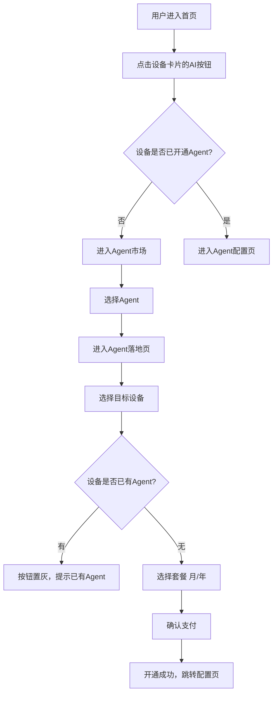
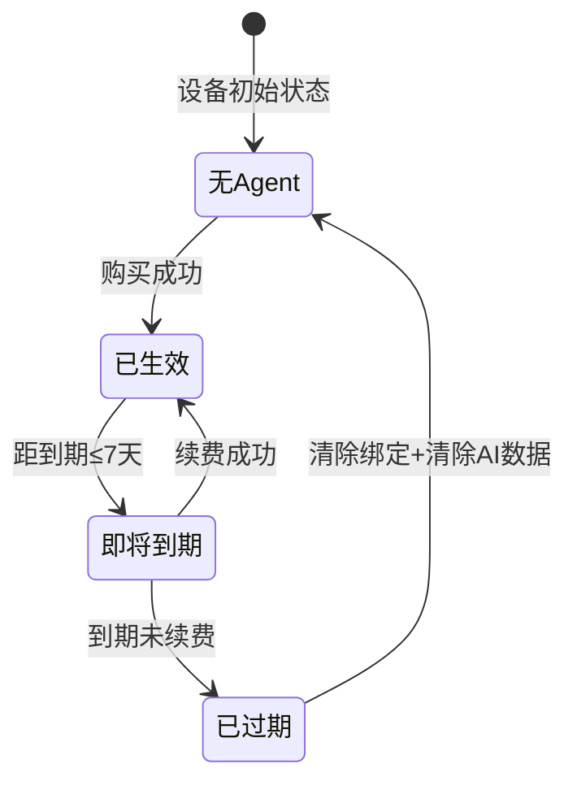
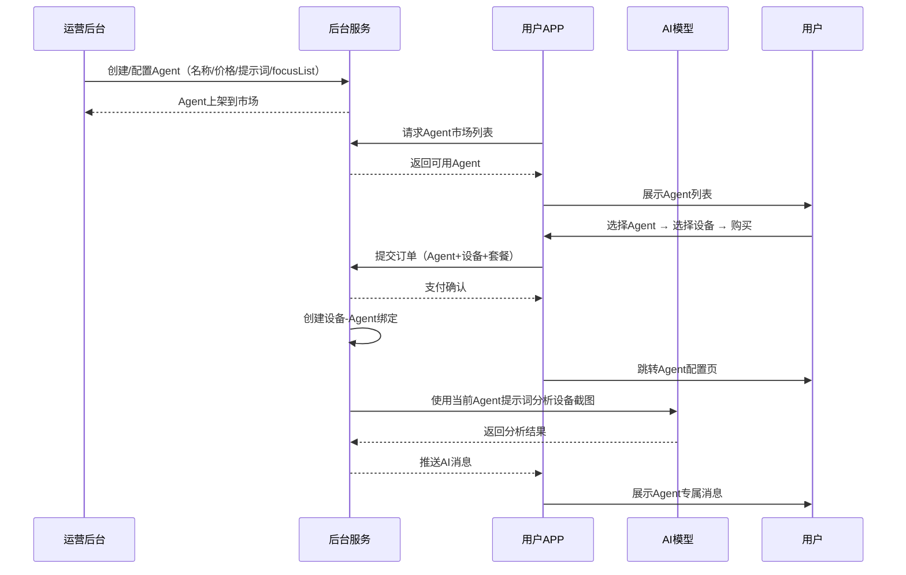
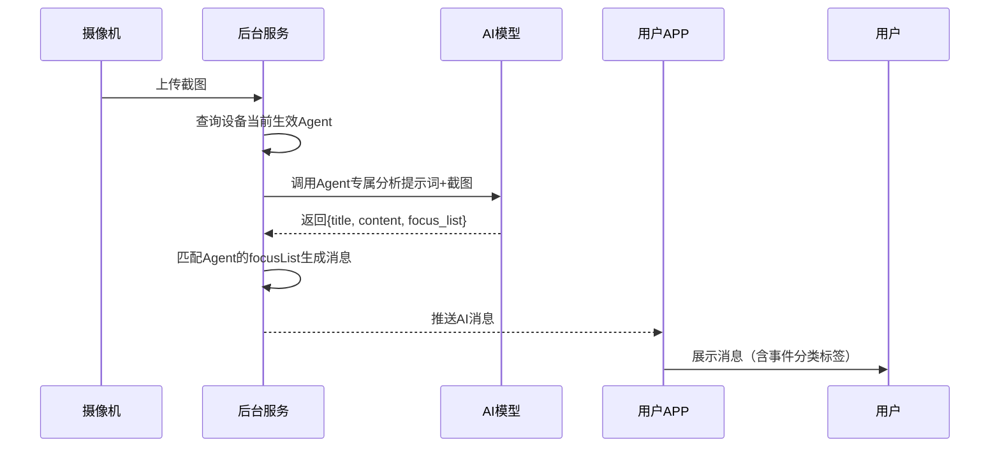

# Agent工厂 — 完整业务 PRD

## 修订记录

| 修订时间 | 修订内容 | 修订人 |
|----------|----------|--------|
| 2026-08-06 | 初稿 | PRD生成AI工程师 |

---

## 一、业务背景

### 业务场景

carecam_pro 现有「全能AI」智能服务，通过视觉模型对摄像机画面进行单图分析，输出语义化的事件描述，覆盖儿童守护、包裹送达、厨房守护、动物看护4个通用关注类别。

现计划建设 **Agent工厂**：将全能AI拆分为多个垂直智能体，每个智能体专注一个领域（宠物看护、家门看护等），拥有专属的检测规则和日报聚合逻辑。用户在设备上购买/订阅 Agent，同一时间每设备仅生效一个。

### 用户痛点

1. **全能AI不够专**：养宠用户收到儿童/厨房等无关内容；注重门口安全的用户收到的宠物消息是噪音
2. **付费意愿弱**：「什么都检测但什么都不精」→ 用户觉得不值得订阅
3. **没有选择权**：用户只能选「开AI」或「不开AI」，无法按需选择不同的智能体
4. **无可扩展性**：新增垂直场景只能往全能AI里硬塞规则

### 产品目标

1. Agent 市场：用户可浏览、购买/订阅垂直智能体
2. 每设备单 Agent 激活：一设备同时只有一个生效
3. 内容差异化：每个 Agent 提供专属的消息推送、日报总结、搜索服务
4. 退订回退：Agent 到期后设备退回基础侦测（硬件自带的人形/声音检测），不保留AI数据

---

## 二、名词解释

| 术语 | 说明 |
|------|------|
| Agent（智能体） | 一个垂直AI服务单元，包含名称、描述、价格、关注事件列表、专属检测规则、专属日报逻辑 |
| 全能AI Agent | 通用智能体，覆盖儿童/包裹/厨房/动物4个关注类别 |
| 宠物看护 Agent | 垂直智能体，专注宠物进食/排泄/异常/玩耍/睡眠行为识别 |
| 家门看护 Agent | 垂直智能体，专注包裹追踪/访客分类/安全监测/出入记录 |
| 关注事件（focus event） | Agent预置的检测类别（如「宠物进食」「包裹送达」），AI分析画面后匹配对应类别生成消息 |
| 非关注事件 | 不在focusList中的检测结果（如全能AI未配置某类别但仍检测到的声音/车辆等） |
| Agent 有效期 | 用户购买Agent后从生效到过期的时间段，期间该设备使用该Agent的分析规则 |
| 基础侦测 | 不激活任何Agent时设备自带的能力（硬件人形检测、声音检测等），无AI语义分析 |
| 设备-Agent绑定 | 一台设备与一个Agent的购买关系，同一时间一台设备只有一条有效绑定 |
| Agent落地页 | 每个Agent独立的产品介绍与购买页面，始终展示购买视图 |

---

## 三、业务实体说明

### 核心实体

**Agent（智能体）**
- 唯一标识、名称、一句话卖点（slogan）
- 图标（emoji）、主题渐变色
- 月订阅价格、年订阅价格
- 核心能力列表（图标+名称+一句话描述）
- 关注事件列表（预置检测类别，含名称和图标）
- 示例消息（2-3条模拟推送消息）
- 示例日报（总结语+分类统计数据）
- 权限类型：全能AI支持自定义关注事件；宠物/家门仅支持开关预置事件

**设备-Agent绑定**
- 设备名称 → Agent信息（ID、名称、图标、到期日期、状态）
- 状态：生效中（active）/ 已过期（expired）
- 一台设备最多一条有效绑定

**购买记录**
- Agent ID、Agent名称、设备名称
- 开始日期、到期日期
- 状态：生效中 / 已过期

### 实体关系

```
Agent 1 ──── N 设备-Agent绑定 N ──── 1 设备
  │
  └── N 购买记录 N ──── 1 设备
```

- 一个Agent可被多台设备购买
- 一台设备同一时间只有一条生效的Agent绑定
- 一台设备可有多条历史购买记录

---

## 四、核心业务流程

### 4.1 购买开通流程



### 4.2 Agent状态流转



### 4.3 全局协作时序



### 4.4 消息推送局部时序



---

## 五、业务规则

### 5.1 购买与订阅

| 规则编号 | 规则描述 |
|----------|----------|
| BR-001 | 一台设备同一时间只能有一个生效Agent |
| BR-002 | 设备已有生效Agent时，不可重复购买，落地页购买按钮置灰 |
| BR-003 | 落地页始终展示购买视图，已开通设备通过彩色提示条告知状态 |
| BR-004 | 相同Agent已开通 → 绿色提示「当前设备已开通XX，有效期至...」 |
| BR-005 | 不同Agent已开通 → 橙色警告「当前设备已开通YY，到期后可更换」 |
| BR-006 | 月订阅价格 9.9元/月，年订阅价格 99元/年 |
| BR-007 | Agent到期后自动失效，设备退回基础侦测 |

### 5.2 关注事件管理

| 规则编号 | 规则描述 |
|----------|----------|
| BR-101 | 全能AI：用户可添加/编辑/删除/开关关注事件，最多4个 |
| BR-102 | 宠物看护：关注事件为预置列表（5个），仅支持开关，不可编辑/删除/新增 |
| BR-103 | 家门看护：关注事件为预置列表（8个），仅支持开关，不可编辑/删除/新增 |
| BR-104 | 开启「智能推送」后，仅推送已开启的关注事件消息，非关注事件不推送 |

### 5.3 消息与内容

| 规则编号 | 规则描述 |
|----------|----------|
| BR-201 | AI消息内容由当前设备激活的Agent决定（宠物Agent推送宠物事件，家门Agent推送门口事件） |
| BR-202 | AI日报总结按Agent专属分类维度聚合（宠物按进食/排泄/玩耍/睡眠；家门按包裹/访客/出入/安全） |
| BR-203 | AI搜索建议和搜索结果按Agent领域定制（宠物Agent优先匹配宠物相关事件） |
| BR-204 | 未开通Agent的设备仅显示基础运动侦测/人形侦测消息 |

### 5.4 展示规则

| 规则编号 | 规则描述 |
|----------|----------|
| BR-301 | 首页设备卡片AI按钮根据Agent显示不同图标和文字（🐱宠物看护中 / 🚪家门看护中 / 🌐AI守护中） |
| BR-302 | Agent市场页面不显示设备筛选栏，仅展示Agent列表 |
| BR-303 | Agent配置页标题显示「{Agent名称}配置」 |
| BR-304 | 已开通配置页右上角显示Agent商城入口 |

---

## 六、功能架构

```
Agent工厂
├── Agent市场
│   ├── Agent列表（浏览所有可用Agent）
│   └── Agent落地页（产品详情+购买，含已开通提示）
├── Agent配置
│   ├── Agent状态展示（名称+有效期+守护状态）
│   ├── 关注事件管理（全能AI可编辑，宠物/家门仅开关）
│   ├── 智能推送总开关
│   └── 我的Agent入口
├── AI服务（按Agent差异化）
│   ├── AI消息推送（设备截图→Agent专属分析→消息入库）
│   ├── AI日报总结（当日消息聚合→Agent专属维度分类）
│   └── AI智能搜索（自然语言搜索→Agent领域优先匹配）
├── 我的Agent
│   ├── 当前生效Agent状态
│   ├── 历史购买记录
│   └── 续费/选购入口
└── 消息中心
    ├── 消息列表（按Agent显示差异化内容）
    └── 分类筛选（按Agent的focusList动态生成筛选项）
```

---

## 七、详细功能描述

### 7.1 Agent市场

#### 功能应用场景
用户想为设备开通AI智能服务，进入Agent市场浏览可用的智能体，了解每个Agent的能力和价格。

#### 功能详述

**页面结构**：
- 顶部：返回按钮 + 标题「Agent市场」
- 主体：Agent卡片列表（纵向排列）

**Agent卡片**：
- 左侧：Agent图标（emoji）+ 名称（大字）+ slogan（小字灰色）
- 中间：能力标签行（2×2排列的小标签）
- 右侧：价格信息
- 点击：进入对应Agent落地页

#### 状态说明

| 状态 | 触发条件 | 展示内容 |
|------|----------|----------|
| 正常态 | 后台有上架Agent | 展示全部Agent卡片，可点击进入落地页 |
| 空态 | 后台无可用Agent | 占位提示「暂无可用Agent」 |

---

### 7.2 Agent落地页

#### 功能应用场景
用户从Agent市场点击某个Agent后，进入该Agent的专属产品介绍页，了解详细能力和示例效果，决定是否购买。

#### 功能详述

**页面结构（从上到下）**：

**Hero区**：全宽渐变背景（宠物暖橙、家门深蓝、全能蓝紫），居中显示Agent大图标、名称、slogan
**设备筛选**：横向滚动chip选择目标设备
**已开通提示条**（设备已有Agent时显示）：
  - 同Agent：绿色提示条，告知有效期
  - 不同Agent：橙色警告条，提示到期后可更换
**功能预览区**：4个Tab切换（消息推送/日报总结/搜索/关注事件），每Tab展示模拟效果截图
**核心能力区**：2×2宫格，每格含图标+能力名+一句话描述
**消息示例区**：2-3条模拟推送消息卡片（时间+标题+正文+缩略图）
**日报预览区**：模拟日报卡片（总结语+分类统计行）
**套餐选择区**：月订阅（¥9.9/月）/ 年订阅（¥99/年），选中高亮
**底部固定栏**：购买按钮（显示价格），设备已有Agent时置灰

#### 状态说明

| 状态 | 触发条件 | 展示内容 |
|------|----------|----------|
| 正常态 | 设备无Agent | 全部内容正常展示，购买按钮可点击 |
| 已开通同Agent | 设备已开通相同Agent | 顶部绿色提示条，购买按钮置灰 |
| 已开通不同Agent | 设备已开通其他Agent | 顶部橙色警告条，购买按钮置灰 |
| 空态 | Agent数据加载失败 | 错误提示 |

#### 交互说明

- 点击设备chip：切换目标设备，已开通提示和购买按钮状态联动更新
- 点击功能Tab：切换预览区内容
- 点击套餐卡片：选中对应套餐
- 点击购买按钮（可用时）：确认支付 → 开通成功 → 跳转配置页
- 点击购买按钮（置灰时）：Toast提示「当前设备已有生效Agent」

---

### 7.3 Agent配置页

#### 功能应用场景
设备已开通Agent后，用户进入配置页查看当前Agent状态、管理关注事件、跳转我的Agent或Agent市场。

#### 功能详述

**页面结构（已开通态）**：

**顶部**：返回按钮 + 动态标题（「{Agent名称}配置」）+ Agent商城入口图标
**状态卡片**：Agent名称 + 有效期 + 「守护中」标识
**关注事件管理**：
  - 列表标题 + 添加按钮（仅全能AI显示）
  - 每个事件行：名称 + 描述 + 开关
  - 全能AI：额外显示编辑/删除图标
  - 宠物/家门：仅显示开关
**智能推送**：总开关 + 说明文字「开启后仅推送关注事件消息」
**我的Agent入口**：Agent图标 + 「我的Agent」文字 → 点击跳转
**Agent商城入口**：Header右侧图标 → 点击跳转Agent市场

#### 状态说明

| 状态 | 触发条件 | 展示内容 |
|------|----------|------|
| 已开通态 | 设备有生效Agent | 完整配置页面 |
| 未开通态 | 设备无Agent（兼容旧入口） | 全能AI购买介绍页 |

#### 交互说明

- 点击商城图标：跳转Agent市场
- 点击「我的Agent」：跳转我的Agent页
- 点击添加按钮（全能AI）：弹窗输入关注事件名称和描述
- 点击编辑图标（全能AI）：弹窗修改关注事件
- 点击删除图标（全能AI）：删除关注事件
- 切换事件开关：开启/关闭该关注事件的消息推送
- 切换智能推送总开关：开启/关闭AI消息推送

---

### 7.4 我的Agent

#### 功能应用场景
用户查看当前设备已购Agent的状态、有效期，管理续费或选购新Agent。

#### 功能详述

**当前Agent卡片**：Agent图标+名称、当前生效设备、有效期、状态标签（生效中/即将到期/已到期）
**历史购买列表**：已过期的Agent记录，含名称、使用时间段、再次购买按钮
**操作按钮**：续费（即将到期时显示）、选购新Agent → 跳转Agent市场
**空态**：无购买记录时引导「去Agent市场选购」

#### 状态说明

| 状态 | 触发条件 | 展示内容 |
|------|----------|------|
| 生效中 | 有生效Agent | 状态标签绿色「生效中」 |
| 即将到期 | 距到期≤7天 | 状态标签橙色，续费按钮高亮 |
| 已到期 | Agent已过期 | 状态标签红色，续费按钮消失，显示「选购新Agent」 |
| 无Agent | 从未购买 | 空态引导 |

---

### 7.5 AI日报

#### 功能应用场景
用户查看当日设备AI事件的聚合总结，了解家中/宠物/门口的整体动态。

#### 功能详述

**生成进度**：点击「生成日报」→ 3步动画（分析关注事件→整理时间线→AI生成总结）
**日报内容（按Agent差异）**：

| Agent | 总结维度 | 分类统计项 |
|-------|----------|------------|
| 宠物看护 | 宠物整体状态（温馨风格） | 🍽进食 / 💩排泄 / ⚠异常 / 🏃玩耍 / 😴睡眠 |
| 家门看护 | 门口安全评估（简洁风格） | 📦包裹动态 / 👤访客记录 / 🚪家人出入 / ⚠安全事件 |
| 全能AI | 家庭整体情况（中性客观） | 👤人员经过 / 🐱宠物活动 / 📦包裹送达 |

**日报摘要**：一句话总结 + 展开查看详情
**事件时间线**：每个关注事件显示首条/省略号/末条时间线
**每日限额**：免费3次/天/设备

#### 状态说明

| 状态 | 触发条件 | 展示内容 |
|------|----------|------|
| 未生成 | 当日未生成日报 | 空态引导「点击生成今日日报」 |
| 生成中 | 点击生成后 | 3步进度动画 |
| 已生成 | 生成完成 | 完整日报内容 |
| 次数用尽 | 当日已生成3次 | 「今日生成次数已用完，明天自动重置」 |
| 未开通 | 设备无Agent | 截图预览 + 开通引导按钮 |

---

### 7.6 AI搜索

#### 功能应用场景
用户用自然语言描述想查找的事件（如「今天猫咪吃了几次饭」），AI搜索匹配相关历史事件并展示结果。

#### 功能详述

**搜索框**：文本输入 + 搜索按钮
**搜索建议示例**（按Agent差异）：
  - 宠物看护：「今天猫咪吃了几次饭」「狗狗有没有呕吐」「猫咪在客厅干嘛」
  - 家门看护：「今天有几个包裹送达」「有没有陌生人到访」「快递员几点来的」
  - 全能AI：「奶奶今天出门了吗」「猫咪上午在干嘛」「门口有快递」
**猜你想搜**：未搜索时展示推荐搜索词（TAG样式，点击直接搜索）
**搜索结果**：事件卡片列表（缩略图 + 摘要 + 事件标签 + 时间 + 设备名）
**结果计数**：显示「共找到N条相关事件」
**点击结果**：进入事件详情页

#### 状态说明

| 状态 | 触发条件 | 展示内容 |
|------|----------|------|
| 未搜索 | 进入页面 | 「猜你想搜」推荐词 |
| 搜索有结果 | 搜索命中 | 结果计数 + 结果列表 |
| 搜索无结果 | 无匹配 | 空态提示「未找到相关事件」 |
| 未开通 | 设备无Agent | 截图预览 + 开通引导按钮 |

---

### 7.7 消息中心

#### 功能应用场景
用户查看设备推送的所有AI消息，按关注事件分类筛选。

#### 功能详述

**搜索栏**：AI搜索入口（点击跳转AI搜索页）
**筛选行**：日期筛选 + 设备筛选
**分类Tab（按Agent差异）**：
  - 宠物看护：全部 / 宠物进食 / 宠物排泄 / 呕吐异常 / 宠物玩耍 / 宠物睡眠 / 其他
  - 家门看护：全部 / 包裹送达 / 包裹取走 / 包裹在门口 / 快递外卖 / 陌生人到访 / 家人出入 / 异常徘徊 / 多人聚集 / 其他
  - 全能AI：全部 / 儿童守护 / 包裹送达 / 厨房守护 / 动物看护 / 其他
  - 未开通：全部 / 运动侦测 / 人形侦测
- Tab支持多选，点击「全部」清空其他筛选

**消息列表**：消息卡片（缩略图 + 摘要 + 事件名称标签 + 时间）
**底部按钮**：「消息太多？一键总结」→ 跳转AI日报

#### 消息内容差异化

| Agent | 消息类型示例 |
|-------|------------|
| 宠物看护 | 宠物进食、宠物排泄、呕吐/异常、宠物玩耍、宠物睡眠 |
| 家门看护 | 包裹送达、包裹取走、快递/外卖、陌生人到访、家人出入 |
| 全能AI | 儿童守护、包裹送达、厨房守护、动物看护、声音侦测 |
| 未开通 | 通用运动侦测、人形侦测 |

#### 状态说明

| 状态 | 触发条件 | 展示内容 |
|------|----------|------|
| 有消息 | 设备有AI消息 | 消息列表 |
| 无消息 | 设备无历史消息 | 空态提示 |
| 筛选无结果 | 筛选条件无匹配 | 空态提示 |

---

### 7.8 首页设备卡片AI按钮

#### 功能应用场景
用户在首页查看设备列表时，通过设备卡片的AI按钮快速进入Agent配置或Agent市场。

#### 功能详述

**已开通Agent设备**：显示Agent专属图标（emoji）+ 状态文字
  - 宠物看护：🐱 + 「宠物看护中」
  - 家门看护：🚪 + 「家门看护中」
  - 全能AI：🌐 + 「AI守护中」
- 各Agent图标有对应色调的光晕效果
- 点击 → 进入Agent配置页

**未开通Agent设备**：显示通用图标 + 「AI」渐变标签
- 点击 → 进入Agent市场

---

## 八、页面信息架构

### 页面层级

```
首页（/home）
  ├── 消息中心（/message）
  │     ├── AI搜索（/ai/search）
  │     └── AI日报（/ai/daily）
  │           └── 日报事件详情
  ├── Agent配置页（/ai?device=xxx）
  │     ├── 我的Agent（/my-agent）
  │     │     └── Agent市场（/agent-market）
  │     ├── Agent市场（/agent-market）
  │     │     └── Agent落地页（/agent-market/:agentId）
  │     ├── AI消息推送
  │     ├── AI日报总结
  │     └── AI智能搜索
  └── 设置
```

### 页面跳转关系

| 起点 | 触发操作 | 目标页面 | 条件 |
|------|----------|----------|------|
| 首页设备卡片AI按钮 | 点击 | Agent配置页 | 设备已开通Agent |
| 首页设备卡片AI按钮 | 点击 | Agent市场 | 设备未开通Agent |
| Agent市场Agent卡片 | 点击 | Agent落地页 | 无 |
| Agent落地页购买按钮 | 点击（设备无Agent） | Agent配置页 | 支付成功后 |
| Agent配置页商城图标 | 点击 | Agent市场 | 已开通态 |
| Agent配置页我的Agent | 点击 | 我的Agent | 已开通态 |
| 我的Agent选购新Agent | 点击 | Agent市场 | 无 |
| 消息页搜索栏 | 点击 | AI搜索 | 无 |
| 消息页底部一键总结 | 点击 | AI日报 | 无 |
| AI日报日报事件 | 点击 | 日报事件详情 | 已开通态 |

---

## 九、异常说明

### 9.1 网络异常

| 场景 | 表现 |
|------|------|
| Agent市场列表加载失败 | Toast提示「加载失败」，可下拉重试 |
| 购买支付超时 | Toast提示「支付处理中，请稍后查看」，订单列表可查 |
| AI日报生成超时 | 停留在生成中状态，可手动重试 |
| AI搜索超时 | Toast提示「搜索超时，请重试」 |

### 9.2 数据为空

| 场景 | 表现 |
|------|------|
| Agent市场无可用Agent | 空态「暂无可用Agent」 |
| 设备无AI消息 | 消息页显示空态 |
| 当日无AI事件 | AI日报不可生成（无数据则不聚合） |
| 搜索无匹配结果 | 「未找到相关事件」 |
| 无购买记录 | 我的Agent显示「暂无购买记录」 |

### 9.3 操作失败

| 场景 | 表现 |
|------|------|
| 支付失败（余额不足） | Toast提示失败原因，可重试 |
| 购买时设备已有Agent | 按钮置灰，不发起支付 |
| 添加关注事件超限（全能AI） | Toast提示「最多添加4个关注事件」 |

### 9.4 权限/状态异常

| 场景 | 表现 |
|------|------|
| 设备无Agent进入Agent配置页 | 展示全能AI购买介绍页（兼容旧入口） |
| Agent已到期 | 消息停止推送、日报停止生成，我的Agent显示已到期 |
| 设备未绑定 | 引导绑定设备后再使用Agent功能 |

---

## 十、测试要点

### 功能回归

| 编号 | 测试点 | 前置条件 | 操作步骤 | 预期结果 |
|------|--------|----------|----------|----------|
| T-001 | 原有首页功能不受影响 | — | 浏览首页设备列表、点击消息/回放/设置 | 各功能正常 |
| T-002 | 原有消息页功能不受影响 | — | 进入消息页、搜索、筛选 | 功能正常，新增Agent差异化内容 |
| T-003 | 原有AI日报功能不受影响 | 设备已开通Agent | 进入日报页、点击生成 | 日报正常生成，内容按Agent展示 |
| T-004 | 原有AI搜索功能不受影响 | 设备已开通Agent | 进入搜索页、搜索 | 搜索正常，建议和结果按Agent差异化 |

### 核心场景

| 编号 | 测试点 | 前置条件 | 操作步骤 | 预期结果 |
|------|--------|----------|----------|----------|
| T-101 | 未开通设备购买Agent全流程 | 设备无Agent | 首页AI按钮→Agent市场→选Agent→落地页选设备→购买 | 购买成功，跳转配置页 |
| T-102 | 已开通设备进入配置页 | 设备已开通宠物看护 | 首页设备卡片→AI按钮 | 进入配置页，标题「宠物看护配置」 |
| T-103 | Agent市场→落地页→购买已开通设备 | 标准摄像机已开通全能AI | 落地页切换设备为标准摄像机 | 显示绿色提示条，购买按钮置灰 |
| T-104 | 落地页切换设备联动 | 打开宠物看护落地页 | 切换设备chip | 提示条、按钮状态随设备联动更新 |
| T-105 | AI日报每日限额 | 已生成3次日报 | 点击生成日报 | 显示「今日次数已用完」 |

### 异常场景

| 编号 | 测试点 | 前置条件 | 操作步骤 | 预期结果 |
|------|--------|----------|----------|----------|
| T-201 | 落地页已开通设备防重复购买 | 设备已开通Agent | 进入落地页→选该设备→点购买 | 按钮置灰，不可点击 |
| T-202 | 切设备时事件列表同步 | 先进入全能AI配置页 | 返回首页→进入宠物看护配置页 | 事件列表为宠物预置事件，无编辑/删除图标 |
| T-203 | 全能AI关注事件最多4个 | 已有4个事件 | 点击添加 | Toast提示「最多添加4个关注事件」 |
| T-204 | 未开通设备消息展示 | 设备无Agent | 进入消息页 | 显示通用运动/人形侦测消息，筛选Tab简化 |

### 状态切换

| 编号 | 测试点 | 前置条件 | 操作步骤 | 预期结果 |
|------|--------|----------|----------|----------|
| T-301 | 设备间快速切换Agent配置 | 多设备已开通不同Agent | 连续从首页进不同设备AI按钮 | 每个设备显示正确的Agent配置 |
| T-302 | 消息页切换设备 | — | 消息页切换不同设备 | 消息内容和筛选项按Agent更新 |
| T-303 | AI日报切换设备后内容变化 | — | 日报页切换不同Agent设备 | 内容/分类/历史日报按Agent变化 |

### 兼容性

| 编号 | 测试点 | 前置条件 | 操作步骤 | 预期结果 |
|------|--------|----------|----------|----------|
| T-401 | 不同Agent设备的UI差异 | 多设备开通不同Agent | 分别进入各设备配置页 | 关注事件列表正确、编辑权限正确 |
| T-402 | 未开通设备仍可查看Agent市场 | 设备无Agent | 进入Agent市场 | 正常浏览，可进入落地页 |
| T-403 | 首页AI按钮样式正确 | 多设备不同Agent | 查看首页各设备卡片 | 图标和文案按Agent正确显示 |

---

## 十一、APP埋点与运营数据看板

### 核心指标

| 维度 | 指标 | 说明 |
|------|------|------|
| 业务 | Agent市场PV/UV | 浏览Agent市场的用户数 |
| 业务 | Agent落地页PV/UV（按Agent拆分） | 各Agent落地页访问量 |
| 业务 | 购买转化率 | 落地页→购买的转化率 |
| 业务 | Agent开通率（按设备） | 已开通Agent设备数/总设备数 |
| 行为 | 关注事件开关操作次数 | 用户调整关注事件的频率 |
| 行为 | Agent配置页访问频次 | 用户查看Agent配置的频率 |
| 质量 | 购买成功率 | 支付成功/发起支付 |
| 增长 | Agent续费率 | 到期后续费用户数/到期用户数 |

### 关键埋点事件

| 事件名 | 触发时机 | 关键参数 |
|--------|----------|----------|
| agent_market_view | 进入Agent市场页 | source（入口来源） |
| agent_landing_view | 进入Agent落地页 | agent_id, agent_name |
| agent_landing_device_switch | 落地页切换设备 | from_device, to_device |
| agent_purchase_click | 点击购买按钮 | agent_id, plan_type（monthly/yearly）, device_name |
| agent_purchase_success | 购买成功 | agent_id, plan_type, device_name, price |
| agent_config_view | 进入Agent配置页 | agent_id, device_name |
| agent_config_event_toggle | 关注事件开关操作 | event_name, enabled |
| agent_config_event_edit | 编辑关注事件（全能AI） | event_name, action（add/edit/delete） |
| agent_my_view | 进入我的Agent页 | agent_id |
| agent_renew_click | 点击续费按钮 | agent_id, device_name |
| home_ai_btn_click | 首页设备卡片AI按钮点击 | device_name, has_agent, agent_id |
| msg_filter_tab_click | 消息页筛选Tab点击 | tab_key, agent_id, device_name |
| daily_generate | 日报生成 | agent_id, device_name, remain_free |
| search_query | AI搜索 | agent_id, query_text |
