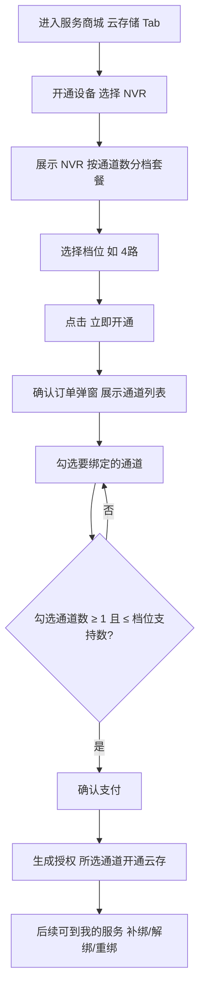
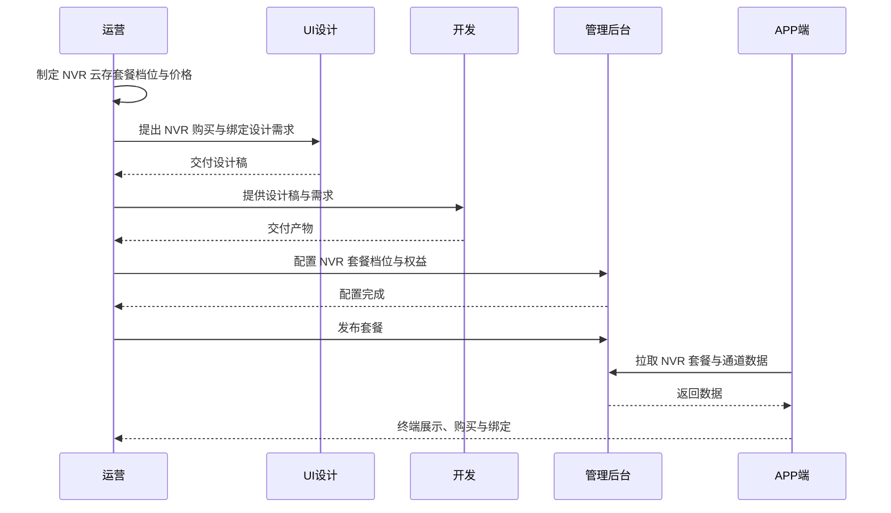
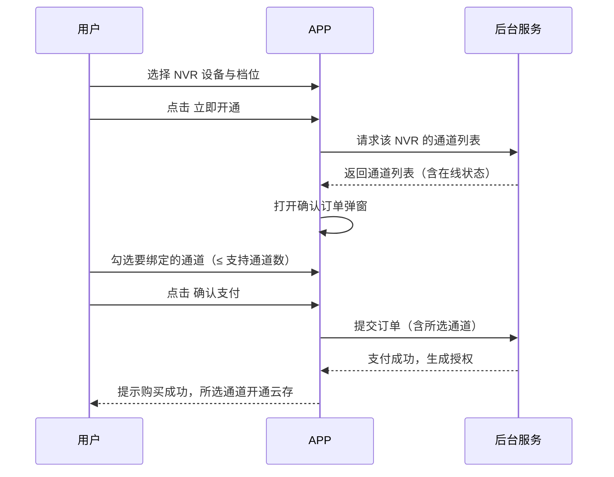
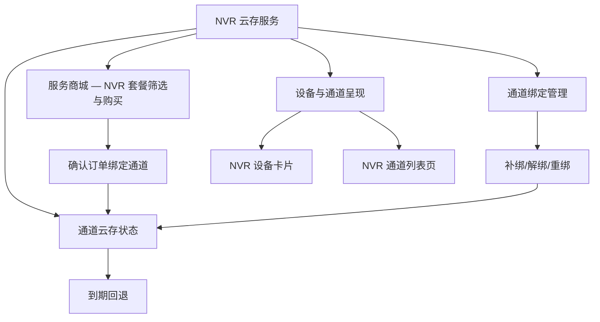

# NVR设备购买云存 — 完整业务 PRD

## 修订记录

| 修订时间 | 修订内容 | 修订人 |
|----------|----------|--------|
| 2026-08-14 | 初稿（融合需求分析与 UI 设计，含「购买时绑定通道」变更） | AI-PRD生成工程师 |

---

## 一、业务背景

### 业务场景

CareCam Pro 现有「服务商城 → 云存储」增值服务：IPC 摄像机按**设备 ID** 购买云存套餐（Basic / Pro / Super Pro），一台设备一份订阅，套餐跟随设备 ID 生效。

现计划接入 **NVR（网络硬盘录像机）** 设备。NVR 是汇聚设备，自身不产生画面，画面来自各**通道**上接入的物理摄像机。因此 NVR 的云存不能绑定 NVR 设备 ID，而要按**通道**购买：用户购买一个「支持 N 个通道」的套餐，在购买时直接选择要开通云存的通道，各通道独立开通。

### 用户痛点

1. **传统 IPC 云存模型不适用 NVR**：NVR 一台设备对应多路摄像机，按设备 ID 买一份云存无法覆盖多路画面，也无法按需只给部分通道开通。
2. **按需开通诉求**：用户可能只关心 NVR 上的 2 路（如正门、车库），不想为整机全通道付费。
3. **灵活分配**：通道对应的摄像机可能更换/调整，用户希望能随时把云存从一路切换到另一路。

### 产品目标

1. NVR 云存按**支持通道数分档**购买（1/4/8/16 路），价格随路数递增。
2. 购买时（确认订单）**直接选择要绑定的通道**；购买后支持**解绑 / 重绑 / 补绑**，灵活分配云存额度。
3. 服务商城「云存储」切换到 NVR 设备时，**自动筛选展示 NVR 专属套餐**。
4. NVR 以「1 张设备卡片 + 通道列表」的形式呈现，各通道独立展示云存状态。

---

## 二、名词解释

| 术语 | 说明 |
|------|------|
| NVR（网络硬盘录像机） | 汇聚多路摄像机画面的录像设备，自身不产生画面，画面来自各通道接入的摄像机 |
| 通道（Channel） | NVR 上接入物理摄像机的端口，1 通道 = 1 台物理摄像机 |
| 支持通道数 | NVR 云存套餐覆盖的通道数量上限（如 4 路套餐最多支持 4 个通道），即「授权额度」上限 |
| 通道绑定 | 将已购套餐的「通道授权」分配到具体物理通道的动作，绑定后该通道开通云存 |
| 解绑 / 重绑 | 释放某通道的授权额度 / 将释放的额度重新绑定到另一通道 |
| 补绑 | 购买时未绑满支持通道数，后续在「我的服务」用剩余额度绑定更多通道 |
| IPC 云存套餐 | 跟随设备 ID 的现有云存套餐（Basic / Pro / Super Pro），仅适用于 IPC 设备 |
| NVR 云存套餐 | 按支持通道数分档的新套餐，绑定到 NVR 设备后按通道分配 |
| 授权额度 | 套餐「支持通道数」中尚未绑定的可用额度（= 支持通道数 − 已绑定通道数） |

---

## 三、业务实体说明

| 实体 | 关键属性 | 说明 |
|------|----------|------|
| NVR 设备 | 设备标识、名称、通道总数、在线状态 | 汇聚设备，1 台对应多路通道 |
| 通道 | 通道号（CH1、CH2…）、名称、在线状态 | 接入 NVR 的物理摄像机端口 |
| NVR 云存套餐 | 套餐名称、支持通道数、价格、有效期、权益内容 | 用户购买的云存授权，按通道分配 |
| 通道绑定关系 | 套餐标识、通道号、绑定时间 | 记录某套餐绑定了哪些通道，即通道的云存生效依据 |

**实体关系**：

- 1 台 NVR 设备包含 N 个通道（N 由硬件决定，如 4/8/16 路）。
- 1 份 NVR 云存套餐最多绑定「支持通道数」个通道。
- 1 个通道同一时间仅可被 1 份生效中的云存套餐绑定（单通道不叠加多份云存）。

---

## 四、核心业务流程

### 4.1 流程图（购买 + 绑定通道）



### 4.2 全局时序图（全链路协作）



### 4.3 局部队列时序图（购买时绑定通道）



---

## 五、业务规则

| 编号 | 规则 | 说明 |
|------|------|------|
| R01 | 套餐按支持通道数分档 | 档位 1/4/8/16 路（档位与价格待运营确认），价格随路数递增 |
| R02 | 购买时绑定通道数上限 | 勾选通道数 ≤ 档位「支持通道数」，达上限后其余通道置灰不可选 |
| R03 | 购买时至少绑定 1 路 | 确认支付前未勾选任何通道时，提示「请选择要绑定的通道」，不进入支付 |
| R04 | 离线通道不可绑定 | 离线/未接入通道置灰不可选，仅在线通道可绑定 |
| R05 | 单通道仅一份云存 | 1 个通道同一时间仅可被 1 份生效中的云存套餐绑定 |
| R06 | 解绑即时释放额度 | 解绑某通道后，该通道云存停止，额度立即回到可用状态 |
| R07 | 补绑 | 购买时未绑满支持通道数时，可在「我的服务」用剩余额度继续绑定 |
| R08 | 套餐到期自动解绑 | 到期未续费时，所有已绑定通道自动解绑，退回本地录像/基础侦测 |
| R09 | 即将到期阈值 | 距到期 ≤ 7 天进入「即将到期」状态，展示续费引导 |
| R10 | 档位超限拦截 | 档位支持通道数超过 NVR 硬件通道数时，拦截购买并提示 |

---

## 六、功能架构



---

## 七、详细功能描述

### 7.1 服务商城 — NVR 套餐筛选

**功能应用场景**：用户在服务商城「云存储」Tab 下，通过顶部「开通设备」切换设备。当切换为 NVR 设备时，套餐列表自动切换为 NVR 专属套餐。

**功能详述**：

| 区域 | 说明 |
|------|------|
| 服务 Tab | 云存储 / AI智能服务 / 离线监测 / 去广告 / 流量充值 |
| 开通设备栏 | 展示当前选中设备，点击弹底部设备选择弹窗 |
| 套餐卡片 | NVR 档位（1路/4路/8路/16路），卡片含运营标签、档位名、价格、权益列表 |

**设备选择弹窗（NVR）**：单选一台 NVR 设备（NVR 之间互斥），选中后套餐内容刷新为 NVR 套餐。

**状态说明**：

| 状态 | 触发条件 | 展示内容 |
|------|----------|----------|
| 正常态（IPC） | 当前设备为 IPC | 展示 Basic/Pro/Super Pro 套餐 |
| 正常态（NVR） | 当前设备为 NVR | 展示 NVR 按通道数分档套餐 |
| 空态 | 无可用设备 | 设备栏提示「点击选择」 |

**交互说明**：切换设备类型（IPC ↔ NVR）即时触发套餐内容刷新；选中档位高亮主色边框。

### 7.2 NVR 云存套餐购买（确认订单绑定通道）

**功能应用场景**：用户选中 NVR 档位后，在确认订单环节直接选择要绑定的通道，支付后所选通道开通云存。

**功能详述**：

| 区域 | 说明 |
|------|------|
| 底部购买栏 | 协议勾选 + 「立即开通 ¥XX/月」按钮 |
| 确认订单弹窗 | 点击「立即开通」后底部弹出（高约 65%） |

**确认订单弹窗结构**（从上到下）：

| 区域 | 说明 |
|------|------|
| 顶部 | 套餐名 + 价格 |
| 支付方式 | 微信支付 / 支付宝 单选 |
| 绑定通道 | 该 NVR 的通道列表多选，上限为档位支持通道数；离线通道置灰不可选 |
| 提示 | 「后续查看/管理绑定通道请前往【我的】→【我的服务】」 |
| 底部按钮 | 「确认支付 ¥XX/月」 |

**状态说明**：

| 状态 | 触发条件 | 展示内容 |
|------|----------|----------|
| 正常态 | NVR 有在线通道 | 通道列表可多选 |
| 满额态 | 已勾选数 = 支持通道数 | 未勾选通道置灰不可选 |
| 空态 | NVR 无可用通道 | 提示「暂无可选通道」 |

**交互说明**：勾选/取消通道即时更新；确认支付前校验至少勾选 1 路，未选提示「请选择要绑定的通道」；支付成功后提示「购买成功」，所选通道开通云存。

### 7.3 通道绑定管理（补绑 / 解绑 / 重绑）

**功能应用场景**：购买后，用户从「我的服务」进入套餐，继续调整通道绑定（补绑未绑满的额度、解绑、重绑）。

**功能详述**：

| 区域 | 说明 |
|------|------|
| 套餐摘要 | 套餐名 + 类型标签 + 大数字「已绑 X / N 路」 |
| 已绑定通道 | 通道列表：图标 + 通道号/名称 + 「已绑定」标签 + 「解绑」按钮 |
| 添加绑定按钮 | 虚线框「+ 添加绑定通道」，仅未绑满时显示 |

**多选弹窗（补绑）**：底部弹出，展示未绑定通道，上限为剩余额度，达上限其余置灰；点「确定」完成绑定。

**状态说明**：

| 状态 | 触发条件 | 展示内容 |
|------|----------|----------|
| 正常态 | 有套餐、有可用通道 | 摘要 + 已绑定列表 + 添加按钮 |
| 空态 | 已购未绑定 | 摘要 + 空态「暂未绑定通道」+ 添加按钮 |
| 满额态 | 已绑定数 = 支持通道数 | 隐藏「添加绑定通道」按钮 |
| 无可用通道 | NVR 无未绑定通道 | 添加弹窗空态「暂无可绑定通道」 |

**交互说明**：解绑需二次确认（弹窗「解绑通道 CH{n} 后，该通道云存将停止，确定解绑？」→ 取消 / 确定）；确定后释放额度，统计数字即时更新。

### 7.4 NVR 设备与通道呈现

**功能应用场景**：首页设备列表以「1 张 NVR 卡片」呈现 NVR 设备；点击进入通道列表页，查看各通道云存状态。

**功能详述**：

| 区域 | 说明 |
|------|------|
| NVR 设备卡片 | NVR 图标 + 名称 + 「N路」通道数标签 + 在线状态；点击跳通道列表页 |
| 通道列表页 | NVR 摘要卡片 + 通道卡片列表 |

**通道卡片（每行）**：左侧通道图标 + 通道号 + 名称；右侧按状态展示「开通云存」按钮或状态标签。

**状态说明**：

| 状态 | 展示内容 |
|------|----------|
| 未绑定 | 「开通云存」主色按钮 |
| 生效中 | 绿色标签「云存生效中」+ 到期时间 |
| 即将到期 | 橙色标签「X天后到期」 |
| 已到期 | 红色标签「已到期」 |

**交互说明**：未绑定通道点「开通云存」跳服务商城（自动选中该 NVR）；已绑定通道提供「解绑」入口。

### 7.5 通道云存状态与到期回退

**功能应用场景**：各通道独立展示云存状态，套餐到期后绑定通道自动解绑，退回本地录像/基础侦测。

**功能详述**：通道云存状态流转见「业务规则 R06–R09」。

**状态说明**：

| 状态 | 触发条件 | 说明 |
|------|----------|------|
| 无云存 | 未绑定 / 已解绑 | 仅本地/SD 回放 |
| 云存生效中 | 已绑定且在有效期内 | 云端录像 + 告警 |
| 即将到期 | 距到期 ≤ 7 天 | 展示续费引导 |
| 已到期 | 到期未续费 | 自动解绑，退回基础侦测 |

---

## 八、页面信息架构

### 8.1 页面层级

```
CareCam Pro APP
├── 首页设备列表
│   └── NVR 设备卡片 → NVR 通道列表页
├── 服务商城（云存储 Tab）
│   ├── 开通设备选择弹窗
│   └── 确认订单弹窗（购买时绑定通道）
└── 我的
    └── 我的服务
        └── 绑定通道页（补绑/解绑/重绑）
```

### 8.2 页面跳转关系

| 起点 | 触发 | 终点 |
|------|------|------|
| 首页 NVR 卡片 | 点击 | NVR 通道列表页 |
| 通道列表页「开通云存」 | 点击 | 服务商城（自动选中该 NVR） |
| 服务商城「立即开通」（NVR） | 点击 | 确认订单弹窗（绑定通道） |
| 确认订单「确认支付」 | 点击 | 购买成功 → 跳 NVR 通道列表页 |
| 我的服务「去绑定」 | 点击 | 绑定通道页（补绑/解绑/重绑） |

---

## 九、异常说明

| 分类 | 场景 | 处理方式 |
|------|------|----------|
| 网络 | NVR 通道数据请求超时 | 确认订单弹窗通道列表显示「加载失败」，可重试 |
| 网络 | 套餐/服务数据加载失败 | 页面显示错误提示，可重试 |
| 数据 | NVR 未接入摄像机 | 通道列表空态「暂未接入摄像机」；确认订单弹窗「暂无可选通道」 |
| 数据 | 档位超过 NVR 硬件通道数 | 拦截购买，提示「超出该 NVR 支持的通道数」 |
| 操作 | 购买时未勾选通道 | 提示「请选择要绑定的通道」，不进入支付 |
| 操作 | 补绑时额度已满 | 隐藏「添加绑定通道」按钮 |
| 操作 | 支付失败 | 不生成授权，Toast 提示失败原因，可重试 |
| 操作 | 重复点击提交 | 前端防抖 + 后台幂等，不产生重复订单 |
| 权限 | 未登录 / NVR 未绑定 | 引导登录或绑定 |
| 设备 | NVR 离线 | 套餐可浏览，通道标记离线不可选 |

---

## 十、测试要点

### 功能回归

| 编号 | 测试点 | 前置条件 | 操作步骤 | 预期结果 |
|------|--------|----------|----------|----------|
| T-001 | IPC 云存购买不受影响 | 当前设备为 IPC | 云存储 Tab 购买 IPC 套餐 | Basic/Pro/Super Pro 正常展示与购买 |
| T-002 | 套餐切换后通道重置 | NVR 模式已勾选通道 | 切换档位（4路→1路） | 已勾选通道清空，上限同步更新 |

### 核心场景

| 编号 | 测试点 | 前置条件 | 操作步骤 | 预期结果 |
|------|--------|----------|----------|----------|
| T-101 | 购买时绑定通道黄金路径 | 选中 NVR，选 4 路档位 | 立即开通 → 勾选 4 个通道 → 确认支付 | 购买成功，4 通道开通云存 |
| T-102 | 补绑剩余额度 | 购买时只绑 2/4 路 | 我的服务 → 去绑定 → 勾选 1 通道 → 确定 | 已绑变 3/4 路 |
| T-103 | 解绑通道 | 通道已绑定 | 通道列表点「解绑」→ 确认 | 释放额度，通道回到未绑定 |

### 异常场景

| 编号 | 测试点 | 前置条件 | 操作步骤 | 预期结果 |
|------|--------|----------|----------|----------|
| T-201 | 未勾选通道直接支付 | NVR 模式未勾选 | 立即开通 → 不勾选 → 确认支付 | 提示「请选择要绑定的通道」 |
| T-202 | 离线通道不可选 | 存在离线通道 | 打开确认订单弹窗 | 离线通道置灰不可勾选 |
| T-203 | 达上限拦截 | 已勾选数 = 支持通道数 | 再勾选其他通道 | 其余通道置灰，无法勾选 |

### 状态切换

| 编号 | 测试点 | 前置条件 | 操作步骤 | 预期结果 |
|------|--------|----------|----------|----------|
| T-301 | 通道云存状态流转 | 通道已绑定 | 模拟到期/即将到期 | 状态标签按「生效中→即将到期→已到期」切换 |
| T-302 | 套餐到期自动解绑 | 套餐已到期 | 查看通道列表 | 所有通道显示已到期/未绑定 |

### 兼容性

| 编号 | 测试点 | 前置条件 | 操作步骤 | 预期结果 |
|------|--------|----------|----------|----------|
| T-401 | 多路数 NVR（16路）布局 | 16 路 NVR | 进入通道列表、确认订单弹窗 | 列表可滚动，无布局错乱 |
| T-402 | 不同屏幕尺寸 | 多种机型 | 打开确认订单弹窗（65% 高） | 弹窗内容完整，底部按钮不被遮挡 |

---

## 十一、关键决策

| # | 决策 | 原因 |
|---|------|------|
| D1 | 购买时直接绑定通道（而非购买后引导绑定） | 减少「购买后还需单独绑定」的步骤，购买即生效 |
| D2 | 购买后仍保留「我的服务」补绑/解绑/重绑 | 通道摄像机可能更换，需支持灵活调整 |
| D3 | 单通道同一时间仅一份云存 | 避免云存叠加导致账单与录像归属混乱 |
| D4 | 一期仅云存，NVR 不开放 AI 等其他服务 | 聚焦云存场景，其余服务对 NVR 显示「不支持」 |
| D5 | 运营埋点暂缓 | 用户确认本次暂不涉及埋点，后续单独补充 |

---

> **本文档为纯业务 PRD，面向产品和开发团队。不包含 API 路由、数据库表结构等技术实现细节。**

---

*文档版本: v1.0 | 创建日期: 2026-08-14*
