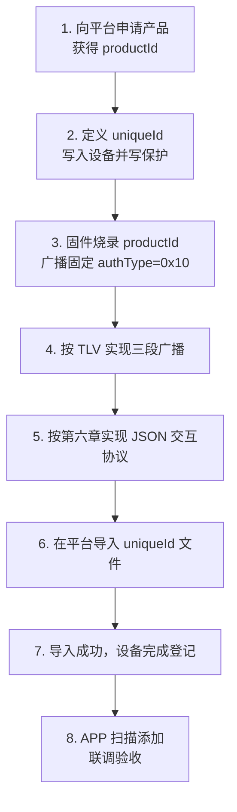

# 三方 ID 蓝牙设备标准接入指南

> 面向对象：设备厂商 / 方案商（固件与硬件侧）
> 适用范围：无需预置授权信息、仅通过蓝牙与 APP 直连的设备

---

## 一、方案概述

设备需在蓝牙广播中携带三个字段：

```
authType = 0x10  +  uniqueId  +  productId
```

APP 扫描到设备后，按这三个字段识别设备并完成授权。厂商侧：**申请 productId、定义并写入 uniqueId、按格式广播**；添加完成后，APP 与设备之间通过**统一的 JSON 交互协议**通信（见第六章）。

---

## 二、接入前置条件

| 条件 | 说明 |
|---|---|
| 已获得 productId | 向平台申请产品，平台分配 productId |
| 已定义 uniqueId | 厂商自行定义设备唯一标识（MAC / 芯片 ID / 厂商 SN 均可） |
| 固件支持 BLE 广播 | 能按本文第五章格式发出广播字段 |
| 固件实现交互协议 | 能按第六章的 JSON 协议收发命令 |
| 已定稿物模型 | 属性 / 服务 / 事件按产品配置实现，命令集合随之确定 |
| 可导入标识文件 | 具备平台账号与设备导入权限，量产前在平台导入 uniqueId（见第七章） |

---

## 三、厂商侧工作清单

| 环节 | 厂商 / 方案商负责 | 交付物 |
|---|---|---|
| 产品对接 | 使用平台分配的 productId，不自行编造 | productId 烧录进固件 |
| 设备标识 | 生成 uniqueId、写入设备并写保护 | uniqueId 规则说明 + 写入方式 |
| 广播 | 按第五章 TLV 格式实现三段广播 | 广播自测报告 |
| 交互协议 | 按第六章实现 JSON 收发、错误码与交互约束 | 协议实现说明 + 联调抓包 |
| 标识导入 | 在平台「外部授权码」页导入 uniqueId 文件 | 导入成功记录 |
| 联调 | 配合完成 APP 扫描、添加、控制的联调验收 | 联调记录 + 接口人 |

---

## 四、接入流程



**关键顺序**：设备量产前必须完成第 6 步并确认导入成功，否则设备在 APP 中被添加时会提示"设备未注册"。

---

## 五、广播与标识要求

### 5.1 广播包格式

每个数据段采用 TLV 结构：

```text
len（1 字节） | type（1 字节） | value（len - 1 字节）
```

广播包中**必须同时包含**以下三段：

| type | 字段 | 要求 |
|---|---|---|
| `0xF0` | `authType` | 固定 1 字节，值必须为 `0x10` |
| `0x16` | `uniqueId` | 长度可变，字节数必须与 `len - 1` 一致 |
| `0xFF` | 平台标识 + `productId` | 前 2 字节固定为 `48 4D`（ASCII `HM`），其余为 productId |

**完整示例：**

```text
02 F0 10
0F 16 41 42 43 44 45 46 47 48 49 4A 4B 4C 4D 4E
0A FF 48 4D 50 52 4F 44 30 30 31
```

拆解：

| 段 | 含义 |
|---|---|
| `02 F0 10` | authType = 0x10 |
| `0F 16 ...` | uniqueId = ASCII `ABCDEFGHIJKLMN`，14 字节 |
| `0A FF 48 4D ...` | HM + productId `PROD001` |

**必须满足：**

- `authType` 固定为 `0x10`，缺失或值不符时 APP 不会按本方案识别该设备；
- `uniqueId` 的 `len` 按实际字节数计算，不能写死；
- `0xFF` 的 value 必须以 `HM` 开头，其后直接跟 productId，不得增加任何前缀；
- 广播包总长度必须符合 BLE 广播 / 扫描响应的长度限制。

> 字节级细节见《蓝牙广播包格式说明》。

### 5.2 uniqueId

| 项目 | 要求 |
|---|---|
| 格式 | 不限制，厂商自行定义 |
| 来源 | MAC 地址 / 芯片 ID / 厂商 SN 均可 |
| 唯一性 | 企业范围内唯一，一台设备一个 uniqueId |
| 写入 | 写入设备并做写保护，不可篡改 |
| 一致性 | 必须与平台导入的文件、广播中的值完全一致（含大小写与字节） |

### 5.3 productId

| 项目 | 要求 |
|---|---|
| 来源 | 平台分配，不可自行编造 |
| 烧录 | 必须烧录进固件，并随广播发出 |
| 注意 | productId 不是产品型号、SKU 或厂商内部编码 |

### 5.4 蓝牙名称（建议）

```text
{品类英文名}_{uniqueId 末 4 位}
```

示例：`Aroma_4D4E`

### 5.5 物模型与连接

- 属性 / 服务 / 事件以产品下发的物模型为准，厂商按配置实现，不自行定义；
- 传输通道为 BLE GATT，报文规则见第六章；
- 必须实现断连自动重连。

---

## 六、蓝牙交互协议（通用）

本章定义 APP 与设备的**统一通信方式**：通道、帧格式、响应规则、交互约束与错误码。**具体有哪些属性、哪些命令，由产品物模型决定**，各品类不同；第六章末尾用香薰机举例说明，仅用于理解格式。

### 6.1 通道与参数

| 项 | 要求 |
|---|---|
| 写入通道 | 特征值 `FFE5`（write without response） |
| 通知通道 | 特征值 `FFE6` |
| MTU | 247（不低于此值；单帧上限 = MTU − 3） |
| 单帧上限 | **244 字节**（含帧尾） |
| 字符编码 | UTF-8 |

> 一帧超过 244 字节时，必须拆分为多条命令（见 6.4）。

### 6.2 帧格式

每条消息是一行 JSON 文本，**必须以 `\n`（0x0A）结尾**；缺少帧尾设备不响应。

```text
请求：{"cmd":"<命令名>","req_id":N,"data":{…}}
回复：{"cmd":"<命令名>","req_id":N,"code":0,"data":{…}}
```

| 字段 | 说明 |
|---|---|
| `cmd` | 命令名，小写下划线风格，如 `get_config`、`set_spray_mode` |
| `req_id` | 由 APP 分配，会话内自 1 递增；设备回复必须回带相同的值 |
| `code` | 结果码，`0` 表示成功，其余见 6.6 |
| `data` | 业务数据；`code != 0` 时不带该字段 |

**命名约定**：`cmd` 用 snake_case；`data` 内的属性名统一首字母大写（PascalCase），与物模型字段名保持一致。

### 6.3 响应规则

1. **必须回带**请求的 `cmd` 与 `req_id`；
2. **必须逐字段回显**请求 `data` 中的每个字段，键名与值完全一致——缺字段或值不同，都会被判为"回复与请求不一致"；
3. **允许附加只读字段**（例如设备计算出来的当前参数值）；
4. 只读字段不得出现在任何请求的 `data` 中。

### 6.4 命令命名与分组

| 类型 | 命名 | 说明 |
|---|---|---|
| 读 | `get_<分组>` | `data` 为空对象 `{}`，回复携带该分组的全部属性 |
| 写 | `set_<属性>` | `data` 携带要修改的字段，回复回显同样字段 |
| 复位 | `reset_config` | 无参数，把配置恢复默认值，不重启链路 |

**分组原则**：按功能分组，保证**单条回复不超过 244 字节**。属性较多的产品应拆成多条读命令，不要硬塞一帧。

> 举例：某产品 12 个属性拼一帧是 318 字节，超出上限，因此拆成 `get_config`（基础组）与 `get_spray_config`（喷雾组）两条读命令。

### 6.5 交互约束

| 项 | 约定 |
|---|---|
| 并发 | 同一时刻只允许**一条在途命令**，收到回复后再发下一条 |
| 超时 | 设备须在 **5 秒**内回复，超时由 APP 判定为无响应 |
| 帧尾 | 每条消息必须以 `\n` 结尾 |
| 对象类型 | `object` 类型属性按**整段替换**语义处理，不接受字段级增量修改 |
| 状态上报 | 是否支持主动上报由产品定义；不支持时，状态仅在连接期间通过读命令获取 |
| 休眠 | 若产品有休眠态，休眠不得断开蓝牙，命令照常收发 |

### 6.6 错误码

| `code` | 含义 |
|---|---|
| `0` | 成功 |
| `1` | 帧格式错误（JSON 解析失败，或缺 `cmd` / `req_id` / `data`） |
| `2` | 命令不支持 |
| `3` | 参数不合法（取值越界、类型不符、字段组合与模式不匹配） |
| `4` | 参数缺失（该模式必需字段未携带） |
| 其他 | 保留 |

- `code != 0` 时**不得携带 `data`**；
- 错误码含义一经定稿，不得在后续固件中改变语义，避免 APP 误判。

### 6.7 能力项举例（香薰机，仅示例）

以下仅用于说明"能力项如何描述"，**不代表所有产品都有这些字段**；实际能力项以产品物模型为准。

| 能力项 | 类型 | 取值 | 读写 | 说明 |
|---|---|---|---|---|
| `WakeSwitch` | int | `0` / `1` | 读写 | 休眠 / 唤醒 |
| `SprayMode` | int | `0` / `1` | 读写 | 标准模式 / 自定义模式 |
| `GearLevel` | int | `1` / `2` / `3` | 读写 | 档位，仅标准模式下有效 |
| `TimerSchedule` | object | `{"StartTime":0~86399,"EndTime":1~172799}` | 读写 | 定时时段，单位为秒 |

对象类型与跨天时段的写法（仅示例）：

- `TimerSchedule` 是**对象**，不是 JSON 字符串；
- 秒数从当天 0 点起算（`28800` = 08:00）；
- 跨天时 `EndTime` 从 `86400` 往上加：`22:00 → 次日 06:00` 写作 `{"StartTime":79200,"EndTime":108000}`；
- 全天不限制写作 `{"StartTime":0,"EndTime":86399}`。

### 6.8 报文示例

```text
→ {"cmd":"get_config","req_id":1,"data":{}}
← {"cmd":"get_config","req_id":1,"code":0,"data":{"WakeSwitch":1,"SprayMode":0}}

→ {"cmd":"set_spray_mode","req_id":6,"data":{"SprayMode":0,"GearLevel":2}}
← {"cmd":"set_spray_mode","req_id":6,"code":0,"data":{"SprayMode":0,"GearLevel":2}}

→ {"cmd":"set_timer_schedule","req_id":8,"data":{"TimerSchedule":{"StartTime":28800,"EndTime":72000}}}
← {"cmd":"set_timer_schedule","req_id":8,"code":0,"data":{"TimerSchedule":{"StartTime":28800,"EndTime":72000}}}

→ {"cmd":"set_spray_mode","req_id":9,"data":{"SprayMode":0,"GearLevel":9}}
← {"cmd":"set_spray_mode","req_id":9,"code":3}
```

> 实际发送时每帧末尾带 `\n`（上例为排版省略）；每帧字节数按 UTF-8 实测算，确保 ≤ 244。

---

## 七、uniqueId 导入（平台操作）

uniqueId 不走线下清单提交，直接在平台页面批量导入文件，导入成功即完成设备登记。

### 7.1 操作路径

**平台 → 设备 → 外部授权码 → 导入**

导入弹窗内二项均为必填：

| 字段 | 说明 |
|---|---|
| 生产产品 | 这批设备对应的产品，可按产品名称或产品 ID 搜索；产品决定该批设备的物模型与 productId |
| uniqueId 文件 | 上传 xlsx / csv 文件 |

### 7.2 文件要求

| 项目 | 要求 |
|---|---|
| 格式 | xlsx / csv |
| 首列列名 | 固定为 `uniqueId` |
| 编码 | UTF-8 |
| 单次数量 | 最多 5000 条，超出请分批导入 |
| 内容 | 一行一个 uniqueId，不要空行、合并单元格 |
| 模板 | 弹窗内可直接下载导入模板 |

示例：

```csv
uniqueId
ABCDEFGHIJKLMN
CCDDEEFFAABB
```

### 7.3 校验与结果

| 项 | 说明 |
|---|---|
| 唯一性范围 | 本企业内唯一：文件内重复、本企业历史已存在，均视为重复 |
| 大小写敏感 | 与广播值逐字节比对，大小写不同视为两台不同设备 |
| 导入结果 | 成功后列表展示该批 uniqueId，含生成时间与所属企业 |
| 重复或格式错误 | 对应行不会被登记，按页面提示修正后重新导入 |

> 导入完成后，建议用页面「查询」按 uniqueId 抽查几条，确认与设备广播值一致。

### 7.4 导入时机

- 必须在设备量产前完成导入，否则设备在 APP 中添加时会提示"设备未注册"；
- 同一批设备重复导入不会影响已登记的设备；

---

## 八、设备添加与通信

### 8.1 添加流程（APP 侧表现）

1. APP 扫描附近蓝牙设备；
2. 读取广播中的 `authType`；
3. `authType == 0x10` → 识别为三方 ID 设备，读取 `uniqueId + productId`；
4. 校验通过 → 设备添加成功并出现在设备列表。

厂商需要保证：广播正确、uniqueId 已登记。

### 8.2 添加后的通信

- APP 用设备列表中的 `uniqueId` 与附近设备广播比对，匹配后建立蓝牙连接；
- 因此设备在添加后**必须持续广播正确的 `uniqueId`**；
- 连接建立后，按第六章协议完成属性读取、命令下发与结果回传。

### 8.3 设备侧规则

| 规则 | 说明 |
|---|---|
| 一台设备一个 uniqueId | 不可复用、不可批量相同 |
| 同一时刻只能被一个账号绑定 | 被占用时应能被其他账号识别为"已被绑定" |
| 解绑后可重新添加 | 解绑后设备仍需正常广播，供再次添加 |

---

## 九、常见问题

| 现象 | 优先排查 |
|---|---|
| 添加提示「设备未注册」 | uniqueId 是否已在平台导入成功、广播值与导入文件是否完全一致 |
| 添加提示「已被其他账号绑定」 | 设备已被绑定，需原账号解绑后重试 |
