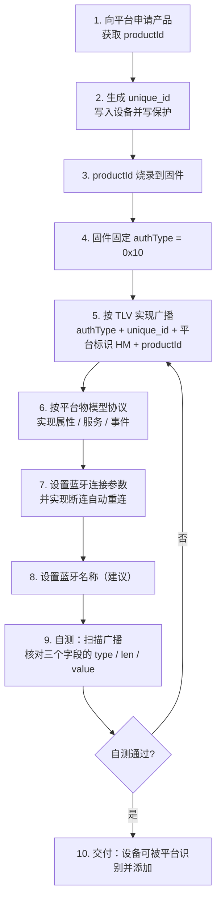

# 三方自有ID授权_接入规范（蓝牙设备）

| 项目 | 内容 |
|------|------|
| 文档版本 | v3.2 |
| 适用范围 | 不烧录 License 的蓝牙设备（如香薰机等） |
| 对接对象 | 设备厂商 |
| 文档性质 | 平台标准对外文档 |

---

## 一、方案概述

传统流程要在生产时把 License 烧录进设备固件，设备侧持有 License，添加时直接读取。**三方自有ID设备不烧录 License**，改为：设备广播携带 `authType` + `unique_id` + `productId`，APP 扫描后上报平台，由平台反查 License 完成添加与绑定。

**核心：设备固件里不需要携带任何授权信息，授权关系完全由平台侧维护。**

### 与传统设备的差异

| 维度 | 传统设备（常规流程） | 三方自有ID设备（本规范） |
|------|------|------|
| License 烧录 | ✅ 生产时烧录 | ❌ 不需要 |
| 广播标志 | 无 / authType ≠ `0x10` | authType = `0x10` |
| 数据载体 | License | `unique_id` + `productId` |
| APP 读取 | 连接后读 License | 扫描广播直接读 |
| 添加流程 | 用 License 添加 | 用 `unique_id` + `productId` 反查添加 |

---

## 二、客户实施步骤



| # | 客户要做的事 | 必要性 | 参考 |
|---|------|------|------|
| 1 | 向平台申请产品，获取 `productId` | ✅ 必须 | — |
| 2 | 生成 `unique_id`，写入设备并做写保护（不可篡改） | ✅ 必须 | 3.5 |
| 3 | 将 `productId` 烧录到固件 | ✅ 必须 | 3.6 |
| 4 | 固件固定 `authType = 0x10` | ✅ 必须 | 3.4 |
| 5 | 按 TLV 实现广播三个字段（`authType` + `unique_id` + 平台标识 `HM` + `productId`） | ✅ 必须 | 3.2 / 3.3 |
| 6 | 保障广播包符合 BLE 协议长度限制 | ✅ 必须 | 3.7 |
| 7 | 按平台物模型协议实现属性 / 服务 / 事件 | ✅ 必须 | 第六章 |
| 8 | 设置蓝牙连接参数（连接间隔、MTU），实现断连自动重连 | ✅ 必须 | — |
| 9 | 设置蓝牙名称 | ⚠️ 建议 | 第五章 |
| 10 | 自测：用蓝牙调试工具扫描广播，核对三个字段的 type / len / value | ✅ 必须 | 3.3 |

---

## 三、广播包格式

### 3.1 总体结构

广播包由多个并列的数据段组成，每段采用以下字节排列：

```text
len（1 字节） | type（1 字节） | value（长度由 len 决定）
```

| 字段 | 说明 |
| --- | --- |
| `len` | 后续 type 和 value 的总字节数，不包含 len 自身 |
| `type` | 消息类型，标识该段数据的含义 |
| `value` | 具体的数据内容，长度为 len - 1 字节 |

```text
len = 1（type）+ value 字节数
单段总长度 = 1（len）+ len
```

一个广播包可以包含多个数据段，APP 依次解析。

### 3.2 必须包含的字段

| type | 字段名 | 说明 |
| --- | --- | --- |
| `0xF0` | `authType` | 授权类型，固定 1 字节；`0x10` 表示三方自有ID流程 |
| `0x16` | `unique_id` | 设备唯一标识，长度可变，字节数须与 `len` 对应 |
| `0xFF` | 平台标识 + `productId` | 前 2 字节固定为 `HM`（`48 4D`），其余字节为 `productId` |

### 3.3 完整广播数据示例

以下示例包含三个并列的数据段：

```text
02 F0 10
0F 16 41 42 43 44 45 46 47 48 49 4A 4B 4C 4D 4E
0A FF 48 4D 50 52 4F 44 30 30 31
```

**按数据段拆解：**

| 段 | len | type | value | 含义 |
| --- | --- | --- | --- | --- |
| 1 | `0x02` | `0xF0` | `10` | authType = `0x10`，表示三方自有ID流程 |
| 2 | `0x0F` | `0x16` | `41 42 43 44 45 46 47 48 49 4A 4B 4C 4D 4E` | unique_id；示例为 ASCII `ABCDEFGHIJKLMN`，共 14 字节，仅为示例长度 |
| 3 | `0x0A` | `0xFF` | `48 4D 50 52 4F 44 30 30 31` | `HM` + productId；示例 productId 为 ASCII `PROD001`，7 字节 |

**长度计算：**

| 字段 | value 字节数 | len 计算 |
| --- | --- | --- |
| authType | 1 | `1 + 1 = 2 = 0x02` |
| unique_id（示例） | 14 | `1 + 14 = 15 = 0x0F` |
| HM + productId | `2 + 7 = 9` | `1 + 9 = 10 = 0x0A` |

> `unique_id` 的实际长度可以变化，`len` 按实际 `unique_id` 字节数计算。

### 3.4 authType（type = 0xF0）

| 项目 | 说明 |
| --- | --- |
| 作用 | 告诉 APP 设备采用哪种接入流程 |
| 值 | `0x10` 表示三方自有ID流程，为当前唯一支持值 |
| value 长度 | 固定 1 字节 |
| len | 固定为 `0x02` |
| 生成方式 | 设备固件固定写入，无需额外烧录 |
| APP 使用方式 | 读取到 type 为 `0xF0` 且 value 为 `0x10` 时，进入三方自有ID流程 |

示例：

```text
02 F0 10
```

### 3.5 unique_id（type = 0x16）

| 项目 | 说明 |
| --- | --- |
| 作用 | 设备唯一标识，用于反查 License |
| 格式 | 长度可变的字节数组 |
| value 内容 | 直接存放 unique_id，不包含额外前缀 |
| 长度要求 | 实际字节数须等于 `len - 1` |
| len | `1 + unique_id 字节数` |
| 生成方式 | 设备固件读取或生成，写入广播，并按实际字节数设置 len |
| APP 使用方式 | 按 `len - 1` 读取 unique_id，上报平台，平台据此反查 License |

示例：

```text
0F 16 41 42 43 44 45 46 47 48 49 4A 4B 4C 4D 4E
```

> 本示例 unique_id 为 ASCII `ABCDEFGHIJKLMN`，共 14 字节，因此 len 为 `0x0F`。**14 字节仅为示例长度，不是固定要求。**

### 3.6 平台标识 + productId（type = 0xFF）

| 项目 | 说明 |
| --- | --- |
| 作用 | 标明设备属于平台，并提供产品级标识 |
| 格式 | 前 2 字节固定为 `48 4D`（ASCII `HM`），其余字节全部为 productId |
| value 长度 | `2 + productId 字节数` |
| len | `1 + 2 + productId 字节数` |
| 生成方式 | productId 由平台创建产品时生成，厂商烧录到固件 |
| APP 使用方式 | 检查 value 是否以 `HM` 开头；提取其余字节作为 productId，与 unique_id 一起上报 |

示例：

```text
0A FF 48 4D 50 52 4F 44 30 30 31
```

value 拆解：

```text
48 4D                → HM，2 字节
50 52 4F 44 30 30 31 → productId：PROD001，7 字节
```

> value 仅包含 `HM` 和 productId，不增加其他前缀。

---

## 四、字段规范

| 字段 | 值 / 来源 | 长度 | 是否烧录 |
|------|------|------|------|
| `authType` | 固定 `0x10` | 1 字节 | ❌ 固件固定，无需单独烧录 |
| `unique_id` | 厂商自选：MAC 地址 / 芯片ID / 厂商 SN | **不固定**，按实际字节数 | ❌ 芯片ID / MAC 天然存在 |
| `productId` | **平台创建产品时生成**（登录后台可查） | **不固定** | ✅ 需要烧录到固件 |

**唯一性要求**

- `unique_id`：由厂商保障在**企业范围内全局唯一**
- `productId`：由平台保障**全局唯一**

---

## 五、蓝牙名称（建议）

```text
{品类名}-{unique_id 末 4 位}
```

| 设备类型 | 蓝牙名称示例 |
|------|------|
| 香薰机 | Aroma-4D4E |
| 喂食器 | Feeder-4D4E |
| 加湿器 | Humidifier-4D4E |

要求：前缀为品类英文名（首字母大写），分隔符 `-`，总长度 ≤ 20 字符，仅限字母、数字、连字符。


---

## 六、物模型协议对接

物模型协议由平台提供，**设备端不需要自己定义**——平台在创建产品时配置，设备端按配置实现对应能力即可。

| 项目 | 说明 |
|------|------|
| 属性（Property） | 设备可读写的状态 |
| 服务（Service） | 设备可执行的动作 |
| 事件（Event） | 设备主动上报的信息 |
| 传输通道 | BLE GATT |
| 数据格式 | 按平台物模型协议 |
| 加密 | 按平台要求 |

---

## 七、生产导入规范

### 7.1 导入格式

| 项目 | 要求 |
|------|------|
| 文件格式 | CSV / Excel |
| 字段 | `unique_id`（必填） |
| 编码 | UTF-8 |

```csv
unique_id
ABCDEFGHIJKLMN
CCDDEEFFAABB
```

### 7.2 导入流程

```text
1. 企业登录平台，获取 productId
2. 导入 unique_id 列表
3. 平台校验 unique_id
4. 校验通过 → 生成 license，建立 unique_id ↔ license 绑定关系，并归属该产品的 productId
5. 校验不通过 / unique_id 重复 → 报错
```

---
