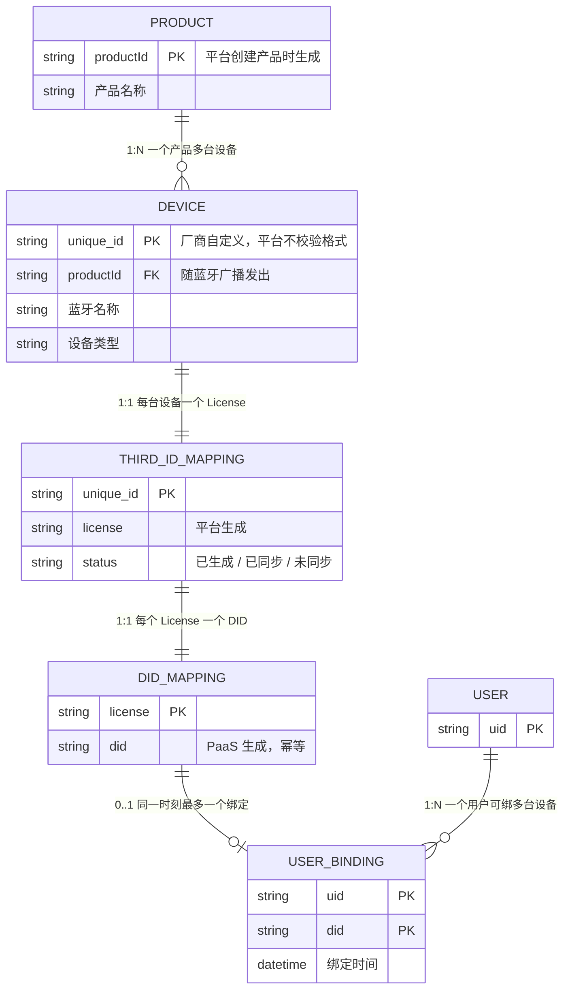
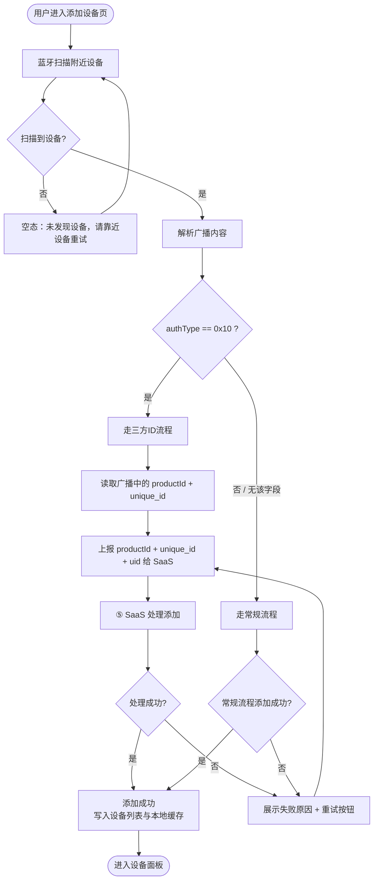
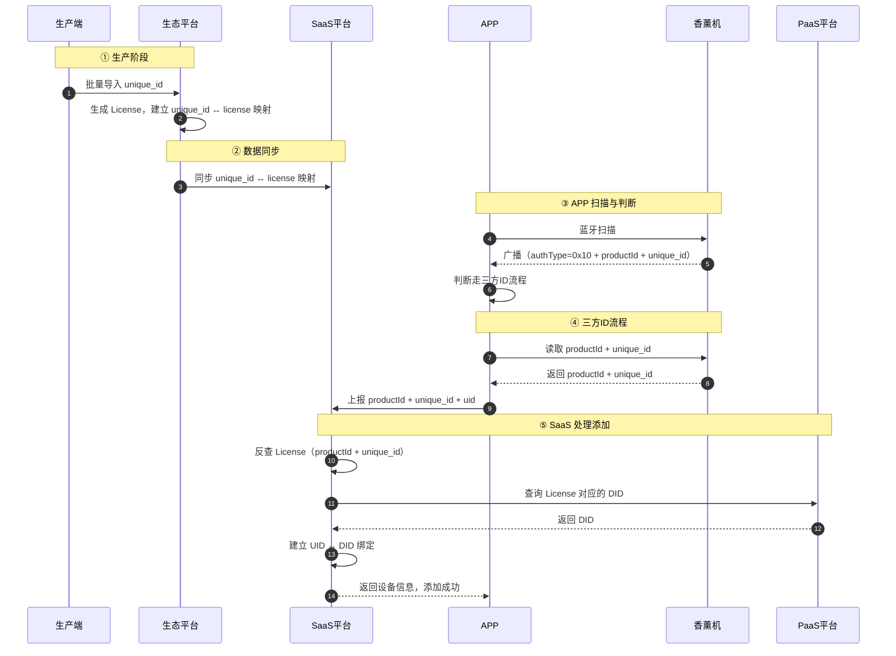
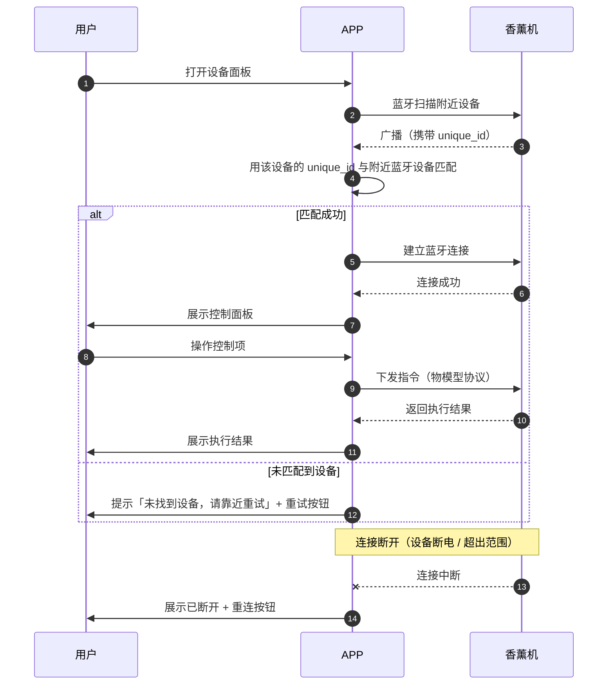
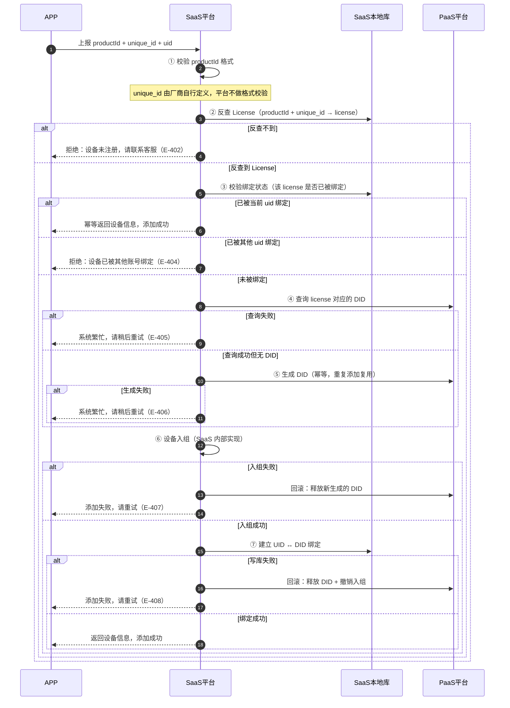
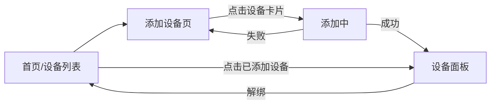

# 三方ID设备接入 — 完整业务 PRD

## 修订记录

| 修订时间 | 修订内容 | 修订人 |
|------|------|------|
| 2026-10-14 | 初版创建，基于业务方梳理的完整流程、全局时序图与需求分析文档生成 |  |

> **说明**：本文档为纯业务视角的完整 PRD，不包含接口名称、路由路径、组件名等技术实现细节。文中提到的「生态平台」「SaaS 平台」「PaaS 平台」指业务协作中的三方系统角色。

---

## 一、业务背景

### 1.1 业务场景描述

平台需要接入**香薰机等不烧录 License 的蓝牙设备**。

传统接入流程要求生产时把 License 烧录进设备固件，设备侧持有 License，添加时直接读取。香薰机这类蓝牙设备不烧录 License，因此无法走传统流程。

新流程：生产端把设备唯一标识 `unique_id` 批量导入生态平台，平台为每个 `unique_id` 生成 License 并建立映射，同时把设备归属到对应产品的 `productId`（平台创建产品时生成，产品唯一标识），再同步给 SaaS。用户添加设备时，APP 通过蓝牙广播拿到 `productId + unique_id` 并上报 SaaS，由 SaaS 以这两者反查 License、查询或生成 DID、完成入组与绑定，最终返回设备信息。

### 1.2 要解决的用户痛点

| 痛点 | 说明 |
|------|------|
| 生产环节复杂 | 传统流程需要增加烧录工序，提高生产成本与不良率 |
| 设备无法接入 | 不烧录 License 的设备走不通传统添加流程，等于无法售卖 |
| APP 无法匹配 | 添加完成后设备列表只有 License 和 DID，缺少 `unique_id`，APP 无法用蓝牙广播匹配到对应设备，导致添加后无法通信 |

### 1.3 产品目标

| 目标 | 说明 |
|------|------|
| 支持不烧录 License 的蓝牙设备接入 | 通过 `unique_id` 反查 License 完成授权 |
| 兼容存量老设备 | 老设备仍走常规流程，行为完全不变 |
| 支持添加后的数据通信 | APP 侧持有 `unique_id`，可用蓝牙广播匹配设备并通信 |

---

## 二、名词解释

| 术语 | 说明 |
|------|------|
| 三方ID流程 | 不烧录 License，用 `unique_id` 反查 License 的设备接入流程 |
| 常规流程 | 生产时烧录 License 的传统接入流程（存量老设备） |
| unique_id | 设备唯一标识，由厂商自行定义（可用 MAC 地址、芯片ID 或厂商SN） |
| productId | 产品ID，**平台创建产品时生成**（字母 + 数字，长度不固定），全局唯一；生产时烧录进设备固件，随蓝牙广播发出 |
| license | 授权码，平台生成，绑定设备的使用权限 |
| did | 设备ID，PaaS 生成，设备在平台的唯一标识 |
| uid | 用户ID |
| authType | 授权类型标志位；`0x10` = 三方自有ID流程；**无此字段或值非 `0x10` = 常规流程** |
| 生态平台 | 负责生产导入、生成 License、维护 `unique_id ↔ license` 映射的系统 |
| SaaS 平台 | 负责设备添加处理（反查、DID 查询/生成、入组、绑定）与对外提供能力的系统 |
| PaaS 平台 | 负责 DID 生成与查询的底层系统 |
| 生产端 | 设备生产环节使用的导入系统，向生态平台提交 `unique_id` 批次 |
| 入组 | 设备加入用户所属的组织/分组，由 SaaS 内部实现 |
| 独占绑定 | 一台设备在同一时刻只能被一个 uid 绑定 |

---

## 三、业务实体说明

### 3.1 核心实体

| 实体 | 说明 | 关键属性 |
|------|------|------|
| 设备 | 香薰机等蓝牙设备 | `unique_id`、`productId`、蓝牙名称、设备类型 |
| License | 授权码 | `license`、状态（未绑定 / 已绑定 / 已禁用）、批次号 |
| 用户 | 平台用户 | `uid` |
| 产品 | 设备所属产品（厂商 / 品牌方） | `productId`、产品名称 |
| DID | 设备在平台的唯一标识 | `did`、创建时间 |
| 三方ID映射 | `unique_id ↔ license` 映射 | `unique_id`、`license`、状态 |
| DID映射 | `license ↔ did` 映射 | `license`、`did` |
| 用户绑定 | `uid ↔ did` 绑定关系 | `uid`、`did`、绑定时间 |

### 3.2 实体关系



### 3.3 关系约束

| 约束 | 说明 |
|------|------|
| `unique_id` : `license` = 1:1 | 一个设备只对应一个 License，不可重复生成 |
| `license` : `did` = 1:1 | 一个 License 只对应一个 DID；**重复添加必须复用同一 DID（幂等）** |
| `uid` : `did` = 1:N | 一个用户可以绑定多台设备 |
| `productId` : `unique_id` = 1:N | 一个产品可有多台设备；`(productId, unique_id)` 组合全局唯一 |

---

## 四、核心业务流程

### 4.1 流程图：设备添加流程分流

设备添加时先解析蓝牙广播，按 `authType` 分流。**老设备（无 authType 或值非 `0x10`）必须走常规流程，本次改动不得影响该路径的任何环节。**



### 4.2 全局时序图（① 生产 → ⑤ 添加完成）



**阶段对照表：**

| 阶段 | 参与方 | 核心动作 | 对应业务规则 |
|------|------|------|------|
| ① 生产阶段 | 生产端 → 生态平台 | 批量导入 unique_id；生成 License 并建立映射 | — |
| ② 数据同步 | 生态平台 → SaaS 平台 | 同步 unique_id ↔ license 映射 | — |
| ③ APP 扫描与判断 | APP ↔ 香薰机 | 蓝牙扫描；设备广播 authType=0x10 + productId + unique_id；APP 分流判断 | R-001 / R-002 |
| ④ 三方ID流程 | APP ↔ 香薰机 → SaaS | APP 读取 productId + unique_id；上报 productId + unique_id + uid | R-003 |
| ⑤ SaaS 处理添加 | SaaS → PaaS | 以 productId + unique_id 反查 License、查询/生成 DID、入组、建立 UID↔DID 绑定、返回设备信息 | R-004 ~ R-007 |

### 4.3 局部队列时序图：添加后数据通信



对应业务规则：R-008（用 `unique_id` 匹配附近蓝牙设备）。

### 4.4 局部时序图：SaaS 添加处理内部链路（含失败与回滚）--研发需按当前实际流程评估



---

## 五、业务规则

### 5.1 规则清单

| 编号 | 规则 | 触发条件 | 执行结果 |
|------|------|------|------|
| R-001 | 广播授权类型判断 | 广播 `authType == 0x10` | 走三方自有ID流程 |
| R-002 | 默认流程 | 广播无 `authType` 或值非 `0x10` | 走常规流程（行为与现状完全一致） |
| R-003 | productId 格式校验 | 收到广播字段 | `productId` 必须为平台创建产品时生成的 productId（字母 + 数字，长度不固定）；不符合则拒绝。**`unique_id` 由厂商自行定义，平台不做格式校验** |
| R-004 | License 反查 | 收到 `productId` + `unique_id` | SaaS 用 `(productId, unique_id)` 组合查本地映射反查 License；**查不到直接拒绝**，不做实时回源 |
| R-005 | DID 查询 / 生成 | 拿到 License | 调 PaaS 查询；无则生成；**1:1 幂等，重复添加复用同一 DID** |
| R-006 | 设备入组 | DID 已拿到 | SaaS 自己实现入组 |
| R-007 | UID 绑定（独占） | 反查到 license 后即校验绑定状态；入组成功后执行绑定 | 已被当前 uid 绑定 → 幂等返回设备信息；已被其他 uid 绑定 → 拒绝；未被绑定 → 入组成功后建立 UID ↔ DID 绑定 |
| R-008 | 数据通信匹配 | 蓝牙扫描到附近设备 | 用设备列表中的 `unique_id` 与附近蓝牙设备的广播比对，匹配上即与目标设备通信 |
| R-010 | 解绑清理 | 用户解绑设备 | 解除 UID↔DID 绑定，清理 APP 本地缓存；**License 与 DID 记录保留** |

### 5.2 规则依赖与优先级

| 依赖关系 | 说明 |
|------|------|
| R-003 先于 R-004 | 格式校验不通过不进入反查 |
| R-004 先于 R-005 | 反查不到 License 无法查询 DID |
| R-005 先于 R-006 | DID 是入组的前置条件 |
| R-006 先于 R-007 | 入组成功才建立绑定 |
| R-001 / R-002 互斥 | 一次添加只走其中一条路径 |

### 5.3 关键约束（数值必须明确）

| 约束项 | 值 |
|------|------|
| `unique_id` 格式 | **不限制**，由厂商自行定义；平台不做长度与字符集校验 |
| `productId` 长度 | **不固定** |
| `productId` 字符集 | 字母 + 数字 |
| `productId` : `unique_id` | 1 : N |
| `unique_id` : `license` | 1 : 1 |
| `license` : `did` | 1 : 1 |
| `did` : `uid` | 1 : 1（独占） |
| `uid` : `did` | 1 : N |
| `authType` 三方自有ID取值 | `0x10`（其余值一律视为常规流程） |
| 单批导入行数上限 | 待确认（见待确认问题 Q-4） |
| 各环节超时阈值 | 待确认（见待确认问题 Q-2） |

---

## 六、功能架构

```
蓝牙设备接入（三方ID流程）
├── 生产导入
│   ├── unique_id 批量导入
│   ├── License 自动生成与 1:1 映射
│   └── 导入结果反馈（成功/失败/明细）
├── 数据同步
│   ├── 生态 → SaaS 增量同步
│   ├── 定时全量校验
│   └── 同步状态与手动重试
├── APP 添加流程
│   ├── 蓝牙扫描与广播解析
│   ├── 流程分流判断（三方ID / 常规）
│   ├── 三方ID流程添加
│   └── 添加状态展示（扫描中/添加中/成功/失败）
├── SaaS 添加处理
│   ├── License 反查
│   ├── DID 查询 / 生成（幂等）
│   ├── 设备入组
│   ├── UID ↔ DID 绑定（独占）
│   └── 失败回滚
├── 数据通信
│   ├── 设备列表（携带 unique_id）
│   ├── APP 本地缓存
│   ├── 蓝牙匹配（unique_id 比对）
│   └── 蓝牙连接与指令通信
└── 设备解绑
    ├── 解除 UID ↔ DID 绑定
    └── 清理 APP 本地缓存
```

---

## 七、详细功能描述

### 7.1 生产导入

#### 功能应用场景

设备生产完成后，生产端操作人员将 `unique_id` 列表导入生态平台，平台生成 License 并建立映射，作为后续反查授权的依据。

**解决了什么问题**：让不烧录 License 的设备具备可被平台识别的授权来源。

#### 功能详述

| 区域 | 元素 | 行为 |
|------|------|------|
| 导入区 | 上传文件 | 支持 CSV / Excel |
| 导入区 | 批次号 | 必填，用于批次管理 |
| 结果区 | 成功数量 | 展示导入成功数 |
| 结果区 | 失败数量 | 展示导入失败数 |
| 结果区 | 失败原因 | 展示失败明细（行号 + 原因） |

#### 状态说明

| 状态 | 触发条件 | 展示内容 |
|------|------|------|
| 正常态 | 导入成功 | 成功数量 + 失败数量 + 明细 |
| 空态 | 无导入记录 | 提示「暂无导入记录」 |
| 边界态 | 文件格式错误 | 提示「文件格式不支持」 |
| 异常态 | 导入中断 | 提示「网络异常，请检查网络」+ 重试按钮 |

#### 交互说明

| 交互 | 触发条件 | 效果 |
|------|------|------|
| 上传文件 | 点击上传 | 打开文件选择器 |
| 提交导入 | 点击导入 | 校验文件格式、列名与批次号，写入数据 |
| 查看失败明细 | 点击失败数量 | 展开失败列表，展示行号与失败原因 |

#### 业务约束

- `unique_id` 由厂商自行定义，平台不做格式校验；为空的行计入失败明细，不影响其他行导入
- 同一文件内 `unique_id` 重复时，保留第一条，后续重复行计入失败明细
- 已导入过的 `unique_id` 再次导入时识别为重复，**不重复生成 License**，原映射保持不变
- 批次号必填；License 生成失败时该批次整体回滚，不产生半成品数据

### 7.2 数据同步

#### 功能应用场景

生态平台生成映射后，需要同步给 SaaS，供用户添加设备时反查使用。

**解决了什么问题**：让 SaaS 具备反查 License 的能力，是三方ID流程可用的前提。

#### 功能详述

| 区域 | 元素 | 行为 |
|------|------|------|
| 同步配置 | 同步方式 | 增量同步 + 定时全量校验 |
| 同步配置 | 同步频率 | 实时推送 + 每日全量 |
| 同步结果 | 同步状态 | 成功 / 失败 |
| 同步结果 | 同步时间 | 最近同步时间 |

#### 状态说明

| 状态 | 触发条件 | 展示内容 |
|------|------|------|
| 正常态 | 同步成功 | 显示成功状态 + 时间 |
| 异常态 | 同步失败 | 显示失败状态 + 重试按钮 |
| 空态 | 无同步记录 | 提示「暂无同步记录」 |
| 冲突态 | 同一 unique_id 在 SaaS 侧存在不同 license | 以生态平台为准覆盖，并标记异常供人工核对 |

#### 交互说明

| 交互 | 触发条件 | 效果 |
|------|------|------|
| 手动同步 | 点击同步 | 触发一次全量同步 |
| 重试 | 同步失败 | 重新触发同步 |

#### 业务约束

- 达到每日定时时点自动执行全量校验，比对两端差异并补齐 SaaS 侧缺失项
- 全量同步频率固定为每日一次，不可手动提高频率
- 全量同步耗时过长时按分片续传，已同步部分不中断

### 7.3 APP 添加流程（三方ID流程）

#### 功能应用场景

用户通过 APP 添加香薰机等蓝牙设备。

**解决了什么问题**：让不烧录 License 的设备能够被用户扫描、识别并添加到账号下。

#### 功能详述

| 区域 | 元素 | 行为 |
|------|------|------|
| 扫描区 | 附近设备列表 | 展示扫描到的蓝牙设备 |
| 扫描区 | 设备名称 | 格式 `{品类名}-{ID后4位}`（后 4 位取 `unique_id` 末 4 位） |
| 扫描区 | 添加按钮 | 点击进入添加流程 |
| 添加中 | 加载提示 | 展示「添加中...」 |
| 结果区 | 成功提示 | 展示「添加成功」+ 设备信息 |
| 结果区 | 失败提示 | 展示失败原因 + 重试按钮 |

#### 状态说明

| 状态 | 触发条件 | 展示内容 |
|------|------|------|
| 正常态 | 扫描到设备 | 展示设备列表 |
| 空态 | 未扫描到设备 | 提示「未发现设备，请靠近设备重试」+ 重新扫描按钮 |
| 加载态 | 添加中 | 展示加载动画 |
| 成功态 | 添加成功 | 展示「添加成功」+ 设备信息（含 DID 与 unique_id） |
| 失败态 | 添加失败 | 展示失败原因 + 重试按钮 |

#### 交互说明

| 交互 | 触发条件 | 效果 |
|------|------|------|
| 扫描 | 进入页面 | 自动扫描附近设备 |
| 点击添加 | 点击设备 | 进入添加流程；按钮置灰，防止重复点击 |
| 失败重试 | 添加失败 | 重新发起添加 |
| 重新扫描 | 空态下点击 | 重新开始扫描 |

#### 流程分流

| 广播内容 | 判定 | 走向 |
|------|------|------|
| 含 `authType` 且值 == `0x10` | 三方自有ID流程 | 读取 `productId` + `unique_id` 并上报 SaaS |
| 无 `authType` 字段 | 常规流程 | 走既有添加逻辑 |
| 含 `authType` 但值 ≠ `0x10` | 常规流程 | 走既有添加逻辑 |

### 7.4 SaaS 添加处理

#### 功能应用场景

SaaS 收到 APP 上报的 `unique_id + uid` 后，完成 License 反查、DID 查询或生成、入组、绑定，并返回设备信息。

**解决了什么问题**：把「设备标识」转换为「平台的设备身份（DID）」并建立与用户的归属关系。

#### 功能详述

| 步骤 | 动作 | 说明 |
|------|------|------|
| 1 | 校验 productId | 必须为平台创建产品时生成的 productId（字母 + 数字，长度不固定）；不合规直接拒绝。`unique_id` 不校验格式 |
| 2 | 反查 License | 用 `productId` + `unique_id` 查本地映射 |
| 3 | **校验绑定状态** | **反查到 license 后立即判断**：已被当前 uid 绑定 → 幂等返回设备信息（视为添加成功）；已被其他 uid 绑定 → 拒绝（独占）；未被绑定 → 继续 |
| 4 | 查询 DID | 查 `license` 对应的 DID |
| 5 | 生成 DID | 无 DID 时生成；**幂等，重复添加复用同一 DID** |
| 6 | 设备入组 | SaaS 内部实现 |
| 7 | 建立 UID ↔ DID 绑定 | 绑定成功即完成归属 |
| 8 | 返回设备信息 | 返回给 APP（含 DID 与 unique_id） |

#### 状态说明

| 状态 | 触发条件 | 展示内容（APP 侧） |
|------|------|------|
| 正常态 | 全流程成功 | 返回设备信息，展示「添加成功」 |
| 正常态 | 已添加过（当前 uid 已绑定） | 幂等返回设备信息，展示「添加成功」 |
| 异常态 | 反查失败 | 「设备未注册，请联系客服」 |
| 异常态 | PaaS 调用失败 / 超时 | 「系统繁忙，请稍后重试」+ 重试按钮 |
| 异常态 | 入组失败 | 「添加失败，请重试」+ 重试按钮 |
| 异常态 | 设备已被他人绑定 | 「设备已被其他账号绑定」 |

#### 交互说明

| 交互 | 触发条件 | 效果 |
|------|------|------|
| 反查 License | 收到 productId + unique_id | 查本地映射 |
| 校验绑定状态 | 反查到 license | 判断是否已被绑定：当前 uid → 幂等返回；其他 uid → 拒绝；未绑定 → 继续 |
| 查询 DID | 拿到 License | 向 PaaS 查询 |
| 生成 DID | DID 不存在 | 向 PaaS 申请生成 |
| 入组 | DID 拿到 | SaaS 内部处理 |
| 绑定 | 入组成功 | 建立归属关系 |
| 回滚 | 入组/绑定环节失败 | 释放新生成的 DID、撤销入组 |

#### 失败回滚规则

| 失败环节 | 需回滚的内容 |
|------|------|
| 6 设备入组失败 | 5 新生成的 DID |
| 7 绑定写库失败 | 5 新生成的 DID、6 入组结果 |

> 绑定冲突（设备已被其他 uid 绑定）在第 3 步即被拦截，此时尚未生成 DID、也未入组，**不产生任何需要回滚的数据**。

> **幂等要求**：同一 `unique_id` 重复添加必须复用同一 DID，不得重复生成。

### 7.5 数据通信

#### 功能应用场景

设备添加完成后，用户打开设备面板，APP 需要匹配附近蓝牙设备进行数据交互。

**解决了什么问题**：让添加后的设备真正可用——能连上、能控制。

#### 功能详述

| 区域 | 元素 | 行为 |
|------|------|------|
| 设备列表 | 设备卡片 | 展示 DID + License + unique_id |
| 蓝牙扫描 | 扫描结果 | 扫描附近蓝牙设备，设备广播携带 `unique_id` |
| 匹配 | unique_id 匹配 | 用设备列表中的 `unique_id` 与附近蓝牙设备的广播比对；匹配上即锁定目标设备 |
| 连接 | 蓝牙连接 | 匹配成功后建立连接 |
| 通信 | 数据交互 | 按物模型协议通信 |

#### 状态说明

| 状态 | 触发条件 | 展示内容 |
|------|------|------|
| 正常态 | 匹配成功 | 建立连接，展示控制面板 |
| 空态 | 未匹配到设备 | 提示「未找到设备，请靠近重试」+ 重试按钮 |
| 异常态 | 连接失败 | 提示「连接失败，请重试」+ 重试按钮 |
| 异常态 | 连接断开 | 面板展示「已断开」+ 重连按钮 |

#### 交互说明

| 交互 | 触发条件 | 效果 |
|------|------|------|
| 打开面板 | 点击设备 | 触发蓝牙扫描 |
| 扫描 | 进入面板 | 自动扫描附近蓝牙设备 |
| 匹配 | 扫描到设备 | 用 `unique_id` 与附近蓝牙设备的广播比对 |
| 连接 | 匹配成功 | 建立蓝牙连接 |
| 控制 | 用户操作 | 下发指令，展示结果 |

### 7.6 设备解绑

#### 功能应用场景

用户主动解除设备与账号的绑定关系。

#### 功能详述

| 区域 | 元素 | 行为 |
|------|------|------|
| 设备面板 | 解绑入口 | 点击后弹二次确认 |
| 确认弹窗 | 确认 / 取消 | 确认后执行解绑 |

#### 状态说明

| 状态 | 触发条件 | 展示内容 |
|------|------|------|
| 正常态 | 解绑成功 | 提示「解绑成功」，设备从列表移除 |
| 异常态 | 网络异常 | 提示「网络异常，请检查网络」+ 重试 |
| 异常态 | 权限不足 | 提示「无权限操作」 |

#### 业务约束

| 约束 | 说明 |
|------|------|
| 二次确认 | 必须，防止误操作 |
| 解绑后 License 状态 | 回到「未绑定」 |
| 解绑后 DID | **保留**，不清除 |
| 解绑后 license↔did 映射 | **保留** |
| 解绑后 APP 本地缓存 | 清理该设备条目 |
| 解绑后重新添加 | 允许，任意用户可重新添加，**复用原 DID** |

---

## 八、页面信息架构

### 8.1 页面层级与跳转



| 页面 | 核心信息 | 跳转关系 |
|------|------|------|
| 添加设备页 | 扫描附近蓝牙设备（名称、添加入口） | 点击设备 → 添加流程 → 成功进入设备面板 / 失败留在本页重试 |
| 设备面板 | 设备控制 + 连接状态 + 设备信息（DID / License / unique_id） | 打开 → 蓝牙匹配 → 通信；解绑 → 返回设备列表 |

### 8.2 各页面状态覆盖

| 页面 | 正常态 | 空态 | 加载态 | 失败态 |
|------|------|------|------|------|
| 添加设备页 | 展示扫描到的设备列表 | 「未发现设备，请靠近设备重试」 | 扫描动画 | 添加失败原因 + 重试 |
| 设备面板 | 控制面板可用 | 「未找到设备，请靠近重试」 | 实时查询中 / 连接中 | 「连接失败，请重试」/「已断开」+ 重连 |

---

## 九、异常说明

| 异常 | 页面表现 | 处理方式 |
|------|------|------|
| 网络异常 | 提示「网络异常，请检查网络」 | 提供重试按钮 |
| 扫描无设备 | 提示「未发现设备，请靠近设备重试」 | 提供重新扫描按钮 |
| 蓝牙未开启 / 未授权 | 提示「请开启蓝牙」/「请开启蓝牙权限」 | 引导跳转系统设置 |
| 未登录 | 跳转登录页 | 引导登录 |
| 反查失败（设备未注册） | 提示「设备未注册，请联系客服」 | 引导联系客服，不提供重试 |
| DID 生成失败 / PaaS 调用失败 | 提示「系统繁忙，请稍后重试」 | 提供重试按钮 |
| 入组失败 | 提示「添加失败，请重试」 | 回滚 DID，提供重试按钮 |
| 设备已被其他账号绑定 | 提示「设备已被其他账号绑定」 | 不提供重试，引导联系客服 |
| 连接失败 | 提示「连接失败，请重试」 | 提供重试按钮 |
| 连接断开 | 面板展示「已断开」 | 提供重连按钮 |
| 权限不足 | 提示「无权限操作」 | 引导登录 / 开通 |

---

## 十、测试要点

### 功能回归

| 编号 | 测试点 | 前置条件 | 操作步骤 | 预期结果 |
|------|------|------|------|------|
| T-001 | 常规流程不受影响 | 老设备 | 添加老设备 | 走常规流程，添加成功 |
| T-002 | 老设备广播无 authType | 老设备 | 扫描 | 默认走常规流程 |
| T-003 | 新老设备共存 | 两种设备 | 同时扫描 | 各自走对应流程 |
| T-004 | 老设备数据通信 | 已添加的老设备 | 打开面板 | 通信行为与改动前一致 |
| T-005 | 设备列表展示 | 同时存在新老设备 | 查看列表 | 新设备展示 unique_id，老设备展示不受影响 |

### 核心场景

| 编号 | 测试点 | 前置条件 | 操作步骤 | 预期结果 |
|------|------|------|------|------|
| T-101 | 三方ID流程添加成功 | 新设备已导入并同步 | 扫描 → 添加 | 添加成功，返回设备信息 |
| T-102 | productId 格式校验 | 新设备 | 上报错误的 productId | 拒绝添加 |
| T-103 | License 反查成功 | 已导入 | 添加 | 反查成功 |
| T-104 | DID 自动生成 | 首次添加 | 添加 | DID 生成成功 |
| T-105 | UID ↔ DID 绑定 | 添加成功 | 查看绑定 | 绑定正确 |
| T-106 | DID 幂等 | 解绑后重新添加 | 添加 | 复用原 DID，不新建 |
| T-107 | 同用户重复添加 | 已添加的设备 | 再次添加 | 幂等返回，不报错、不重复绑定 |
| T-108 | unique_id 匹配直接连接 | 设备已添加且在广播 | 打开面板 | 用 unique_id 匹配到附近设备并建立连接 |
| T-110 | 批量导入成功 | 合法清单 | 导入 | 成功/失败数量正确，License 已生成 |

### 异常场景

| 编号 | 测试点 | 前置条件 | 操作步骤 | 预期结果 |
|------|------|------|------|------|
| T-201 | 反查失败 | 未导入 | 添加 | 提示「设备未注册，请联系客服」 |
| T-202 | PaaS 调用失败 | PaaS 异常 | 添加 | 提示「系统繁忙，请稍后重试」 |
| T-203 | PaaS 调用超时 | PaaS 超时 | 添加 | 同上，且不产生脏数据 |
| T-204 | 入组失败 | 入组异常 | 添加 | 回滚 DID，提示「添加失败，请重试」 |
| T-205 | 绑定写库失败 | 写库异常 | 添加 | 回滚 DID 与入组，提示失败 |
| T-206 | 设备已被他人绑定 | 设备已绑定给 uid A | 用 uid B 添加 | 提示「设备已被其他账号绑定」，A 的绑定不受影响 |
| T-207 | 并发抢占同一设备 | 两个用户同时添加同一设备 | 并发添加 | 先到者成功，后到者提示已被绑定 |
| T-208 | 网络异常 | 断网 | 添加 | 提示「网络异常，请检查网络」 |
| T-209 | 蓝牙连接失败 | 信号弱 | 打开面板连接 | 提示「连接失败，请重试」 |
| T-210 | 连接中断 | 连接中设备断电 | 等待 | 面板展示「已断开」+ 重连按钮 |
| T-211 | 导入文件格式错误 | 非法文件 | 导入 | 提示「文件格式不支持」，不写入任何数据 |
| T-212 | 导入存在空值行 | 部分行 unique_id 为空 | 导入 | 合法行成功，空值行计入失败明细 |
| T-213 | 导入 License 生成失败 | 系统异常 | 导入 | 整批回滚，不产生半成品数据 |
| T-214 | 同步失败 | 生态或 SaaS 不可用 | 触发同步 | 展示失败 + 重试按钮 |

### 状态切换

| 编号 | 测试点 | 前置条件 | 操作步骤 | 预期结果 |
|------|------|------|------|------|
| T-301 | 添加中 → 成功 | 新设备 | 添加 | 状态正确切换，设备出现在列表 |
| T-302 | 添加中 → 失败 | 新设备 | 添加失败 | 状态正确切换，展示失败原因 |
| T-303 | 匹配成功 → 连接 | 设备已添加且在广播 | 打开面板 | 匹配到附近设备并建立连接 |
| T-305 | 已连接 → 断开 → 重连 | 设备断电再上电 | 重连 | 状态正确恢复 |
| T-306 | 解绑 → 重新添加 | 已绑定设备 | 解绑后重新添加 | 复用原 DID，添加成功 |
| T-307 | 快速重复点击添加 | 新设备 | 连续点击设备卡片 | 仅发起一次添加 |

### 兼容性

| 编号 | 测试点 | 前置条件 | 操作步骤 | 预期结果 |
|------|------|------|------|------|
| T-401 | iOS 兼容 | iPhone | 添加 + 通信 | 正常 |
| T-402 | Android 兼容 | Android | 添加 + 通信 | 正常 |
| T-403 | 弱网环境 | 弱网 | 添加 | 正常或给出明确提示 |
| T-404 | 多设备同时添加 | 多台设备 | 依次添加 | 正常，各自绑定正确 |
| T-405 | 多设备面板切换 | 用户绑定多台 | 切换面板 | 各自匹配各自设备，互不干扰 |


*文档状态：初版。待需求分析文档中「待确认问题 Q-1 ~ Q-12」确认后同步更新。*
