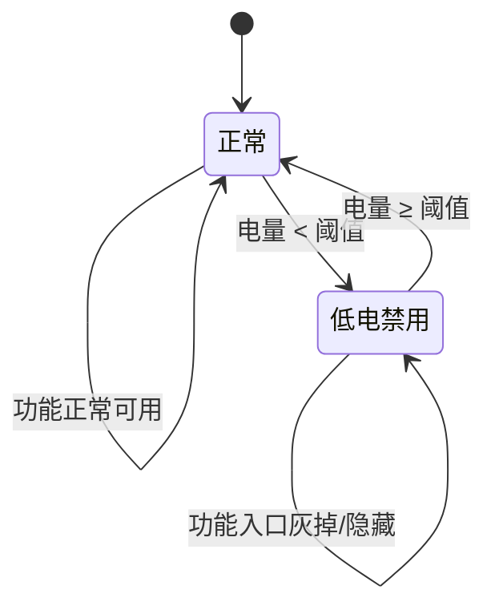

# 低电量禁用功能配置 — 需求分析文档

## 修订记录

| 修订时间 | 修订内容 | 修订人 |
|------|------|------|
| 2026-07-02 | 初稿 | Kiro |

---

## 一、业务背景

低功耗设备（门铃、电池摄像机等）在电量不足时需要限制高功耗功能，避免设备因瞬时大电流导致异常关机或电池损坏。

**痛点**：

1. 不同厂家、不同型号的功耗特性不同，PTZ 旋转的耗电量可能相差数倍，阈值无法统一
2. 当前 APP 无差别暴露所有功能入口，用户低电量操作后设备异常关机，体验差且增加客诉
3. 设备固件改造成本高，存量设备无法快速覆盖

**目标**：

- 平台按产品型号配置低电量阈值和禁用功能列表，一次配置全型号生效
- APP 拉取配置 + 设备上报电量，本地判断是否禁用对应功能入口
- 设备侧无需改固件，存量设备立即生效

---

## 二、名词解释

| 术语 | 说明 |
|------|------|
| 低电量阈值 | 电量低于此百分比时触发功能禁用，回升到此值以上恢复 |
| 禁用功能列表 | 低电量状态下不允许使用的功能集合 |
| 低功耗设备 | 电池供电的 IPC 设备（门铃、电池摄像机等） |

---

## 三、功能范围

### 3.1 功能列表

| 序号 | 功能 | 优先级 | 说明 |
|------|------|:--:|------|
| F1 | 低电量阈值配置 | P0 | 产品型号级别，百分比，范围 1–100 |
| F2 | 禁用功能多选 | P0 | PTZ控制、语音对讲、一键呼叫，支持多选 |
| F3 | APP 端功能入口控制 | P0 | 拉配置 + 设备电量 → 禁用/恢复入口 |

### 3.2 不做

| 功能 | 原因 |
|------|------|
| 设备固件侧低电拦截 | 固件改造成本高，纯 APP 判断已满足需求 |
| 用户自定义阈值 | 阈值由厂家/运营配置，不开放给终端用户 |
| 低电量推送提醒 | 属于消息推送模块，不在本需求范围 |

---

## 四、场景穷举分析

### 4.1 正常场景

| 编号 | 场景 | 步骤 | 预期 |
|------|------|------|------|
| N-001 | 配置低电策略 | 产品审核→App配置→默认配置→设置阈值+选择禁用功能→保存 | 配置生效，该型号所有设备应用 |
| N-002 | APP 低电禁用入口 | 设备电量 15% < 阈值 20% → 进入设备页 | PTZ/对讲/呼叫入口灰掉或隐藏 |
| N-003 | APP 电量恢复 | 设备电量回升至阈值以上 | 功能入口恢复正常 |
| N-004 | 不配置低电策略 | 默认配置中留空或不启用 | 所有功能正常可用 |
| N-005 | 仅禁用部分功能 | 仅勾选 PTZ + 对讲 | 一键呼叫不受影响 |

### 4.2 异常场景

| 编号 | 异常 | 触发 | 行为 |
|------|------|------|------|
| E-001 | 电量数据缺失 | 设备未上报或上报异常 | 不拦截，功能正常可用（宁可多用不可误拦） |
| E-002 | 配置未下发 | APP 拉配置失败 | 不拦截，降级为全功能可用 |
| E-003 | 阈值设为 0% | 运营误操作 | 前端拦截，阈值最小 1% |

### 4.3 状态流转



---

## 五、跨模块联动

| 模块 | 关系 | 影响 |
|------|------|------|
| 产品审核 → App配置 → 默认配置 | 配置入口 | 本需求改动 |
| 设备状态上报 | 提供 `battery` 字段 | 已有，无需改动 |
| APP 设备详情页 | 读取配置 + 电量 → 控制入口 | APP 适配 |

---

## 六、数据模型

### 产品默认配置扩展

```javascript
{
  // 已有字段...
  lowBatteryPolicy: {
    enabled: false,           // 是否启用
    threshold: 20,            // 低电量阈值，百分比，1–100
    disabledFeatures: []      // ['ptz', 'talk', 'call']
  }
}
```

| 字段 | 类型 | 默认值 | 说明 |
|------|------|------|------|
| `enabled` | boolean | `false` | 是否启用低电策略 |
| `threshold` | number | `20` | 低电量阈值（%），低于此值禁用，回升至此值恢复 |
| `disabledFeatures` | string[] | `[]` | 禁用功能列表，可选值：`ptz`/`talk`/`call` |

---

## 七、文件清单

| 文件 | 说明 |
|------|------|
| `src/views/product/app.vue` | 默认配置 Tab 新增低电策略配置区 |
| APP 端设备详情页 | 读取配置 + 电量，控制功能入口显隐 |

---

*文档版本: v1.0 | 创建日期: 2026-07-02*
