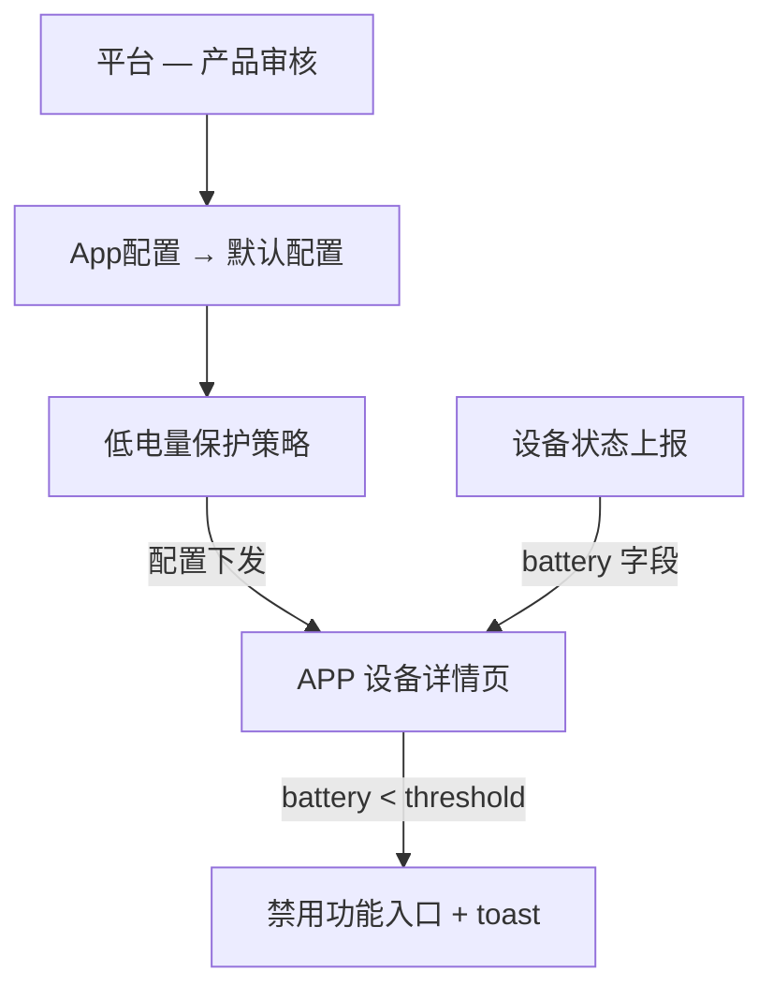
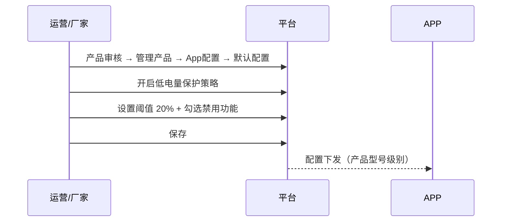
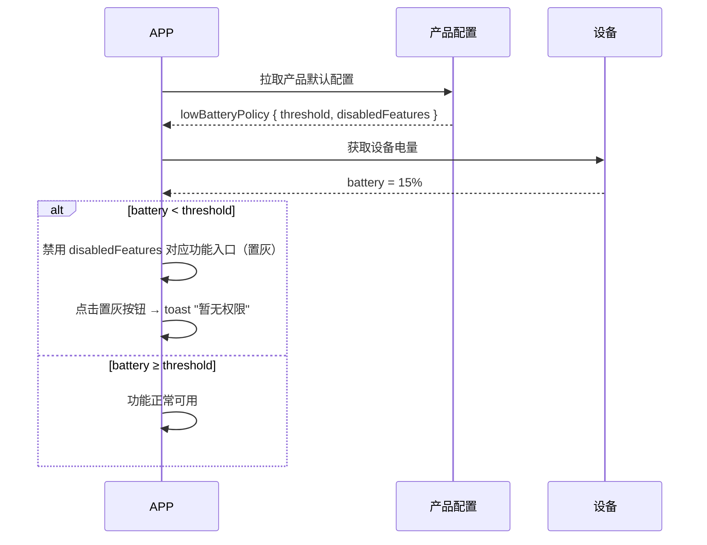

# 低电量禁用功能配置 — 完整业务 PRD

## 修订记录

| 修订时间 | 修订内容 | 修订人 |
|------|------|------|
| 2026-07-02 | 初稿 | Kiro |

---

## 一、业务背景

低功耗设备（门铃、电池摄像机等）在电量不足时需要限制高功耗功能，避免设备因瞬时大电流导致异常关机或电池损坏。

**痛点**：

1. 不同厂家、不同型号的功耗特性不同，PTZ 旋转的耗电量可能相差数倍，阈值无法统一
2. 当前 APP 无差别暴露所有功能入口，用户低电量操作后设备异常关机，体验差且增加客诉
3. 设备固件改造成本高，存量设备无法快速覆盖

**产品目标**：

- 平台按产品型号配置低电量阈值和禁用功能列表，一次配置全型号生效
- APP 拉取配置 + 设备上报电量，本地判断是否禁用对应功能入口
- 设备侧无需改固件，存量设备立即生效

---

## 二、名词解释

| 术语 | 说明 |
|------|------|
| 低电量阈值 | 电量低于此百分比时触发功能禁用，回升至此值恢复 |
| 禁用功能列表 | 低电量状态下不允许使用的功能集合 |
| 低功耗设备 | 电池供电的 IPC 设备（门铃、电池摄像机等） |

---

## 三、功能架构



---

## 四、核心流程

### 4.1 配置流程



### 4.2 APP 端执行流程



---

## 五、业务规则

| 编号 | 规则 | 说明 |
|------|------|------|
| R01 | 配置粒度 | 产品型号级别，一个型号一份配置 |
| R02 | 纯 APP 判断 | 设备无需改固件，APP 本地比对配置和电量 |
| R03 | 兜底策略 | 电量数据缺失或配置拉取失败 → 不拦截，全功能可用 |
| R04 | 即时生效 | 配置保存后 APP 下次进入设备页即生效 |
| R05 | 置灰样式 | 禁用功能入口变灰 + 不可点击 + 点击时 toast「暂无权限」 |

---

## 六、详细功能描述

### 6.1 平台侧 — 低电量保护策略配置

**位置**：产品审核 → 管理产品 → App配置 → 默认配置 Tab

| 属性 | 值 |
|------|------|
| 启用开关 | `el-switch`，默认关闭，与视频插值开关同一样式 |
| 低电量阈值 | `el-input-number`，范围 1–100，默认 20，后跟 `%` |
| 禁用功能 | `el-checkbox-group`，三个选项：PTZ控制 / 语音对讲 / 一键呼叫 |
| 配置展开 | 开关开启后下方展开阈值和禁用功能区域 |
| 描述 | 阈值行附带提示「低于此电量将禁用所选功能」 |

### 6.2 APP 侧 — 功能入口控制

| 行为 | 效果 |
|------|------|
| 电量 ≥ 阈值 | 功能入口正常显示，可操作 |
| 电量 < 阈值 + 功能在 disabledFeatures 中 | 入口置灰，点击 toast「暂无权限」 |
| 电量 < 阈值 + 功能不在 disabledFeatures 中 | 功能正常可用 |
| 无电量数据 | 不拦截 |

**置灰样式**：
- 按钮/入口降低透明度（opacity: 0.4）
- 不可点击
- 点击时 `toast "暂无权限"`

---

## 七、页面信息架构

```
产品审核
└── 管理产品
    └── App功能配置
        ├── 安装指引 Tab
        ├── App使用范围 Tab
        └── 默认配置 Tab
            ├── 默认分辨率
            ├── 图片插值
            ├── 视频插值
            ├── 全彩模式时段
            ├── 一键报警配置
            ├── 假三目设置
            ├── 灯控开关显示
            └── 低电量保护策略 ★新增
                ├── 启用开关
                ├── 低电量阈值 [1-100] %
                └── 禁用功能 ☑PTZ控制 ☑语音对讲 ☑一键呼叫
```

---

## 八、数据模型

### 产品默认配置扩展

```javascript
lowBatteryPolicy: {
  enabled: false,           // 是否启用
  threshold: 20,            // 低电量阈值，百分比，1–100
  disabledFeatures: []      // ['ptz', 'talk', 'call']
}
```

---

## 九、异常说明

| 场景 | 处理方式 |
|------|------|
| 电量数据缺失 | 不拦截，功能正常可用 |
| 配置拉取失败 | 不拦截，降级为全功能可用 |
| 阈值设为 ≤0 | 前端拦截，最小值 1 |
| 阈值设为 >100 | 前端拦截，最大值 100 |

---

## 十、文件清单

| 文件 | 类型 | 说明 |
|------|------|------|
| `src/views/product/app.vue` | 平台前端 | 默认配置 Tab 新增低电策略配置区 |
| APP 设备详情页 | APP 前端 | 读取配置 + 电量，控制功能入口显隐 |

---

*文档版本: v1.0 | 创建日期: 2026-07-02*
