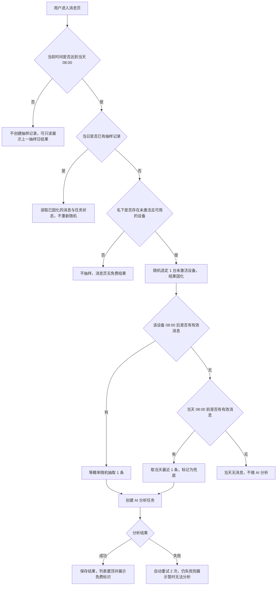
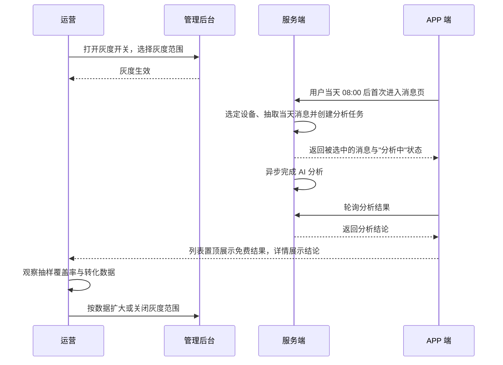
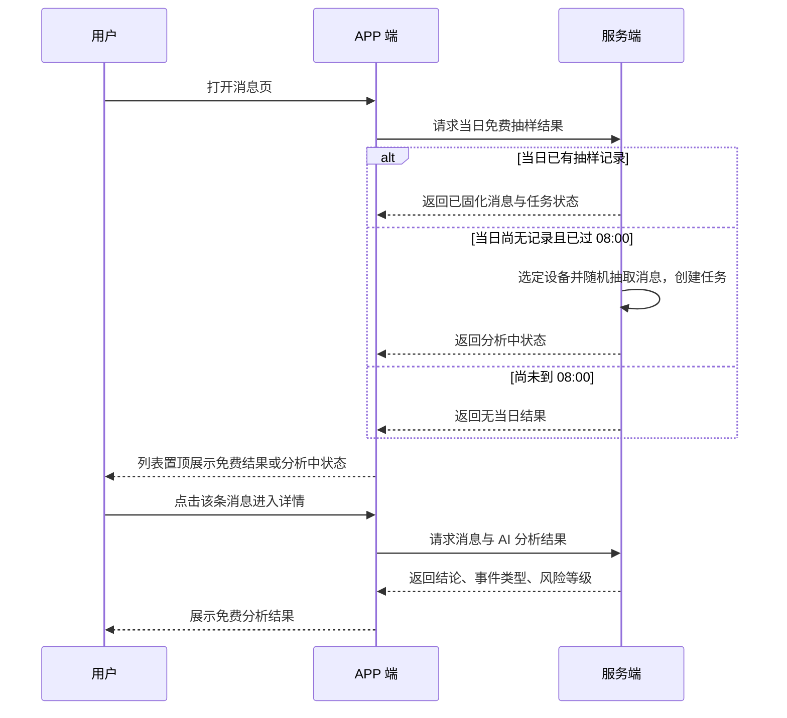
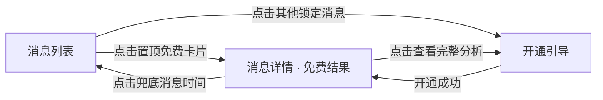

# 全能AI每日免费抽样方案 — 完整业务 PRD

## 修订记录

| 修订时间 | 修订内容 | 修订人 |
|------|------|------|
| 2026-10-28 | 初稿：确定统计主体为设备、08:00 前不消耗名额、兜底取 08:00 前最近一条、系统指定强曝光、每日免费 1 条 | Kiro |
| 2026-10-28 | 修订：抽样日改为自然日；取消跨天回溯，只分析当天消息；当天无消息不生成分析；取消运营配置项，参数全部写死 | Kiro |
| 2026-10-28 | 简化：取消手动重试与空态占位，当天无消息与未灰度表现一致 | Kiro |
| 2026-10-28 | 明确触发时机：仅当日 08:00 后首次进入消息页触发，取消定时批量任务 | Kiro |

---

## 一、业务背景

全能AI 是安防摄像头的智能看护能力，AI 识别出的结论以「AI 分析」的形式呈现在消息详情中。当前该能力按**设备维度激活**：只有已激活设备的消息才有 AI 分析结果，未激活设备的消息只显示锁定态。

**要解决的问题**：未激活设备的用户每天都会产生真实消息（人形、运动等），但看不到任何 AI 结论，既无法判断这项能力值不值得买，也没有一个稳定的免费体验入口。消息页因此长期停留在"只有告警、没有智能"的形态。

**产品目标**：

1. 让未激活设备的用户，在**当天有消息时每天获得 1 次真实的 AI 分析体验**，降低首次理解门槛；当天无消息则不生成；
2. **成本可控**：每个用户每个抽样日最多生成 1 条免费分析，不随设备数量线性增长；
3. 用真实的分析结果承接开通转化，但**不影响已激活设备的完整权益**；
4. 免费结果**强曝光**，不依赖用户主动点击——主动选择的路径用户大概率不会走。

**不做的事**：不改造 AI 模型识别能力、不重构事件分类、不做每日多条免费分析、不做历史消息批量补算。

---

## 二、名词解释

| 术语 | 说明 |
|------|------|
| 全能AI | 摄像头智能看护功能，包含 AI 消息、AI 日报、AI 搜索、关注事件管理等 |
| 设备激活 | 对单台设备开通全能AI 的行为，激活后该设备可使用全部 AI 功能 |
| 已激活设备 | 已开通全能AI 服务的设备，享有完整 AI 分析权益 |
| 未激活设备 | 未开通全能AI 服务的设备，是本次免费抽样的唯一适用对象 |
| 消息 | 设备因识别到事件而生成的一条记录，包含时间、缩略图、事件类型 |
| AI 分析 | 对单条消息的画面内容生成结构化结论，包含结论摘要、事件类型、风险等级 |
| 抽样日 | 以用户时区自然日 00:00:00 至 23:59:59 为一个统计周期；抽样动作只在当天 08:00 之后执行 |
| 免费抽样消息 | 每个抽样日被系统选中、可免费查看 AI 分析的那 1 条消息 |
| 抽样记录 | 记录"某抽样日、某设备、某条消息"被选中的业务记录，含抽样状态与分析任务状态 |
| 兜底消息 | 当天 08:00 后无有效消息时，取当天 00:00–07:59 内最近 1 条有效消息；不跨天回溯 |
| 强曝光 | 免费结果在消息列表中置顶并带明确标识，在详情页默认展开 |

---

## 三、业务实体说明

### 3.1 核心实体

**用户（User）**
- 名下可拥有多台设备
- 拥有账户时区（无有效时区时使用服务端默认时区）
- 换账号后按新账号独立计算

**设备（Device）**
- 通过 AI 激活状态区分已激活 / 未激活
- 产生消息，是本次抽样的统计主体

**消息（Message）**
- 关键属性：所属设备、产生时间、事件类型（人形侦测 / 运动侦测等）、状态（有效 / 已删除 / 已失效）、是否可被 AI 分析
- 一条消息在同一抽样日内最多被 1 条抽样记录引用

**抽样记录（Sampling Record）**
- 关键属性：用户、设备、抽样日、用户时区、被选中的消息、是否兜底、抽样状态、分析任务状态、创建时间
- 唯一约束：设备 + 抽样日（同一台设备同一抽样日只能有一条记录）
- 时效：结果保留 30 天

**分析任务（Analysis Task）**
- 关键属性：关联抽样记录、任务状态（等待中 / 分析中 / 成功 / 失败）、重试次数、结果内容、失败原因
- 一条抽样记录只对应一个有效任务，重试沿用同一任务

### 3.2 实体关系

```mermaid
erDiagram
    USER["用户"] ||--o{ DEVICE["设备"] : 拥有
    USER ||--o{ SAMPLING["抽样记录"] : 归属
    DEVICE ||--o{ MESSAGE["消息"] : 产生
    DEVICE ||--o{ SAMPLING : 被抽中
    MESSAGE ||--o{ SAMPLING : 被分析
    SAMPLING ||--|| TASK["分析任务"] : 对应
    DEVICE ||--o| ACTIVATION["AI激活状态"] : 拥有
```

---

## 四、核心业务流程

### 4.1 抽样决策流程



### 4.2 全链路业务协作时序



### 4.3 局部交互时序（用户进入消息页）



---

## 五、业务规则

### 5.1 抽样主体与名额

| 编号 | 规则 | 说明 |
|------|------|------|
| R01 | 抽样主体为**设备** | 抽样结果归属于某台设备；同一台设备同一抽样日只有 1 条抽样记录 |
| R02 | 每用户每抽样日最多 1 条免费分析 | 即使用户名下有多台未激活设备，当日也只随机选定 1 台，不按设备数叠加 |
| R03 | 设备选定需固化 | 当日选定的设备写入抽样记录，用户重复进入不重新选设备 |
| R04 | 仅未激活设备参与 | 已激活设备不参与抽样、不占用名额，其 AI 分析按现有完整权益执行 |
| R05 | 无可用设备则不抽样 | 用户名下无设备、或全部设备已激活、或设备均不可用时，当日无免费结果 |

### 5.2 抽样日与时间窗口

| 编号 | 规则 | 说明 |
|------|------|------|
| R06 | 抽样日按自然日计算 | 以用户时区 00:00:00 至 23:59:59 为一个抽样日；抽样动作只在当天 08:00 之后执行 |
| R07 | 08:00:00 整产生的消息符合条件 | 边界按"大于等于"处理 |
| R08 | **08:00 前不创建抽样记录** | 用户在 08:00 前进入消息页，不抽样、不消耗当日名额；页面可只读展示上一抽样日结果 |
| R09 | 每个抽样日只决策一次 | 不因用户重复进入消息页、下拉刷新而重新随机 |
| R10 | 时区取值 | 优先取账户时区；无有效时区时使用服务端默认时区，并在抽样记录中标记兜底时区 |
| R34 | 触发时机 | 抽样与分析任务只在**用户当天 08:00 后首次进入消息页**时创建；同一抽样日只触发一次；不设定时批量任务 |

### 5.3 抽样范围与抽取

| 编号 | 规则 | 说明 |
|------|------|------|
| R11 | 候选消息条件 | 属于当日选定设备、状态有效（未删除/未撤回/未标记无效）、已完成基础处理、产生时间在 08:00:00 至抽检时刻之间 |
| R12 | 抽取方式 | 在候选消息中等概率随机抽取 1 条 |
| R13 | 结果固化 | 抽取结果写入抽样记录；同一抽样日重复请求返回同一条消息 |
| R14 | 兜底规则 | 当天 08:00 后无候选消息时，取该设备**当天 00:00:00 至 07:59:59** 内最近 1 条有效消息，标记兜底＝是 |
| R15 | **不跨天回溯** | 只分析抽样日当天产生的消息；前一天及更早的消息既不入候选，也不作兜底 |
| R16 | 同时间消息排序 | 多条消息产生时间完全相同时，按消息编号稳定排序，保证结果可复现 |
| R17 | 当天无消息 | 当天 00:00 起无任何有效消息时，不做 AI 分析、不创建任务，页面不展示任何免费相关元素 |

### 5.4 分析任务与失败处理

| 编号 | 规则 | 说明 |
|------|------|------|
| R18 | 先记录后分析 | 抽样记录创建成功后才允许创建分析任务；同一记录最多 1 个有效任务 |
| R19 | 任务状态 | 等待中 → 分析中 → 成功 / 失败 |
| R20 | 自动重试 | 失败后自动重试 2 次，间隔 1 分钟、5 分钟；重试不额外消耗每日名额 |
| R22 | 失败后不重新抽取 | 任何失败情形都不更换消息，避免突破每日 1 条规则 |
| R23 | 消息失效 | 分析开始前消息被删除或撤回，任务取消，当日不更换消息，详情展示"原消息已失效" |

### 5.5 展示与权益边界

| 编号 | 规则 | 说明 |
|------|------|------|
| R24 | 强曝光 | 免费抽样消息在消息列表置顶展示，并带"今日免费 AI 分析"标识；详情页默认展开结果卡 |
| R25 | 免费可见范围 | 展示 AI 结论摘要、事件类型、风险等级、结果生成时间；**不展示**完整分析与建议 |
| R26 | 完整内容门控 | 点击"查看完整分析"进入开通引导，不临时解锁其他消息 |
| R27 | 其他消息 | 除抽样消息外，其余消息保持现有未开通锁定态，点击进入开通引导 |
| R28 | 兜底提示 | 兜底消息必须在列表与详情显示该消息的真实日期，并提示"今日暂无新消息，已为你分析最近一条" |
| R29 | 结果保留 | 免费结果保留 30 天，超期按现有存储策略清理 |
| R30 | 激活后衔接 | 用户在抽样后开通服务，已生成的免费结果保留，并按已激活权益展示完整内容 |

### 5.6 多端与账号

| 编号 | 规则 | 说明 |
|------|------|------|
| R31 | 并发唯一 | 多端同时首次进入消息页，也只生成 1 条抽样记录 |
| R32 | 换账号独立 | 退出登录后换账号，按新账号重新计算，不继承旧账号记录 |
| R33 | 跨时区不重算 | 已生成的抽样日记录不因用户跨时区迁移而重新计算 |

---

## 六、功能架构

```
全能AI每日免费抽样方案
├── 抽样触发
│   └── 当天 08:00 后首次进入消息页时触发
├── 抽样记录管理
│   ├── 设备选定与固化
│   ├── 消息抽取与固化和兜底
│   └── 当日唯一性保障
├── AI 分析任务
│   ├── 任务创建与状态流转
│   ├── 自动重试
│   └── 失败原因记录
├── 展示层
│   ├── 消息列表（置顶、免费标识、分析中/失败态）
│   ├── 消息详情（结论卡、兜底提示、失效提示）
│   └── 开通引导（完整分析门控）
└── 运营与监控
    ├── 灰度开关
    └── 抽样、任务、成本监控
```

---

## 七、详细功能描述

### 7.1 每日抽样

#### 功能应用场景
用户未开通全能AI，但设备每天产生消息。系统在该设备所在抽样日 08:00 后为其选定一条消息，生成免费 AI 分析，让用户直接看到 AI 能得出什么结论。

#### 功能详述

| 区域 | 元素与行为 |
|------|-----------|
| 触发时机 | 单一触发：用户在当天 08:00 后**首次进入消息页**时，即时执行抽样并创建分析任务；不做定时批量任务 |
| 设备选定 | 从用户名下"未激活且可用"的设备中随机选定 1 台，写入当日抽样记录 |
| 消息抽取 | 在该设备 08:00 后的有效消息中等概率随机 1 条 |
| 兜底 | 08:00 后无消息时，取当天 08:00 前最近 1 条有效消息；不跨天回溯 |
| 固化 | 设备与消息均写入记录，当日重复请求返回相同结果 |
| 08:00 前访问 | 不创建记录、不消耗名额，返回"当日结果暂未生成" |

#### 状态说明

| 状态 | 触发条件 | 展示内容 |
|------|-----------|-----------|
| 已抽样待分析 | 记录已创建，任务未完成 | 列表显示"分析中" |
| 分析成功 | 任务返回结构化结论 | 列表置顶 + 免费标识；详情展示结论卡 |
| 分析失败 | 自动重试耗尽 | 列表显示"暂时无法分析"，当日不再重试 |
| 兜底 | 当天 08:00 后无有效消息，取当天 08:00 前最近一条 | 额外展示兜底提示与消息真实时间 |
| 当天无消息 | 当天 00:00 起无任何有效消息 | 不展示任何免费相关元素，不创建任务 |
| 未到抽样时间 | 当前时间早于 08:00 | 仅展示上一抽样日结果（只读），不展示当日结果 |

#### 交互说明
- 用户下拉刷新：只读取已有抽样记录，不重新抽样，不产生新任务；
- 同一条消息当日只计入 1 个免费名额；
- 抽样记录创建后不可人工替换消息（运营后台仅可查询，不可编辑）；
- 分析中状态：客户端每 3 秒拉取一次结果，最长 60 秒，完成后原地更新为结论卡，不打断浏览。

### 7.2 AI 分析任务

#### 功能应用场景
抽样完成后，对选中的消息执行一次 AI 分析并把结果固化为可展示内容。

#### 功能详述
- 消息与任务一对一绑定，任务重试不改变消息；
- 任务执行时长、模型选择沿用现有 AI 分析能力，不做能力改造；
- 失败原因需分类记录：消息失效、画面不可访问、模型无返回、返回不可解析、超时。

#### 状态说明

| 状态 | 触发条件 | 展示内容 |
|------|-----------|-----------|
| 等待中 | 记录已创建、任务已入队 | 列表"分析中" |
| 分析中 | 任务开始执行 | 列表"分析中" |
| 成功 | 返回可解析结论 | 结论卡 |
| 失败 | 重试耗尽 | "暂时无法分析"，当日结束 |

#### 交互说明
- 失败后当日不再重试，用户次日进入时按新抽样日重新生成；
- 失败不影响已激活设备的任何权益。

### 7.3 消息列表

#### 功能应用场景
用户进入消息页，第一眼就能看到被免费分析的这条消息及其状态。

#### 功能详述

| 区域 | 元素与行为 |
|------|-----------|
| 置顶区 | 免费抽样消息固定置顶，不参与时间排序 |
| 标识 | 消息卡片右上角显示"今日免费 AI 分析"标签 |
| 状态文案 | 分析中 / 已分析 / 暂时无法分析 三态直接展示在卡片上 |
| 兜底标识 | 兜底消息卡片显示"最近一条"小标签，并展示该消息真实日期 |
| 其他消息 | 保持现有未开通锁定态，点击进入开通引导 |

#### 状态说明

| 状态 | 触发条件 | 展示内容 |
|------|-----------|-----------|
| 正常态 | 抽样成功 | 置顶卡片 + 免费标签 + 时间 + 事件类型 |
| 分析中态 | 任务未完成 | 卡片显示"分析中"，点击可进入详情等待 |
| 失败态 | 任务失败 | 卡片显示"暂时无法分析"，点击进入详情重试 |
| 空态 | 当日无可分析消息 | 列表顶部展示"暂无可分析消息"提示条，其余消息正常展示 |
| 无抽样态 | 用户无未激活设备或功能未灰度 | 不展示任何免费标识，保持现有列表形态 |

#### 交互说明
- 点击置顶卡片：进入消息详情，免费结果默认展开；
- 点击其他消息：进入现有开通引导，不触发新的免费分析；
- 列表刷新：状态以服务端为准，不产生新的抽样。

### 7.4 消息详情

#### 功能应用场景
用户从列表点进被抽中的消息，查看 AI 给出的具体结论。

#### 功能详述

| 区域 | 元素与行为 |
|------|-----------|
| 画面区 | 该消息的缩略画面与时间 |
| 结论卡 | AI 结论摘要、事件类型、风险等级、生成时间 |
| 完整分析入口 | 卡片底部"查看完整分析"，点击进入开通引导 |
| 兜底提示 | 结论卡上方弱提示：今日暂无新消息，已为你分析最近一条（附消息日期） |
| 态提示 | 分析中显示加载态；失败显示失败态与重试按钮；消息已失效显示失效提示 |

#### 状态说明

| 状态 | 触发条件 | 展示内容 |
|------|-----------|-----------|
| 正常态 | 分析成功 | 结论卡（摘要 + 类型 + 风险等级 + 时间） |
| 兜底态 | 抽样为兜底消息 | 正常态 + 兜底提示 + 真实日期 |
| 分析中态 | 任务未完成 | 骨架加载 + "AI 正在分析这条消息" |
| 失败态 | 任务失败 | "暂时无法分析"，当日不再重试 |
| 失效态 | 消息被删除或撤回 | "原消息已失效"，不展示结论 |
| 空态 | 当日无可分析消息 | "暂无可分析消息" |

#### 交互说明
- "查看完整分析"：进入开通引导页，返回后保留当前详情；
- 兜底态点击消息时间：可跳转该消息所在日期的消息记录。

### 7.5 开通引导

#### 功能应用场景
用户看到免费结果后想了解完整内容，或点击其他锁定消息时，进入统一开通路径。

#### 功能详述
- 免费结果页与锁定消息使用同一套开通引导，不做两套；
- 引导页需说明：已激活设备可获得全部消息的 AI 分析、AI 日报、AI 搜索等能力；
- 开通按设备维度生效，默认选中用户当前查看的设备。

#### 状态说明

| 状态 | 触发条件 | 展示内容 |
|------|-----------|-----------|
| 正常态 | 设备未激活 | 套餐信息 + 开通按钮 |
| 已激活态 | 设备在别端被激活 | 提示已开通，刷新后按完整权益展示 |
| 支付失败态 | 下单或支付失败 | 失败提示 + 重新支付入口 |

#### 交互说明
- 开通成功后返回消息详情，原免费结果升级为完整展示；
- 不因开通动作重新抽样或更换消息。

### 7.6 固定参数（全部写死，不开放运营配置）

本期所有数值直接写死，不提供运营配置入口，调整需发版。

| 参数 | 固定值 |
|------|--------|
| 每日免费分析条数 | 1 条 |
| 每日抽样设备数 | 1 台 |
| 每日开始时间 | 08:00（用户时区） |
| 抽样范围 | 仅当天 00:00 起产生的消息 |
| 自动重试次数 | 2 次（间隔 1 分钟、5 分钟） |
| 免费结果保留时长 | 30 天 |
| 免费可见字段 | 结论摘要、事件类型、风险等级、生成时间 |

> 上线范围只用客户端版本与服务端灰度开关控制；灰度开关仅决定功能是否开启，不改变上述任何数值。

---

## 八、页面信息架构



| 页面 | 核心信息结构 |
|------|-------------|
| 消息列表 | 置顶免费卡片（状态 + 标识）→ 日期分组 → 其余消息 |
| 消息详情 | 画面 → 结论卡（摘要/类型/风险/时间）→ 完整分析入口 → 兜底或失败提示 |
| 开通引导 | 能力说明 → 套餐信息 → 开通按钮 → 结果反馈 |

---

## 九、异常说明

| 场景 | 处理方式 |
|------|-----------|
| 08:00 后仅有 1 条消息 | 直接抽取该条，不执行随机 |
| 08:00 后有多条消息 | 等概率随机 1 条并固化 |
| 当天 08:00 前有消息、08:00 后无消息 | 取当天 08:00 前最近 1 条，标记兜底 |
| 当天 00:00 起无任何消息 | 不做 AI 分析，不创建任务，页面不展示任何免费相关元素 |
| 用户当天未进入消息页 | 不触发抽样，不产生任何分析成本 |
| 昨天有消息、今天没有 | 不分析，不跨天回溯，展示空态 |
| 用户 08:00 前进入消息页 | 不抽样、不占名额，展示上一抽样日结果或"稍后为你生成" |
| 抽样后消息被删除 | 任务取消，不更换消息，详情展示"原消息已失效" |
| AI 服务超时或失败 | 自动重试 2 次；仍失败展示"暂时无法分析"，当日不再重试 |
| 设备离线 | 历史消息仍可抽样与分析；不因离线跳过抽样 |
| 用户跨时区旅行 | 已生成记录不重算；新抽样日按新时区重新计算 |
| 换账号登录 | 按新账号独立计算，不继承旧账号抽样记录 |
| 多端并发进入 | 服务端唯一约束保证只生成 1 条记录 |
| 功能灰度关闭 | 不再生成新抽样；已生成结果按 30 天保留策略继续展示 |
| 用户当日在抽样后开通服务 | 免费结果保留，并按已激活权益展示完整内容 |

---

## 十、测试要点

### 功能回归

| 编号 | 测试点 | 前置条件 | 操作步骤 | 预期结果 |
|------|--------|----------|----------|----------|
| T-001 | 已激活设备权益不受影响 | 用户有 1 台已激活设备 | 进入消息页并查看任一消息详情 | AI 分析正常展示，不出现"今日免费"标识，不占用免费名额 |
| T-002 | 锁定消息仍走开通引导 | 未激活设备、非抽样消息 | 点击任意其他消息 | 进入开通引导，不触发新的免费分析 |
| T-003 | 列表时间分组正常 | 存在免费抽样消息 | 上下滚动列表 | 除置顶卡片外，其余消息仍按日期分组排序 |
| T-004 | 未灰度用户无变化 | 灰度开关关闭 | 未激活用户进入消息页 | 不出现免费标识与置顶卡片，界面与上线前一致 |

### 核心场景

| 编号 | 测试点 | 前置条件 | 操作步骤 | 预期结果 |
|------|--------|----------|----------|----------|
| T-101 | 08:00 后多条消息随机 | 设备当日 08:00 后有 5 条有效消息 | 进入消息页 | 置顶 1 条免费分析，且当日重复进入返回同一条 |
| T-102 | 08:00 整点消息参与抽样 | 消息产生时间为 08:00:00 | 进入消息页 | 该消息进入候选集，可被抽中 |
| T-103 | 08:00 后无消息走兜底 | 当天 08:00 后有 0 条、08:00 前有 3 条 | 进入消息页 | 抽中当天 08:00 前最近 1 条，展示兜底提示与时间 |
| T-104 | 多设备只选 1 台 | 用户名下 3 台未激活设备，均有消息 | 进入消息页 | 仅 1 台产生免费分析，重复进入设备不变 |
| T-105 | 全部设备已激活 | 用户名下设备均已激活 | 进入消息页 | 不产生抽样记录，无免费标识 |
| T-106 | 免费内容范围正确 | 抽样分析成功 | 查看详情 | 展示结论摘要、事件类型、风险等级、时间；完整分析需开通 |
| T-107 | 开通后权益升级 | 抽样成功后完成开通 | 返回消息详情 | 结果保留并展示完整内容，不重新抽样 |
| T-108 | 首次进入才触发 | 用户当天 08:00 后未打开过消息页 | 08:00 后第一次进入 | 生成当日抽样并进入分析中；此后再次进入只读结果，不新建任务 |

### 异常场景

| 编号 | 测试点 | 前置条件 | 操作步骤 | 预期结果 |
|------|--------|----------|----------|----------|
| T-201 | 08:00 前访问不占名额 | 时间 07:50 | 进入消息页后等到 08:30 再进 | 07:50 不生成当日记录；08:30 正常抽样 |
| T-202 | 分析失败不换消息 | 模拟 AI 服务失败 | 等待自动重试耗尽 | 展示"暂时无法分析"，消息不变，名额不重置 |
| T-204 | 消息在分析前被删除 | 抽样后删除该消息 | 进入详情 | 展示"原消息已失效"，不重新抽取 |
| T-205 | 当天无消息不分析 | 设备当天 00:00 起无任何消息，昨天有 5 条 | 进入消息页 | 展示空态，不创建分析任务，不回溯昨天的消息 |
| T-206 | 多端并发 | 两台设备同时登录同一账号 | 同时进入消息页 | 仅生成 1 条抽样记录，两端展示同一结果 |
| T-207 | 弱网/断网 | 网络不稳定 | 进入消息页并下拉刷新 | 展示缓存状态，不重复抽样，恢复后状态以服务端为准 |
| T-208 | 换账号 | 抽样后退出并登录另一账号 | 进入消息页 | 新账号独立计算，不继承旧账号结果 |

### 状态切换

| 编号 | 测试点 | 前置条件 | 操作步骤 | 预期结果 |
|------|--------|----------|----------|----------|
| T-301 | 分析中 → 成功 | 任务处理中 | 停留在列表并在完成后进入详情 | 列表由"分析中"变为"已分析"，详情展示结论 |
| T-302 | 分析中 → 失败 | 任务处理中且最终失败 | 停留观察 | 列表变为"暂时无法分析"，详情提供重试 |
| T-303 | 前后台切换 | 详情页分析中 | 切后台 30 秒后返回 | 状态刷新至最新，不重复创建任务 |
| T-304 | 连续快速返回 | 详情页 | 快速反复进入退出 | 不产生新的抽样或任务，无重复请求堆积 |
| T-305 | 抽样日切换 | 23:59 停留至次日 08:00 后 | 刷新列表 | 新抽样日生成新结果，旧结果按保留策略仍在历史中可见 |

### 兼容性

| 编号 | 测试点 | 前置条件 | 操作步骤 | 预期结果 |
|------|--------|----------|----------|----------|
| T-401 | 多机型布局 | 小屏、大屏、刘海屏各 1 台 | 查看置顶卡片与详情结论卡 | 无遮挡、无截断，标签完整展示 |
| T-402 | 多语言文案 | 切换至英文及小语种 | 浏览免费结果相关文案 | 文案完整，无中文残留，无超长溢出 |
| T-403 | 多时区 | 分别以 UTC+8、UTC+0、UTC-5 账号登录 | 08:00 前后各进入一次 | 抽样日按各自时区计算，结果符合规则 |
| T-404 | 深色模式 | 系统深色模式 | 查看列表与详情 | 标签、结论卡配色可读，无白底闪屏 |
| T-405 | 低版本客户端 | 灰度范围内旧版本 | 进入消息页 | 不展示新样式，不报错，状态正常 |

---

## 十一、APP 埋点与运营数据看板

### 11.1 核心指标

| 维度 | 指标 | 计算口径 |
|------|------|----------|
| 覆盖 | 每日抽样覆盖率 | 成功抽样用户数 ÷ 灰度范围内符合条件用户数 |
| 质量 | AI 分析成功率 | 成功任务数 ÷ 创建任务数 |
| 质量 | 兜底占比 | 兜底抽样数 ÷ 成功抽样数 |
| 曝光 | 免费结果曝光率 | 结果曝光用户数 ÷ 抽样成功用户数 |
| 行为 | 免费结果点击率 | 进入详情次数 ÷ 结果曝光次数 |
| 行为 | 平均浏览时长 | 详情页停留时长均值 |
| 转化 | 免费分析到开通转化率 | 该入口支付成功用户数 ÷ 结果曝光用户数 |
| 成本 | 单用户日均 AI 调用量 | 当日 AI 调用次数 ÷ 抽样成功用户数 |
| 成本 | 单日分析总成本 | 当日调用次数 × 单条成本 |
| 回归 | 已激活用户结果时延 | 已激活用户 AI 结果生成至展示的时长 |

### 11.2 关键埋点

| 事件名 | 触发时机 | 关键参数 |
|--------|----------|----------|
| daily_ai_sampling_triggered | 用户当天首次进入消息页触发抽样 | 用户激活状态、时区、是否灰度、触发时刻 |
| daily_ai_sampling_selected | 抽样成功 | 消息产生时间、是否兜底、候选消息数、被选设备编号、报告日期 |
| daily_ai_sampling_empty | 当天无可分析消息 | 设备编号、时区、当天候选消息数 |
| daily_ai_analysis_created | 创建分析任务 | 报告日期、是否兜底、任务编号 |
| daily_ai_analysis_success | 分析成功 | 用时、结果类型、风险等级 |
| daily_ai_analysis_failed | 分析失败 | 失败原因分类、重试次数 |
| daily_ai_result_exposed | 免费结果曝光 | 展示位置（列表置顶/详情）、是否兜底 |
| daily_ai_result_clicked | 进入结果详情 | 来源、停留时长 |
| daily_ai_upgrade_clicked | 从免费结果进入开通 | 入口位置、结果风险等级 |
| daily_ai_upgrade_paid | 该入口支付成功 | 设备编号、套餐类型、金额 |

> 埋点统一按《埋点事件公共参数规范》补齐必选公共参数，保证可按版本、渠道、国家地区、用户分群拆分。

### 11.3 数据看板

| 区域 | 内容 |
|------|------|
| 概览 | 抽样覆盖率、分析成功率、兜底占比、单日总成本（含环比） |
| 漏斗 | 抽样成功 → 结果曝光 → 进入详情 → 点击开通 → 支付成功 |
| 分群 | 按版本、国家/地区、设备类型、新老用户拆分转化 |
| 异常 | 失败原因分布、任务积压量、单用户调用量 Top 分布 |
| 回归 | 已激活用户结果时延与失败率对比（上线前 7 天基线） |

### 11.4 上线后回收

- 上线 T+7：核对抽样覆盖率、成功率、兜底占比，确认无异常消耗；
- 上线 T+30：以"免费分析到开通转化率"与"单用户日均成本"两项判定是否扩大灰度；
- 归因口径：功能问题 / 运营未执行 / 口径或埋点错误。
