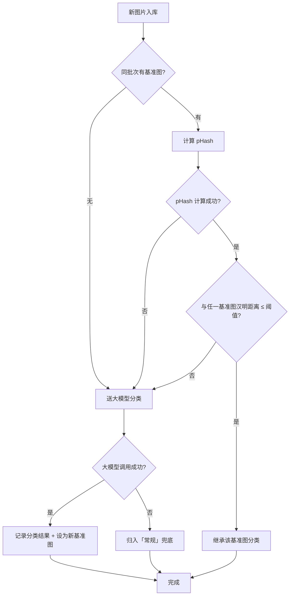
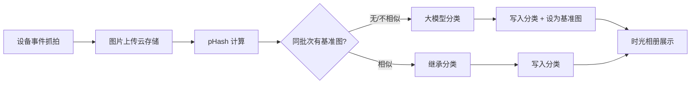

# 时光相册成本二次优化 — 需求分析文档

> 关联需求：[时光相册01ReqAnalysis.md](../时光相册/时光相册01ReqAnalysis.md)、[时光相册03PRD.md](../时光相册/时光相册03PRD.md)

## 修订记录
| 修订时间 | 修订内容 | 修订人 |
|----------|----------|--------|
| 2026-07-23 | 初稿 | 需求AI分析师 |

---

## 一、业务背景

### 业务场景

时光相册当前对接大模型，对设备事件（移动侦测、人形检测等）触发的抓拍图片进行分类识别，将图片归入「常规」「宠物」「老人」「儿童」四个分类。

**当前问题**：每条抓拍图片都送大模型识别。设备单次事件（如一次移动侦测）往往在短时间内连续抓拍多张图片，这些图片角度、光线、内容高度相似。对相似图片重复调用大模型造成了大量不必要的 token 消耗。

### 用户痛点
- 一次事件的多张连拍图片内容几乎相同，逐一送大模型是浪费
- 大模型调用成本高，图片越多成本越高
- 分类质量不受影响（相似图片本应得到相同的分类结果）

### 产品目标
- 在不降低分类准确率的前提下，通过相似度去重大幅减少大模型调用量
- 使用零成本的 pHash（感知哈希）在服务端做相似度判断
- 相似图片直接继承分类结果，仅不相似的图片送大模型

---

## 二、名词解释

| 术语 | 说明 |
|------|------|
| pHash | 感知哈希（Perceptual Hash），通过 DCT 变换提取图片感知特征生成指纹，相似图片的 hash 汉明距离小，对轻微亮度/位移变化有容错 |
| 汉明距离 | 两个 hash 值不同比特位的数量。距离越小图片越相似，0 表示完全相同 |
| 相似度阈值 | 汉明距离 ≤ 阈值判定为相似图片，默认推荐值 10（可根据实际效果调整） |
| 基准图 | 一次事件中第一张被送大模型分类的图片，后续图片与它比较相似度 |
| 分类继承 | 相似度匹配成功后，直接复用基准图的分类结果，不再调用大模型 |
| 大模型兜底 | 相似度不匹配的图片仍送大模型分类，保证分类质量 |
| 事件窗口 | 同一设备短时间内触发的一组抓拍，通常由一次设备事件（如移动侦测）产生 |

---

## 三、功能范围

### 3.1 功能列表总览

| 序号 | 模块 | 功能 | 优先级 | 说明 |
|------|------|------|:--:|------|
| F1 | 后端 | pHash 计算 | P0 | 抓拍图片入库时计算 pHash 指纹并存储 |
| F2 | 后端 | 图片分组 | P0 | 按设备 + 时间窗口将连续抓图归入同一事件批次 |
| F3 | 后端 | 相似度匹配 | P0 | 同批次内后续图片与基准图比较汉明距离 |
| F4 | 后端 | 分类继承 | P0 | 相似图片直接复用基准图的 AI 分类结果 |
| F5 | 后端 | 大模型兜底 | P0 | 不相似图片仍送大模型分类，同时更新为新的基准图 |
| F6 | 后端 | 相似度阈值配置 | P1 | 支持调整汉明距离阈值，便于运营调优 |
| F7 | 后端 | 现有流程兼容 | P0 | 原逐张送大模型的流程不受影响，作为降级路径 |

### 3.2 不做/暂不做的功能

| 功能 | 原因 | 后续计划 |
|------|------|----------|
| 跨事件去重 | 不同事件的图片即使相似也是不同场景，不应复用分类 | 不做 |
| 端侧预处理 | APP 端不参与计算，全部在服务端完成 | 不做 |
| embedding 向量相似度 | 有 API 成本，与降本目标矛盾 | 不做 |
| APP 端/管理后台 UI 变更 | 纯后端算法优化，前端无改动 | 不做 |
| 管理后台相似度阈值配置界面 | 一期用配置/环境变量，后续按需加 UI | 按需评估 |

---

## 四、场景穷举分析

### 4.1 核心流程 — 相似度去重分类

#### 4.1.1 功能概述

设备事件触发抓拍 → 图片上传至云端 → 服务端按事件批次处理 → 同批次内首张送大模型分类 → 后续图片计算 pHash 与基准图比较 → 相似则继承分类，不相似则送大模型。

整个流程对时光相册下游透明，不改变分类结果的数据结构。

#### 4.1.2 正常场景

| 场景编号 | 场景名称 | 前置条件 | 操作步骤 | 预期结果 | 状态变化 |
|----------|----------|----------|----------|----------|----------|
| N-001 | 同批次全相似 | 设备触发移动侦测，连续抓拍 5 张，内容几乎相同 | 1. 第 1 张送大模型 → 分出「宠物」 2. 第 2-5 张计算 pHash 与第 1 张比较 3. 汉明距离均 ≤ 10 | 第 1 张大模型分类，后 4 张继承「宠物」标签 | 5 张图仅 1 次大模型调用 |
| N-002 | 同批次中出现新场景 | 5 张连拍中前 3 张是猫，后 2 张是走进画面的老人 | 1. 第 1 张送大模型 → 「宠物」 2. 第 2-3 张相似 → 继承「宠物」 3. 第 4 张与第 1 张不相似 → 送大模型 → 「老人」 4. 第 4 张成为新基准图 5. 第 5 张与第 4 张相似 → 继承「老人」 | 2 次大模型调用 | 第 4 张成为新基准图 |
| N-003 | 单张抓拍（仅 1 张） | 设备事件仅产生 1 张抓图 | 1. 无基准图可比较 2. 直接送大模型分类 | 正常分类，1 次大模型调用 | 无去重收益但不影响流程 |
| N-004 | 完全不同的连拍 | 3 张连拍内容完全不同（如设备被移动） | 1. 第 1 张送大模型 → 「常规」 2. 第 2 张不相似 → 送大模型 → 「宠物」 3. 第 3 张与所有基准图不相似 → 送大模型 → 「常规」 | 3 次大模型调用，无节省但分类正确 | 每次更新基准图池 |

#### 4.1.3 异常场景

| 场景编号 | 异常类型 | 触发条件 | 系统行为 | 用户感知 |
|----------|----------|----------|----------|----------|
| E-001 | pHash 计算失败 | 图片损坏/格式不支持/尺寸过小 | 跳过相似度匹配，直接送大模型分类 | 无感知，降级为原流程 |
| E-002 | 大模型调用失败 | 首张图或兜底图调用大模型超时/报错 | 标记分类失败，该图归入「常规」；不阻断同批次其他图片处理 | 该图显示在「常规」分类中 |
| E-003 | 大模型返回异常 | 返回的分类标签不在枚举范围内 | 归入「常规」兜底 | 无感知 |
| E-004 | pHash 存储失败 | 数据库写入异常 | 不影响当前图片分类（已完成的分类结果不变），仅影响后续去重 | 该图片无法作为基准图 |
| E-005 | 同批次图片过多 | 单次事件产生超过预期数量图片（如设备异常连续抓拍） | 设置批次图片上限（如 50 张），超过部分进入新批次 | 可能多调用一次大模型，不影响分类 |

#### 4.1.4 边界条件

| 条件项 | 最小值 | 最大值 | 默认值 | 说明 |
|--------|--------|--------|--------|------|
| 事件窗口 | 1 秒 | 60 秒 | 30 秒 | 同设备在此时间窗口内的抓图视为同一批次 |
| 汉明距离阈值 | 0（完全相同） | 20（宽松） | 10 | 阈值越小越保守（更多送大模型），越大越激进 |
| 基准图数量 | 1 | 3 | — | 保留最近 3 张不同的大模型分类结果作为基准图池 |
| 批次图片上限 | — | 50 | — | 超限自动切新批次 |
| pHash 长度 | — | — | 64 位 | 标准 pHash，汉明距离范围 0-64 |

#### 4.1.5 状态流转

---

### 4.2 相似度阈值管理（P1）

#### 4.2.1 功能概述

一期通过配置/环境变量设置汉明距离阈值，供运营/开发调优。默认值 10，可根据实际分类效果和成本节省比例调整。

#### 4.2.2 正常场景

| 场景编号 | 场景名称 | 前置条件 | 操作步骤 | 预期结果 |
|----------|----------|----------|----------|----------|
| N-010 | 调整阈值更激进 | 当前阈值 10，成本节省 60% | 调大阈值到 15 | 更多图片走继承路径，进一步减少大模型调用 |
| N-011 | 调整阈值更保守 | 当前阈值 10，发现部分误分类 | 调小阈值到 5 | 更多图片送大模型确认，提升分类准确率 |

---

## 五、跨模块联动分析

### 5.1 与现有模块的关联

| 关联模块 | 影响 | 说明 |
|----------|------|------|
| 时光相册分类展示 | 不变 | 分类结果数据结构不变，前端无感知 |
| AI 识别服务调用 | 减少调用量 | 去重后仅首次和差异图片调用大模型 |
| 图片上传服务 | 新增 pHash 计算步骤 | 在图片入库后异步计算 pHash |
| 数据库 | 新增字段 | 图片表新增 `phash` 和 `classified_by` 字段 |
| 现有逐张分类流程 | 保留 | 作为降级路径，pHash 计算失败时回退 |

### 5.2 数据流

### 5.3 对下游影响

- **时光相册 APP**：零改动，分类结果格式不变
- **管理后台**：零改动
- **数据报表**：可新增「大模型调用节省率」指标（衍生指标，不影响现有报表）

---

## 六、成本节省预估

| 场景 | 假设条件 | 预计节省比例 |
|------|----------|:--:|
| 保守 | 平均每事件 2 张图，同批次相似度 60% | ~35% |
| 中等 | 平均每事件 3 张图，同批次相似度 75% | ~60% |
| 乐观 | 平均每事件 5 张图，同批次相似度 85% | ~75% |

实际节省比例取决于每事件平均抓图数和场景变化频率，建议上线后通过 A/B 对比验证。

---

## 七、待确认问题

| 序号 | 问题 | 当前假设 | 
|------|------|------|
| Q1 | 每事件平均抓图数 | 未知，建议上线后通过数据统计确认 |
| Q2 | 相似度阈值 10 是否合适 | 默认 10，上线后根据误分类率调优 |

---

*文档版本: v1.0 | 创建日期: 2026-07-23*
