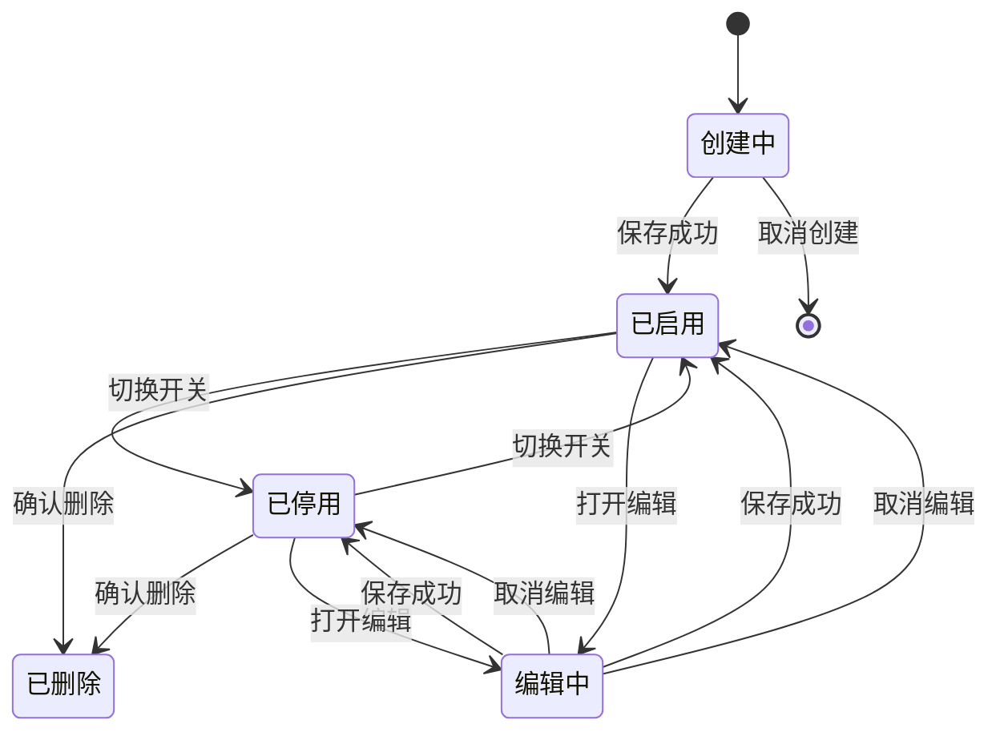

# 智能体管理 — 需求分析文档

## 修订记录

| 修订时间 | 修订内容 | 修订人 |
|----------|----------|--------|
| 2026-07-14 | 初稿 | 需求分析AI工程师 |

---

## 一、业务背景

### 业务场景
iot-platform 现有「全能AI」等智能服务，需调用大模型能力来完成设备端 AI 分析（画面理解、告警研判）及用户端交互（AI 助手）。当前平台缺乏统一的智能体管理能力——模型选择、提示词、工具/插件等散落在代码或未配置化，运营无法自助创建和调试智能体。

### 用户痛点
1. **无法自助配置**：新增一个 AI 场景（如「厨房安全智能体」）需开发介入写提示词、调模型
2. **无法调试验证**：提示词效果不可见，只能上线后看用户反馈
3. **模型/Key 散落**：不同算法可能用不同模型，API Key 缺乏统一管理
4. **无法复用**：同一個智能体逻辑无法被多个产品/算法共享

### 产品目标
建设**智能体管理平台**，实现：
1. 可视化创建、配置、调试智能体（提示词 + 模型 + 工具）
2. 模型/API Key 统一管理
3. 智能体与现有算法体系打通，为「全能AI」等智能服务提供配置化支撑
4. 在线调试能力，运营可即时验证智能体效果

### 参考平台
阿里云百炼（Bailian）智能体平台：可视化定义提示词、模型、知识库、插件，提供在线调试窗口。

---

## 二、名词解释

| 术语 | 说明 |
|------|------|
| 智能体 (Agent) | 一个完整的大模型调用配置单元，包含提示词、模型、工具、参数等，对外暴露统一的调用接口 |
| 模型 (Model) | 大语言模型实例，如通义千问 Qwen-Max、文心一言 ERNIE-4.0、GLM-4 等 |
| 模型厂商 (Provider) | 模型供应商，如阿里云、百度智能云、智谱 AI 等 |
| 工具 (Tool) | 智能体可调用的外部能力插件，如「获取摄像头截图」「查询设备状态」「发送通知」等 |
| 提示词 (System Prompt) | 智能体的系统指令，定义其角色、行为规则、输出格式 |
| 调试会话 (Debug Session) | 后台在线测试智能体的临时对话，用于验证提示词效果 |
| 知识库 (Knowledge Base) | 智能体可检索的参考文档集合（RAG），首期不做 |
| 算法绑定 | 智能体与现有 things-model 算法（algorithmId）的关联关系 |

---

## 三、功能范围

### 3.1 功能列表总览

| 序号 | 模块 | 功能 | 优先级 | 说明 |
|------|------|------|--------|------|
| 1 | 智能体管理 | 智能体列表 | P0 | 分页列表，展示名称、绑定模型、关联算法数、更新时间 |
| 2 | 智能体管理 | 创建/编辑智能体 | P0 | 配置名称、描述、模型、提示词、参数 |
| 3 | 智能体管理 | 删除智能体 | P0 | 确认后删除，被算法引用时提示 |
| 4 | 模型管理 | 模型列表 | P0 | 管理可用的模型清单 |
| 5 | 模型管理 | 添加/编辑模型 | P0 | 配置厂商、模型标识、API Key、Endpoint |
| 6 | 模型管理 | 启用/停用模型 | P0 | 开关控制，停用后已绑定智能体仍可编辑 |
| 7 | 智能体调试 | 在线调试窗口 | P0 | 类似百炼的对话测试面板，即时验证智能体 |
| 8 | 智能体调试 | 调试历史 | P1 | 保存调试会话记录 |
| 9 | 智能体配置 | 工具/插件绑定 | P1 | 为智能体绑定可调用工具（摄像头截图、设备查询等） |
| 10 | 智能体配置 | 模型参数调节 | P0 | 温度、最大 Token、Top-P 等 |
| 11 | 算法联动 | 算法绑定智能体 | P0 | 在算法配置中关联已创建的智能体 |
| 12 | 调用日志 | 调用记录 | P1 | 记录每次智能体调用的输入/输出/耗时/Token 消耗 |

### 3.2 不做/暂不做的功能（明确边界）

| 功能 | 原因 | 后续计划 |
|------|------|----------|
| 知识库（RAG） | 复杂度高，需向量数据库等基础设施 | 二期 |
| 工作流编排（多智能体协作） | 首期聚焦单智能体 | 按需 |
| 用户端自定义智能体 | 首期仅运营后台配置 | 后续 |
| 模型微调/训练 | 超出配置化范围 | 不计划 |
| 智能体版本管理/回滚 | 首期用编辑历史替代 | 按需 |
| A/B 测试联动 | 可手动在 AB 实验中选择不同智能体 | 按需 |
| 模型性能监控/告警 | 首期仅基础日志 | 二期 |

---

## 四、场景穷举分析

### 4.1 智能体管理（列表 + 创建/编辑 + 删除）

#### 4.1.1 功能概述
- **功能目的**：运营在后台管理智能体配置，支持创建、查看、编辑和删除。
- **前置条件**：已登录后台，至少存在一个可用模型。

#### 4.1.2 正常场景

| 场景编号 | 场景名称 | 前置条件 | 操作步骤 | 预期结果 | 状态变化 |
|----------|----------|----------|----------|----------|----------|
| N-001 | 创建智能体 | 已有可用模型 | 点击「创建智能体」→ 填写名称/描述 → 选择模型 → 填写提示词 → 设置参数 → 保存 | 列表新增一条记录，状态为「已启用」 | 新增 |
| N-002 | 编辑智能体 | 智能体已存在 | 点击编辑 → 修改提示词/模型/参数 → 保存 | 配置更新，调试窗口提示词同步刷新 | 更新 |
| N-003 | 删除智能体（未被引用） | 智能体未被任何算法绑定 | 点击删除 → 确认弹窗 → 确认 | 智能体从列表移除 | 删除 |
| N-004 | 删除智能体（已被引用） | 智能体已被算法绑定 | 点击删除 → 提示「被 N 个算法引用，确定删除？」 → 确认 | 删除后对应算法的智能体字段清空 | 删除 |
| N-005 | 停用智能体 | 智能体为启用状态 | 切换启用开关 → 关闭 | 关联算法的智能体调用返回错误提示 | 停用 |
| N-006 | 列表筛选 | 列表存在多条记录 | 输入智能体名称关键词 → 回车 | 列表过滤显示匹配项 | — |
| N-007 | 翻页 | 智能体数量 > 单页上限 | 点击下一页 | 加载下一页数据 | — |

#### 4.1.3 异常场景

| 场景编号 | 异常类型 | 触发条件 | 系统行为 | 用户感知 |
|----------|----------|----------|----------|----------|
| E-001 | 数据为空 | 尚未创建任何智能体 | 列表展示空态 | 空态占位 + 「创建第一个智能体」引导按钮 |
| E-002 | 保存失败 | 网络异常 / 超时 | 保持弹窗不关闭 | Toast 提示「保存失败，请重试」 |
| E-003 | 模型不可用 | 所有模型均未启用 | 点击创建时模型下拉为空 | 下拉提示「暂无可用模型，请先配置模型」 |
| E-004 | 必填校验 | 名称/模型/提示词未填 | 点击保存 | 对应字段标红提示 |
| E-005 | 名称重复 | 创建时名称与已有智能体重名 | 点击保存 | 建议不拦截，仅弱提示（名称非唯一标识） |
| E-006 | 数据异常 | 已绑定的模型被删除 | 智能体仍存在，模型字段显示「已删除」 | 编辑时强制要求重选模型 |
| E-007 | 并发冲突 | 两人同时编辑同一智能体 | 后保存者 | 覆盖前保存，不做冲突检测（首期） |

#### 4.1.4 边界条件

| 条件项 | 最小值 | 最大值 | 默认值 | 超限行为 |
|--------|--------|--------|--------|----------|
| 智能体名称 | 1 字符 | 50 字符 | — | Toast 提示 |
| 提示词长度 | 1 字符 | 10000 字符 | — | Toast 提示 |
| 温度 (Temperature) | 0 | 2.0 | 0.7 | 滑块限位 |
| 最大 Token | 256 | 128000（模型上限） | 4096 | 滑块 + 输入框限位 |
| Top-P | 0 | 1.0 | 0.9 | 滑块限位 |
| 单页列表数 | — | — | 页容量 10 | 翻页 |

#### 4.1.5 状态流转



---

### 4.2 模型管理

#### 4.2.1 功能概述
- **功能目的**：统一管理大模型厂商的 API Key、模型标识、Endpoint，供智能体选择使用。
- **前置条件**：已登录后台。

#### 4.2.2 正常场景

| 场景编号 | 场景名称 | 前置条件 | 操作步骤 | 预期结果 | 状态变化 |
|----------|----------|----------|----------|----------|----------|
| N-101 | 添加模型 | 已有厂商 API Key | 点击添加 → 选择厂商 → 填写模型标识/API Key/Endpoint → 保存 | 模型列表新增一条，默认启用 | 新增 |
| N-102 | 编辑模型 | 模型已存在 | 点击编辑 → 修改 API Key/Endpoint → 保存 | 已绑定智能体的模型配置同步更新 | 更新 |
| N-103 | 停用模型 | 模型被智能体引用 | 切换启用开关 → 确认提示 | 已绑定智能体不中断，编辑时提示重选 | 停用 |
| N-104 | 删除模型（未被引用） | 模型未被任何智能体绑定 | 点击删除 → 确认 → 删除 | 列表移除 | 删除 |

#### 4.2.3 异常场景

| 场景编号 | 异常类型 | 触发条件 | 系统行为 | 用户感知 |
|----------|----------|----------|----------|----------|
| E-101 | API Key 无效 | 添加时填入无效 Key | 不做实时校验 | 智能体调用时返回「模型鉴权失败」 |
| E-102 | 删除被引用 | 模型已被智能体绑定 | 提示「被 N 个智能体引用，不可删除」 | 引导先解绑再删除 |
| E-103 | 厂商选择 | 预设厂商不满足需求 | — | 提供「自定义」选项，手动填写 Endpoint |

#### 4.2.4 边界条件

| 条件项 | 最小值 | 最大值 | 默认值 | 超限行为 |
|--------|--------|--------|--------|----------|
| 厂商 | 预设 3 个（阿里/百度/智谱） | — | 阿里云 | 支持自定义 |
| API Key | — | — | — | 输入框掩码显示（仅最后 4 位明文） |
| Endpoint URL | — | — | 按厂商预填 | — |

---

### 4.3 智能体在线调试

#### 4.3.1 功能概述
- **功能目的**：运营创建/编辑智能体后，在后台即时测试智能体效果，无需发布到 APP。
- **前置条件**：智能体已保存（至少名称+模型+提示词已填）。

#### 4.3.2 正常场景

| 场景编号 | 场景名称 | 前置条件 | 操作步骤 | 预期结果 | 状态变化 |
|----------|----------|----------|----------|----------|----------|
| N-201 | 在线调试 | 智能体已配置 | 在调试窗口输入消息 → 发送 | 展示智能体回复，下方显示耗时/Token 消耗 | — |
| N-202 | 多轮对话 | 调试窗口已有上下文 | 连续发送多条消息 | 多条消息保持上下文 | — |
| N-203 | 清空上下文 | 调试窗口有历史对话 | 点击「清空对话」 | 历史消息清空，可重新开始 | — |
| N-204 | 调试参数覆盖 | 智能体温度为 0.7 | 调试面板将温度临时改为 0.3 → 发送 | 本次调用使用 0.3，不影响智能体保存的温度 | — |
| N-205 | 切换模型调试 | 智能体绑定模型 A | 调试面板切换为模型 B → 发送 | 使用模型 B 调用，智能体配置不变 | — |

#### 4.3.3 异常场景

| 场景编号 | 异常类型 | 触发条件 | 系统行为 | 用户感知 |
|----------|----------|----------|----------|----------|
| E-201 | 模型调用失败 | API Key 无效 / 额度不足 / 超时 | 调试窗口显示错误消息 | 「调用失败：{错误信息}」，可重试 |
| E-202 | 内容过长 | 回复超过 Token 上限 | 截断或分页 | 显示截断内容 + 提示 |
| E-203 | 网络超时 | 请求超过 30s 无响应 | 中止请求 | 「请求超时，请重试」 |
| E-204 | 提示词为空 | 未配置提示词 | 发送消息 | 使用默认提示词，并给出弱提示 |

---

### 4.4 工具/插件绑定（P1）

#### 4.4.1 功能概述
- **功能目的**：为智能体配置可调用的外部工具，实现与 IoT 设备的联动（截图、查询状态等）。
- **前置条件**：平台已定义可用工具清单。

#### 4.4.2 正常场景

| 场景编号 | 场景名称 | 前置条件 | 操作步骤 | 预期结果 | 状态变化 |
|----------|----------|----------|----------|----------|----------|
| N-301 | 绑定工具 | 编辑智能体 | 在「工具」区勾选可用工具 → 保存 | 智能体拥有工具调用能力 | — |
| N-302 | 解绑工具 | 智能体已绑定工具 | 取消勾选 → 保存 | 该智能体不再具备该工具能力 | — |

---

## 五、跨模块联动分析

### 5.1 与现有「产品开发 → 算法配置」的联动

```
智能体管理（新模块）                   产品开发（现有）
┌─────────────────┐               ┌─────────────────────────┐
│ 智能体列表        │               │ Step 2: 设备算法配置       │
│ ├ 智能体 A        │◄── 绑定 ──►  │ ├ 全能AI (algorithmId:1013)│
│ ├ 智能体 B        │               │ ├ 智能告警 (algorithmId:...) │
│ └ 智能体 C        │               │ └ ...                     │
└─────────────────┘               └─────────────────────────┘
```

- 在现有算法配置中新增「关联智能体」下拉，选择已创建的智能体
- 一个算法可绑定一个智能体
- 一个智能体可被多个算法引用
- 智能体停用/删除时，需同步通知关联算法

### 5.2 与套餐管理的联动

- 套餐配置中「AI 服务」勾选后，需确保对应智能体已配置
- 套餐价格可关联智能体调用次数/配额

### 5.3 与 APP 端的联动

- 设备触发 AI 分析 → APP/设备端请求后端 → 后端调用对应智能体 → 返回结果
- 用户在 APP 内使用 AI 助手 → APP 请求后端 → 后端调用智能体 → 流式返回
- 智能体配置变更后，后端即时生效（无需 APP 发版）

---

## 六、建议方案（澄清问题答复）

### Q1: 智能体的应用场景范围？

**建议：两者覆盖，首期以设备端 AI 分析为主。**

设备端分析场景（如摄像头画面理解、告警研判）优先级更高，因为这是 IoT 平台的核心差异化能力。对话交互（APP 内 AI 助手）作为辅助场景，使用同一套智能体配置。

### Q2: 核心配置项？

**建议首期支持：名称、描述、模型选择、系统提示词、温度、最大 Token、Top-P。**

工具/插件绑定列为 P1（需要先定义可用工具清单）。知识库列为二期。

### Q3: 模型对接？

**建议：预设三家厂商（阿里云通义千问、百度文心一言、智谱 GLM），支持自定义 Endpoint + API Key。**

API Key 统一在模型管理中配置，智能体只选择模型，不感知 Key。支持启用/停用模型，停用后不影响已有智能体编辑。

### Q4: 调试功能范围？

**建议：首期做对话测试窗口 + 基础指标（耗时/Token）。**

调试历史 P1，高级分析二期。调试窗口支持临时覆盖模型和参数，方便 A/B 测试不同配置的效果。

### Q5: 与现有「全能AI」算法的关系？

**建议：智能体独立于算法体系，通过绑定关联。**

在现有 `config.vue` Step 2 的算法表格中新增「关联智能体」列，下拉选择。一个智能体可被多个算法复用（如「通用视觉分析智能体」可同时用于全能AI、智能告警等）。

### Q6: 知识库？

**建议：二期做。** 首期聚焦提示词 + 模型 + 调试的 MVP。

---

## 七、待确认问题

| 序号 | 问题 | 建议方案 | 待用户确认 |
|------|------|----------|:---:|
| ① | 智能体是否需要支持流式输出（SSE）？ | 建议首期做，调试窗口展示打字机效果 | ☐ |
| ② | 工具/插件清单是否需要首期定义？ | 建议先预留 UI，首期仅做「暂无可用工具」空态 | ☐ |
| ③ | 是否需要多语言提示词（中/英等）？ | 建议首期不做，使用单语言提示词 | ☐ |
| ④ | 模型参数是否需要支持多模型独立配置？ | 每个智能体选一个模型，参数跟随智能体 | ☐ |
| ⑤ | 调试窗口是否需要支持图片输入（多模态）？ | 首期仅文本，多模态二期 | ☐ |
| ⑥ | 智能体是否需要独立的新路由页面？ | 建议新增 `/agent` 路由，同时保留从产品开发页跳转 | ☐ |
