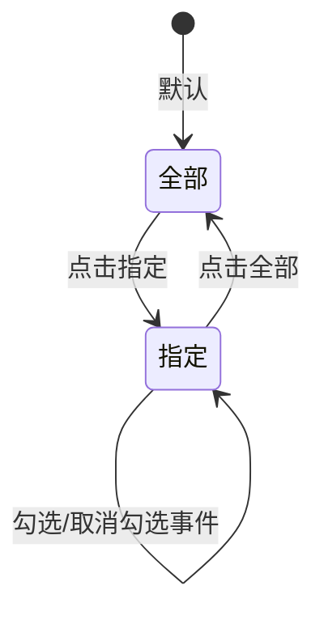
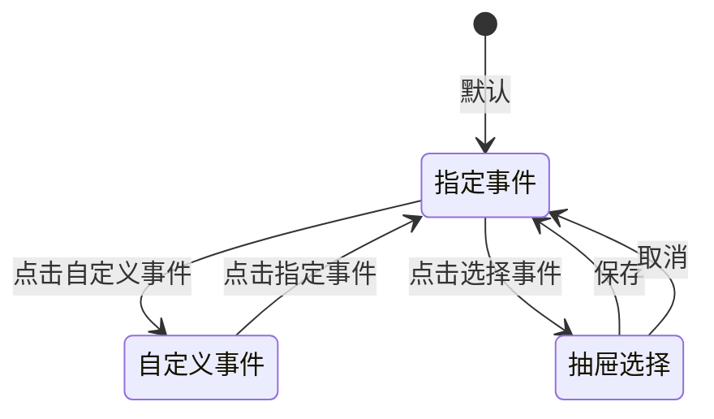
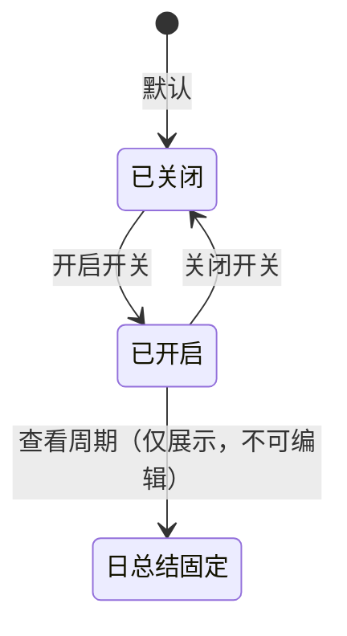

# 智能体配置优化 — 需求分析文档

## 修订记录

| 修订时间 | 修订内容 | 修订人 |
|----------|----------|--------|
| 2026-08-20 | 初稿 | 需求分析AI工程师 |

---

## 一、业务背景

### 业务场景
智能体管理已上线「智能体配置」页（`/agent/:id` 的配置 Tab），运营可在该页为智能体配置抓图、事件识别、AI 搜索、阶段总结等能力。当前配置项存在三处不符合实际业务语义的问题，需优化：

1. **事件识别缺少事件范围配置**：原配置仅有「模型选择 + 提示词 + 输出字段」，未区分智能体要识别「哪些事件」，无法约束识别范围。
2. **抓图配置缺少触发事件类型**：原配置只支持「事件触发 / 定时触发 / 混合触发」三种抓图模式，事件触发模式下未细分「哪些事件触发抓图」。
3. **阶段总结周期不可控**：原「总结周期」为自由配置（周期 + Cron 表达式），与产品实际定位（按日生成）不符。

### 用户痛点
1. **识别范围不可控**：运营无法指定智能体只识别「宠物看护」或「家门看护」的特定事件，导致智能体对所有事件无差别识别，误判率高。
2. **抓图范围过宽**：事件触发抓图时无法限定触发事件类型，全部事件都抓图，产生大量无效抓图、消耗存储与算力。
3. **总结周期语义模糊**：自由 Cron 配置过于技术化，运营难以理解「日总结」的业务约束（次数上限、补生成规则）。
4. **冗余模型选择**：事件识别、阶段总结环节的模型选择与智能体整体的模型选择重复，运营困惑，需去除。

### 产品目标
1. 事件识别支持「指定事件 / 自定义事件」两种事件配置方式，指定事件可侧边弹窗多选，去除模型选择
2. 抓图配置在事件/混合触发模式下新增「触发事件类型：全部 / 指定」，指定时多选事件
3. 阶段总结周期固定为「日总结」，明确生成规则，去除模型选择

---

## 二、名词解释

| 术语 | 说明 |
|------|------|
| 智能体 (Agent) | 一个完整的大模型调用配置单元，包含提示词、模型、工具、参数等，对外暴露统一调用接口 |
| 智能体配置 | 智能体管理下的配置页，包含抓图配置、事件识别、AI 搜索、阶段总结、高级设置等模块 |
| 抓图配置 | 配置设备在何种时机抓取图片供智能体分析，分「事件触发 / 定时触发 / 混合触发」三种模式 |
| 触发事件类型 | 事件/混合触发抓图模式下，限定「哪些事件」触发抓图，取值为「全部 / 指定」 |
| 事件识别 | 智能体对抓取图片进行事件分析，输出结构化事件结果 |
| 事件配置 | 事件识别模块中限定智能体「识别哪些事件」的配置，取值为「指定事件 / 自定义事件」 |
| 指定事件 | 平台预置的事件清单（来自事件库中算法 ID「4003」关联的事件），运营多选 |
| 自定义事件 | 由终端用户在 APP 侧自行定义的事件，平台不提供配置，仅说明引导 |
| 事件库 | 物模型管理中的事件体系（`thing-model`），事件以事件 ID 唯一标识 |
| 算法 ID 4003 | 关联「宠物看护」「家门看护」事件集的事件库算法标识，作为指定事件数据源 |
| 阶段总结 | 智能体按周期对某段时间内的设备事件进行汇总分析并生成总结 |
| 日总结 | 阶段总结的固定周期，按自然日生成一次总结 |

---

## 三、功能范围

### 3.1 功能列表总览

| 序号 | 模块 | 功能 | 优先级 | 说明 | 备注 |
|------|------|------|--------|------|------|
| 1 | 抓图配置 | 触发事件类型「全部」 | P0 | 事件/混合触发模式下默认值，全部事件均触发抓图 | 新增 |
| 2 | 抓图配置 | 触发事件类型「指定」 | P0 | 指定时展示事件多选，选中的事件才触发抓图 | 新增 |
| 3 | 事件识别 | 事件配置「指定事件」 | P0 | 默认值，侧边弹窗多选事件库「4003」关联事件 | 新增 |
| 4 | 事件识别 | 事件配置「自定义事件」 | P0 | 平台不提供配置，仅展示引导说明 | 新增 |
| 5 | 事件识别 | 去除模型选择 | P0 | 事件识别不再单独选模型，沿用智能体整体模型 | 移除 |
| 6 | 阶段总结 | 总结周期固定「日总结」 | P0 | 固定为日总结，展示生成规则备注 | 改造 |
| 7 | 阶段总结 | 去除模型选择 | P0 | 阶段总结不再单独选模型 | 移除 |

### 3.2 不做/暂不做的功能（明确边界）

| 功能 | 原因 | 后续计划 |
|------|------|----------|
| 自定义事件在平台侧配置 | 由终端用户在 APP 侧自行定义，平台不管理 | 不计划 |
| 指定事件数据源的手动编辑 | 数据源固定为事件库「4003」关联事件，不开放增删 | 事件库变更时同步 |
| 阶段总结周期自定义（周/月/自定义 Cron） | 产品定位固定为日总结 | 按需扩展 |
| 抓图触发事件类型的自定义事件来源 | 抓图触发事件为设备能力类事件（侦测/告警），与事件识别事件库不同源 | 不计划 |

---

## 四、场景穷举分析

### 4.1 抓图配置 — 触发事件类型

#### 4.1.1 功能概述
- **功能目的**：在「事件触发」「混合触发」两种抓图模式下，限定哪些事件会触发抓图，减少无效抓图。
- **前置条件**：进入智能体配置页，抓图模式为「事件触发」或「混合触发」。

#### 4.1.2 正常场景

| 场景编号 | 场景名称 | 前置条件 | 操作步骤 | 预期结果 | 状态变化 |
|----------|----------|----------|----------|----------|----------|
| N-001 | 默认「全部」 | 抓图模式为事件/混合触发 | 进入配置页，查看触发事件类型 | 默认选中「全部」，展示提示「设备上报的全部事件均触发抓图」 | — |
| N-002 | 切换「指定」 | 触发事件类型为「全部」 | 点击「指定」 | 展示事件多选复选框列表 | 切换 |
| N-003 | 勾选多个事件 | 触发事件类型为「指定」 | 勾选 2 个及以上事件 | 选中事件高亮，配置保存后仅这些事件触发抓图 | 选中 |
| N-004 | 取消勾选 | 已勾选若干事件 | 取消某事件勾选 | 该事件从选中列表移除 | 取消选中 |
| N-005 | 切回「全部」 | 已勾选若干事件 | 点击「全部」 | 复选框区隐藏，恢复「全部事件触发」 | 切换 |

#### 4.1.3 异常场景

| 场景编号 | 异常类型 | 触发条件 | 系统行为 | 用户感知 |
|----------|----------|----------|----------|----------|
| E-001 | 数据为空 | 「指定」下未勾选任何事件 | 保存时 | 提示「请至少选择一个触发事件」，或回退「全部」 |
| E-002 | 模式切换 | 从「事件触发」切到「定时触发」 | 触发事件类型区隐藏 | 已选事件配置保留在表单中，切回后还原 |
| E-003 | 保存失败 | 网络异常/超时 | 保持当前页面 | Toast 提示「保存失败，请重试」 |

#### 4.1.4 边界条件

| 条件项 | 最小值 | 最大值 | 默认值 | 超限行为 |
|--------|--------|--------|--------|----------|
| 指定事件勾选数 | 0（提示未选） | 8（全部） | 0 | 保存时校验提示 |
| 触发事件类型 | 全部 | 指定 | 全部 | 单选互斥 |

#### 4.1.5 状态流转

---

### 4.2 事件识别 — 事件配置

#### 4.2.1 功能概述
- **功能目的**：限定智能体识别的事件范围，支持从事件库预置清单多选，或交由终端用户自定义。
- **前置条件**：进入智能体配置页，事件识别模块已展开。

#### 4.2.2 正常场景

| 场景编号 | 场景名称 | 前置条件 | 操作步骤 | 预期结果 | 状态变化 |
|----------|----------|----------|----------|----------|----------|
| N-101 | 默认「指定事件」 | 进入配置页 | 查看事件配置 | 默认选中「指定事件」，未选择时展示「未选择事件」空态 | — |
| N-102 | 打开选择事件抽屉 | 事件配置为「指定事件」 | 点击「选择事件」 | 弹出右侧抽屉，展示事件清单（事件名称 + 事件 ID） | 打开 |
| N-103 | 多选事件 | 抽屉已打开 | 勾选多个事件 → 保存 | 抽屉关闭，选中事件以标签形式展示，可单个删除 | 选中 |
| N-104 | 删除已选事件 | 已选若干事件 | 点击某事件标签的关闭按钮 | 该事件移除 | 删除 |
| N-105 | 重新打开抽屉 | 已选若干事件 | 再次点击「选择事件」 | 抽屉内已选事件预勾选 | 打开 |
| N-106 | 切换「自定义事件」 | 事件配置为「指定事件」 | 点击「自定义事件」 | 指定事件选择区隐藏，展示引导说明 | 切换 |
| N-107 | 查看自定义事件说明 | 事件配置为「自定义事件」 | 查看说明文案 | 展示「自定义事件由终端用户自行定义，平台不提供事件配置」 | — |

#### 4.2.3 异常场景

| 场景编号 | 异常类型 | 触发条件 | 系统行为 | 用户感知 |
|----------|----------|----------|----------|----------|
| E-101 | 数据为空 | 事件清单加载失败/为空 | 打开抽屉 | 空态占位，提示「暂无可用事件」 | 空态 |
| E-102 | 抽屉保存失败 | 网络异常/超时 | 点击抽屉保存 | 抽屉保持打开 | Toast「保存失败，请重试」 |
| E-103 | 数据源缺失 | 事件库无「4003」关联事件 | 打开抽屉 | 事件清单为空 | 空态 + 提示联系运维核对事件库 |

#### 4.2.4 边界条件

| 条件项 | 最小值 | 最大值 | 默认值 | 超限行为 |
|--------|--------|--------|--------|----------|
| 指定事件勾选数 | 0 | 13（全部） | 0 | 允许为 0（不识别） |
| 事件配置类型 | 指定事件 | 自定义事件 | 指定事件 | 单选互斥 |
| 事件 ID | 500001 | 600008 | — | 不可手输，仅多选 |

#### 4.2.5 状态流转

#### 4.2.6 指定事件数据源

事件数据源固定为事件库中算法 ID「4003」关联的事件，共 13 个：

| 分类 | 事件名称 | 事件 ID |
|------|----------|---------|
| 宠物看护 | 宠物进食 | 500001 |
| 宠物看护 | 宠物排泄 | 500002 |
| 宠物看护 | 呕吐/异常 | 500003 |
| 宠物看护 | 宠物玩耍 | 500004 |
| 宠物看护 | 宠物睡眠 | 500005 |
| 家门看护 | 包裹送达 | 600001 |
| 家门看护 | 包裹取走 | 600002 |
| 家门看护 | 包裹在门口 | 600003 |
| 家门看护 | 快递/外卖 | 600004 |
| 家门看护 | 陌生人到访 | 600005 |
| 家门看护 | 家人出入 | 600006 |
| 家门看护 | 异常徘徊 | 600007 |
| 家门看护 | 多人聚集 | 600008 |

---

### 4.3 阶段总结 — 总结周期

#### 4.3.1 功能概述
- **功能目的**：明确阶段总结按自然日生成，约束生成次数与补生成规则。
- **前置条件**：进入智能体配置页，阶段总结模块已开启。

#### 4.3.2 正常场景

| 场景编号 | 场景名称 | 前置条件 | 操作步骤 | 预期结果 | 状态变化 |
|----------|----------|----------|----------|----------|----------|
| N-201 | 查看总结周期 | 阶段总结已开启 | 查看总结周期 | 展示固定「日总结」标签 + 备注说明 | — |
| N-202 | 了解生成规则 | 阶段总结已开启 | 查看备注 | 展示「用户手动生成，单日最多生成3次，历史未生成总结的日期，仅支持生成1次」 | — |
| N-203 | 关闭阶段总结 | 阶段总结已开启 | 切换开关关闭 | 周期及备注区隐藏，展示「开启阶段总结」引导 | 关闭 |

#### 4.3.3 异常场景

| 场景编号 | 异常类型 | 触发条件 | 系统行为 | 用户感知 |
|----------|----------|----------|----------|----------|
| E-201 | 生成次数超限 | 单日已生成 3 次后再次生成 | 拒绝生成 | 提示「单日最多生成 3 次」 |
| E-202 | 补生成校验 | 历史未生成日期尝试补生成 | 仅允许生成 1 次 | 第二次提示「仅支持生成 1 次」 |

#### 4.3.4 边界条件

| 条件项 | 最小值 | 最大值 | 默认值 | 超限行为 |
|--------|--------|--------|--------|----------|
| 总结周期 | 日总结（固定） | 日总结（固定） | 日总结 | 不可修改 |
| 单日生成次数 | 0 | 3 | — | 超过 3 次拒绝 |
| 历史补生成次数 | 0 | 1 | — | 超过 1 次拒绝 |

#### 4.3.5 状态流转

---

## 五、跨模块联动分析

### 5.1 与事件库（物模型管理）的联动
- 事件识别的「指定事件」数据源来自事件库中算法 ID「4003」关联的事件
- 事件库中「4003」关联事件新增/删除时，配置页事件清单需同步更新
- 事件 ID 为唯一标识，配置保存时按事件 ID 存储

### 5.2 与 APP 端（carecam_pro）的联动
- 「自定义事件」由 APP 终端用户定义，平台仅展示引导说明，不参与管理
- 事件 ID 与 APP 侧事件定义保持一致，确保识别结果对得上

### 5.3 与智能体调用的联动
- 事件识别范围（指定事件清单）将作为智能体识别时的约束参数下发
- 抓图触发事件类型将影响设备端抓图策略，需随配置下发到设备/后端

### 5.4 模型选择的去重
- 事件识别、阶段总结去除独立模型选择后，统一沿用智能体整体的模型配置，避免多处配置冲突

---

## 六、待确认问题

| 序号 | 问题 | 建议方案 | 待用户确认 |
|------|------|----------|:---:|
| ① | 指定事件数据源「4003」在事件库中暂无对应算法定义，当前以 carecam_pro 宠物看护/家门看护 13 个事件为准 | 若存在正式的「4003」事件清单，请提供，将切换到 `getAlgorithmEvents('4003')` 动态取数 | ☐ |
| ② | 抓图「指定」未勾选任何事件时是否允许保存？ | 建议保存时校验，提示「请至少选择一个触发事件」 | ☐ |
| ③ | 事件识别「指定事件」是否允许 0 个（即不识别任何事件）？ | 建议允许 0 个，等同「不限制/不识别」 | ☐ |
| ④ | 抓图触发事件类型与事件识别的指定事件清单是否复用同一数据源？ | 建议不同源：抓图为设备能力事件（侦测/告警），事件识别为事件库「4003」事件 | ☐ |
| ⑤ | 阶段总结「日总结」是否需要在配置页展示生成按钮/入口？ | 建议配置页仅展示规则说明，生成在 APP/后端侧进行 | ☐ |
