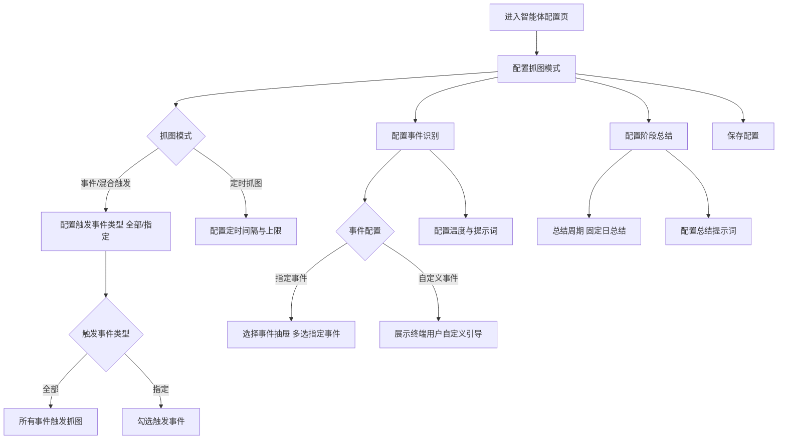
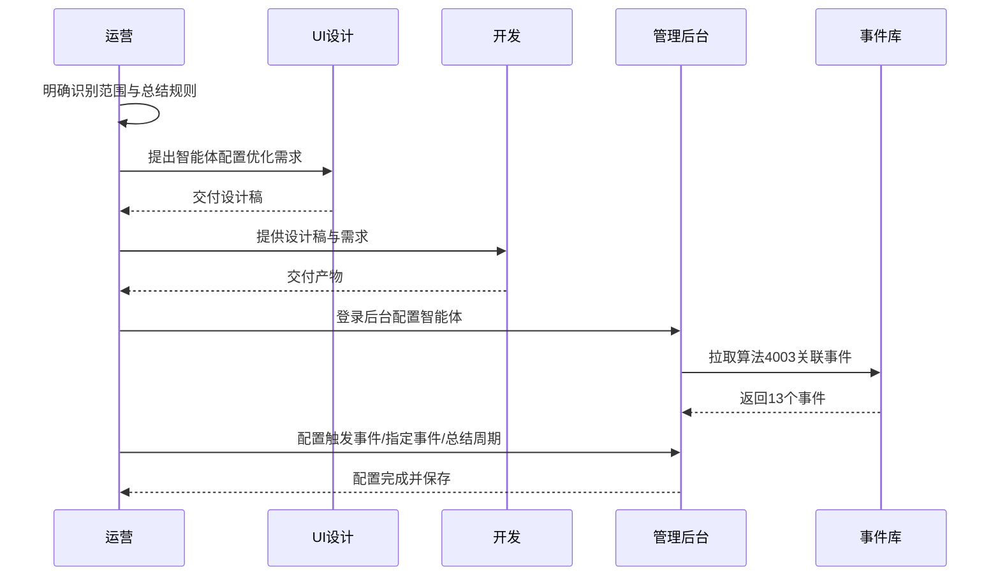
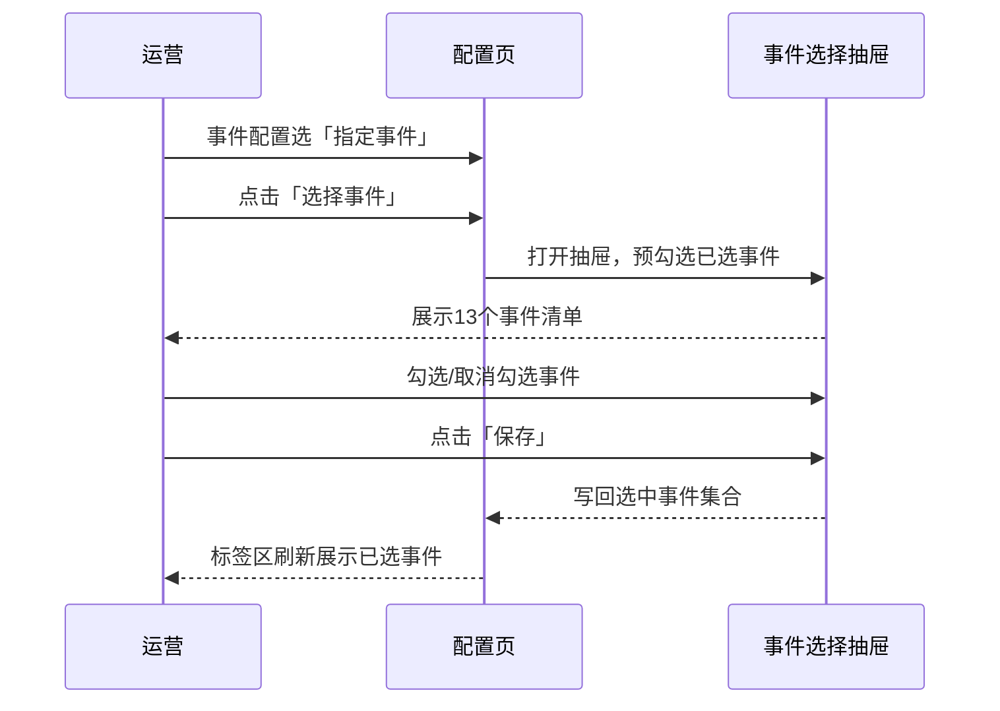
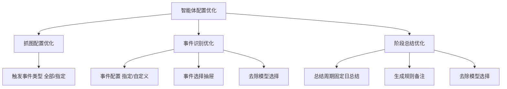

# 智能体配置优化 — 完整业务 PRD

## 修订记录

| 修订时间 | 修订内容 | 修订人 |
|----------|----------|--------|
| 2026-08-20 | 初稿（融合需求分析与 UI 设计） | AI-PRD生成工程师 |

---

## 一、业务背景

### 业务场景

智能体管理已上线「智能体配置」页，运营在该页为智能体配置抓图、事件识别、AI 搜索、阶段总结等能力。现有配置项存在三处与业务语义不符的问题，需优化：

1. **事件识别缺少事件范围配置**：原仅配置「模型 + 提示词 + 输出字段」，未区分智能体要识别「哪些事件」，识别范围不可控。
2. **抓图配置缺少触发事件类型**：事件/混合触发模式下未细分「哪些事件触发抓图」，导致全部事件无差别抓图，产生大量无效抓图。
3. **阶段总结周期不可控**：原「总结周期」为自由配置（周期 + Cron 表达式），与产品定位（按日生成）不符。

### 用户痛点

1. 运营无法指定智能体只识别「宠物看护」或「家门看护」的特定事件，误判率高
2. 事件触发抓图无法限定触发事件，全部事件都抓图，消耗存储与算力
3. 自由 Cron 配置过于技术化，运营难以理解「日总结」的次数上限与补生成规则
4. 事件识别、阶段总结的模型选择与智能体整体模型重复，造成配置冗余与困惑

### 产品目标

1. 事件识别支持「指定事件 / 自定义事件」两种事件配置方式，指定事件可侧边弹窗多选，去除模型选择
2. 抓图配置在事件/混合触发模式下新增「触发事件类型：全部 / 指定」，指定时多选事件
3. 阶段总结周期固定为「日总结」，明确生成规则，去除模型选择

---

## 二、名词解释

| 术语 | 说明 |
|------|------|
| 智能体 (Agent) | 一个完整的大模型调用配置单元，包含提示词、模型、工具、参数等，对外暴露统一调用接口 |
| 智能体配置 | 智能体管理下的配置页，包含抓图配置、事件识别、AI 搜索、阶段总结、高级设置等模块 |
| 抓图配置 | 配置设备在何种时机抓取图片供智能体分析，分「事件触发 / 定时抓图 / 混合模式」三种模式 |
| 触发事件类型 | 事件/混合触发抓图模式下，限定「哪些事件」触发抓图，取值「全部 / 指定」 |
| 事件识别 | 智能体对抓取图片进行事件分析，输出结构化事件结果 |
| 事件配置 | 事件识别模块中限定智能体「识别哪些事件」的配置，取值「指定事件 / 自定义事件」 |
| 指定事件 | 平台预置的事件清单（事件库算法 ID「4003」关联事件），运营多选 |
| 自定义事件 | 由终端用户在 APP 侧自行定义的事件，平台不提供配置 |
| 事件库 | 物模型管理中的事件体系，事件以事件 ID 唯一标识 |
| 算法 ID 4003 | 关联「宠物看护」「家门看护」事件集的事件库算法标识，作为指定事件数据源 |
| 阶段总结 | 智能体按周期对某段时间内的设备事件进行汇总分析并生成总结 |
| 日总结 | 阶段总结的固定周期，按自然日生成一次总结 |

---

## 三、业务实体说明

| 实体 | 关键属性 | 说明 |
|------|----------|------|
| 智能体 | 名称、描述、模型、系统提示词、参数 | 配置的主体，本次优化其下属配置项 |
| 抓图配置 | 抓图模式、触发事件类型、触发事件集合、定时间隔、每日上限 | 定义设备抓图策略 |
| 事件识别配置 | 事件配置类型、指定事件集合、温度、系统提示词、输出格式提示词 | 定义智能体识别范围与规则 |
| 事件 | 事件 ID、事件名称、所属分类 | 事件库中可被识别的原子事件 |
| 阶段总结配置 | 总结周期（固定日总结）、总结提示词、输出格式提示词 | 定义总结生成规则 |

**实体关系**：

- 1 个智能体包含 1 份抓图配置、1 份事件识别配置、1 份阶段总结配置。
- 抓图配置的「触发事件集合」引用设备能力类事件（侦测/告警），与事件识别的「指定事件」不同源。
- 事件识别配置的「指定事件集合」引用事件库算法 ID「4003」关联的 13 个事件。
- 事件识别、阶段总结不再单独配置模型，统一沿用智能体整体模型。

---

## 四、核心业务流程

### 4.1 流程图（智能体配置优化）



### 4.2 全局时序图（全链路协作）



### 4.3 局部队列时序图（指定事件多选）



---

## 五、业务规则

| 编号 | 规则 | 说明 |
|------|------|------|
| R01 | 触发事件类型默认「全部」 | 事件/混合抓图模式下，触发事件类型默认选中「全部」 |
| R02 | 触发事件类型随抓图模式显隐 | 抓图模式为「定时抓图」时，触发事件类型区整体隐藏；切回「事件/混合」时还原（已选值保留） |
| R03 | 触发事件类型「指定」多选 | 指定时展示 8 个设备能力类事件多选，选中的事件触发抓图 |
| R04 | 触发事件类型「全部」语义 | 设备上报的全部事件均触发抓图 |
| R05 | 事件配置默认「指定事件」 | 事件识别模块默认选中「指定事件」 |
| R06 | 指定事件数据源 | 指定事件清单固定为事件库算法 ID「4003」关联的 13 个事件（宠物看护 5 + 家门看护 8），不可手输 |
| R07 | 指定事件多选 | 支持 0~13 个事件多选，0 个时展示「未选择事件」空态 |
| R08 | 自定义事件不配置 | 事件配置选「自定义事件」时，平台不提供事件配置，仅展示终端用户自定义引导说明 |
| R09 | 事件识别去除模型选择 | 事件识别模块不再单独选模型，统一沿用智能体整体模型 |
| R10 | 阶段总结周期固定 | 总结周期固定为「日总结」，不可编辑 |
| R11 | 日总结生成规则 | 用户手动生成，单日最多生成 3 次，历史未生成总结的日期仅支持生成 1 次 |
| R12 | 阶段总结去除模型选择 | 阶段总结模块不再单独选模型，统一沿用智能体整体模型 |

---

## 六、功能架构



---

## 七、详细功能描述

### 7.1 抓图配置 — 触发事件类型（新增）

**功能应用场景**：运营在「事件触发」「混合模式」抓图下，需要限定哪些事件才触发抓图，减少无效抓图、控制存储与算力成本。

**功能详述**：

| 区域 | 说明 |
|------|------|
| 触发事件类型 | 「全部 / 指定」单选（`el-radio-group`） |
| 全部提示 | 选中「全部」时展示「设备上报的全部事件均触发抓图」 |
| 事件多选 | 选中「指定」时展示 8 个事件复选框（流式 pills 排列） |

**8 个触发事件**：移动侦测、声音侦测、人形检测、宠物检测、车辆检测、门铃呼叫、烟雾告警、温度告警

**状态说明**：

| 状态 | 触发条件 | 展示内容 |
|------|----------|----------|
| 全部态 | 触发事件类型为「全部」（默认） | 单选「全部」+ 提示文案 |
| 指定态 | 触发事件类型为「指定」 | 8 个事件复选框 |
| 隐藏态 | 抓图模式为「定时抓图」 | 触发事件类型区整体隐藏 |

**交互说明**：点「全部」↔「指定」切换复选框区显隐；切回「全部」时保留已勾选事件不丢失；勾选/取消事件即时更新。

### 7.2 事件识别 — 事件配置（新增）

**功能应用场景**：运营需限定智能体识别哪些事件，避免对所有事件无差别识别。

**功能详述**：

| 区域 | 说明 |
|------|------|
| 事件配置 | 「指定事件 / 自定义事件」单选（`el-radio-group`） |
| 指定事件区 | 已选事件标签 + [选择事件] 按钮 |
| 自定义事件区 | 引导说明文案 |

**自定义事件引导文案**：「自定义事件由终端用户自行定义，平台不提供事件配置；终端用户可在 APP 中根据实际需求创建自定义事件。」

**状态说明**：

| 状态 | 触发条件 | 展示内容 |
|------|----------|----------|
| 指定事件态 | 事件配置为「指定事件」（默认） | 已选事件标签 + [选择事件] 按钮 |
| 指定空态 | 指定事件未选择任何事件 | 「未选择事件」占位 |
| 自定义态 | 事件配置为「自定义事件」 | 引导说明文案 |

**交互说明**：点「指定事件」↔「自定义事件」切换下方区域；已选事件标签点 × 直接删除；点 [选择事件] 打开事件选择抽屉。

### 7.3 事件选择抽屉（新增）

**功能应用场景**：运营在「指定事件」下通过侧边抽屉多选要识别的事件。

**功能详述**：

| 区域 | 说明 |
|------|------|
| 抽屉标题 | 「选择事件」 |
| 事件表格 | 3 列：选择（多选框）、事件名称、事件 ID |
| 底部按钮 | [取消] [保存] |

**13 个指定事件**（事件库算法 ID「4003」关联）：

| 分类 | 事件名称 | 事件 ID |
|------|----------|---------|
| 宠物看护 | 宠物进食 / 宠物排泄 / 呕吐异常 / 宠物玩耍 / 宠物睡眠 | 500001~500005 |
| 家门看护 | 包裹送达 / 包裹取走 / 包裹在门口 / 快递外卖 / 陌生人到访 / 家人出入 / 异常徘徊 / 多人聚集 | 600001~600008 |

**状态说明**：

| 状态 | 触发条件 | 展示内容 |
|------|----------|----------|
| 正常态 | 打开抽屉 | 事件清单表格，已选事件预勾选 |
| 空态 | 事件清单为空 | 空态占位「暂无可用事件」 |

**交互说明**：打开抽屉时已选事件预勾选；勾选/取消实时更新临时集合；点「保存」写回表单并关闭抽屉；点「取消」丢弃改动并关闭。

### 7.4 阶段总结 — 总结周期（改造）

**功能应用场景**：明确阶段总结按自然日生成，约束生成次数与补生成规则。

**功能详述**：

| 区域 | 说明 |
|------|------|
| 总结周期 | 固定展示「日总结」标签（`el-tag`），不可编辑 |
| 生成规则备注 | 「用户手动生成，单日最多生成3次，历史未生成总结的日期，仅支持生成1次」 |
| 总结提示词 | 保留（textarea + 调试按钮） |
| 输出格式提示词 | 保留（textarea + 调试按钮） |

**状态说明**：

| 状态 | 触发条件 | 展示内容 |
|------|----------|----------|
| 正常态 | 阶段总结已开启 | 「日总结」标签 + 备注 + 提示词 |
| 关闭态 | 阶段总结开关关闭 | 展示「开启阶段总结」引导 |

**交互说明**：总结周期纯展示，无交互；备注为说明文字。

---

## 八、页面信息架构

### 8.1 页面层级

本需求仅改动「智能体配置」单页的 3 个区块，无新增页面、无页面跳转：

```
智能体配置页 (/agent/:id 配置 Tab)
├── 左侧导航锚点（① 抓图配置 / ② 事件识别 / ③ AI 搜索 / ④ 阶段总结 / 高级设置）
├── 中间表单区
│   ├── ① 抓图配置（含新增「触发事件类型」）
│   ├── ② 事件识别（含新增「事件配置」、去模型选择）
│   ├── ③ AI 搜索（不变）
│   └── ④ 阶段总结（周期固定日总结、去模型选择）
├── 右侧预览区（不变）
└── 事件选择抽屉（新增，事件多选弹层）
```

### 8.2 弹层/跳转关系

| 起点 | 触发 | 终点 |
|------|------|------|
| 事件识别「选择事件」按钮 | 点击 | 事件选择抽屉 |
| 事件选择抽屉「保存」 | 点击 | 关闭抽屉，写回已选事件 |
| 事件选择抽屉「取消」 | 点击 | 关闭抽屉，丢弃改动 |

---

## 九、异常说明

| 分类 | 场景 | 处理方式 |
|------|------|----------|
| 网络 | 事件清单加载失败/超时 | 事件选择抽屉展示空态或错误提示，可重试 |
| 网络 | 保存配置失败 | Toast 提示「保存失败，请重试」，保持当前页面 |
| 数据 | 事件清单为空 | 事件选择抽屉展示空态「暂无可用事件」 |
| 数据 | 事件库无「4003」关联事件 | 抽屉事件清单为空，提示联系运维核对事件库 |
| 操作 | 抽屉保存失败 | 抽屉保持打开，Toast 提示失败 |
| 操作 | 重复提交保存 | 前端防抖，不产生重复请求 |
| 权限 | 未登录后台 | 引导登录 |

---

## 十、测试要点

### 功能回归

| 编号 | 测试点 | 前置条件 | 操作步骤 | 预期结果 |
|------|--------|----------|----------|----------|
| T-001 | 抓图模式切换不受影响 | 抓图模式为事件触发 | 切换到定时抓图再切回 | 触发事件类型区隐藏后还原，已选值保留 |
| T-002 | 事件识别其余配置不受影响 | 事件识别已开启 | 修改温度/提示词并保存 | 温度、提示词正常保存 |
| T-003 | 阶段总结提示词不受影响 | 阶段总结已开启 | 修改总结提示词并保存 | 提示词正常保存 |

### 核心场景

| 编号 | 测试点 | 前置条件 | 操作步骤 | 预期结果 |
|------|--------|----------|----------|----------|
| T-101 | 触发事件类型「指定」黄金路径 | 抓图模式为事件/混合 | 选「指定」→ 勾选 3 个事件 → 保存 | 3 个事件生效，仅这些事件触发抓图 |
| T-102 | 指定事件多选黄金路径 | 事件识别已开启 | 选「指定事件」→ 选择事件 → 抽屉勾选 2 个 → 保存 | 标签区展示 2 个已选事件 |
| T-103 | 自定义事件切换 | 事件识别已开启 | 选「自定义事件」 | 展示终端用户自定义引导说明 |

### 异常场景

| 编号 | 测试点 | 前置条件 | 操作步骤 | 预期结果 |
|------|--------|----------|----------|----------|
| T-201 | 事件清单为空 | 事件库无事件 | 打开事件选择抽屉 | 展示空态「暂无可用事件」 |
| T-202 | 抽屉取消不生效 | 已选若干事件 | 打开抽屉 → 取消勾选 1 个 → 点取消 | 原已选事件保持不变 |
| T-203 | 保存失败 | 模拟网络异常 | 修改配置点保存 | Toast「保存失败，请重试」 |

### 状态切换

| 编号 | 测试点 | 前置条件 | 操作步骤 | 预期结果 |
|------|--------|----------|----------|----------|
| T-301 | 触发事件类型切换 | 触发事件类型为「全部」 | 反复切换「全部」↔「指定」 | 复选框区显隐正确，值不丢失 |
| T-302 | 事件配置切换 | 事件配置为「指定事件」 | 反复切换「指定事件」↔「自定义事件」 | 下方区域对应切换 |
| T-303 | 阶段总结开关 | 阶段总结已开启 | 关闭再开启开关 | 周期区隐藏后还原 |

### 兼容性

| 编号 | 测试点 | 前置条件 | 操作步骤 | 预期结果 |
|------|--------|----------|----------|----------|
| T-401 | 13 个事件抽屉布局 | 事件清单完整 | 打开事件选择抽屉 | 13 行可滚动，无错乱 |
| T-402 | 8 个事件 pills 换行 | 抓图指定模式 | 勾选多个事件 | pills 流式换行，无溢出 |

---

## 十一、关键决策

| # | 决策 | 原因 |
|---|------|------|
| D1 | 指定事件数据源以 carecam_pro 宠物看护/家门看护 13 个事件为准 | 事件库中暂无算法 ID「4003」的正式定义，13 个事件为当前权威清单；若后续提供正式「4003」清单，切换为动态取数 |
| D2 | 事件识别、阶段总结去除独立模型选择 | 与智能体整体模型重复，统一沿用智能体模型，避免多处配置冲突 |
| D3 | 自定义事件不纳入平台配置 | 由终端用户在 APP 侧自行定义，平台仅展示引导说明 |
| D4 | 抓图触发事件与事件识别指定事件不同源 | 抓图为设备能力类事件（侦测/告警），事件识别为事件库「4003」事件 |
| D5 | 本次为后台配置优化，不涉及 APP 端埋点 | 无新增 APP 端用户触点，埋点与运营数据看板不适用 |

---

> **本文档为纯业务 PRD，面向产品和开发团队。不包含 API 路由、数据库表结构等技术实现细节。**

---

*文档版本: v1.0 | 创建日期: 2026-08-20*
