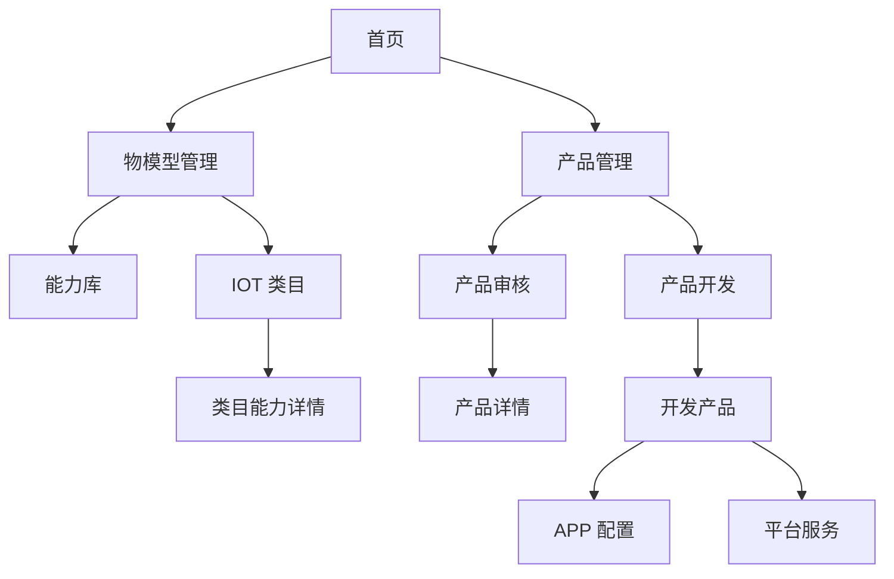

# 生态平台物模型重构 — UI/UE 设计说明

## 修订记录

| 修订时间 | 修订内容 | 修订人 |
|---|---|---|
| 2026-10-22 | 初版 |  |

---

## 一、设计目标

| 目标 | 说明 |
|---|---|
| 专业后台感 | 高密度表格、紧凑控件、清晰层级，适合长时间操作 |
| 视觉统一 | 全站统一颜色、字体、圆角、间距、表格与弹窗样式 |
| 导航统一 | 深色可收起菜单 + 浅色内容区；二级页面统一返回栏 |
| 交互一致 | 同类筛选、标签、模块切换、关联/移除操作保持同一形态 |
| 信息分层 | 页面头部 → 工具条 → 数据区 → 底部统计，避免一屏过载 |

---

## 二、全局布局

### 2.1 页面框架

```
┌──────┬─────────────────────────────────────────────┐
│      │  顶部栏：面包屑 / 帮助 / 通知 / 用户          │
│ 深色 ├─────────────────────────────────────────────┤
│ 菜单 │                                             │
│      │              页面内容区                     │
│      │                                             │
└──────┴─────────────────────────────────────────────┘
```

### 2.2 深色菜单

| 状态 | 宽度 | 内容 |
|---|---|---|
| 展开态 | 208px | Logo、平台名/版本、收起按钮、一级菜单、子菜单 |
| 收起态 | 64px | Logo、图标；悬浮一级菜单弹出子菜单面板 |

- 菜单项高度 36px，圆角 8px。
- 选中态：`sky-600/20` 背景 + `sky-300` 文字 + `sky-500/25` 边框。
- 子菜单选中：白色 6% 背景 + `sky-300` 文字 + 小圆点。
- 收起态悬浮面板：白色卡片、圆角 12px、阴影、宽 240px，包含标题、子菜单和数量。
- 菜单展开状态持久化，刷新后保持。

### 2.3 顶部栏

- 高度 56px，白底，下边框 `slate-200`。
- 左侧：菜单切换按钮 + 面包屑（首页 / 模块 / 页面）。
- 右侧：帮助图标、通知图标（红点）、用户信息。
- 不展示全局搜索与环境标识。

### 2.4 内容区

- 背景 `slate-50`。
- 页面内边距 16px（开发产品页为 16px，列表页工具条 16px）。
- 卡片：白底、`slate-200` 边框、圆角 8px、轻阴影。
- 列表页统一结构：工具条 → 数据卡片 → 底部统计栏。

---

## 三、设计规范

### 3.1 颜色

| 用途 | 色值 |
|---|---|
| 主色 | `#0284c7`（sky-600） |
| 主色悬浮 | `#0ea5e9`（sky-500） |
| 主色按下 | `#0369a1`（sky-700） |
| 页面背景 | `#f8fafc`（slate-50） |
| 卡片背景 | `#ffffff` |
| 主文字 | `#0f172a`（slate-900） |
| 次文字 | `#475569` / `#64748b` |
| 辅助文字 | `#94a3b8`（slate-400） |
| 分割线 | `#e2e8f0` / `#f1f5f9` |
| 成功 | `#10b981`（emerald-500） |
| 警告 | `#f59e0b`（amber-500） |
| 危险 | `#f43f5e`（rose-500） |

### 3.2 字体

| 场景 | 字体 |
|---|---|
| 界面文字 | Inter / 系统无衬线 |
| 标识符、时间、代码 | JetBrains Mono / 等宽 |
| 页面标题 | 16px / 700 |
| 区块标题 | 13~14px / 700 |
| 表格正文 | 12px |
| 表格表头 | 10px / 600 / 大写 / 字距 0.05em |
| 辅助说明 | 11px |

### 3.3 圆角与阴影

| 元素 | 圆角 | 阴影 |
|---|---|---|
| 卡片 | 8px | `0 1px 2px rgba(15,23,42,.04)` |
| 按钮/输入 | 6px | 无/极轻 |
| 弹窗 | 12px | 大阴影 |
| 标签 | 4px（类型）/ 999px（状态） |
| 悬浮菜单 | 12px | 大阴影 |

### 3.4 间距

- 页面内边距：16px。
- 卡片内边距：16~20px。
- 模块间距：16px。
- 表单行间距：16px。
- 工具条元素间距：8~12px。

---

## 四、通用组件规范

### 4.1 按钮

| 类型 | 样式 | 使用场景 |
|---|---|---|
| 主按钮 | sky-600 底、白字、12px/600 | 添加、导入、保存、确定 |
| 次按钮 | 白底、slate-200 边框、slate-700 字 | 取消、查看 TSL、模板导入 |
| 文字操作 | sky-600 文字，无底色 | 编辑、添加参数、配置 |
| 危险操作 | rose-500 文字 | 删除、移除 |
| 图标按钮 | 28~30px 方形，hover 浅灰 | 返回、刷新、复制 |

### 4.2 筛选 Pill

- 容器：`slate-100/80` 背景、圆角 8px、内边距 2px。
- 选中项：白底、`slate-900` 文字、600 字重、轻阴影。
- 未选中：`slate-600` 文字、500 字重，hover 变深。
- 类型筛选可在文字前加 1.5px 彩色圆点（属性 sky、服务 emerald、事件 amber）。
- 所有列表页统一使用该形态，禁止混用不同选中样式。

### 4.3 类型标签

| 类型 | 颜色 |
|---|---|
| 属性 | sky-50 底 / sky-700 字 / sky-200 边框 |
| 服务 | emerald-50 底 / emerald-700 字 / emerald-200 边框 |
| 事件 | amber-50 底 / amber-700 字 / amber-200 边框 |

- 高度 18px，字号 11px，圆角 4px。
- 仅用于**能力项**，参数不展示类型标签。

### 4.4 状态标签

- 圆角 999px，字号 11px，带边框。
- 开发中：sky；发布中：amber；已发布：emerald；引用产品：slate。
- 待审核：amber；已通过：emerald；已拒绝：rose。

### 4.5 表格

- 表头：`slate-50` 背景、10px 大写、字距 0.05em、`slate-500` 文字。
- 行：白底，hover `slate-50`，分割线 `slate-100`。
- 单元格：12px，左右内边距 14px，行高约 40px。
- 标识符、时间使用等宽字体。
- 操作列右对齐，行内文字操作，多个操作之间用 8~10px 间距。
- 展开行：`slate-50` 背景，内部参数表为独立白底卡片。
- 空态：居中提示 + 可选操作入口。

### 4.6 弹窗与抽屉

| 元素 | 规范 |
|---|---|
| 弹窗宽度 | 小 480~520px；中 600~720px；大 860~960px |
| 头部 | 15px 24px，标题 14px/700，底部分割线 |
| 内容 | 20px 24px，表单项间距 16px |
| 底部 | 12px 24px，`slate-50` 背景，右对齐 |
| 抽屉 | 720px，头部/底部与弹窗一致 |
| 表单标签 | 12px/600，右对齐，宽度 90~110px |
| 提示文字 | 11px，`slate-400`，放在字段下方 |

### 4.7 页面返回栏

- 结构：返回按钮（白底、slate-200 边框、箭头 + 文案） + 竖分隔线 + 页面标题 + 副标题。
- 返回按钮文案按页面不同：返回列表 / 返回类目 / 返回审核。
- 三个二级页面（类目能力详情、开发产品、产品详情）使用同一组件，禁止使用不同形态。

### 4.8 模块列表面板

- 宽度 224px（类目能力详情）或 256px（能力库）。
- 头部：彩色圆点 +「模块」+ 数量；副标题说明当前范围。
- 搜索框：白底、slate-200 边框、圆角 6px。
- 列表项：36px 高，选中白底 + 边框 + 轻阴影，显示模块名与数量。
- 在类目能力详情中，模块列表与能力表格放在**同一张卡片**内，左右两栏同级。

---

## 五、页面结构

### 5.1 导航结构



### 5.2 能力库

| 区域 | 布局 |
|---|---|
| 左侧模块面板 | 256px，模块搜索、全部模块、模块列表、数量 |
| 主工具条 | 添加能力项、类型筛选、搜索、刷新 |
| 数据区 | 能力项表格，支持展开参数；操作列添加参数/编辑/删除 |
| 底部 | 显示范围、总数、每页条数、分页 |

弹窗：
- 添加/编辑模块（480px）。
- 添加/编辑能力项（520px，含类型、名称、ID、模块、草稿参数）。
- 添加/编辑参数（860px，属性内容配置：名称、标识、数据类型、读写模式、描述、数据定义）。
- 子参数/结构体字段弹窗（620px）。

### 5.3 IOT 类目

| 区域 | 布局 |
|---|---|
| 工具条 | 添加类目、全部/顶级/子类目筛选、搜索、刷新 |
| 数据区 | 树形表格：类目名称、标识符、能力项数量、描述、操作 |
| 操作 | 关联能力、编辑、删除 |
| 底部 | 类目总数 |

弹窗：
- 添加/编辑类目（520px，父级、名称、标识、描述）。
- 关联能力穿梭框（960px，左侧可选能力按模块分组，右侧待关联）。

### 5.4 类目能力详情

| 区域 | 布局 |
|---|---|
| 返回栏 | 返回类目 + 类目能力详情 + 类目名称 |
| 工具条 | 关联能力、类型筛选、搜索、重置 |
| 内容卡片 | 左侧模块筛选（224px）+ 右侧能力表格，同一卡片内左右两栏 |
| 表格 | 类型、能力项名称、ID、所属模块、参数数量、操作（移除） |
| 展开 | 参数名称、标识、数据类型、数据定义、描述、编辑/移除 |
| 底部 | 能力项数、参数数 |

弹窗：
- 关联能力穿梭框。
- 编辑参数（860px，属性内容配置）。

### 5.5 产品列表

| 区域 | 布局 |
|---|---|
| 工具条 | 添加产品、批量导入/导出（占位）、状态筛选、搜索、类型/状态选择、查询 |
| 数据区 | 产品ID、名称、类型、功能点、开发状态、创建时间、操作 |
| 底部 | 总记录数、分页 |

### 5.6 产品开发

| 区域 | 布局 |
|---|---|
| 页面说明 | 标题、描述、操作文档链接 |
| 筛选区 | 标签、排序、产品ID、产品ID/名称/型号、搜索、重置、创建产品 |
| 条件条 | 当前类目/状态/开发方式 + 重置 |
| 提示条 | 引用产品只读提示 |
| 数据区 | 产品信息（首字母图标 + 名称 + ID）、类目、开发方式、来源企业、状态、授权、操作人、企业、创建/更新时间、操作 |
| 底部 | 产品总数、分页 |

操作按状态区分：
- 开发中：继续开发、添加固件、更多（复制/查看/删除）。
- 发布中：复制产品、添加固件、更多（查看/删除）。
- 已发布：App 配置、添加固件、更多（复制/查看/删除）。
- 引用产品：无操作。

### 5.7 开发产品

| 区域 | 布局 |
|---|---|
| 返回栏 | 返回列表 + 开发产品 |
| 产品卡片 | 产品图标、名称、编辑、状态、描述、SDK 版本；四宫格：产品 ID（复制）、型号、类目、协议 |
| 步骤条 | 三步：功能定义与配置 / APP 控制面板配置 / 平台服务 & 发布 |
| 步骤 1 | 平台标准能力项卡片（查看 TSL、添加能力项、提示条、表格）；自定义能力项卡片（添加、表格或空态） |
| 步骤 2 | 白色卡片：分辨率显示模式、插值设置、App 安全策略、假三目、灯控、低电量保护 |
| 步骤 3 | 白色卡片：平台服务表格（服务 ID、名称、描述、是否支持） |
| 底部吸附栏 | 自动保存状态 + 时间、取消并退出、保存并下一步/完成 |

弹窗/抽屉：
- 查看 TSL（760px，JSON 查看器 + 复制）。
- 能力穿梭框（960px）。
- 能力参数编辑（860px）。
- 算法配置抽屉、PIR 配置抽屉、事件关联抽屉、套餐绑定抽屉。
- 自定义能力项/参数创建弹窗。

空态：
- 无标准能力：表格空态。
- 无自定义能力：虚线容器 + 芯片图标 + 说明 + 「从能力模板库导入」「立即新建自定义属性」。

### 5.8 产品审核

| 区域 | 布局 |
|---|---|
| 筛选区 | 产品名称、类目、状态、企业、创建时间、搜索、重置 |
| 自动赠送授权 | 标题、开关、状态文字、配置入口 |
| 数据区 | 序号、产品信息、类目、状态、开发方式、授权单价、赠送授权、采购授权、企业、创建时间、操作 |
| 操作 | 待审核：审核、赠送授权、管理产品、删除；其他：管理产品、删除 |
| 底部 | 待审核数、总数、分页 |

弹窗：
- 审核（520px，通过/拒绝 + 意见）。
- 赠送授权（500px，测试/生产数量）。
- 自动赠送授权配置（520px，测试/生产数量 + 适用类目）。

### 5.9 产品详情

| 区域 | 布局 |
|---|---|
| 返回栏 | 返回审核 + 产品详情 + 产品名称 |
| 基本信息卡片 | 3 列信息表 |
| 物模型配置卡片 | 已配置子项数 + 查看/修改 |
| 平台服务卡片 | 算法/服务表格，支持合并单元格 |
| App 配置卡片 | 安装指引、使用范围 + 前往查看/修改 |
| 语音助手卡片 | 唤醒词、语言、平台、状态 |
| 固件版本历史卡片 | 版本、日期、大小、更新内容、状态 |

弹窗/抽屉：
- 设备配置（物模型）。
- 关联事件抽屉、算法能力配置抽屉、套餐绑定抽屉。

---

## 六、状态覆盖

| 页面 | 正常态 | 空态 | 加载态 | 错误态 |
|---|---|---|---|---|
| 能力库 | 表格展示能力项 | 「暂无能力项」+ 添加 | 表格加载 | 表单校验错误提示 |
| IOT 类目 | 树表展示类目 | 「暂无设备类目」+ 添加 | 表格加载 | 校验错误提示 |
| 类目能力详情 | 卡片内展示能力 | 「该类目暂无绑定能力」+ 关联 | 表格加载 | 校验错误提示 |
| 产品列表 | 表格展示产品 | 「暂无产品数据」+ 添加 | 表格 loading | 校验错误提示 |
| 产品开发 | 表格展示产品 | 「暂无产品数据」+ 创建 | 表格加载 | 创建校验提示 |
| 开发产品 | 卡片/步骤/表格 | 各表格/自定义空态 | 页面加载 | 校验/复制失败提示 |
| 产品审核 | 表格展示审核数据 | 「暂无审核数据」 | 表格加载 | 校验提示 |
| 产品详情 | 各卡片/表格 | 各表格空态 | 页面加载 | 空数据提示 |

---

## 七、关键交互

| 交互 | 说明 |
|---|---|
| 菜单展开/收起 | 汉堡按钮或侧栏按钮切换；状态持久化 |
| 收起态悬浮子菜单 | 悬浮一级菜单弹出白色子菜单面板，移入可继续操作，180ms 延迟关闭 |
| 页面返回 | 统一返回栏；类目能力详情返回类目，开发产品返回产品开发，产品详情返回审核 |
| 筛选 pill | 点击切换选中态并立即过滤；计数同步 |
| 模块列表 | 点击切换模块；能力库支持模块增删改，类目能力详情只做筛选 |
| 树形展开 | 类目表格箭头控制展开/收起，箭头与名称、圆点同行对齐 |
| 关联能力 | 穿梭框：勾选 → 移入待关联 → 确认；支持全选模块、搜索、移除 |
| 表格展开 | 能力项展开参数子表，参数行可编辑/删除 |
| 弹窗提交 | 必填校验、标识唯一性校验、数值/枚举边界校验；失败时留在弹窗 |
| 删除/移除 | 二次确认，文案说明影响范围 |
| 底部吸附栏 | 开发产品页固定于内容底部，步骤切换时按钮文案同步 |
| 复制产品 ID | 点击复制图标，成功/失败均有提示 |

---

## 八、组件清单

| 组件 | 用途 | 所在区域 |
|---|---|---|
| 深色可收起菜单 | 全局导航 | 全部页面 |
| 顶部面包屑栏 | 页面定位 | 全部页面 |
| 页面返回栏 | 二级页面返回 | 类目能力详情、开发产品、产品详情 |
| 模块列表面板 | 模块筛选/管理 | 能力库、类目能力详情 |
| 筛选 Pill | 类型/状态筛选 | 能力库、类目、类目能力详情、产品列表 |
| 类型标签 | 能力项类型 | 能力库、类目/类目能力详情、开发产品 |
| 状态标签 | 产品/审核状态 | 产品列表、产品开发、产品审核 |
| 数据表格 | 列表展示 | 全部列表页 |
| 展开参数表 | 参数管理 | 能力库、类目能力详情、开发产品 |
| 穿梭框 | 关联/添加能力 | 类目、类目能力详情、开发产品 |
| 弹窗 | 表单编辑 | 全部页面 |
| 抽屉 | 参数/算法/事件/套餐配置 | 开发产品、产品详情 |
| 步骤条 | 开发产品流程 | 开发产品 |
| 底部吸附栏 | 保存/下一步 | 开发产品 |
| 空态容器 | 无数据引导 | 各列表/自定义能力 |
| TSL 查看器 | 物模型 JSON | 开发产品 |
| APP 控制面板预览 | 物模型示例 | 开发产品 |
