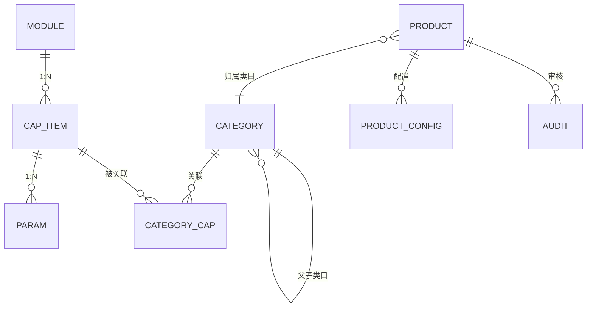
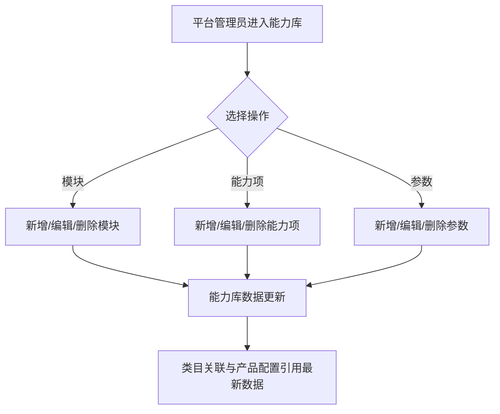
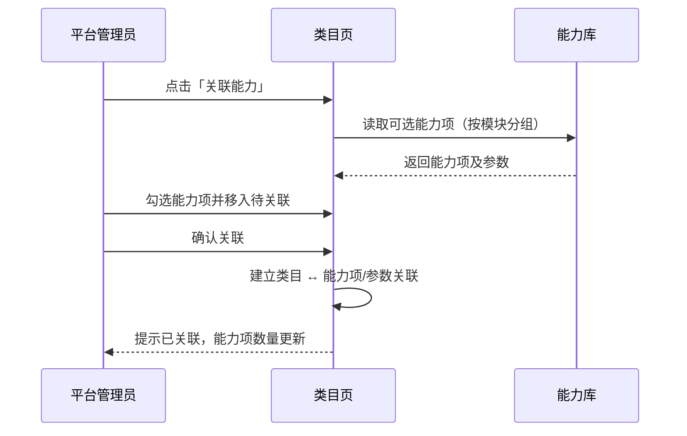
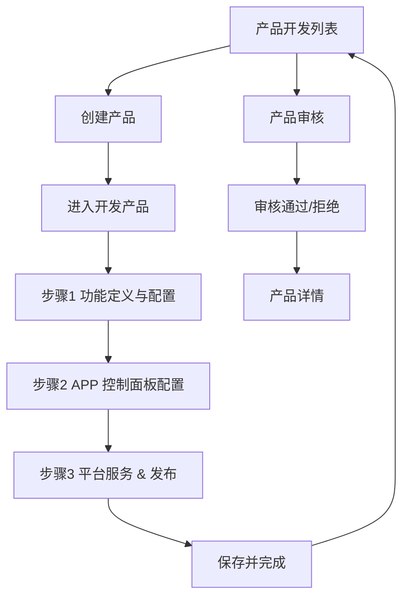
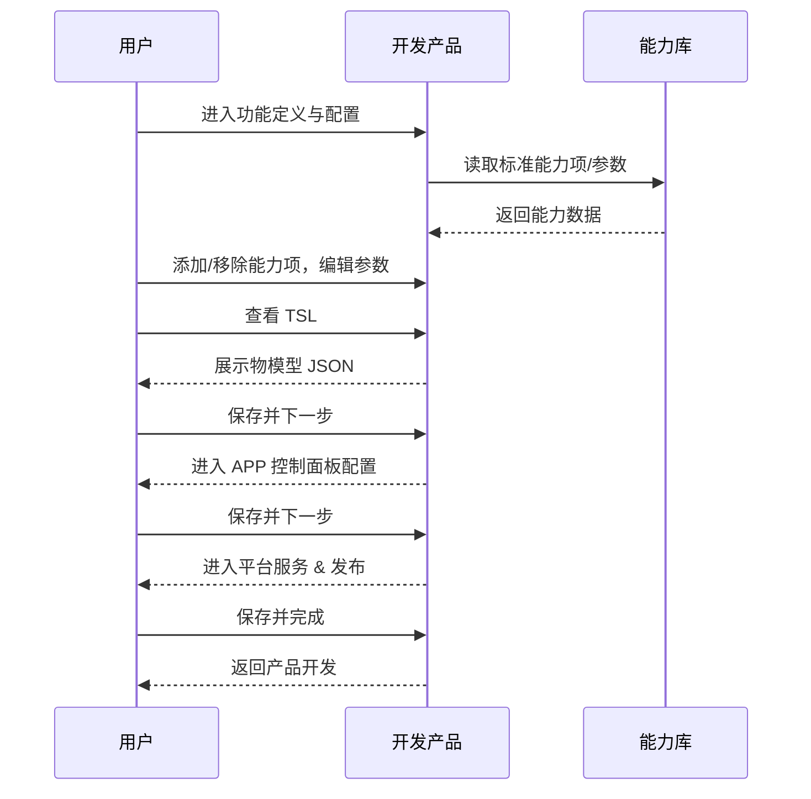
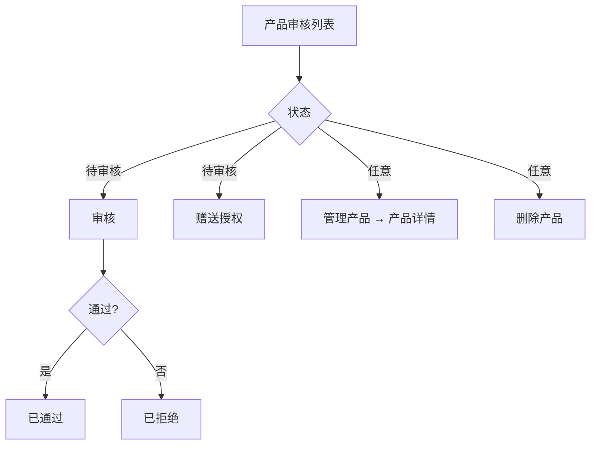
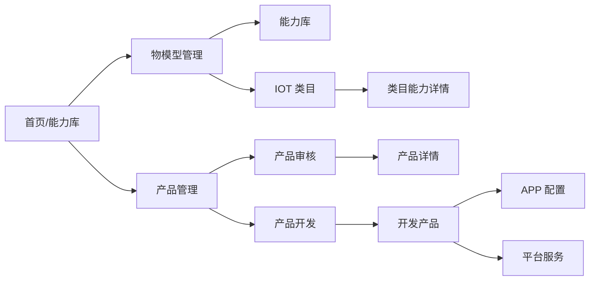

# 生态平台物模型重构 — 完整业务 PRD

## 修订记录

| 修订时间 | 修订内容 | 修订人 |
|---|---|---|
| 2026-10-22 | 初版 |  |

---

## 一、业务背景

### 1.1 业务场景描述

IoT 平台面向平台管理员、设备厂商与平台运营人员，提供物模型管理、产品配置与产品审核能力。

**物模型管理**

- 能力库：由平台维护能力模块、能力项与参数，形成平台标准能力资产。
- IOT 类目：由平台维护设备类目树，并将能力库中的能力项关联到类目。
- 类目能力详情：查看某个类目已关联的能力项与参数，管理关联关系。

**产品管理**

- 产品开发：查询、创建产品，并按产品状态进入开发、复制或删除。
- 开发产品：按「功能定义与配置 → APP 控制面板配置 → 平台服务 & 发布」三步完成产品配置。
- 产品审核：平台对企业提交的产品进行审核、赠送授权与管理。
- 产品详情：查看产品基本信息、物模型配置、平台服务、APP 配置、语音助手与固件历史。

### 1.2 目标用户与业务价值

| 角色 | 使用场景 | 业务价值 |
|---|---|---|
| 设备厂商 / 产品经理 | 从能力库选用标准能力，配置产品功能与 APP 面板 | 复用平台标准能力，减少重复配置 |
| 固件 / 研发人员 | 查看 TSL、能力项与参数定义 | 获得可直接对接的统一数据结构 |
| 平台运营 | 审核企业产品、赠送授权、管理产品 | 完成产品准入与授权管理 |
| 平台管理员 | 维护能力库（模块/能力项/参数）与类目树 | 保证平台能力资产与类目统一、可复用 |

### 1.3 业务目标

| 目标 | 说明 |
|---|---|
| 能力资产统一 | 平台统一维护能力库与类目，作为产品配置的统一数据源 |
| 类目能力关联 | 类目可关联标准能力项，产品创建时按类目复用能力 |
| 产品全流程配置 | 从产品创建、功能定义、APP 配置到平台服务，形成完整闭环 |
| 审核与授权 | 支持产品审核、赠送授权与自动赠送授权配置 |
| 交互一致 | 菜单、返回、筛选、模块切换、关联能力等交互全局统一 |
| 参数模型统一 | 能力项保留属性/服务/事件类型，参数统一按属性内容配置 |

### 1.4 业务范围

本期覆盖「物模型管理」与「产品管理」两个业务域。套餐管理、智能体管理、运营管理、算法库与事件库独立页面不在本期范围；产品列表作为独立页面保留，不在一级菜单展示。

---

## 二、名词解释

| 术语 | 说明 |
|---|---|
| 物模型 | 对设备能力的数据化描述，包括属性、服务、事件 |
| 能力模块 | 对能力项进行归类的分组 |
| 能力项 | 物模型能力的载体，分为属性、服务、事件 |
| 参数 | 能力项下的数据字段；统一按属性内容配置 |
| 能力库 | 全平台标准能力项的集合 |
| 类目 | 设备类目树 |
| 关联能力 | 将能力库中的能力项绑定到类目 |
| TSL | 平台下发给设备的物模型描述 |
| 产品 | 一组具有相关功能定义的设备集合 |
| 开发产品 | 对产品进行功能定义、APP 配置与平台服务配置 |
| 产品审核 | 平台对企业提交的产品进行审核、授权与管理 |
| 引用产品 | 来自其他企业、当前企业只读使用的产品 |
| 标准开发 / 自定义开发 | 产品的两种开发方式 |

---

## 三、业务实体说明

### 3.1 核心实体

| 实体 | 关键属性 | 说明 |
|---|---|---|
| 能力模块 | 名称、标识、能力项数量 | 能力项的分组 |
| 能力项 | 类型、名称、标识、所属模块、更新时间、参数数量 | 属性/服务/事件 |
| 参数 | 名称、标识、数据类型、数据定义、描述 | 能力项下的数据字段 |
| 类目 | 名称、标识、父级、描述、能力项数量 | 设备类目树 |
| 类目能力关联 | 类目、能力项、参数 | 类目与能力项的绑定关系 |
| 产品 | 产品 ID、名称、类目、开发方式、状态、企业、授权信息 | 设备产品 |
| 产品配置 | 标准能力项、自定义能力项、APP 配置、平台服务 | 开发产品的配置结果 |
| 审核记录 | 产品、审核状态、审核意见、授权数量 | 产品审核 |

### 3.2 实体关系



### 3.3 关键约束

| 约束 | 说明 |
|---|---|
| 模块标识唯一 | 全局唯一，字母开头，仅字母/数字/下划线 |
| 能力项标识唯一 | 全局唯一，格式同上 |
| 参数标识唯一 | 同一能力库内全局唯一，格式同上 |
| 参数类型 | 参数统一按属性内容配置，不区分属性/服务/事件 |
| 能力项类型 | 属性/服务/事件，仅用于能力项分类 |
| 类目标识唯一 | 全局唯一，格式同上 |
| 类目层级 | 不允许成环 |
| 产品 ID | 大写字母、数字、下划线，创建后不可修改 |
| 类目与能力 | 一个能力项可关联多个类目；移除关联不删除能力 |

---

## 四、核心业务流程

### 4.1 能力库维护流程



### 4.2 类目关联能力流程



### 4.3 产品开发主流程



### 4.4 开发产品配置流程



### 4.5 产品审核流程



---

## 五、业务规则

### 5.1 能力库规则

| 编号 | 规则 | 说明 |
|---|---|---|
| R-101 | 模块标识唯一 | 新增/编辑模块时校验全局唯一 |
| R-102 | 能力项标识唯一 | 新增/编辑能力项时校验全局唯一 |
| R-103 | 参数标识唯一 | 新增/编辑参数时校验全局唯一 |
| R-104 | 标识格式 | 字母开头，仅允许字母、数字、下划线 |
| R-105 | 参数统一属性 | 参数只配置数据类型、读写模式、数据定义，不区分属性/服务/事件 |
| R-106 | 删除模块级联 | 删除模块时同步删除能力项、参数及类目关联 |
| R-107 | 删除能力项级联 | 删除能力项时同步删除参数及类目关联 |
| R-108 | 删除参数解绑 | 删除参数时同步解除类目关联 |
| R-109 | 枚举校验 | 枚举型至少一个有效枚举值 |
| R-110 | 数值范围校验 | 数值型最大值必须大于最小值 |
| R-111 | 编辑类型不清空参数 | 编辑能力项时可修改类型，不影响已有参数 |

### 5.2 类目规则

| 编号 | 规则 | 说明 |
|---|---|---|
| R-201 | 类目标识唯一 | 全局唯一 |
| R-202 | 父级不可成环 | 父级候选中排除自身及全部子孙 |
| R-203 | 删除类目级联 | 删除类目时删除全部子类目，并解除能力关联 |
| R-204 | 关联能力单位 | 以能力项为单位关联，能力项下全部参数一并关联 |
| R-205 | 重复关联 | 已全部关联的能力项不再出现在可选列表 |
| R-206 | 移除能力项 | 移除能力项时解除其全部参数与类目的关联，不删除能力库数据 |
| R-207 | 移除参数 | 仅解除该参数与类目的关联 |

### 5.3 产品规则

| 编号 | 规则 | 说明 |
|---|---|---|
| R-301 | 产品 ID 格式 | 大写字母、数字、下划线；创建后不可修改 |
| R-302 | 产品状态 | 开发中 / 发布中 / 已发布 / 引用产品 |
| R-303 | 引用产品只读 | 引用产品不提供继续开发、发布、删除等写操作 |
| R-304 | 复制产品 | 复制生成独立副本，名称追加「（副本）」 |
| R-305 | App 配置入口 | 已发布产品可进入开发产品的 APP 配置步骤 |
| R-306 | 产品审核状态 | 待审核 / 已通过 / 已拒绝 |
| R-307 | 审核幂等 | 已审核产品不再展示审核与赠送授权操作 |
| R-308 | 赠送授权 | 测试授权、生产授权数量范围 0~999 |

### 5.4 开发产品规则

| 编号 | 规则 | 说明 |
|---|---|---|
| R-401 | 三步顺序 | 功能定义与配置 → APP 控制面板配置 → 平台服务 & 发布 |
| R-402 | 标准能力项 | 来源于能力库，可添加/移除；移除不删除能力库数据 |
| R-403 | 自定义能力项 | 产品级扩展，支持属性/服务/事件 |
| R-404 | 参数配置 | 参数统一按属性内容配置：数据类型、读写模式、数据定义；不提供输入/输出参数配置 |
| R-405 | TSL | 根据当前标准/自定义能力项及参数生成，可查看与复制 |
| R-406 | APP 配置 | 分辨率显示、插值、安全策略、假三目、灯控、低电量保护 |
| R-407 | 平台服务 | 逐项设置是否支持 |
| R-408 | 保存下一步 | 保存当前步骤并进入下一步；最后一步完成后返回产品开发 |
| R-409 | 自动保存提示 | 底部展示「已自动保存至云端草稿」与时间 |

### 5.5 全局交互规则

| 编号 | 规则 | 说明 |
|---|---|---|
| R-501 | 菜单范围 | 仅展示物模型管理、产品管理两个已实现模块 |
| R-502 | 菜单状态 | 展开/收起状态本地持久化 |
| R-503 | 收起态悬浮 | 悬浮一级菜单展示子菜单面板，180ms 延迟关闭 |
| R-504 | 页面返回 | 二级页面统一返回栏；返回目标固定为上级页面 |
| R-505 | 筛选选中 | 所有筛选 pill 使用同一选中态；点击即过滤 |
| R-506 | 类型标签 | 仅能力项展示属性/服务/事件标签；参数不展示类型标签 |
| R-507 | 删除确认 | 删除/移除操作必须二次确认，并说明影响范围 |

---

## 六、功能架构

```
生态平台物模型
├── 物模型管理
│   ├── 能力库
│   │   ├── 模块管理（增删改、搜索、数量）
│   │   ├── 能力项管理（增删改、类型筛选、搜索、分页）
│   │   └── 参数管理（增删改、展开子表、属性内容配置）
│   ├── IOT 类目
│   │   ├── 类目树（增删改、父子级、展开收起）
│   │   ├── 筛选（全部/顶级/子类目、搜索）
│   │   └── 关联能力（穿梭框）
│   └── 类目能力详情
│       ├── 模块筛选（与能力列表同卡片）
│       ├── 能力项/参数展开、移除
│       └── 关联能力
├── 产品管理
│   ├── 产品开发
│   │   ├── 多条件筛选、创建产品
│   │   ├── 状态操作（继续开发/App配置/添加固件/复制/查看/删除）
│   │   └── 引用产品只读
│   ├── 开发产品
│   │   ├── 产品信息卡、步骤条
│   │   ├── 功能定义与配置（标准/自定义能力项、参数、TSL、示例）
│   │   ├── APP 控制面板配置
│   │   ├── 平台服务 & 发布
│   │   └── 底部吸附操作栏
│   ├── 产品审核
│   │   ├── 多条件筛选、自动赠送授权
│   │   ├── 审核、赠送授权、管理、删除
│   │   └── 分页
│   └── 产品详情
│       ├── 基本信息、物模型配置
│       ├── 平台服务、App 配置
│       └── 语音助手、固件历史
└── 全局
    ├── 深色可收起菜单 + 悬浮子菜单
    ├── 面包屑、统一返回栏
    └── 统一表格/标签/弹窗/筛选样式
```

---

## 七、详细功能描述

### 7.1 能力库

#### 功能应用场景

由平台维护标准能力模块、能力项与参数，为类目关联和产品配置提供数据来源。维护者为平台管理员。

#### 功能详述

| 区域 | 元素 | 行为 |
|---|---|---|
| 模块面板 | 添加、搜索、模块列表、数量 | 点击模块切换筛选；悬浮显示编辑/删除 |
| 工具条 | 添加能力项、类型筛选、搜索、刷新 | 添加能力项；按属性/服务/事件筛选；搜索名称/标识 |
| 表格 | 类型、名称、ID、所属模块、更新时间、操作 | 操作：添加参数、编辑、删除；展开查看参数 |
| 参数表 | 名称、标识、数据类型、数据定义、描述、操作 | 编辑/删除参数 |
| 底部 | 显示范围、总数、每页条数、分页 | 分页浏览 |

#### 状态说明

| 状态 | 展示 |
|---|---|
| 正常态 | 展示能力项列表 |
| 空态 | 「暂无能力项」+ 添加入口 |
| 参数空态 | 展开后「暂无参数」 |

#### 交互说明

- 添加能力项时可先添加草稿参数，提交时一并创建。
- 参数编辑统一为属性内容：数据类型（枚举/数值/浮点/布尔/字符串/数组/结构体）、读写模式、数据定义、默认值。
- 删除模块/能力项/参数均二次确认，并提示影响范围。
- 标识重复、格式错误、枚举为空、数值范围错误时阻止提交。

### 7.2 IOT 类目

#### 功能应用场景

由平台维护设备类目树，并将能力库能力项关联到类目。维护者为平台管理员。

#### 功能详述

| 区域 | 元素 | 行为 |
|---|---|---|
| 工具条 | 添加类目、筛选、搜索、刷新 | 全部/顶级/子类目筛选 |
| 表格 | 类目名称、标识、能力项数量、描述、操作 | 关联能力、编辑、删除 |
| 树形 | 父子类目展开箭头 | 展开/收起 |
| 底部 | 类目总数 | 统计 |

#### 交互说明

- 父级类目可选，编辑时排除自身及子孙。
- 删除类目级联删除子类目，并解除能力关联。
- 关联能力以能力项为单位，能力项下全部参数一并关联；已关联的不再出现在可选列表。

### 7.3 类目能力详情

#### 功能应用场景

查看某个类目已关联的能力项与参数，并管理关联关系。

#### 功能详述

| 区域 | 元素 | 行为 |
|---|---|---|
| 返回栏 | 返回类目、类目能力详情、类目名称 | 返回类目列表 |
| 工具条 | 关联能力、类型筛选、搜索、重置 | 新增关联；筛选列表 |
| 内容卡片 | 左侧模块列表 + 右侧能力表格 | 同一卡片内左右两栏，同级对齐 |
| 能力表格 | 类型、名称、ID、所属模块、参数数量、操作 | 移除能力项 |
| 参数表 | 名称、标识、数据类型、数据定义、描述、操作 | 编辑/移除参数 |
| 底部 | 能力项数、参数数 | 统计 |

#### 交互说明

- 模块列表仅展示该类目已关联能力所属的模块。
- 移除能力项/参数仅解除关联，不删除能力库数据。

### 7.4 产品列表

#### 功能应用场景

快速查看产品、进入开发、增删改。

#### 功能详述

| 区域 | 元素 | 行为 |
|---|---|---|
| 工具条 | 添加产品、状态筛选、搜索、类型/状态选择、查询 | 查询产品 |
| 表格 | 产品ID、名称、类型、功能点、开发状态、创建时间、操作 | 开始开发/继续开发/查看配置、编辑、删除 |
| 底部 | 总记录数、分页 | 分页浏览 |

#### 说明

产品列表现作为独立直达页面保留，不在左侧菜单展示。

### 7.5 产品开发

#### 功能应用场景

创建产品并按状态进入开发、复制、查看或删除。

#### 功能详述

| 区域 | 元素 | 行为 |
|---|---|---|
| 页面说明 | 标题、说明、操作文档链接 | 了解开发流程 |
| 筛选区 | 标签、排序、产品ID、名称/型号、搜索、重置、创建产品 | 多条件筛选 |
| 条件条 | 当前类目/状态/开发方式 | 展示筛选条件，可重置 |
| 提示条 | 引用产品只读提示 | 仅当列表含引用产品时展示 |
| 表格 | 产品信息、类目、开发方式、来源企业、状态、授权、操作人、企业、时间 | 按状态展示操作 |
| 底部 | 产品总数、分页 | 分页浏览 |

#### 操作矩阵

| 状态 | 操作 |
|---|---|
| 开发中 | 继续开发、添加固件、更多（复制/查看详情/删除） |
| 发布中 | 复制产品、添加固件、更多（查看详情/删除） |
| 已发布 | App 配置、添加固件、更多（复制/查看详情/删除） |
| 引用产品 | 无写操作 |

### 7.6 开发产品

#### 功能应用场景

完成产品的功能定义、APP 配置与平台服务配置。

#### 功能详述

| 区域 | 元素 | 行为 |
|---|---|---|
| 返回栏 | 返回列表 + 开发产品 | 返回产品开发 |
| 产品卡片 | 产品名、编辑、状态、描述、SDK 版本、ID、型号、类目、协议 | 展示产品信息；复制 ID |
| 步骤条 | 功能定义与配置 / APP 控制面板配置 / 平台服务 & 发布 | 点击切换步骤 |
| 步骤 1 | 平台标准能力项、自定义能力项 | 添加/移除能力项、展开参数、编辑/删除参数、查看 TSL、查看示例 |
| 步骤 2 | APP 配置表单 | 修改配置项 |
| 步骤 3 | 平台服务表格 | 设置是否支持 |
| 底部 | 自动保存状态、取消并退出、保存并下一步/完成 | 保存与流转 |

#### 状态说明

| 状态 | 展示 |
|---|---|
| 正常态 | 各步骤内容正常展示 |
| 标准能力空态 | 「暂无数据」 |
| 参数空态 | 「暂无参数」 |
| 自定义能力空态 | 虚线容器 + 说明 + 模板库导入/新建入口 |

#### 交互说明

- 底部主按钮文案随步骤变化：配置 APP / 平台服务 / 保存并完成。
- 移除能力项直接生效；参数删除/编辑在展开子表中操作。
- TSL 弹窗展示物模型 JSON，支持一键复制。
- 查看物模型示例在右侧展示 APP 控制面板预览。

### 7.7 产品审核

#### 功能应用场景

平台对提交的产品进行审核、赠送授权与管理。

#### 功能详述

| 区域 | 元素 | 行为 |
|---|---|---|
| 筛选区 | 名称、类目、状态、企业、创建时间、搜索、重置 | 多条件筛选 |
| 自动赠送授权 | 开关、状态、配置 | 开启/关闭自动赠送；配置授权数量与适用类目 |
| 表格 | 序号、产品信息、类目、状态、开发方式、单价、赠送授权、采购授权、企业、时间、操作 | 审核、赠送授权、管理、删除 |
| 底部 | 待审核数、总数、分页 | 统计与分页 |

#### 审核规则

- 审核结果：通过 / 拒绝；可填写审核意见。
- 审核通过 → 已通过；拒绝 → 已拒绝。
- 已审核产品不再展示审核与赠送授权操作。

### 7.8 产品详情

#### 功能应用场景

查看产品完整信息与配置结果。

#### 功能详述

| 区域 | 元素 | 行为 |
|---|---|---|
| 返回栏 | 返回审核 + 产品详情 + 产品名称 | 返回审核 |
| 基本信息 | 名称、ID、类目、企业、状态、授权单价 | 只读展示 |
| 物模型配置 | 已配置子项数 + 查看/修改 | 打开设备配置弹窗 |
| 平台服务 | 算法/服务表格 | 查看服务与开通方式 |
| App 配置 | 安装指引、使用范围 | 前往开发产品 APP 配置 |
| 语音助手 | 唤醒词、语言、平台、状态 | 只读展示 |
| 固件历史 | 版本、日期、大小、更新内容、状态 | 只读展示 |

#### 交互说明

- 支持关联事件抽屉、算法能力配置抽屉、套餐绑定抽屉。
- APP 配置跳转开发产品步骤 2。

### 7.9 全局导航与交互

#### 功能详述

| 区域 | 元素 | 行为 |
|---|---|---|
| 深色菜单 | 一级菜单、子菜单、收起按钮 | 展开/收起；子菜单跳转 |
| 收起态 | 图标、悬浮面板 | 悬浮展示子菜单 |
| 顶部栏 | 面包屑、帮助、通知、用户 | 导航与个人信息 |
| 返回栏 | 返回按钮 + 标题 + 副标题 | 二级页面返回 |

#### 交互说明

- 菜单包含物模型管理、产品管理两个业务模块。
- 展开状态持久化。
- 收起态悬浮面板 180ms 延迟关闭。
- 二级页面统一返回栏，返回目标固定。
- 筛选 pill、类型标签、状态标签、表格、弹窗样式全局统一。

---

## 八、页面信息架构



| 页面 | 核心信息 | 跳转关系 |
|---|---|---|
| 能力库 | 模块、能力项、参数 | 模块切换；参数展开 |
| IOT 类目 | 类目树、能力关联 | 进入类目能力详情 |
| 类目能力详情 | 已关联能力/参数 | 返回类目 |
| 产品列表 | 产品查询与操作 | 进入开发产品 |
| 产品开发 | 产品列表与状态操作 | 进入开发产品/产品详情 |
| 开发产品 | 三步配置 | 返回产品开发 |
| 产品审核 | 审核与授权 | 进入产品详情 |
| 产品详情 | 产品完整信息 | 返回审核；进入 APP 配置 |

---

## 九、异常说明

| 异常 | 页面表现 | 处理方式 |
|---|---|---|
| 必填为空 | 表单错误提示 | 补全后重新提交 |
| 标识格式错误 | 表单错误提示 | 按提示修改 |
| 标识重复 | 提示更换标识 | 修改后提交 |
| 枚举为空 | 提示至少一个枚举值 | 添加枚举值 |
| 数值范围错误 | 提示最大值必须大于最小值 | 修正范围 |
| 列表无数据 | 空态占位 | 提供添加入口或关联入口 |
| 参数为空 | 展开行空态 | 提示暂无参数 |
| 删除关联数据 | 二次确认 | 确认后级联删除/解绑 |
| 复制失败 | 提示手动复制 | 用户手动复制 |
| 菜单状态异常 | 默认展开态 | 重新展开/收起 |
| 直接访问二级页面 404 | 部署层回退到首页 | 配置 SPA 路由回退 |
| 引用产品写操作 | 不提供写操作 | 只读展示 |
| 无审核数据 | 空态 | 提示暂无审核数据 |
| 无固件/服务数据 | 表格空态 | 提示暂无数据 |

---

## 十、测试要点

### 功能回归

| 编号 | 测试点 | 前置条件 | 操作步骤 | 预期结果 |
|---|---|---|---|---|
| T-001 | 能力库模块增删改 | 已进入能力库 | 新增/编辑/删除模块 | 模块列表与数量正确 |
| T-002 | 能力项增删改 | 已进入能力库 | 新增/编辑/删除能力项 | 表格与参数正确 |
| T-003 | 参数增删改 | 能力项已存在 | 添加/编辑/删除参数 | 参数子表更新 |
| T-004 | 类目增删改 | 已进入类目 | 新增/编辑/删除类目 | 树结构与级联关系正确 |
| T-005 | 类目关联能力 | 已进入类目 | 穿梭框关联 | 能力项与参数关联成功 |
| T-006 | 类目能力详情移除 | 已关联能力 | 移除能力项/参数 | 仅解除关联，能力库保留 |
| T-007 | 产品创建 | 已进入产品开发 | 填写并创建 | 产品加入列表 |
| T-008 | 产品状态操作 | 不同状态产品 | 继续开发/App配置/复制/删除 | 操作符合状态矩阵 |
| T-009 | 开发产品三步切换 | 已进入开发产品 | 点击步骤/保存下一步 | 步骤内容与按钮文案正确 |
| T-010 | TSL 查看复制 | 步骤 1 | 查看 TSL、复制 | JSON 展示与复制成功 |
| T-011 | 产品审核 | 待审核产品 | 审核通过/拒绝 | 状态更新，操作隐藏 |
| T-012 | 赠送授权 | 待审核产品 | 填写数量并确认 | 授权数量更新 |
| T-013 | 产品详情查看 | 已进入详情 | 查看各卡片/表格 | 信息展示正确 |
| T-014 | 菜单展开/收起 | 任意页面 | 切换菜单、悬浮子菜单 | 状态与跳转正确 |
| T-015 | 页面返回 | 二级页面 | 点击返回 | 返回上级页面 |

### 核心场景

| 编号 | 测试点 | 前置条件 | 操作步骤 | 预期结果 |
|---|---|---|---|---|
| T-101 | 新增能力项并带参数 | 已进入能力库 | 新增能力项 + 草稿参数 → 提交 | 能力项与参数同时创建 |
| T-102 | 类目关联能力项 | 类目与能力项存在 | 关联并确认 | 能力项数量与详情正确 |
| T-103 | 产品配置全流程 | 产品已创建 | 步骤 1→2→3 保存 | 配置保存，返回产品开发 |
| T-104 | 服务/事件能力项添加参数 | 服务/事件能力项存在 | 添加参数 | 参数编辑器与属性一致（数据类型/数据定义） |
| T-105 | 类型筛选与计数 | 多类型能力项 | 切换筛选 | 列表与计数一致 |
| T-106 | 类目筛选 | 多级类目 | 切换全部/顶级/子类目 | 展示范围正确 |
| T-107 | 产品审核后操作 | 待审核产品 | 审核通过 | 审核/赠送授权操作消失 |

### 异常场景

| 编号 | 测试点 | 前置条件 | 操作步骤 | 预期结果 |
|---|---|---|---|---|
| T-201 | 标识重复 | 标识已存在 | 提交 | 阻止提交并提示 |
| T-202 | 枚举为空 | 枚举型参数 | 清空枚举提交 | 阻止提交并提示 |
| T-203 | 数值范围错误 | 数值型参数 | 最大值≤最小值 | 阻止提交并提示 |
| T-204 | 删除影响提示 | 模块/类目有关联数据 | 删除 | 二次确认说明影响范围 |
| T-205 | 空列表 | 无数据 | 进入页面 | 空态与引导入口 |
| T-206 | 引用产品操作 | 引用产品 | 查看操作列 | 无写操作 |
| T-207 | 直接访问二级路由 | 已部署 | 刷新二级页面 | SPA 回退正常 |

### 状态切换

| 编号 | 测试点 | 前置条件 | 操作步骤 | 预期结果 |
|---|---|---|---|---|
| T-301 | 产品状态切换 | 不同状态产品 | 执行对应操作 | 状态与操作矩阵一致 |
| T-302 | 审核状态切换 | 待审核 | 通过/拒绝 | 状态正确更新 |
| T-303 | 开发产品步骤切换 | 已进入配置 | 前后步骤切换 | 内容与底部按钮同步 |
| T-304 | 菜单展开状态持久化 | 已切换菜单 | 刷新页面 | 保持上次状态 |
| T-305 | 树形展开状态 | 类目有子级 | 展开/收起/筛选 | 箭头与内容正确 |

### 兼容性

| 编号 | 测试点 | 前置条件 | 操作步骤 | 预期结果 |
|---|---|---|---|---|
| T-401 | Chrome / Edge | 桌面端 | 全流程操作 | 布局与交互正常 |
| T-402 | 不同分辨率 | 1280 / 1440 / 1920 | 查看列表与弹窗 | 无横向溢出，表格可滚动 |
| T-403 | 长文本 | 名称/描述较长 | 查看表格/弹窗 | 截断/换行合理 |
| T-404 | 大量数据 | 列表数据较多 | 分页/筛选 | 操作流畅 |
| T-405 | 直接访问部署地址二级路由 | Vercel | 打开/刷新 | 正常回退到应用 |

---

## 十一、页面截图占位

> 本节用于补充实际系统截图，PRD 评审时由产品补充。

| 截图编号 | 页面 | 说明 |
|---|---|---|
| S-01 | 能力库 | 模块列表 + 能力项表格 |
| S-02 | 能力库 | 添加参数弹窗 |
| S-03 | IOT 类目 | 类目树表 + 筛选 |
| S-04 | 类目能力详情 | 模块列表与能力表格同卡片 |
| S-05 | 产品开发 | 产品列表与筛选 |
| S-06 | 开发产品 | 产品卡片 + 步骤条 + 能力项 |
| S-07 | 产品审核 | 审核列表 |
| S-08 | 产品详情 | 信息卡片 |
