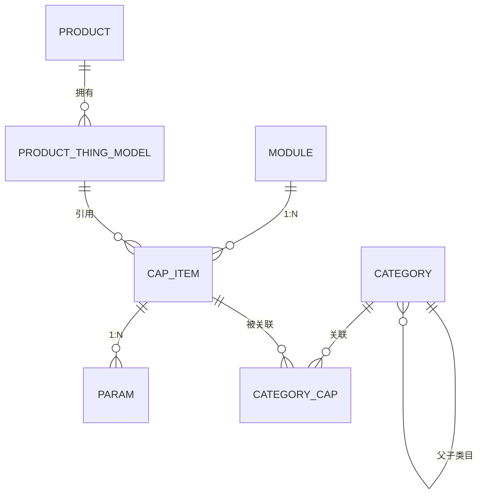
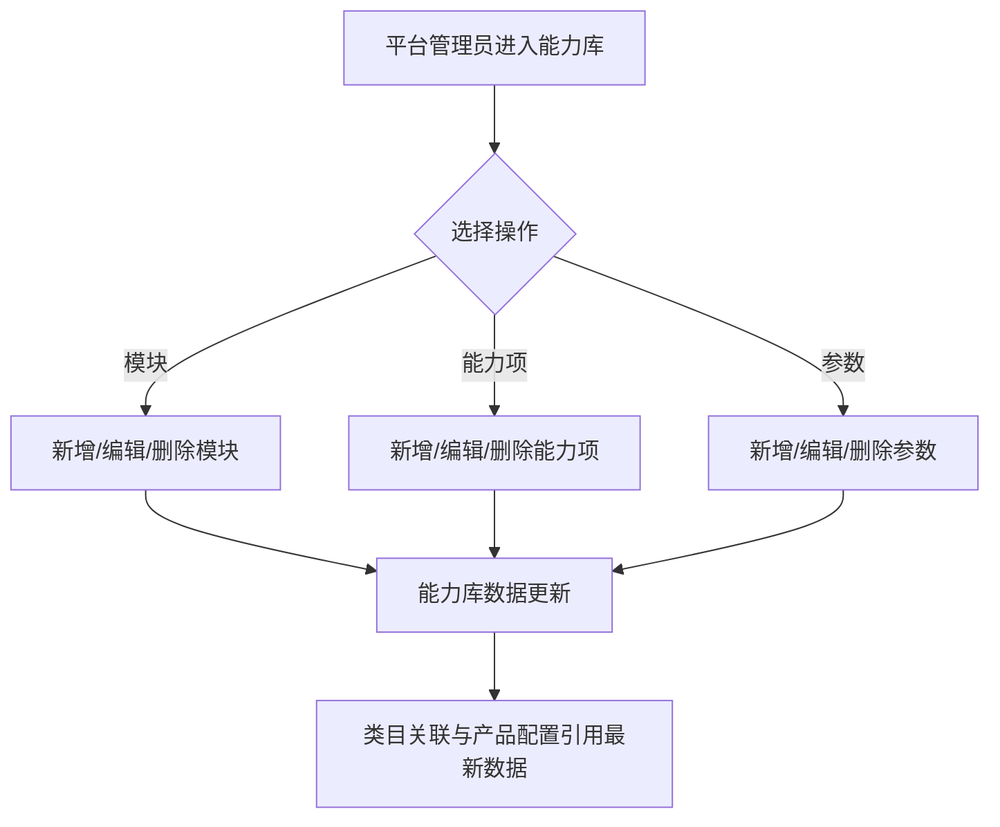
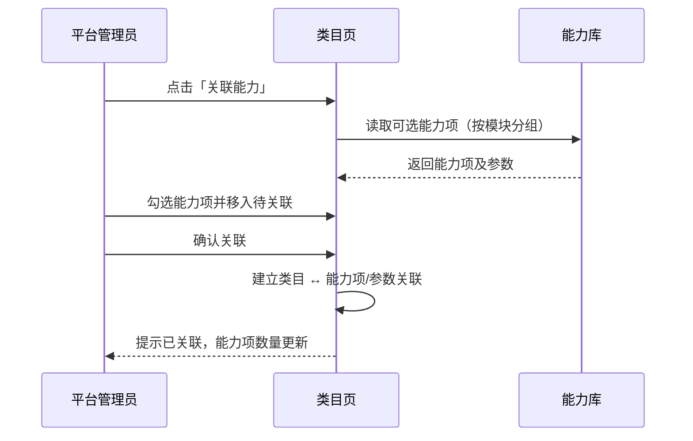
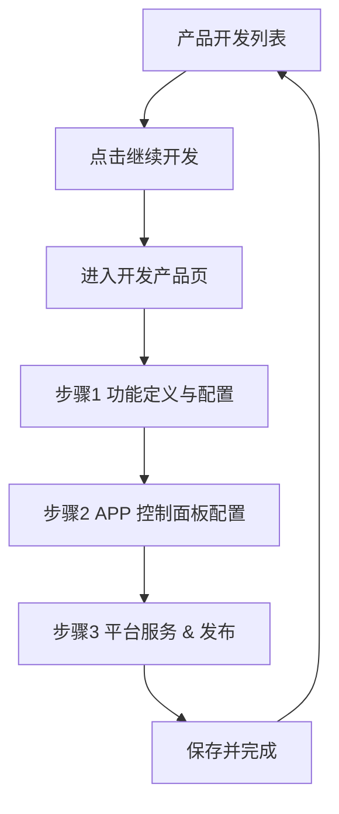
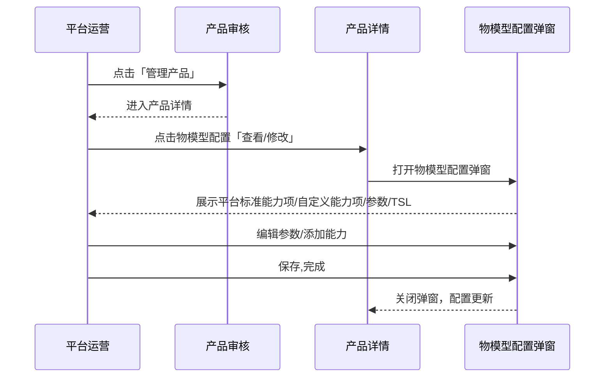
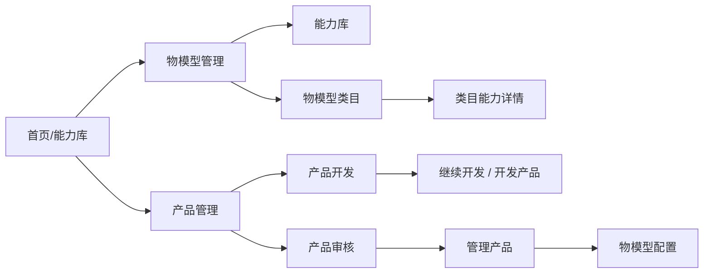

# 生态平台物模型重构 — 完整业务 PRD

## 修订记录

| 修订时间 | 修订内容 | 修订人 |
|---|---|---|
| 2026-10-22 | 初版 |  |
| 2026-10-22 | 范围收敛为能力库、物模型类目、继续开发、审核物模型配置；参数标识改为能力项下唯一 |  |

---

## 一、业务背景

### 1.1 业务场景描述

生态平台面向平台管理员、设备厂商与平台运营人员，提供物模型能力管理、类目管理、产品开发与产品审核能力。

本期聚焦四个功能：

1. **能力库**：平台维护能力模块、能力项与参数，形成标准能力资产。
2. **物模型类目**：平台维护设备类目树，并将能力库能力项关联到类目。
3. **产品开发-继续开发**：从产品开发列表进入产品配置页，完成功能定义与配置。
4. **产品审核-管理产品的物模型配置**：从产品审核进入产品详情，查看/修改产品物模型配置。

### 1.2 目标用户与业务价值

| 角色 | 使用场景 | 业务价值 |
|---|---|---|
| 平台管理员 | 维护能力库与物模型类目 | 保证平台能力资产与类目统一、可复用 |
| 设备厂商 / 产品经理 | 通过继续开发配置产品能力 | 复用标准能力，快速完成产品功能定义 |
| 平台运营 | 审核产品并管理产品物模型 | 完成产品准入与物模型配置 |
| 固件 / 研发人员 | 查看 TSL、能力项与参数定义 | 获得可直接对接的统一数据结构 |

### 1.3 业务目标

| 目标 | 说明 |
|---|---|
| 能力资产统一 | 平台按模块维护能力项与参数，作为类目与产品的统一数据源 |
| 类目能力关联 | 类目可关联标准能力项，产品按类目复用能力 |
| 继续开发闭环 | 从产品开发进入配置页，完成功能定义与配置 |
| 物模型可管理 | 审核管理入口可查看/修改产品物模型配置 |
| 交互一致 | 菜单、返回、筛选、模块切换、关联能力等交互统一 |

### 1.4 业务范围

本期覆盖能力库、物模型类目（含类目能力详情）、继续开发（开发产品）、审核管理的物模型配置。

以下功能**沿用现有能力**，不在本文档展开：

- 产品列表、创建产品
- 产品开发列表的筛选、状态操作、复制、删除
- 产品审核列表、审核、赠送授权、自动赠送授权
- 产品详情中除「物模型配置」外的其他信息
- 开发产品中的 APP 控制面板配置、平台服务（复用现有）
- 套餐管理、智能体管理、运营管理、算法库、事件库

---

## 二、名词解释

| 术语 | 说明 |
|---|---|
| 物模型 | 对设备能力的数据化描述，包括属性、服务、事件 |
| 能力模块 | 对能力项进行归类的分组 |
| 能力项 | 物模型能力的载体，分为属性、服务、事件 |
| 参数 | 能力项下的数据字段，统一按属性内容配置 |
| 能力库 | 平台标准能力项的集合，按模块管理 |
| 类目 | 设备类目树 |
| 关联能力 | 将能力库中的能力项绑定到类目 |
| TSL | 平台下发给设备的物模型描述 |
| 继续开发 | 产品开发列表中进入产品配置页的入口 |
| 管理产品 | 产品审核中进入产品详情页的入口 |
| 物模型配置 | 产品详情中查看/修改产品能力项与参数的配置 |

---

## 三、业务实体说明

### 3.1 核心实体

| 实体 | 关键属性 | 说明 |
|---|---|---|
| 能力模块 | 名称、标识、能力项数量 | 能力项的分组 |
| 能力项 | 类型、名称、标识、所属模块、参数数量 | 属性/服务/事件 |
| 参数 | 名称、标识、数据类型、数据定义、描述 | 能力项下的数据字段 |
| 类目 | 名称、标识、父级、描述、能力项数量 | 设备类目树 |
| 类目能力关联 | 类目、能力项、参数 | 类目与能力项的绑定关系 |
| 产品物模型配置 | 标准能力项、自定义能力项、参数 | 产品的物模型配置结果 |

### 3.2 实体关系

### 3.3 关键约束

| 约束 | 说明 |
|---|---|
| 模块标识唯一 | 全局唯一，字母开头，仅字母/数字/下划线 |
| 能力项标识唯一 | 全局唯一，格式同上 |
| 参数标识唯一 | 同一能力项下唯一，格式同上 |
| 参数类型 | 参数统一按属性内容配置，不区分属性/服务/事件 |
| 能力项类型 | 属性/服务/事件，仅用于能力项分类 |
| 类目标识唯一 | 全局唯一，格式同上 |
| 类目层级 | 不允许成环 |
| 物模型配置 | 仅修改当前产品配置，不影响能力库与类目 |

---

## 四、核心业务流程

### 4.1 能力库维护流程

### 4.2 物模型类目关联能力流程

### 4.3 继续开发流程

### 4.4 审核管理产品的物模型配置流程

---

## 五、业务规则

### 5.1 能力库规则

| 编号 | 规则 | 说明 |
|---|---|---|
| R-101 | 模块标识唯一 | 新增/编辑模块时校验全局唯一 |
| R-102 | 能力项标识唯一 | 新增/编辑能力项时校验全局唯一 |
| R-103 | 参数标识唯一 | 新增/编辑参数时校验同一能力项下唯一 |
| R-104 | 标识格式 | 字母开头，仅允许字母、数字、下划线 |
| R-105 | 参数统一属性 | 参数只配置数据类型、读写模式、数据定义，不区分属性/服务/事件 |
| R-106 | 删除模块级联 | 删除模块时同步删除能力项、参数及类目关联 |
| R-107 | 删除能力项级联 | 删除能力项时同步删除参数及类目关联 |
| R-108 | 删除参数解绑 | 删除参数时同步解除类目关联 |
| R-109 | 枚举校验 | 枚举型至少一个有效枚举值 |
| R-110 | 数值范围校验 | 数值型/浮点型最大值必须大于最小值 |
| R-111 | 浮点型精度 | 浮点型支持任意位小数，步长默认 0.1，不做固定小数位限制 |
| R-112 | 编辑类型不清空参数 | 编辑能力项时可修改类型，不影响已有参数 |

### 5.2 物模型类目规则

| 编号 | 规则 | 说明 |
|---|---|---|
| R-201 | 类目标识唯一 | 全局唯一 |
| R-202 | 父级不可成环 | 父级候选中排除自身及全部子孙 |
| R-203 | 删除类目级联 | 删除类目时删除全部子类目，并解除能力关联 |
| R-204 | 关联能力单位 | 以能力项为单位关联，能力项下全部参数一并关联 |
| R-205 | 重复关联 | 已全部关联的能力项不再出现在可选列表 |
| R-206 | 移除能力项 | 移除能力项时解除其全部参数与类目的关联，不删除能力库数据 |
| R-207 | 移除参数 | 仅解除该参数与类目的关联 |

### 5.3 继续开发规则

| 编号 | 规则 | 说明 |
|---|---|---|
| R-301 | 页面入口 | 从产品开发列表点击「继续开发」进入 |
| R-302 | 三步顺序 | 功能定义与配置 → APP 控制面板配置 → 平台服务 & 发布 |
| R-303 | 标准能力项 | 来源于能力库，可添加/移除；移除不删除能力库数据 |
| R-304 | 自定义能力项 | 产品级扩展，支持属性/服务/事件 |
| R-305 | 参数配置 | 与能力库参数规则一致，统一按属性内容配置 |
| R-306 | TSL | 根据当前能力项及参数生成，可查看与复制 |
| R-307 | APP 配置/平台服务 | 沿用现有能力 |
| R-308 | 保存下一步 | 保存当前步骤并进入下一步；最后一步完成返回产品开发 |

### 5.4 物模型配置规则

| 编号 | 规则 | 说明 |
|---|---|---|
| R-401 | 入口 | 产品审核 → 管理产品 → 产品详情 → 物模型配置 |
| R-402 | 弹窗形式 | 查看/修改以弹窗承载功能定义与配置内容，不跳转页面 |
| R-403 | 内容范围 | 仅保留平台标准能力项、自定义能力项、参数、TSL；不展示产品信息卡、步骤条、APP 配置、平台服务 |
| R-404 | 交互复用 | 能力项、参数、TSL 交互与继续开发页步骤 1 保持一致 |
| R-405 | 参数编辑 | 与能力库参数规则一致 |
| R-406 | 保存 | 点击保存,完成，关闭弹窗并更新配置 |

### 5.5 全局交互规则

| 编号 | 规则 | 说明 |
|---|---|---|
| R-501 | 菜单范围 | 物模型管理、产品管理两个业务模块 |
| R-502 | 菜单状态 | 展开/收起状态本地持久化 |
| R-503 | 收起态悬浮 | 悬浮一级菜单展示子菜单面板，180ms 延迟关闭 |
| R-504 | 页面返回 | 二级页面统一返回栏；返回目标固定为上级页面 |
| R-505 | 筛选选中 | 所有筛选 pill 使用同一选中态；点击即过滤 |
| R-506 | 类型标签 | 仅能力项展示属性/服务/事件标签；参数不展示类型标签 |
| R-507 | 删除确认 | 删除/移除操作必须二次确认，并说明影响范围 |

---

## 六、功能架构

| 一级模块 | 二级模块 | 功能点 | 说明 |
|---|---|---|---|
| 物模型管理 | 能力库 | 模块管理 | 新增/编辑/删除模块、搜索、模块数量 |
| 物模型管理 | 能力库 | 能力项管理 | 新增/编辑/删除能力项、类型筛选、搜索、分页 |
| 物模型管理 | 能力库 | 参数管理 | 新增/编辑/删除参数、展开子表、属性内容配置 |
| 物模型管理 | 物模型类目 | 类目树 | 新增/编辑/删除类目、父子级、展开收起 |
| 物模型管理 | 物模型类目 | 类目筛选 | 全部/顶级/子类目筛选、搜索 |
| 物模型管理 | 物模型类目 | 关联能力 | 穿梭框选择能力项并关联到类目 |
| 物模型管理 | 类目能力详情 | 模块筛选 | 按模块筛选已关联能力，与能力列表同卡片 |
| 物模型管理 | 类目能力详情 | 能力/参数管理 | 展开参数、编辑参数、移除能力项/参数 |
| 物模型管理 | 类目能力详情 | 关联能力 | 继续关联新的能力项 |
| 产品管理 | 继续开发 | 产品信息卡 | 产品名、状态、描述、SDK 版本、ID、型号、类目、协议 |
| 产品管理 | 继续开发 | 步骤条 | 功能定义与配置 → APP 控制面板配置 → 平台服务 & 发布 |
| 产品管理 | 继续开发 | 功能定义与配置 | 标准/自定义能力项、参数、TSL、物模型示例 |
| 产品管理 | 继续开发 | APP 配置/平台服务 | 沿用现有能力 |
| 产品管理 | 继续开发 | 底部操作栏 | 自动保存状态、取消退出、保存并下一步/完成 |
| 产品管理 | 审核-物模型配置 | 入口/弹窗 | 产品审核 → 管理产品 → 产品详情 → 查看/修改 → 打开物模型配置弹窗 |
| 产品管理 | 审核-物模型配置 | 弹窗内容 | 仅功能定义与配置：平台标准能力项、自定义能力项、参数、TSL |
| 产品管理 | 审核-物模型配置 | 保存 | 点击保存,完成，关闭弹窗并更新配置 |
| 全局 | 导航 | 深色可收起菜单 | 展开/收起、悬浮子菜单、状态持久化 |
| 全局 | 页面框架 | 面包屑与返回栏 | 面包屑导航、二级页面统一返回 |
| 全局 | 设计系统 | 表格/标签/弹窗/筛选 | 全站统一的组件与交互样式 |

---

## 七、详细功能描述

### 7.1 能力库

#### 功能应用场景

由平台维护标准能力模块、能力项与参数，为类目关联和产品配置提供数据来源。维护者为平台管理员。

#### 功能详述

| 区域 | 元素 | 行为 |
|---|---|---|
| 模块面板 | 添加、搜索、模块列表、数量 | 点击模块切换筛选；悬浮显示编辑/删除 |
| 工具条 | 添加能力项、类型筛选、搜索、刷新 | 添加能力项；按属性/服务/事件筛选 |
| 表格 | 类型、名称、ID、所属模块、更新时间、操作 | 添加参数、编辑、删除；展开查看参数 |
| 参数表 | 名称、标识、数据类型、数据定义、描述、操作 | 编辑/删除参数 |
| 底部 | 显示范围、总数、每页条数、分页 | 分页浏览 |

#### 状态说明

| 状态 | 展示 |
|---|---|
| 正常态 | 展示能力项列表 |
| 空态 | 「暂无能力项」+ 添加入口 |
| 参数空态 | 展开后「暂无参数」 |

#### 交互说明

- 添加能力项时可先添加草稿参数，提交时一并创建。
- 参数编辑统一为属性内容：数据类型（枚举/数值/浮点/布尔/字符串/数组/结构体）、读写模式、数据定义、默认值。
- 浮点型支持任意位小数，步长默认 0.1。
- 参数标识在同一能力项下唯一，不同能力项可重复。
- 删除模块/能力项/参数均二次确认，并提示影响范围。

### 7.2 物模型类目

#### 功能应用场景

由平台维护设备类目树，并将能力库能力项关联到类目。维护者为平台管理员。

#### 功能详述

| 区域 | 元素 | 行为 |
|---|---|---|
| 工具条 | 添加类目、筛选、搜索、刷新 | 全部/顶级/子类目筛选 |
| 表格 | 类目名称、标识、能力项数量、描述、操作 | 关联能力、编辑、删除 |
| 树形 | 父子类目展开箭头 | 展开/收起 |
| 底部 | 类目总数 | 统计 |

#### 交互说明

- 父级类目可选，编辑时排除自身及子孙。
- 删除类目级联删除子类目，并解除能力关联。
- 关联能力以能力项为单位，能力项下全部参数一并关联。

### 7.3 类目能力详情

#### 功能应用场景

查看某个类目已关联的能力项与参数，并管理关联关系。

#### 功能详述

| 区域 | 元素 | 行为 |
|---|---|---|
| 返回栏 | 返回类目、类目能力详情、类目名称 | 返回类目列表 |
| 工具条 | 关联能力、类型筛选、搜索、重置 | 新增关联；筛选列表 |
| 内容卡片 | 左侧模块列表 + 右侧能力表格 | 同一卡片内左右两栏 |
| 能力表格 | 类型、名称、ID、所属模块、参数数量、操作 | 移除能力项 |
| 参数表 | 名称、标识、数据类型、数据定义、描述、操作 | 编辑/移除参数 |
| 底部 | 能力项数、参数数 | 统计 |

#### 交互说明

- 移除能力项/参数仅解除关联，不删除能力库数据。
- 模块列表仅展示该类目已关联能力所属的模块。

### 7.4 继续开发（开发产品）

#### 功能应用场景

从产品开发列表点击「继续开发」进入产品配置页，完成产品功能定义与配置。

#### 功能详述

| 区域 | 元素 | 行为 |
|---|---|---|
| 返回栏 | 返回列表 + 开发产品 | 返回产品开发 |
| 产品卡片 | 产品名、编辑、状态、描述、SDK 版本、ID、型号、类目、协议 | 展示产品信息；复制 ID |
| 步骤条 | 功能定义与配置 / APP 控制面板配置 / 平台服务 & 发布 | 点击切换步骤 |
| 步骤 1 | 平台标准能力项、自定义能力项 | 添加/移除能力项、展开参数、编辑/删除参数、查看 TSL、查看示例 |
| 步骤 2 | APP 配置（沿用现有） | 修改配置项 |
| 步骤 3 | 平台服务（沿用现有） | 设置是否支持 |
| 底部 | 自动保存状态、取消并退出、保存并下一步/完成 | 保存与流转 |

#### 状态说明

| 状态 | 展示 |
|---|---|
| 正常态 | 各步骤内容正常展示 |
| 标准能力空态 | 「暂无数据」 |
| 参数空态 | 「暂无参数」 |
| 自定义能力空态 | 虚线容器 + 说明 + 模板库导入/新建入口 |

#### 交互说明

- 底部主按钮文案随步骤变化：配置 APP / 平台服务 / 保存并完成。
- TSL 弹窗展示物模型 JSON，支持一键复制。
- 查看物模型示例在右侧展示 APP 控制面板预览。
- 参数配置规则与能力库一致。

### 7.5 产品审核-物模型配置

#### 功能应用场景

平台运营在产品审核中点击「管理产品」进入产品详情，查看/修改产品物模型配置。查看/修改以弹窗形式承载「继续开发」页面的功能定义与配置内容。

#### 功能详述

| 区域 | 元素 | 行为 |
|---|---|---|
| 入口 | 管理产品 | 进入产品详情 |
| 物模型配置 | 查看/修改 | 打开物模型配置弹窗 |
| 平台标准能力项 | 标题 + 数量、查看 TSL、添加平台能力项、提示条、表格 | 添加/移除能力项，展开参数，编辑/删除参数 |
| 自定义能力项 | 标题 + 数量、添加自定义能力项、表格/空态 | 添加/查看/编辑自定义能力项 |
| 底部 | 关闭 / 保存,完成 | 保存并关闭弹窗 |

#### 交互说明

- 弹窗仅承载功能定义与配置内容，不展示产品信息卡、步骤条、APP 配置、平台服务。
- 能力项、参数、TSL 交互与继续开发页步骤 1 保持一致。
- 仅修改当前产品物模型配置，不影响能力库与类目。
- 参数编辑规则与能力库一致。
- 产品详情其他信息沿用现有。

### 7.6 全局导航与交互

| 区域 | 元素 | 行为 |
|---|---|---|
| 深色菜单 | 一级菜单、子菜单、收起按钮 | 展开/收起；子菜单跳转 |
| 收起态 | 图标、悬浮面板 | 悬浮展示子菜单 |
| 顶部栏 | 面包屑、帮助、通知、用户 | 导航与个人信息 |
| 返回栏 | 返回按钮 + 标题 + 副标题 | 二级页面返回 |

- 菜单展开状态持久化。
- 收起态悬浮面板 180ms 延迟关闭。
- 筛选 pill、类型标签、表格、弹窗样式全局统一。

---

## 八、页面信息架构

| 页面 | 核心信息 | 跳转关系 |
|---|---|---|
| 能力库 | 模块、能力项、参数 | 模块切换；参数展开 |
| 物模型类目 | 类目树、能力关联 | 进入类目能力详情 |
| 类目能力详情 | 已关联能力/参数 | 返回类目 |
| 继续开发 | 产品信息、三步配置 | 返回产品开发 |
| 物模型配置 | 标准/自定义能力项与参数 | 弹窗展示功能定义，保存后关闭 |

---

## 九、异常说明

| 异常 | 页面表现 | 处理方式 |
|---|---|---|
| 必填为空 | 表单错误提示 | 补全后重新提交 |
| 标识格式错误 | 表单错误提示 | 按提示修改 |
| 标识重复 | 提示更换标识；参数仅在同一能力项下校验 | 修改后提交 |
| 枚举为空 | 提示至少一个枚举值 | 添加枚举值 |
| 数值范围错误 | 提示最大值必须大于最小值 | 修正范围 |
| 列表无数据 | 空态占位 | 提供添加入口或关联入口 |
| 参数为空 | 展开行空态 | 提示暂无参数 |
| 删除关联数据 | 二次确认 | 确认后级联删除/解绑 |
| 复制失败 | 提示手动复制 | 用户手动复制 |
| 直接访问二级页面 404 | 部署层回退到首页 | 配置 SPA 路由回退 |
| 物模型配置无数据 | 表格空态 | 提示暂无数据 |

---

## 十、测试要点

### 功能回归

| 编号 | 测试点 | 前置条件 | 操作步骤 | 预期结果 |
|---|---|---|---|---|
| T-001 | 能力库模块增删改 | 已进入能力库 | 新增/编辑/删除模块 | 模块列表与数量正确 |
| T-002 | 能力项增删改 | 已进入能力库 | 新增/编辑/删除能力项 | 表格与参数正确 |
| T-003 | 参数增删改 | 能力项已存在 | 添加/编辑/删除参数 | 参数子表更新 |
| T-004 | 类目增删改 | 已进入类目 | 新增/编辑/删除类目 | 树结构与级联关系正确 |
| T-005 | 类目关联能力 | 已进入类目 | 穿梭框关联 | 能力项与参数关联成功 |
| T-006 | 类目能力详情移除 | 已关联能力 | 移除能力项/参数 | 仅解除关联，能力库保留 |
| T-007 | 继续开发进入 | 产品开发列表 | 点击继续开发 | 进入开发产品页 |
| T-008 | 开发产品三步切换 | 已进入开发产品 | 点击步骤/保存下一步 | 步骤内容与按钮文案正确 |
| T-009 | TSL 查看复制 | 步骤 1 | 查看 TSL、复制 | JSON 展示与复制成功 |
| T-010 | 审核管理入口 | 产品审核列表 | 点击管理产品 | 进入产品详情 |
| T-011 | 物模型配置查看 | 产品详情 | 点击查看/修改 | 打开物模型配置弹窗，仅展示功能定义内容 |
| T-012 | 菜单展开/收起 | 任意页面 | 切换菜单、悬浮子菜单 | 状态与跳转正确 |
| T-013 | 页面返回 | 二级页面 | 点击返回 | 返回上级页面 |

### 核心场景

| 编号 | 测试点 | 前置条件 | 操作步骤 | 预期结果 |
|---|---|---|---|---|
| T-101 | 新增能力项并带参数 | 已进入能力库 | 新增能力项 + 草稿参数 → 提交 | 能力项与参数同时创建 |
| T-102 | 类目关联能力项 | 类目与能力项存在 | 关联并确认 | 能力项数量与详情正确 |
| T-103 | 继续开发配置 | 产品状态允许继续开发 | 步骤 1→2→3 保存 | 配置保存，返回产品开发 |
| T-104 | 服务/事件能力项添加参数 | 服务/事件能力项存在 | 添加参数 | 参数编辑器与属性一致 |
| T-105 | 类型筛选与计数 | 多类型能力项 | 切换筛选 | 列表与计数一致 |
| T-106 | 类目筛选 | 多级类目 | 切换全部/顶级/子类目 | 展示范围正确 |
| T-107 | 浮点型参数配置 | 已进入能力库 | 添加参数并选择浮点型 | 参数保存成功并显示浮点型 |
| T-108 | 参数标识跨能力项重复 | 两个能力项 | 分别添加同名参数标识 | 均添加成功 |
| T-109 | 参数标识同能力项重复 | 同一能力项 | 添加同名参数标识 | 阻止提交并提示 |

### 异常场景

| 编号 | 测试点 | 前置条件 | 操作步骤 | 预期结果 |
|---|---|---|---|---|
| T-201 | 标识重复 | 标识已存在 | 提交 | 阻止提交并提示 |
| T-202 | 枚举为空 | 枚举型参数 | 清空枚举提交 | 阻止提交并提示 |
| T-203 | 数值范围错误 | 数值型/浮点型参数 | 最大值≤最小值 | 阻止提交并提示 |
| T-204 | 浮点型多位小数 | 浮点型参数 | 输入 0.12345~1.23456 并保存 | 原值保留，不截断为两位小数 |
| T-205 | 删除影响提示 | 模块/类目有关联数据 | 删除 | 二次确认说明影响范围 |
| T-206 | 空列表 | 无数据 | 进入页面 | 空态与引导入口 |
| T-207 | 直接访问二级路由 | 已部署 | 刷新二级页面 | SPA 回退正常 |

### 状态切换

| 编号 | 测试点 | 前置条件 | 操作步骤 | 预期结果 |
|---|---|---|---|---|
| T-301 | 开发产品步骤切换 | 已进入配置 | 前后步骤切换 | 内容与底部按钮同步 |
| T-302 | 菜单展开状态持久化 | 已切换菜单 | 刷新页面 | 保持上次状态 |
| T-303 | 树形展开状态 | 类目有子级 | 展开/收起/筛选 | 箭头与内容正确 |

### 兼容性

| 编号 | 测试点 | 前置条件 | 操作步骤 | 预期结果 |
|---|---|---|---|---|
| T-401 | Chrome / Edge | 桌面端 | 四个功能全流程 | 布局与交互正常 |
| T-402 | 不同分辨率 | 1280 / 1440 / 1920 | 查看列表与弹窗 | 无横向溢出，表格可滚动 |
| T-403 | 长文本 | 名称/描述较长 | 查看表格/弹窗 | 截断/换行合理 |
| T-404 | 直接访问部署地址二级路由 | Vercel | 打开/刷新 | 正常回退到应用 |

---

## 十一、页面截图占位

| 截图编号 | 页面 | 说明 |
|---|---|---|
| S-01 | 能力库 | 模块列表 + 能力项表格 |
| S-02 | 能力库 | 添加参数弹窗 |
| S-03 | 物模型类目 | 类目树表 + 筛选 |
| S-04 | 类目能力详情 | 模块列表与能力表格同卡片 |
| S-05 | 继续开发 | 产品卡片 + 步骤条 + 能力项 |
| S-06 | 物模型配置 | 物模型配置弹窗（仅功能定义内容） |
