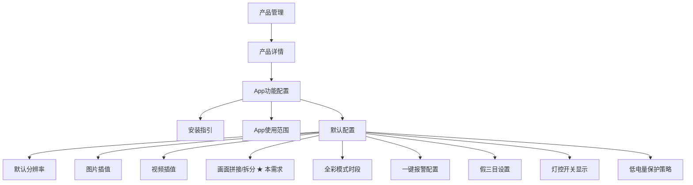

# 画面拼接与拆分 — 设计说明

## 修订记录

| 修订时间 | 修订内容 | 修订人 |
|---|---|---|
| 2026-11-12 | 更新交互：拼接改为选择「拼接路数 1~7」+ 多选 Camera 0~6；拆分改为每条配置一块独立卡片；Camera 编号统一为 0~6 | UI/UE AI 设计师 |
| 2026-11-09 | 初稿 | UI/UE AI 设计师 |

---

## 页面结构

本需求不新增页面，只在现有 **App功能配置 · 默认配置** 中新增一个配置项。

**导航路径**：产品管理 → 选择产品 → App功能配置 → 默认配置。

---

## 布局详述

### 区域 1：配置项标题行（始终可见）

| 项 | 规格 |
|---|---|
| 位置 | 默认配置表单内，位于「视频插值」之后、「全彩模式时段」之前 |
| 表单标签 | `画面拼接/拆分`，右对齐，标签宽 140px，字号 14px |
| 控件 | Switch 开关（小号）+ 状态文字「开启 / 关闭」，字号 13px |
| 分隔 | 上下各一条 1px 分割线，与其他配置项一致 |

### 区域 2：展开配置块（开关开启后出现）

| 项 | 规格 |
|---|---|
| 容器 | 浅灰底 `#F7F7F9`，圆角 6px，内边距 12px，子项纵向间距 12px |
| 缩进 | 与左侧标签列对齐，不顶到卡片边缘 |

**行 1 · 模式**

- 标签「模式」宽 100px，字号 13px，次级灰色
- 单选控件：`拼接` / `拆分`，默认选中「拆分」

**行 2A · 拼接分支（单选为拼接时）**

| 行 | 标签 | 控件 | 尺寸 |
|---|---|---|---|
| 1 | 拼接路数 | 下拉选择，选项 1~7 路 | 170px |
| 2 | 拼接 Camera | 多选下拉，选项 Camera 0~6，超出路数的勾选被阻止 | 240px |
| 3 | — | 进度说明文字，12px 占位灰：`已选 2 / 3 路` | 自动生成 |

**行 2B · 拆分分支（单选为拆分时）**

每条拆分配置渲染为一张**独立白色卡片**，卡片之间纵向间距 12px；卡片内行距 12px。

| 行 | 标签 | 控件 | 尺寸 |
|---|---|---|---|
| 1 | Camera | 下拉选择，选项 Camera 0~6；已被其他卡片占用的编号置灰 | 170px；行尾放「删除」文字按钮（红色） |
| 2 | 子画面数量 | 下拉选择，选项 2 路 / 3 路 / 4 路 | 170px |
| 3 | 分割点 | N-1 个数字输入框 + 「%」，横向排列，间距 16px | 每个 96px |
| 4 | — | 该条配置的占比说明文字，12px 占位灰：`画面一 50%，画面二 50%` | 自动生成 |

卡片下方放「+ 添加配置」按钮，左对齐。

### 区域 3：配置项说明（始终可见）

- 位置：配置块下方
- 文案：`拼接：多路视频流合成为一个画面；拆分：一路视频流按分割点拆分为多个画面。`
- 样式：13px，占位灰，行高 1.6

---

## 状态说明

| 状态 | 触发条件 | 展示内容 |
|---|---|---|
| 关闭态 | 总开关为关闭 | 仅显示标题行（开关 + 「关闭」），无配置块 |
| 拼接态 | 开关开启 + 模式为拼接 | 拼接路数 + 拼接 Camera 多选 + 已选进度 |
| 拆分态 | 开关开启 + 模式为拆分 | 若干张配置卡片（Camera + 子画面数量 + 分割点 + 占比）+「添加配置」按钮 |
| 多配置态 | 拆分态且配置条数 ≥ 2 | 多张卡片并列展示，各自独立；已被占用的 Camera 编号在其余卡片中置灰 |
| 单配置态 | 拆分态且配置条数 = 1 | 一张卡片；点击删除提示「至少保留一个拆分配置」 |
| 拼接未选满态 | 拼接态且已选数量 < 路数 | 进度文字提示「已选 x / N 路」，保存被拦截 |
| 输入非法态 | 分割点不满足递增或越界 | 输入框值即时被自动修正，无报错样式 |
| 保存成功态 | 保存请求成功 | Toast「保存成功」 |
| 保存失败态 | 保存请求失败 | Toast「网络异常，请重试」，页面内容保留 |

---

## 交互说明

| 交互 | 触发 | 效果 |
|---|---|---|
| 总开关 | 点击 Switch | 开启时展开配置块，默认模式为「拆分」；关闭时收起全部子配置 |
| 切换模式 | 点击单选 | 拼接↔拆分互相切换，**已配置的拆分配置数据保留不清空** |
| 拼接路数 | 下拉选择 | 更新多选上限；已选数量超出新路数时自动截断 |
| 拼接 Camera | 多选下拉 | 超出路数的勾选被阻止；已选数量实时显示 |
| 修改 Camera | 下拉选择 | 只改变当前这张卡片的 Camera；已被其他卡片占用的编号不可选 |
| 添加配置 | 点击「添加配置」 | 新增一张完整卡片，Camera 自动取当前最小可用编号；条数上限 4 |
| 删除配置 | 点击卡片内「删除」 | 只移除该卡片，其余卡片不变；仅剩 1 条时阻止删除并 Toast 提示 |
| 修改子画面数量 | 下拉选择 | 分割点数量随之变化（2 路 1 个、3 路 2 个、4 路 3 个），并按均分重置 |
| 修改分割点 | 数字框输入/步进 | 非法值即时修正：非递增→置为前一个 +1；越界→钳制到 1~99；清空→回填最小允许值 |
| 查看占比 | 分割点变化后自动 | 下方说明文字实时反算各子画面占比，只读不可编辑 |
| 保存 | 点击页面底部「保存配置」 | 沿用现有保存行为，整页配置一并提交 |

---

## 组件清单

Web 后台使用 **Element Plus**，与项目现有页面保持一致。

| 组件 | 用途 | 所在区域 |
|---|---|---|
| `el-form-item` | 配置项容器，复用现有 140px 标签列 | 区域 1 |
| `el-switch` | 总开关 | 区域 1 |
| `el-radio-group` / `el-radio` | 模式单选 | 区域 2 行 1 |
| `el-select` / `el-option` | 拼接路数、拼接 Camera（多选）、拆分 Camera、子画面数量 | 区域 2 行 2A / 2B |
| `el-button` | 添加配置；卡片内删除为 text + danger 样式 | 区域 2 行 2B |
| `el-input-number` | 分割点输入，右侧步进，范围 1~99 | 区域 2 行 2B |
| `el-message` | 保存成功 / 失败、删除拦截提示 | 全局 |

---

## 视觉规范

沿用 `默认配置` Tab 现有规范，不引入新样式变量：

| 项 | 取值 |
|---|---|
| 配置项分割线 | `var(--border-lighter)` |
| 次级文字色 | `var(--text-secondary)` |
| 占位/说明文字色 | `var(--text-placeholder)` |
| 配置块底色 | `var(--gray-50)`（`#F7F7F9`） |
| 主按钮 | 项目主色，沿用底部「保存配置」 |
| 圆角 | 配置块 6px |
