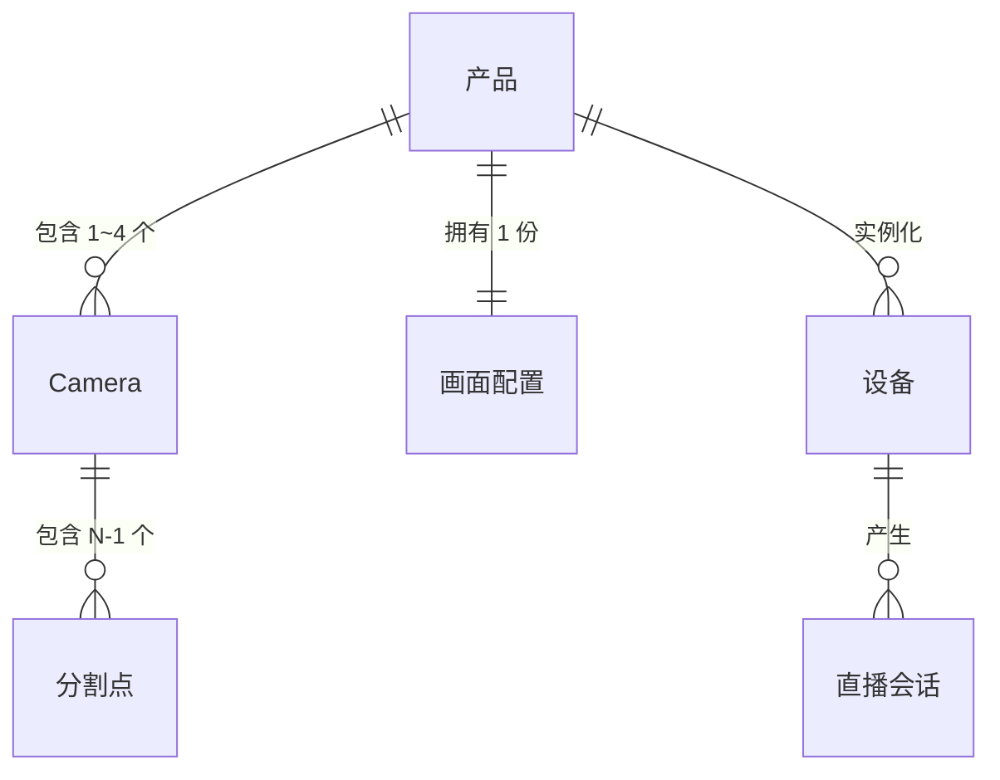
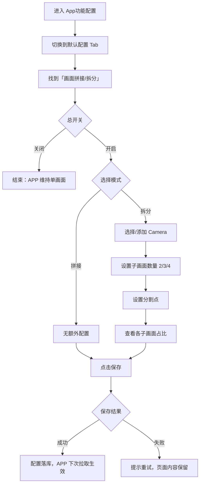
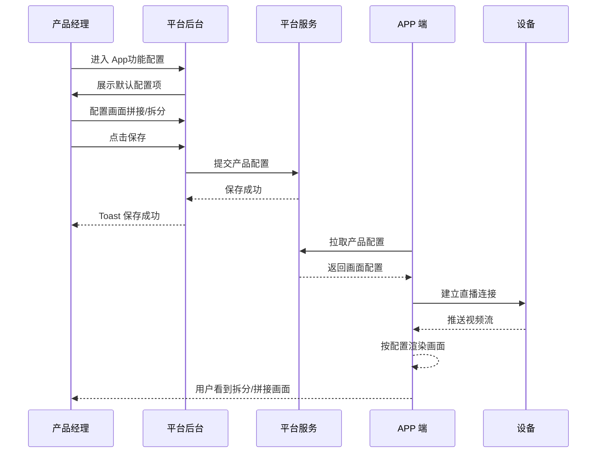
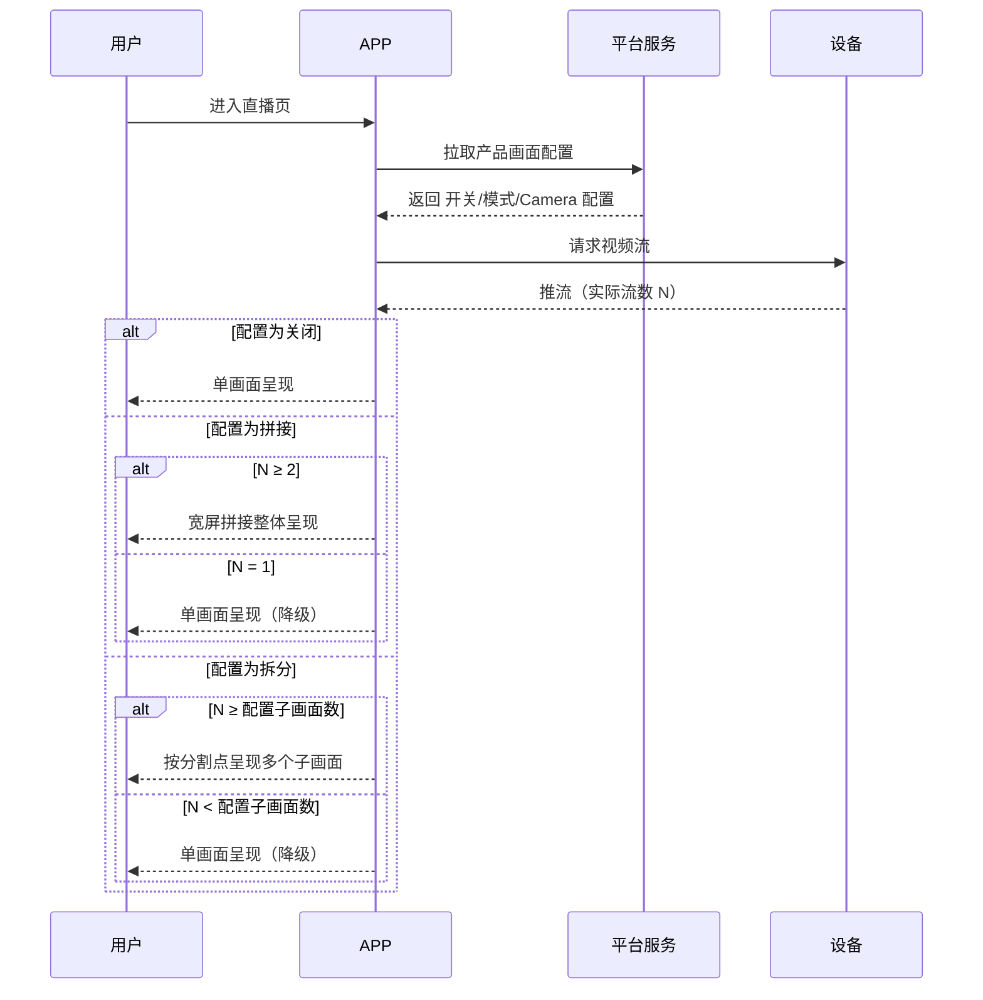
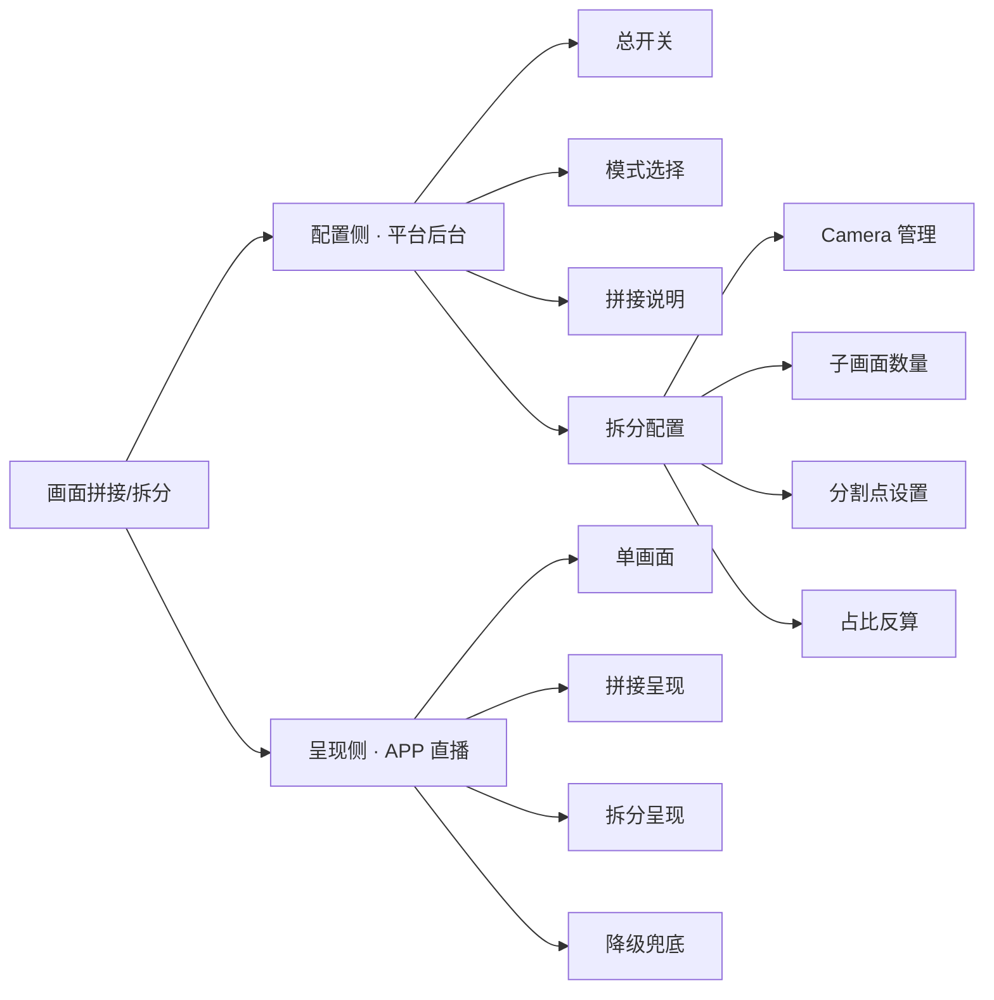
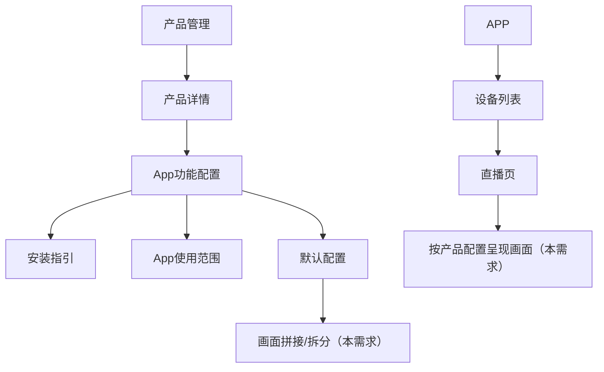

# 画面拼接与拆分 — 完整业务 PRD

## 修订记录

| 修订时间 | 修订内容 | 修订人 |
|---|---|---|
| 2026-11-09 | 初稿：汇总需求分析、UI 设计、运营分析全流程产出 | PRD 生成 AI 工程师 |

---

## 一、业务背景

### 业务场景

摄像机产品的画面来源有两种形态：

1. 设备同时输出**多路**视频流，需要在 APP 上合成为一个画面观看（宽屏类机型）；
2. 设备只输出**一路**视频流，但这一路里并排承载了多个采集通道的画面，需要在 APP 上拆开分别观看。

过去平台侧没有统一配置入口，只能由 APP 按机型硬编码，每接入一款新机型就要发一次版。

### 用户痛点

| 角色 | 痛点 |
|---|---|
| 产品 / 运营 | 新机型接入 APP 必须走发版流程，周期长 |
| 平台配置人员 | 无法在产品维度描述"这路流要拆成几个画面" |
| 最终用户 | 部分设备在 APP 上只能看到一整张拼图，看不清细节 |

### 产品目标

在产品级「App功能配置」中提供统一的画面拼接/拆分配置，让同一套 APP 通过配置适配不同机型，**不改 APP 代码即可上线新机型**。

> **范围声明**：本需求只作用于实时直播画面呈现，不影响回放、云存储、事件抓图与分享截图。

---

## 二、名词解释

| 术语 | 说明 |
|---|---|
| 画面拼接 | 多路视频流合成为**一个**画面呈现，典型为宽屏设备的特殊展示形态 |
| 画面拆分 | **一路**视频流按分割点拆分为**多个**画面分别呈现 |
| Camera | 设备侧的一个采集通道，即设备输出的一路流；一个 Camera 对应一路流 |
| 子画面 | 拆分后得到的单个画面 |
| 分割点 | 拆分时画面之间的分界位置，以百分比表示；N 个子画面对应 N-1 个分割点 |
| 画面占比 | 由相邻分割点（或边界与分割点）的差值反算得出，只读 |
| 产品级配置 | 挂在产品维度、对该产品下所有设备生效的配置，不支持单台设备覆盖 |
| 降级 | 设备实际流数少于配置的子画面数时，退化为单画面呈现 |
| 直播 | 实时预览页面，不含回放、云存储与事件抓图 |

---

## 三、业务实体说明

| 实体 | 说明 | 关键属性 |
|---|---|---|
| 产品 | 设备的型号维度，配置的载体 | 产品ID、产品名称、类目 |
| Camera | 产品下的一路采集通道 | 名称（Camera_N）、子画面数量、分割点 |
| 画面配置 | 产品级的画面呈现规则 | 开关状态、模式、Camera 列表 |
| 设备 | 产品的实例 | 设备ID、所属产品、实际输出流数、在线状态 |
| 直播会话 | 用户一次进入直播页的行为 | 用户ID、设备ID、呈现结果 |

**实体关系**：

---

## 四、核心业务流程

### 4.1 配置流程图

### 4.2 全局时序图

### 4.3 局部时序图：直播呈现与降级

---

## 五、业务规则

### 5.1 配置规则

| 编号 | 规则 | 说明 |
|---|---|---|
| R-01 | 配置为产品级 | 同产品下所有设备共用一份配置，不支持单设备覆盖 |
| R-02 | 总开关关闭时 | 隐藏全部子配置；APP 按现有逻辑呈现单画面 |
| R-03 | 模式必须二选一 | 开启后必须选择拼接或拆分，默认「拆分」 |
| R-04 | 模式切换不清空数据 | 拼接与拆分互相切换时，拆分配置数据保留 |
| R-05 | 拼接模式无配置项 | 仅展示说明文案；具体布局由 APP 按机型固定处理 |
| R-06 | Camera 数量 1~4 | 至少保留 1 个；达到上限后不可继续添加 |
| R-07 | Camera 自动命名 | 按 Camera_1、Camera_2… 顺序生成，不支持自定义命名 |
| R-08 | Camera 配置相互独立 | 每个 Camera 的子画面数量与分割点互不影响 |

### 5.2 分割点规则

| 编号 | 规则 | 说明 |
|---|---|---|
| R-09 | 数量联动 | 子画面数量决定分割点个数：2 路 1 个、3 路 2 个、4 路 3 个 |
| R-10 | 修改数量即重置 | 子画面数量变化后，分割点按均分重新生成 |
| R-11 | 取值范围 | 每个分割点 1~99，不允许出现 0% 或 100% 的子画面 |
| R-12 | 必须严格递增 | 后一个分割点必须大于前一个；违反时自动修正为「前一个 + 1」 |
| R-13 | 越界钳制 | 超出 1~99 时钳制到边界值 |
| R-14 | 空值回填 | 输入被清空时回填该位置的最小允许值 |
| R-15 | 占比只读 | 各子画面占比由分割点反算，不允许直接编辑 |

### 5.3 生效与呈现规则

| 编号 | 规则 | 说明 |
|---|---|---|
| R-16 | 生效范围 | 仅作用于实时直播页 |
| R-17 | 生效时机 | 配置保存后，APP 下次拉取产品配置时生效；不主动推送 |
| R-18 | 降级规则 | 设备实际流数少于配置的子画面数时，退化为单画面，不提示用户 |
| R-19 | 单路流拼接 | 拼接模式下设备仅上报 1 路流时，按单画面呈现 |
| R-20 | 离线优先 | 设备离线时不进入画面呈现逻辑，展示离线态 |

### 5.4 状态流转

| 当前状态 | 可转换到 | 触发条件 |
|---|---|---|
| 关闭 | 拼接 | 开启开关并选择拼接 |
| 关闭 | 拆分 | 开启开关并选择拆分 |
| 拼接 | 拆分 | 切换模式（拆分配置保留） |
| 拼接 | 关闭 | 关闭开关 |
| 拆分 | 拼接 | 切换模式（拆分配置保留） |
| 拆分 | 关闭 | 关闭开关 |

---

## 六、功能架构

| 模块 | 职责 |
|---|---|
| 配置侧 | 定义产品画面的呈现规则，产出可被 APP 读取的配置 |
| 呈现侧 | 读取配置，在直播页按规则渲染画面，并对异常情况兜底 |

---

## 七、详细功能描述

### 7.1 画面拼接/拆分配置

#### 功能应用场景

平台配置人员在接入一款双通道拼接流机型，或一款需要宽屏合并的多路流机型时使用。

#### 功能详述

**位置**：产品管理 → 产品详情 → App功能配置 → 默认配置，位于「视频插值」与「全彩模式时段」之间。

**区域 1 · 标题行**

- 标签：`画面拼接/拆分`
- 控件：开关 + 状态文字「开启 / 关闭」

**区域 2 · 配置块（开关开启后展开）**

- 行「模式」：单选 `拼接` / `拆分`，默认拆分
- 拼接分支：一行说明文字，不出现任何输入控件
- 拆分分支：
  - 行「Camera」：下拉选择 + 添加按钮 + 删除按钮
  - 行「子画面数量」：下拉 2 路 / 3 路 / 4 路
  - 行「分割点」：N-1 个百分比输入框
  - 行「占比说明」：实时显示各子画面占比，只读

**区域 3 · 配置说明**

- 文案：`拼接：多路视频流合成为一个画面；拆分：一路视频流按分割点拆分为多个画面。`

#### 状态说明

| 状态 | 触发条件 | 展示内容 |
|---|---|---|
| 关闭态 | 开关关闭 | 仅标题行 |
| 拼接态 | 开关开启 + 拼接 | 模式单选 + 拼接说明 |
| 拆分态 | 开关开启 + 拆分 | 完整拆分配置 |
| 单 Camera 态 | Camera 数量 = 1 | 删除按钮点击被拦截 |
| 非法输入态 | 分割点非递增/越界/为空 | 输入值即时被修正 |

#### 交互说明

| 交互 | 效果 |
|---|---|
| 添加 Camera | 新增 Camera_N，使用默认参数并自动切换 |
| 删除 Camera | 删除当前项并切换到相邻项；仅剩 1 个时 Toast「至少保留一个 Camera」 |
| 切换 Camera | 展示该 Camera 的独立配置 |
| 修改子画面数量 | 分割点数量联动变化并重置为均分 |
| 修改分割点 | 非法值即时修正，占比同步刷新 |
| 保存 | 沿用页面底部「保存配置」，整页一并提交 |

---

### 7.2 APP 直播呈现

#### 功能应用场景

用户打开已配置设备的实时预览页面时，画面按产品配置呈现。

#### 功能详述

| 配置 | 设备实际流数 | 呈现结果 |
|---|---|---|
| 关闭 | 任意 | 单画面 |
| 拼接 | ≥ 2 | 宽屏拼接整体呈现 |
| 拼接 | 1 | 单画面（降级） |
| 拆分 N 路 | ≥ N | 按分割点呈现 N 个子画面 |
| 拆分 N 路 | < N 且 ≥ 1 | 单画面（降级） |
| 任意 | 0 | 设备离线态 |

#### 状态说明

| 状态 | 触发条件 | 展示内容 |
|---|---|---|
| 单画面态 | 未配置或降级 | 一个完整画面 |
| 拼接态 | 配置为拼接且流数达标 | 宽屏合并画面 |
| 拆分态 | 配置为拆分且流数达标 | 多个子画面 |
| 离线态 | 设备离线 | 离线占位 |

#### 交互说明

- 本需求不新增直播页交互，画面形态完全由配置决定。
- 用户无法在直播页临时切换单/多画面（本期不做，见第十章开放性说明）。

---

## 八、页面信息架构

- **配置侧**：单页内完成，无跳转
- **呈现侧**：直播页读取产品配置，无新增页面

---

## 九、异常说明

| 场景 | 表现 |
|---|---|
| 保存时网络异常 | Toast「网络异常，请重试」，页面已填内容不清空 |
| 保存时权限不足 | 沿用平台现有权限提示，配置项只读 |
| 并发编辑冲突 | 以最后一次保存为准，本端提示「配置已被他人修改，请刷新后重试」 |
| 删除最后一个 Camera | 拦截并 Toast「至少保留一个 Camera」 |
| 分割点非法 | 输入值即时被自动修正，不弹错误提示 |
| Camera 达上限 | 添加被阻止，按钮置灰或 Toast「最多 4 个 Camera」 |
| 配置未生效 | 本次进入直播仍按上一版配置呈现，下次进入生效 |
| 实际流数少于配置 | 降级为单画面，不提示用户 |
| 设备离线 | 展示离线态，配置不参与渲染 |
| 直播流加载失败 | 展示加载失败态与重试入口 |

> **已知取舍**：直播按配置拆分，但回放、云存储、事件抓图仍为整帧。用户从直播切到回放时会看到画面形态变化。本期不处理，建议客服侧预备话术。

---

## 十、测试要点

### 功能回归

| 编号 | 测试点 | 前置条件 | 操作步骤 | 预期结果 |
|---|---|---|---|---|
| T-001 | 默认配置页其他项不受影响 | 已配置画面拼接/拆分 | 逐项检查默认分辨率、图片插值、视频插值等 | 功能与样式均无变化 |
| T-002 | 保存按钮行为一致 | 本配置有修改 | 点击保存 | 与其他配置项一同提交，提示一致 |
| T-003 | 未配置产品行为不变 | 产品从未配置 | 进入直播页 | 与改造前一致的单画面 |
| T-004 | 切 Tab 后状态保持 | 开启并配置拆分 | 切到安装指引再切回 | 配置内容正确回显 |

### 核心场景

| 编号 | 测试点 | 前置条件 | 操作步骤 | 预期结果 |
|---|---|---|---|---|
| T-101 | 开启默认拆分 | 开关关闭 | 打开开关 | 模式默认「拆分」，展示 Camera_1、2 路、分割点 50 |
| T-102 | 拼接无配置 | 开关开启 | 选择拼接 | 仅显示说明文案，无输入控件 |
| T-103 | 模式切换数据保留 | 拆分已配 3 路 | 切拼接再切回拆分 | 原 Camera 与分割点完整保留 |
| T-104 | 添加/删除 Camera | 存在 1 个 | 添加两次再删除一次 | 名称递增、数量正确、自动切换当前项 |
| T-105 | 数量联动 | 2 路 | 改为 4 路 | 分割点由 1 个变 3 个，且为均分值 |
| T-106 | 占比反算 | 3 路，分割点 30/80 | 观察下方说明 | 显示 画面一 30%、画面二 50%、画面三 20% |
| T-107 | 直播拆分 2 画面 | 配置 2 路 50% | 进入直播页 | 呈现两个子画面 |

### 异常场景

| 编号 | 测试点 | 前置条件 | 操作步骤 | 预期结果 |
|---|---|---|---|---|
| T-201 | 保存断网 | 断网状态 | 修改后点击保存 | Toast 网络异常，内容保留 |
| T-202 | 删除最后一个 Camera | 仅有 1 个 | 点击删除 | 拦截并提示「至少保留一个 Camera」 |
| T-203 | 分割点非递增 | 3 路 | 第一个填 70，第二个填 60 | 第二个自动修正为 71 |
| T-204 | 分割点越界 | 任意 | 输入 0 或 120 | 钳制为 1 或 99 |
| T-205 | 分割点清空 | 任意 | 清空输入框 | 回填最小允许值，占比正常显示 |
| T-206 | 流数不足降级 | 配置 3 路，设备仅 1 路 | 进入直播页 | 单画面呈现，无报错提示 |
| T-207 | 设备离线 | 设备离线 | 进入直播页 | 展示离线态 |

### 状态切换

| 编号 | 测试点 | 前置条件 | 操作步骤 | 预期结果 |
|---|---|---|---|---|
| T-301 | 关闭→开启→关闭 | 已配置拆分 | 反复切换开关 | 状态与配置均正确，无残留 |
| T-302 | 快速连续添加 Camera | 存在 1 个 | 连续点击添加至上限 | 不出现重复名称、不越界 |
| T-303 | 修改后不保存离开 | 已修改 | 直接切 Tab | 未保存内容不落库，返回后回到已保存状态 |
| T-304 | 配置更新后再次进入直播 | 直播中修改配置 | 退出重进直播页 | 按新配置呈现 |

### 兼容性

| 编号 | 测试点 | 前置条件 | 操作步骤 | 预期结果 |
|---|---|---|---|---|
| T-401 | 不同分辨率屏幕 | 配置页 | 1280 / 1440 / 1920 宽度查看 | 配置块不换行错位、不溢出 |
| T-402 | 不同机型直播 | 配置拆分 | 在小屏/大屏手机观看 | 子画面比例正确，无拉伸变形 |
| T-403 | 多 App 共用配置 | 产品限定了多个 App | 用不同 App 打开同一设备 | 呈现结果一致 |

---

## 十一、APP 埋点与运营数据看板

> 完整方案见 `画面拼接与拆分04bp.md`，此处为摘要。

### 11.1 核心指标

| 指标 | 类型 | 说明 |
|---|---|---|
| 配置覆盖率 | 业务 | 已开启配置的产品数 ÷ 摄像机产品总数 |
| 模式分布占比 | 业务 | 拼接 / 拆分各占已开启产品的比例 |
| 配置保存成功率 | 质量 | 保存成功次数 ÷ 保存请求次数 |
| 直播画面降级率 | 质量 | 降级次数 ÷ 有配置的直播次数 |
| 分割点自定义率 | 行为 | 修改过分割点的 Camera 占比 |

### 11.2 关键埋点

| 事件ID | 触发时机 | event_type |
|---|---|---|
| `split_enable_toggle` | 切换总开关 | 1 |
| `split_mode_select` | 切换模式 | 1 |
| `split_point_edit` | 分割点修改失焦 | 1 |
| `split_config_save` | 保存成功 | 1 |
| `split_config_save_fail` | 保存失败 | 2 |
| `live_split_render` | 直播首帧渲染完成 | 1 |
| `live_split_fallback` | 直播降级为单画面 | 2 |

### 11.3 数据看板

- **区域 1**：核心指标卡片（覆盖率、降级率、保存成功率、自定义率）
- **区域 2**：趋势与结构（覆盖率/降级率周趋势、模式分布饼图、Camera 数分布柱状图）
- **区域 3**：产品明细表（按降级率降序）
- **区域 4**：异常下钻（降级明细、保存失败明细）

### 11.4 告警

| 告警 | 条件 | 级别 |
|---|---|---|
| 直播降级率超标 | 当日 > 5% 且样本 ≥ 100 | P1 |
| 单机型集中降级 | 单产品当日 > 20% | P1 |
| 保存失败率超标 | 1 小时内 > 10% | P1 |

---

## 附录：本期不做的功能

| 功能 | 原因 |
|---|---|
| 影响回放、云存储、事件抓图、分享截图 | 本期只做直播 |
| 拼接布局参数化配置 | 由 APP 按机型固定处理 |
| 与「假三目设置」合并 | 本期决定共存 |
| 按 App 分别配置 | 多 App 共用 |
| 单设备覆盖产品配置 | 配置为产品级 |
| 子画面独立 PTZ / 独立抓图 | 超出本期范围 |
| APP 内临时切换单/多画面 | 未定义，后续评估 |
| 子画面点击放大/全屏 | 后续评估 |

---

**文档结束**
