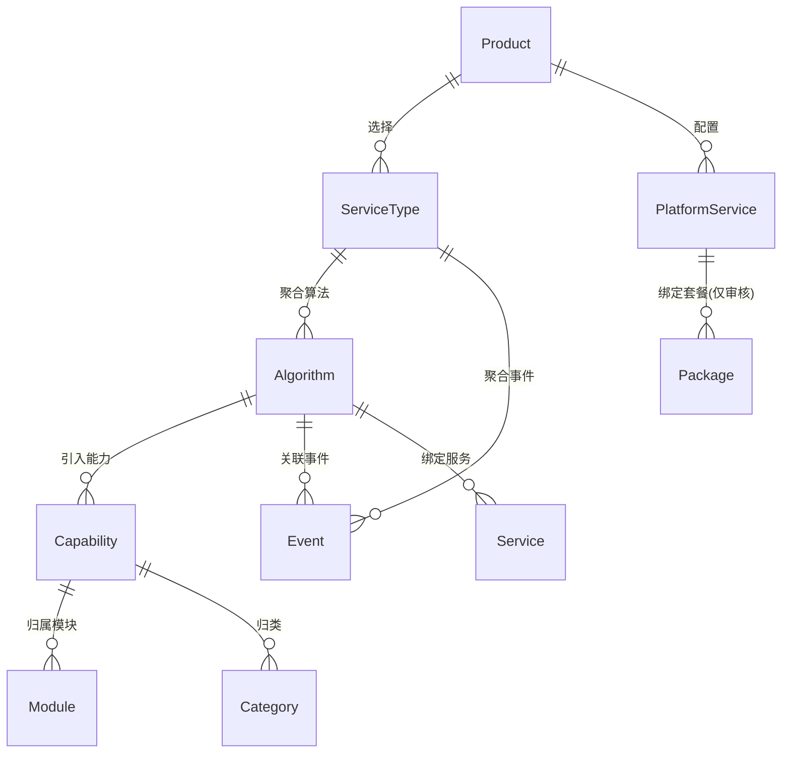

# 算法管理 — 需求分析文档

## 修订记录

| 修订时间 | 修订内容 | 修订人 |
|------|------|------|
| 2026-06-03 | 按 SKILL 规范重写，场景穷举分析 | Kiro |
| 2026-07-07 | 基于实际代码实现更新：算法类型、关联服务、免开通/套餐绑定规则、平台服务合并单元格、审核页联动；移除所有开发代码相关内容 | Kiro |
| 2026-07-08 | 服务类型改为只读反显算法库绑定关系（去主动绑定）；平台服务精简为四列；算法列头改为「算法ID（AIIOTTYPE）」 | Kiro |
| 2026-07-08 | 纯业务化：移除代码字段名、存储字段列、数据层与API对接等开发实现痕迹，仅保留业务实体与关系 | Kiro |

---

## 一、业务背景

- **业务场景**：IoT 平台支持多种侦测与AI算法（运动、人形、车辆、声音、哭声、烟火、宠物、老人看护等），当前算法定义分散在多个环节，新增一个算法需要研发跨环节改动。
- **用户痛点**：运营/产品人员无法自主配置算法和事件，必须走开发流程，迭代周期长。
- **产品目标**：建设平台级「算法管理」模块，作为物模型上层元数据组织层，实现算法和事件的配置化管理。

---

## 二、名词解释

| 术语 | 说明 |
|------|------|
| 算法 Algorithm | 设备端运行的侦测/AI能力，如运动侦测、人形侦测、人脸识别。每个算法有独立的算法ID、多语言名称、图标，并关联能力和事件。 |
| 事件 Event | 算法/设备触发后上报给平台的消息事件（如「检测到移动物体」）。事件通过事件ID（纯数字）唯一标识，创建后不可修改。 |
| 能力项 Capability | 算法可配置的功能原子单元，如开关、灵敏度、侦测区域。从能力池导入，算法不自行定义。 |
| 服务类型 ServiceType | 算法的「打包层」。一个服务类型聚合多个算法 + 事件 + 物模型，是产品开发中选择算法能力的入口。 |
| 算法ID | 算法在平台内的唯一标识符（如 4001、1003）。创建时可编辑，修改时需校验唯一性。 |
| 事件ID | 事件在平台内的唯一数字标识（如 100001），创建后不可修改。 |
| 算法类型 | 分为设备端算法（默认）和平台算法两类。 |
| 引用计数 | 算法被多少个产品/设备引用；事件被多少个算法引用。 |

---

## 三、架构与实体关系

### 3.1 整体架构

```
物模型管理
├── 能力库
│   ├── Tab: 标准能力 ── 能力池（全品类原子能力，含「算法能力模块」）
│   └── Tab: 自定义能力 ── 企业自定义能力
│
├── 算法管理
│   ├── Tab: 算法库 ── 算法定义 + 能力导入 + 事件关联
│   └── Tab: 事件库 ── 事件定义（EventID、名称、推送文案）
│
├── 算法能力详情
│   └── 单算法的能力关联管理（导入/编辑/移除）
│
├── 套餐管理 → 服务类型
│   └── 服务类型 = 算法聚合 + 事件聚合（弹窗只读反显算法库已绑定物模型）
│
└── 产品开发 → 继续开发
    ├── Step 2：设备算法服务（合并单元格表格 + 能力配置/事件关联/免开通）
    └── Step 3：平台服务（精简表格：服务ID/名称/描述/是否支持，不含免开通和套餐绑定）
```

### 3.2 数据实体关系图



**关系说明**：

| 关系 | 方向 | 说明 |
|------|------|------|
| 算法 → 能力 | N:M | 算法从能力池引入能力项 |
| 算法 → 事件 | N:M | 算法关联事件 |
| 算法 → 服务 | N:M | 算法在算法库绑定服务 |
| 服务类型 → 算法 | N:M | 由算法库绑定反向派生，服务类型弹窗只读反显 |
| 服务类型 → 事件 | N:M | 服务类型聚合事件 |
| 产品 → 服务类型 | N:1 | 产品配置中选择服务类型 |

**数据流向**：
```
能力池(能力定义) → 算法(引入能力) → 服务类型(聚合算法+事件) → 产品(选择服务)
事件库(事件定义) → 算法(关联事件) → 服务类型(聚合事件) → 产品(设备上报)
```

### 3.3 两层算法管理

项目中存在两个算法管理入口，共享同一套算法数据：

| 特性 | 算法管理主入口 | 物模型路由版 |
|------|------|------|
| 菜单位置 | 侧栏「算法管理」 | 物模型管理 → 算法库 |
| 页卡结构 | 标签页：算法库 + 事件库 | 单页算法列表 |
| 功能完整性 | 完整（算法 + 事件 CRUD） | 精简版（仅算法 CRUD，无事件 Tab） |
| 数据源 | 同一算法数据存储 | 同一算法数据存储 |
| 关联事件 | 表格展示事件数量（点击打开抽屉） | 表格展示 + 侧边抽屉编辑 |
| 关联服务 | 表格展示服务ID标签（点击打开抽屉编辑） | 表格展示服务ID标签 + 侧边抽屉编辑 |
| 关联能力 | 表格展示能力标签 | 表格展示能力标签 + 点击跳转能力详情页 |
| 算法类型 | 表格展示（设备/平台标签） | 表格展示（设备/平台标签） |

---

## 四、功能范围

### 4.1 功能列表总览

| 序号 | 模块 | 功能 | 优先级 | 说明 |
|------|------|------|:--:|------|
| F1 | 算法管理 | 算法列表 | P0 | 分页展示、关键词搜索（匹配 algorithmId + 中文名称） |
| F2 | 算法管理 | 添加算法 | P0 | 弹窗填写基础信息 + 勾选能力项 + 穿梭框关联事件 |
| F3 | 算法管理 | 编辑算法 | P0 | 回填表单，可修改全部字段（含 AlgorithmID） |
| F4 | 算法管理 | 删除算法 | P0 | 二次确认，有设备引用时禁止删除 |
| F5 | 算法管理 | 算法能力详情页 | P1 | 二级页，展示已关联能力、支持导入/编辑/移除能力 |
| F6 | 事件库 | 事件列表 | P0 | 分页展示、关键词搜索（匹配 eventId + 中文名称） |
| F7 | 事件库 | 添加事件 | P0 | 弹窗表单，eventId + 多语言名称 + 推送文案 |
| F8 | 事件库 | 编辑事件 | P0 | 回填表单，eventId 不可修改 |
| F9 | 事件库 | 删除事件 | P0 | 二次确认，有算法引用时禁止删除 |

### 4.2 不做/暂不做的功能

| 功能 | 原因 | 后续计划 |
|------|------|------|
| 批量导入算法/事件 | 一期数据量小，逐条添加可满足 | 二期评估 Excel 导入 |
| 算法版本管理 | 当前算法无版本概念，协议层不支持 | 待协议升级后评估 |
| 事件与设备直接关联 | 事件通过算法间接关联设备，不建直接关系 | 暂无计划 |
| 多语言翻译自动填充 | 翻译质量不可控 | 人工填写 |

---

## 五、场景穷举分析

### 5.1 算法列表

#### 5.1.1 功能概述
- **功能目的**：展示平台所有算法，支持搜索和分页浏览
- **前置条件**：用户已登录 IoT 管理后台，进入算法管理 → 算法库 Tab

#### 5.1.2 正常场景

| 场景编号 | 场景名称 | 前置条件 | 操作步骤 | 预期结果 |
|------|------|------|------|------|
| N-001 | 首次加载算法列表 | 平台已有算法 | 进入算法管理页面 | 默认第 1 页、每页 20 条，展示 AlgorithmID/图标/名称/能力标签/关联事件数/引用设备数 |
| N-002 | 关键词搜索 | 平台有算法 | 输入关键词 → 点击查询 | 列表过滤出 algorithmId 或中文名称匹配的算法，分页重置 |
| N-003 | 翻页浏览 | 算法总数 > 20 | 点击第 2 页 | 展示第 21-40 条 |
| N-004 | 修改每页条数 | 算法列表已加载 | 切换每页为 50 | 重新请求，每页展示 50 条 |
| N-005 | 重置搜索 | 搜索框有值 | 点击重置按钮 | 清空搜索框，恢复全部列表，分页重置 |

#### 5.1.3 异常场景

| 场景编号 | 异常类型 | 触发条件 | 系统行为 |
|------|------|------|------|
| E-001 | 网络异常 | 请求超时或无网络 | 保留当前列表，接口错误提示 |
| E-002 | 数据为空 | 平台无任何算法 | 空态插图 +「暂无算法」+「添加算法」按钮 |
| E-003 | 搜索无结果 | 搜索不存在的关键词 | 空态（同 E-002） |

#### 5.1.4 边界条件

| 条件项 | 默认值 | 可选项 |
|------|------|------|
| 每页条数 | 20 | 10 / 20 / 50 |
| 搜索关键词 | 空 | 最长 100 字符 |
| 页码 | 1 | 取决于 total/pageSize |

### 5.2 添加算法

#### 5.2.1 功能概述
- **功能目的**：创建新算法，配置 AlgorithmID、多语言名称、图标、能力勾选、事件关联、扩展属性
- **前置条件**：用户在算法库 Tab，点击「添加算法」按钮

#### 5.2.2 正常场景

| 场景编号 | 场景名称 | 操作步骤 | 预期结果 |
|------|------|------|------|
| N-006 | 最小字段添加 | 填写 AlgorithmID + 中文名称 → 确认创建 | 算法创建成功，弹窗关闭，列表刷新 |
| N-007 | 全字段添加 | 填写所有字段（多语言名称、图标、能力全勾选、关联事件、扩展属性） | 算法创建成功，所有字段正确保存 |
| N-008 | 勾选能力 | 弹窗中勾选/取消能力项 | 能力关联实时更新 |
| N-009 | 关联事件 | 穿梭框勾选事件加入右侧 → 保存 | 事件写入算法的关联事件 |

#### 5.2.3 异常场景

| 场景编号 | 异常类型 | 触发条件 | 系统行为 |
|------|------|------|------|
| E-005 | ID 冲突 | AlgorithmID 与其他算法重复 | 提示「AlgorithmID 已存在」 |
| E-006 | 必填为空 | AlgorithmID 或中文名称未填写 | 表单校验拦截，红色提示 |
| E-007 | 网络异常 | 提交时网络中断 | 错误提示，弹窗不关闭，保留已填内容 |
| E-008 | 重复提交 | 快速双击确认 | 按钮置为加载态并禁用，防止重复提交 |

#### 5.2.4 边界条件

| 条件项 | 最小值 | 最大值 | 默认值 |
|------|------|------|------|
| AlgorithmID 长度 | 1 | 100 | — |
| 排序权重 | 0 | 9999 | 0 |
| 关联事件数 | 0 | 事件总数 | 0 |
| 侦测子类型行数 | 0 | 20 | 0 |
| 扩展属性长度 | 0 | 5000 字符 | 空 |

### 5.3 编辑算法

| 场景编号 | 场景名称 | 操作步骤 | 预期结果 |
|------|------|------|------|
| N-010 | 修改算法名称 | 编辑弹窗 → 修改中文名称 → 确认保存 | 名称更新，列表刷新 |
| N-011 | 修改 AlgorithmID | 新 ID 未被占用 → 修改 → 确认 | ID 更新成功（设备侧下次拉取同步） |
| N-012 | 修改能力配置 | 勾选/取消能力项 → 确认 | 能力关联更新 |
| N-013 | 修改关联事件 | 穿梭框调整 → 确认 | 关联事件更新 |

| 场景编号 | 异常类型 | 触发条件 | 系统行为 |
|------|------|------|------|
| E-011 | ID 冲突 | 新 AlgorithmID 与其他算法重复 | 提示「AlgorithmID 已存在」 |
| E-012 | 原数据被删 | 弹窗打开期间他人删除 | 保存时返回不存在，弹窗关闭，列表刷新 |
| E-013 | 取消编辑 | 弹窗中已修改，点击取消 | 修改丢弃，列表不变 |

### 5.4 删除算法

| 场景编号 | 场景名称 | 操作步骤 | 预期结果 |
|------|------|------|------|
| N-014 | 删除无引用算法 | 点击删除 → 确认弹窗 → 确定 | 删除成功，列表刷新 |
| N-015 | 取消删除 | 点击删除 → 取消 | 弹窗关闭，算法保留 |

| 场景编号 | 异常类型 | 触发条件 | 系统行为 |
|------|------|------|------|
| E-015 | 有设备引用 | 算法被 N 台设备引用 | 提示「有 N 台设备使用该算法，不可删除」 |
| E-016 | 网络异常 | 确认删除后网络中断 | 错误提示，列表不变 |

### 5.5 事件列表

与算法列表一致的分页/搜索/空态模式，搜索匹配 eventId 和中文名称。

### 5.6 添加/编辑/删除事件

| 场景编号 | 场景名称 | 关键规则 |
|------|------|------|
| N-019 | 添加事件 | EventID（纯数字，必填，唯一）+ 中文名称（必填）+ 推送文案（必填）+ 备注（选填） |
| N-021 | 编辑事件 | EventID 不可修改（禁用），其余字段可编辑 |
| N-023 | 删除事件 | 有算法引用时禁止删除，提示引用算法数 |

---

## 六、跨模块联动分析

### 6.1 与能力库的关系

- 算法从能力库**导入能力**，不自行定义能力。
- 算法与能力为多对多关联，能力项挂载在算法下。
- 能力池有 7 个模块 ~20 个标准能力，覆盖属性 / 服务 / 事件三种类型。
- 「算法能力模块」专门存放算法可用的原子能力（如算法开关）。
- 算法能力详情页提供完整的导入/编辑/移除能力功能。

### 6.2 与事件库的关系

- 事件库与算法库在同一页面，通过标签页切换。
- 算法关联事件为多对多关系（N:M）。
- 事件列表展示引用计数（被多少算法引用）。
- 删除事件时自动清理所有算法对该事件的关联，并自动重算引用计数。

### 6.3 与服务类型（套餐管理）的关系

- 服务类型聚合算法由算法库中算法绑定的服务反向派生；聚合事件为多对多关系。
- 服务类型是产品开发中选择算法能力的入口。
- 一个算法可被多个服务类型引用（N:M）。
- 算法与服务的绑定统一在「算法库 → 关联服务侧边抽屉」维护；服务类型弹窗只读反显「已绑定物模型」，不提供主动绑定。

### 6.4 与产品开发的关系

- 产品开发「继续开发」→ Step 2（设备算法服务）加载全量算法列表。
- 每个算法查找关联的服务，在表格中按算法分组展示（算法ID/名称/描述/能力配置/关联事件为算法级信息，服务ID/是否支持/免开通逐行展示）。
- Step 2 支持免开通开关，但免开通前提是「是否支持」已开启，开发阶段不绑定套餐。
- Step 3（平台服务）采用精简表格展示，仅含服务ID、服务名称、描述、是否支持四列，不含算法级合并单元格。
- Step 3 不支持免开通和绑定套餐，仅包含是否支持开关。
- 产品配置中对算法的能力配置与算法库的能力数据相互独立——产品侧复制一份到产品配置中，不影响算法库的原始定义。

### 6.5 与产品审核的关系

- 产品审核详情页的算法服务配置和平台服务均采用合并单元格表格。
- 审核页中算法服务配置和平台服务均支持免开通（前提：是否支持已开启）和绑定套餐（由平台管理员操作）。
- 关闭免开通时自动清除已绑定的套餐。
- 产品开发配置页的设备算法服务有免开通但无绑定套餐，平台服务无免开通也无绑定套餐。

### 6.6 刷新通知矩阵

| 触发操作 | 需刷新的页面/组件 |
|------|------|
| 新建/编辑/删除算法 | 算法列表、服务类型（关联算法数变更）、产品配置（算法数据变更） |
| 新建/编辑/删除事件 | 事件列表、算法列表（关联事件数变更）、产品配置 |
| 能力池增删改 | 算法能力详情页（下次打开时可见变更） |
| 服务类型增删改 | 产品配置（可选算法变更） |

---

## 七、待确认问题

| # | 问题 | 当前假设 |
|------|------|------|
| Q1 | 设备解绑/重置后，算法引用数是否同步清除？ | 由设备管理模块负责，算法管理只查询后端返回的引用数 |
| Q2 | 扩展属性是否需要格式校验？ | 一期不做校验，后端存为文本 |
| Q3 | 多语言未填时是否允许保存？ | 中文必填（名称+推送文案），其他语言选填 |
| Q4 | 弹窗关闭时已有修改是否需要二次确认？ | 与项目现有模式一致，不二次确认，直接关闭丢弃 |
| Q5 | 两层算法管理页面是否需要统一？ | 当前共存，后续可评估合并路径 |
