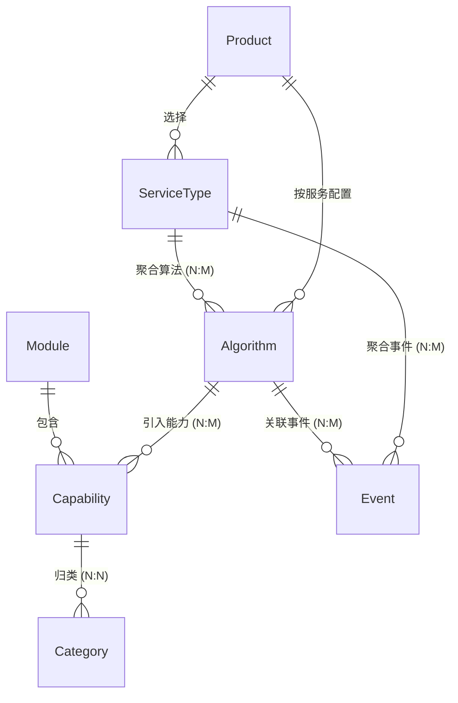
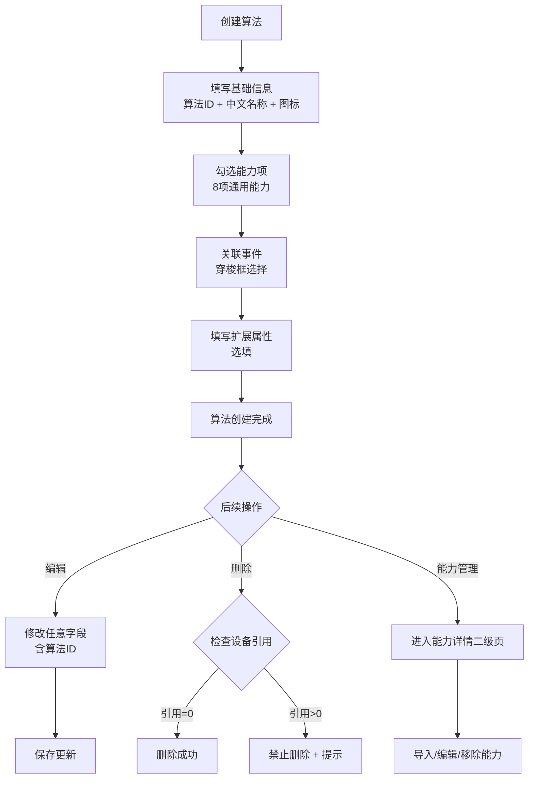
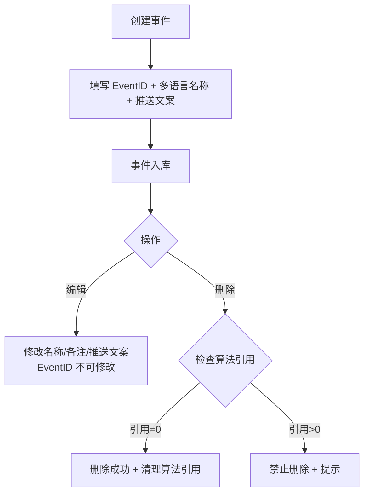
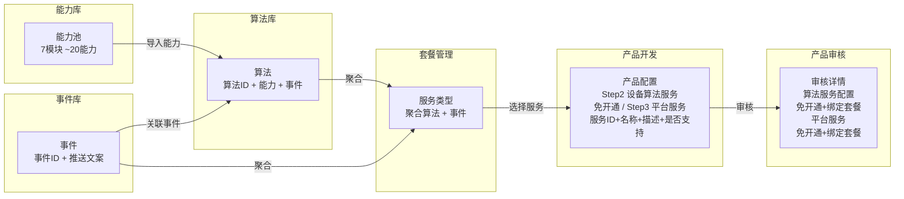

# 算法管理 — 完整业务 PRD

## 修订记录

| 修订时间 | 修订内容 | 修订人 |
|------|------|------|
| 2026-06-04 | 初稿，基于需求分析和UI设计生成 | Kiro |
| 2026-07-07 | 基于实际实现全面修订：算法类型、关联服务、免开通/套餐绑定规则、平台服务合并单元格；移除所有开发代码相关内容 | Kiro |
| 2026-07-08 | 服务类型弹窗改为只读反显「已绑定物模型」（去 Tab、去主动绑定，绑定源自算法库）；平台服务精简为四列；算法列头改为「算法ID（AIIOTTYPE）」 | Kiro |
| 2026-07-08 | 全文纯业务化：移除代码字段名/JSON结构/存储字段列/dataDef结构/数据层与API等开发实现痕迹，仅保留业务实体与规则 | Kiro |

---

## 一、业务背景

IoT 平台支持多种侦测与 AI 算法（运动、人形、车辆、声音、哭声、烟火、宠物、老人看护等）。当前算法定义分散在多个环节，新增一个算法需要研发跨环节改动，运营/产品人员无法自主配置。

**产品目标**：建设平台级「算法管理」模块，作为物模型上层元数据组织层，实现算法和事件的配置化管理。

**核心设计思想**：三层解耦
```
能力池（原子能力定义）→ 算法（能力组合 + 事件关联）→ 服务类型（算法+事件聚合，面向产品）
```

---

## 二、名词解释

| 术语 | 说明 |
|------|------|
| 算法 Algorithm | 设备端运行的侦测/AI 能力。每个算法有独立的算法ID、多语言名称（16 语言）、图标、排序权重，并关联若干能力和事件。 |
| 事件 Event | 算法/设备触发后上报给平台的消息。通过事件ID（纯数字）唯一标识，创建后不可修改。含多语言推送文案（16 语言）。 |
| 能力项 Capability | 算法可配置的功能原子单元。从能力池导入，算法不自行定义。分为属性、服务、事件三种类型，每种有独立数据定义。 |
| 能力模块 Module | 能力的组织单元。标准能力分属 7 个模块（工作模式、录制模式、灯光模式、事件侦测、门铃设置、安防侦测、算法能力）。 |
| 服务类型 ServiceType | 算法的「打包层」。将多个算法 + 事件 + 物模型聚合成一个面向产品的服务包。 |
| 算法ID | 算法唯一标识符（如 4001、1003）。创建时可编辑，修改时需校验唯一性。 |
| 事件ID | 事件唯一标识符，纯数字（如 100001）。创建后不可修改。 |
| 算法类型 | 分为设备端算法（默认）和平台算法两类。 |
| 引用计数 | 算法被设备引用数 / 事件被算法引用数，用于删除保护。 |
| 数据定义 | 能力的数据定义，内容随能力类型不同而变化。 |

---

## 三、业务实体说明

### 3.1 核心实体数据模型

#### 算法（Algorithm）

| 属性 | 说明 |
|------|------|
| 算法ID | 业务标识，如 4001 |
| 算法名称 | 16 语言名称，以中文为主 |
| 算法图标 | emoji 或图片 |
| 算法类型 | 设备端算法（默认）/ 平台算法 |
| 排序权重 | 0-9999，列表按升序排列 |
| 关联能力 | 算法引入的能力项集合 |
| 关联事件 | 算法关联的事件集合 |
| 关联服务 | 算法绑定的服务集合 |
| 扩展属性 | 选填 |
| 引用设备数 | 被多少设备使用 |
| 描述 | 算法说明 |

#### 事件（Event）

| 属性 | 说明 |
|------|------|
| 事件ID | 业务标识，如 100001（创建后不可修改） |
| 事件名称 | 16 语言名称 |
| 备注 | 内部备注（选填） |
| 推送文案 | 16 语言推送文案 |
| 引用算法数 | 被多少算法引用 |

#### 能力（Capability）

| 属性 | 说明 |
|------|------|
| 所属模块 | 能力归属的模块 |
| 能力类型 | 属性 / 服务 / 事件 |
| 名称 | 能力名称 |
| 标识符 | 全局唯一，算法通过此值引用 |
| 描述 | 能力说明 |
| 数据定义 | 随能力类型不同而变化：属性含取值范围与默认值；服务含入参、出参；事件含事件级别（告警/信息/故障）与上报参数 |

#### 服务类型（ServiceType）

| 属性 | 说明 |
|------|------|
| 服务名称 | 如「智能告警」 |
| 服务ID | 如 110600 |
| 所属分类 | 服务分类 |
| 关联算法 | 由算法库绑定反向关联 |
| 关联事件 | 聚合的事件集合 |

### 3.2 实体关系图



**关系表**：

| 关系 | 方向 | 说明 |
|------|------|------|
| 算法 → 能力 | N:M | 算法从能力池引入能力项 |
| 算法 → 事件 | N:M | 算法关联事件 |
| 算法 → 服务 | N:M | 算法在算法库绑定服务 |
| 服务类型 → 算法 | N:M | 由算法库绑定反向派生，服务类型弹窗只读反显 |
| 服务类型 → 事件 | N:M | 服务类型聚合事件 |
| 产品 → 服务类型 | N:1 | 产品配置中选择服务类型 |

### 3.3 数据规模

当前平台内置初始内容：算法约 8 条、事件约 8 条、能力模块 7 个、标准能力约 20 条、服务类型约 24 条（含算法与事件关联）。

---

## 四、核心业务流程

### 4.1 算法管理流程



### 4.2 事件管理流程



### 4.3 跨模块数据流



---

## 五、业务规则

### 5.1 算法管理

| 编号 | 规则 | 说明 |
|------|------|------|
| R01 | ID 必填 | 唯一标识，字符串类型 |
| R02 | ID 唯一 | 全局唯一，修改时需校验不冲突 |
| R03 | 中文名称必填 | 算法名称多语言中的中文值不能为空 |
| R04 | 删除需校验引用 | 有设备引用时禁止删除，提示引用数 |
| R05 | 能力关联可选 | 算法可零能力关联。能力通过弹窗勾选或二级页导入 |
| R06 | 事件关联可选 | 算法可零事件关联。通过弹窗内穿梭框配置 |
| R07 | 排序权重 | 0-9999，默认 0，列表按升序排列 |

### 5.2 事件管理

| 编号 | 规则 | 说明 |
|------|------|------|
| R08 | EventID 必填 | 唯一数字标识，1-99999999 |
| R09 | EventID 不可修改 | 创建后禁用，避免关联断裂 |
| R10 | EventID 唯一 | 全局唯一 |
| R11 | 中文名称必填 | 多语言名称的中文值不能为空 |
| R12 | 中文推送文案必填 | 推送文案的中文值不能为空 |
| R13 | 删除需校验引用 | 有算法引用时禁止删除，提示引用算法数 |
| R14 | 删除自动清理 | 删除事件后自动清理所有算法对该事件的关联并重算引用计数 |

### 5.3 能力关联

| 编号 | 规则 | 说明 |
|------|------|------|
| R15 | 能力从池导入 | 算法不自行定义能力，所有能力从能力池关联 |
| R16 | 关联去重 | 已关联的能力不在穿梭框左侧显示 |
| R17 | 元数据不计数 | 能力关联中的元数据项（如侦测类型配置）不计入能力计数 |
| R18 | 解除关联 | 移除能力关联不删除能力池中的原始定义 |

### 5.4 服务类型关联

| 编号 | 规则 | 说明 |
|------|------|------|
| R19 | 服务类型聚合算法 | 通过算法库中算法绑定的服务反向关联（N:M）。算法在算法库绑定服务ID后，服务类型自动关联该算法 |
| R20 | 绑定入口唯一 | 算法与服务的绑定仅在「算法库 → 关联服务侧边抽屉」中操作，服务类型弹窗不提供主动绑定 |
| R21 | 服务类型弹窗只读反显 | 服务类型创建/修改弹窗不含 Tab，仅展示「已绑定物模型」只读列表（算法ID + 算法名称），数据来自算法库绑定关系；未绑定时提示「前往算法库绑定后自动关联」 |

### 5.5 产品与审核

| 编号 | 规则 | 说明 |
|------|------|------|
| R22 | 设备算法服务免开通 | Step 2 设备算法服务支持免开通开关，但开发阶段不绑定套餐 |
| R23 | 审核绑定套餐 | 套餐绑定仅在产品审核页操作；算法服务配置和平台服务均支持免开通和绑定套餐 |
| R24 | 免开通前提 | 免开通仅在「是否支持」开启时才可操作（未开启时开关禁用） |
| R25 | 免开通关闭清理 | 关闭免开通时自动清除已绑定的套餐 |
| R26 | 平台服务精简展示 | 产品开发阶段（Step 3）平台服务仅展示服务ID、服务名称、描述、是否支持四列，不含算法级明细列；不支持免开通和绑定套餐，仅审核阶段支持 |

---

## 六、功能架构

```
算法管理
├── 算法库页（Tab: 算法库）
│   ├── 搜索栏（关键词搜索 AlgorithmID + 名称）
│   ├── 算法表格（ID / 图标 / 名称 / 算法类型 / 能力标签 / 关联事件 / 关联服务 / 引用设备 / 操作）
│   ├── 分页组件
│   ├── 添加/编辑算法弹窗（基础信息 + 算法类型 + 能力勾选 + 事件穿梭框）
│   ├── 关联服务侧边抽屉（全量服务表格勾选）
│   └── 删除确认
│
├── 事件库（Tab: 事件库）
│   ├── 搜索栏（关键词搜索 EventID + 名称）
│   ├── 事件表格（ID / 名称 / 备注 / 推送文案 / 引用算法数 / 操作）
│   ├── 分页组件
│   ├── 添加/编辑事件弹窗
│   └── 删除确认
│
├── 物模型路由版（精简版算法列表）
│   ├── 搜索栏 + 表格 + 分页（同算法库 Tab，但独立页面无事件 Tab）
│   ├── 添加/编辑算法弹窗
│   ├── 关联事件侧边抽屉（全量事件表格勾选）
│   ├── 关联服务侧边抽屉（全量服务表格勾选）
│   └── 算法能力详情二级页入口
│
└── 算法能力详情页（二级页）
    ├── 顶部返回栏（返回 + 算法名 + 能力计数 + 关联能力按钮）
    ├── 左栏模块侧栏（仅显示已关联能力涉及的模块）
    ├── 右栏能力表格（类型 / 名称 / 标识符 / 数据类型 / 数据定义 / 描述 / 模块 / 操作）
    ├── 关联能力穿梭框（从能力池导入，按模块分组）
    ├── 编辑能力参数弹窗（类型/名称/标识符只读，数据定义可编辑）
    └── 参数编辑弹窗（Int/String/Boolean/Enum/Array 类型）
```

---

## 七、详细功能描述

### 7.1 算法库页

#### 功能应用场景
平台管理员查看和管理所有算法，配置算法的能力关联和事件关联。

#### 搜索栏
- 文本输入框（240px，placeholder「搜索 AlgorithmID / 名称」）+「查询」+「重置」
- 搜索匹配算法ID和中文名称
- 回车触发查询；重置清空搜索框并刷新列表

#### 算法表格

| 列 | 说明 |
|------|------|
| 算法ID（AIIOTTYPE） | 代码风格标签，180px。列头标注 AIIOTTYPE 以对应设备端算法类型标识 |
| 图标 | 支持 emoji 或图片 URL（28×28，圆角 4px） |
| 算法名称 | 展示中文名称，加粗 |
| 算法类型 | 设备（默认标签）/ 平台（warning 类型标签），80px 居中 |
| 能力标签 | 小号圆角标签排列，最多显示 5 个 + 更多计数；能力名来自中英文映射表；无能力时显示「配置」按钮 |
| 关联事件 | 小号绿色标签显示数量，可点击（打开抽屉）；无事件时显示「配置」按钮 |
| 关联服务 | 服务ID标签排列，可点击打开侧边抽屉编辑；无服务时显示「配置」按钮 |
| 引用设备 | 数字，纯文本展示 |
| 操作 | 「编辑」「删除」，固定右侧 |

- 关联能力数 = 算法已关联的能力项数量（不含元数据配置项）
- 关联能力数在物模型路由版中可点击，跳转至算法能力详情二级页

#### 分页
- 每页条数: 10 / 20 / 50，默认 20
- 左侧「共 N 条记录」+ 右侧分页组件

### 7.2 添加/编辑算法弹窗

#### 弹窗规格
- 模态弹窗，宽度 720px，点击遮罩不关闭，关闭时销毁内容

#### 表单字段

**区域 1：基础信息**
| 字段 | 控件 | 说明 |
|------|------|------|
| AlgorithmID | 文本输入框 | placeholder「如 4001」 |
| 算法名称 | 中文输入框 + 地球图标「多语言」按钮 | 打开多语言弹窗，16 语言 |
| 算法类型 | 单选按钮 | 设备 / 平台，默认设备 |
| 排序 | 数字输入 | 最小 0，宽度 100% |
| 图标 | 文本输入框 | placeholder「icon name 或 emoji」 |

**区域 2：能力配置**
- 8 项通用能力：勾选框网格布局，4 列
- 能力列表：Switch(开关) / Sensitivity(灵敏度) / Schedule(定时侦测) / DetectArea(自定义区域) / SoundAlarm(声音告警) / AlarmRepeatCnt(告警循环次数) / CustomAudio(自定义音频) / LightAlarm(灯光告警)
- 侦测类型子表：动态键值对表格，最多 20 行

**区域 3：关联事件**
- 双面板穿梭框（左：可选事件 / 右：已选事件）
- 每行显示 eventId + 中文名称
- 点击行切换选中状态

**区域 4：扩展属性**
- 多行文本输入框（4 行高度），选填

**底部按钮**：
- 「取消」+ 「确认创建/确认保存」
- 提交时按钮置为加载态防重复

#### 校验规则
- AlgorithmID 必填，唯一性校验
- 算法名称中文必填

### 7.3 算法能力详情页

#### 功能应用场景
查看和管理某个算法已关联的所有能力，按模块分类浏览，支持从能力池导入新能力和编辑已关联能力参数。

#### 页面结构
- 顶部返回栏：返回按钮 + 算法名称 + 能力计数 +「关联能力」按钮
- 左栏模块侧栏：仅显示已关联能力涉及的模块（去重），点击切换模块
- 右栏能力表格：已关联能力的完整信息 + 编辑/移除操作

#### 关联能力穿梭框
- 左侧面板：能力池可选能力，按模块分组（已关联的不显示），支持搜索
- 右侧面板：待导入能力列表
- 确认后写入算法的能力关联

#### 编辑能力参数弹窗
- 类型（能力类型标签）、名称、标识符：只读
- 数据定义：根据能力类型动态渲染编辑控件
- 支持全部数据类型：枚举 / 整数 / 布尔 / 字符串 / 数组 / 结构体
- 数组类型支持元素类型：整数 / 字符串 / 结构体
- 结构体类型和结构体数组支持字段编辑（参数弹窗）

### 7.4 事件库

#### 功能应用场景
平台管理员维护事件定义，为算法提供可关联的事件池。

#### 位置
算法管理页 → 「事件库」Tab

#### 事件表格
| 列 | 说明 |
|------|------|
| EventID | 代码风格标签，110px |
| 事件名称 | 中文名称，加粗 |
| 备注 | 次要文字色，无时 `—` |
| 推送文案 | 中文文案，无时 `—` |
| 引用算法数 | 小号绿色标签，0 时灰色「0」 |
| 操作 | 「编辑」「删除」 |

#### 添加/编辑事件弹窗
- 模态弹窗，宽度 560px
- 表单：EventID（数字输入框，编辑时禁用）+ 多语言名称 + 备注 + 多语言推送文案
- 中文名称和中文推送文案必填

### 7.5 多语言弹窗

- 模态弹窗，宽度 640px，距顶部 5vh
- 顶部预览区展示中文内容（浅色背景，蓝色边框）
- 2 列网格布局，15 种非中文语言
- 语言列表：1=zh / 2=en / 3=zh-TW / 4=fr / 5=ja / 6=es / 7=ko / 8=de / 9=it / 10=ru / 11=pt / 12=vi / 13=th / 14=tr / 15=fa / 16=id
- 打开时深拷贝，确认回写，取消丢弃

### 7.6 删除确认

- 算法删除：确认对话框「确定删除算法「XX」？」
- 事件删除：确认对话框「确定删除事件「XX」？」
- 引用拦截：
  - 算法：「有 N 台设备使用该算法，不可删除」
  - 事件：「有 N 个算法引用该事件，不可删除」

---

## 八、页面信息架构

### 8.1 页面层级

```
IoT 管理后台
├── 算法管理（独立菜单）
│   ├── Tab: 算法库
│   │   ├── 搜索栏 + 表格 + 分页
│   │   ├── 添加/编辑算法弹窗（基础信息 + 能力勾选 + 事件穿梭框）
│   │   └── 删除确认
│   └── Tab: 事件库
│       ├── 搜索栏 + 表格 + 分页
│       ├── 添加/编辑事件弹窗
│       └── 删除确认
│
├── 物模型管理
│   ├── 能力库
│   │   ├── Tab: 标准能力（能力池 + 模块侧栏）
│   │   ├── Tab: 自定义能力
│   │   └── Tab: 旧版能力
│   │
│   ├── 算法库（精简版）
│   │   ├── 搜索栏 + 表格 + 分页
│   │   ├── 添加/编辑算法弹窗
│   │   ├── 关联事件侧边抽屉
│   │   └── 算法能力详情二级页入口
│   │
│   └── 算法能力详情（二级页）
│       ├── 顶部返回栏 + 模块侧栏 + 能力表格
│       ├── 关联能力穿梭框
│       ├── 编辑能力参数弹窗
│       └── 参数编辑弹窗
│
└── 套餐管理
    └── 服务类型
        ├── 服务列表 + 分类
        └── 服务编辑弹窗（无 Tab，仅只读反显「已绑定物模型」列表）
```

### 8.2 页面跳转关系

| 起点 | 触发 | 终点 |
|------|------|------|
| 侧栏「算法管理」菜单 | 点击 | 算法管理页（算法库 Tab） |
| 算法行「关联能力」数（物模型路由版） | 点击 | 算法能力详情页 |
| 算法行「关联事件」标签（物模型路由版） | 点击 | 关联事件侧边抽屉（当前页） |
| 算法能力详情「返回」 | 点击 | 算法列表页 |
| 算法能力详情「关联能力」 | 点击 | 关联能力穿梭框（当前页弹窗） |
| 算法能力详情行「编辑」 | 点击 | 编辑参数弹窗 |
| 算法管理页「事件库」Tab | 点击 | 事件列表 |
| 事件行「编辑」 | 点击 | 事件弹窗 |

---

## 九、异常说明

| 分类 | 场景 | 处理方式 |
|------|------|------|
| 校验 | AlgorithmID 重复 | 后端返回冲突，提示「AlgorithmID 已存在」 |
| 校验 | AlgorithmID 为空 | 表单校验拦截，红色提示 |
| 校验 | 中文名称为空 | 提示「请至少填写中文名称」 |
| 校验 | EventID 重复 | 后端返回冲突，提示「EventID 已存在」 |
| 校验 | 推送文案为空 | 提示「请至少填写中文推送文案」 |
| 操作 | 删除有引用的算法 | 提示「有 N 台设备使用该算法，不可删除」 |
| 操作 | 删除有引用的事件 | 提示「有 N 个算法引用该事件，不可删除」 |
| 操作 | 编辑时原数据被删 | 保存时后端返回不存在，提示后弹窗关闭 |
| 操作 | 多语言弹窗取消 | 修改内容丢弃，保留原值 |
| 操作 | 删除事件 | 同步清理所有关联算法的 eventIds |
| 网络 | 接口超时/无网络 | 统一消息提示（请求拦截器处理） |
| 网络 | 重复提交 | 按钮加载态 + 禁用防抖 |
| 极限 | 列表无数据 | 空态插图 +「暂无算法/事件」+ 快捷添加按钮 |
| 极限 | 搜索无结果 | 空态展示 |
| 极限 | 能力池无可用能力 | 穿梭框左侧空态「能力池暂无能力」 |

---

> **本文档为纯业务PRD，面向产品和开发团队。不包含技术实现细节。**

---

*文档版本: v2.2 | 更新日期: 2026-07-08*
