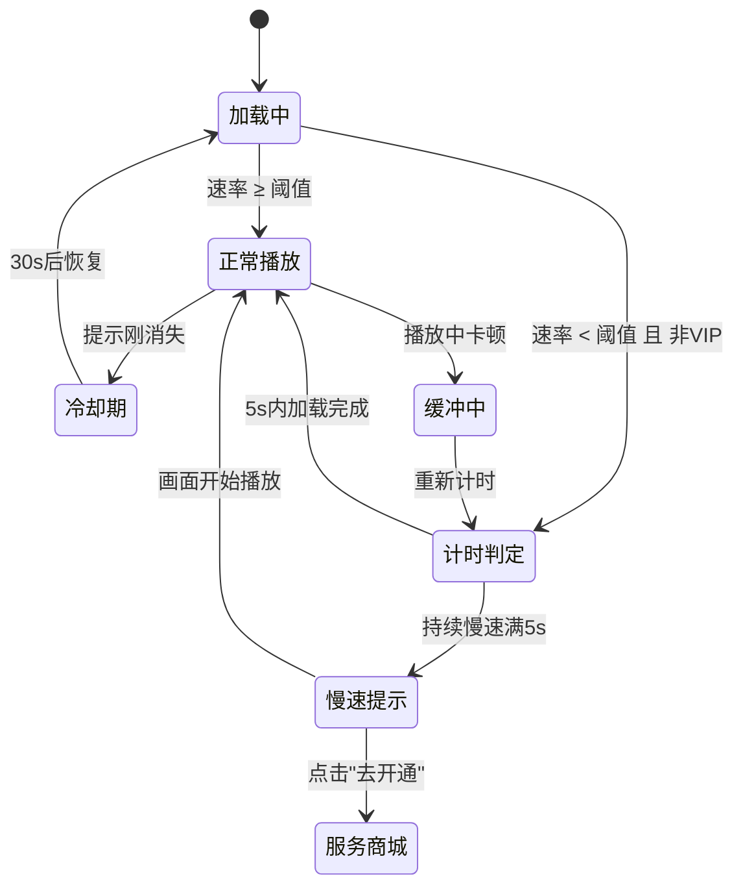

# 网络资源分配策略 — 需求分析文档

## 修订记录

| 修订时间 | 修订内容 | 修订人 |
|------|------|------|
| 2026-07-04 | 初稿 | Kiro |

---

## 一、业务背景

部分地区（印度等）服务器带宽有限，高峰期点播/实时画面加载缓慢甚至失败。需引入网络资源分配策略，优先保障付费用户的观看体验，同时引导免费用户转化为云存订阅用户。

**痛点**：

1. 带宽有限地区播放频繁卡顿、失败，客诉高
2. 付费用户和免费用户共享同一通道，VIP 体验无差异
3. 免费用户不知道卡顿原因，也无改善途径

**产品目标**：

- 服务端按用户类型分流：云存用户 → 快速通道，普通用户 → 正常通道
- APP 端检测加载速率，过慢时对普通用户展示引导文案，提升云存转化率

---

## 二、名词解释

| 术语 | 说明 |
|------|------|
| 快速通道 | 服务端优先分配带宽，保障流畅播放 |
| 正常通道 | 标准带宽分配，高峰期可能较慢 |
| VIP 用户 | 已购买任意云存套餐的用户 |
| 普通用户 | 未购买云存套餐的用户 |
| 速率检测 | APP 端测量视频流加载速率（KB/s） |
| 速率阈值 | 触发慢速提示的最低速率值，默认 200 KB/s |
| 加载提示文案 | 视频区下方展示的文字引导，含"去开通"跳转链接 |

---

## 三、功能范围

### 3.1 功能列表总览

| 序号 | 模块 | 功能 | 优先级 | 说明 | 备注 |
|------|------|------|:--:|------|------|
| F1 | 服务端 | 通道分流 | P0 | 云存用户走快速通道，普通用户走正常通道 | APP 不参与 |
| F2 | APP 回放 | 速率检测 + 提示 | P0 | 加载云回放视频时检测速率，慢速展示引导文案 | — |
| F3 | APP 实时画面 | 速率检测 + 提示 | P0 | 加载实时画面时检测速率，慢速展示引导文案 | — |
| F4 | 平台配置 | 策略参数配置 | P1 | 配置速率阈值、提示文案 | 产品审核 → App配置 |

### 3.2 不做/暂不做的功能

| 功能 | 原因 | 后续计划 |
|------|------|------|
| APP 端切换通道 | 通道分流由服务端控制 | — |
| 独立测速工具 | 自动检测已满足需求 | — |
| 低速提示带关闭按钮 | 速率恢复自动消失，无需手动关 | — |
| VIP 用户慢速也展示提示 | VIP 已享快速通道，不额外打扰 | — |

---

## 四、场景穷举分析

### 4.1 速率检测 + 加载提示

#### 4.1.1 功能概述

用户进入回放（云回放）或实时画面时，APP 在**加载/缓冲阶段**自动检测视频流加载速率。当速率持续低于阈值且用户非云存 VIP 时，在视频区下方展示引导文案。**画面正常播放时不触发提示**。

**前置条件**：
- 设备在线
- 用户进入回放页（云回放源）或实时画面页
- 视频处于加载中或缓冲中状态

**触发规则**：

| 规则 | 参数 | 说明 |
|------|------|------|
| 触发延迟 | 持续慢速 5 秒 | 避免瞬时波动误触发 |
| 恢复消失 | 画面开始正常播放 | 立即消失，无延迟 |
| 冷却时间 | 消失后 30 秒 | 冷却期内不再触发 |
| 缓冲重判 | 播放中再次缓冲 | 重新计时，不受冷却影响 |

#### 4.1.2 正常场景

| 场景编号 | 场景名称 | 前置条件 | 操作步骤 | 预期结果 | 状态变化 |
|------|------|------|------|------|------|
| N-001 | VIP 用户加载慢 | 用户已购云存 | 进入回放/实时画面，加载慢 | 不展示提示 | 无 |
| N-002 | 加载快 | 普通用户，速率 ≥ 阈值 | 进入回放/实时画面，快速加载完成 | 不展示提示 | 正常播放 |
| N-003 | 加载持续慢 | 普通用户，速率持续 < 阈值 5s | 进入回放/实时画面，持续加载中 | 5s 后展示引导文案 | 提示出现 |
| N-004 | 加载成功恢复 | 提示展示中，画面开始播放 | 视频加载完成开始播放 | 提示立即消失 | 提示消失，进入 30s 冷却 |
| N-005 | 播放中再缓冲 | 普通用户，播放中缓冲 | 重新计时，持续慢速 5s | 再次展示提示 | 提示出现 |
| N-006 | 点击"去开通" | 提示展示中 | 点击文案中的"去开通" | 跳转商城云存储 Tab | — |

#### 4.1.3 异常场景

| 场景编号 | 异常类型 | 触发条件 | 系统行为 | 用户感知 |
|------|------|------|------|------|
| E-001 | 云存状态未知 | 未拉取到订阅状态 | 按普通用户处理 | 可能展示提示（宁可多提示，不漏提示） |
| E-002 | 速率检测失败 | 测速逻辑异常 | 不展示提示，正常播放 | 无感知 |
| E-003 | 视频源切换 | 云回放 → SD 卡回放 | 不再检测速率，已展示的提示消失 | 提示消失 |
| E-004 | 实时画面切设备 | 切换不同设备 | 重新检测新设备画面速率 | 提示按新速率更新 |
| E-005 | 退出再进入 | 返回再进入视频页 | 重新检测速率 | 提示按最新速率展示 |

#### 4.1.4 边界条件

| 条件项 | 最小值 | 最大值 | 默认值 | 超限行为 |
|------|------|------|------|------|
| 速率阈值 | 50 KB/s | 1000 KB/s | 200 KB/s | — |
| 触发延迟 | — | — | 5 秒 | 持续慢速超过此时长才展示 |
| 冷却时间 | — | — | 30 秒 | 提示消失后此时间内不再触发 |
| 速率采样 | — | — | 3 秒滑动平均 | 取最近 3 秒均值判定 |
| 提示文案字数 | — | 50 字 | "当前网络速度慢，开通VIP提速" | 超出截断 |

#### 4.1.5 状态流转

---

## 五、跨模块联动分析

| 关联模块 | 关系 | 影响 |
|------|------|------|
| 服务端通道分流 | 服务端根据用户云存状态分配带宽通道 | APP 不感知通道切换 |
| 服务商城 → 云存储 | 提示中"去开通"跳转目标 | 已有，无需改动 |
| 用户云存状态 | 判断是否展示提示的关键依据 | 需从服务端/本地拉取订阅状态 |
| 回放页 | 云回放源的加载速率检测 | 本需求改动 |
| 实时画面页 | 实时流的加载速率检测 | 本需求改动 |
| 平台 App 配置 | 策略参数（开关、阈值、文案）配置入口 | 本需求改动 |

---

## 六、已确认决策

| 编号 | 问题 | 结论 |
|------|------|------|
| Q1 | 提示触发时机？ | 仅在加载/缓冲阶段，正常播放不触发 |
| Q2 | 触发延迟？ | 持续慢速满 5 秒后展示，避免瞬时波动 |
| Q3 | 恢复条件？ | 画面开始正常播放立即消失，进入 30s 冷却 |
| Q4 | 平台侧配置？ | 策略写死，不配置平台参数 |
| Q5 | 商城跳转？ | 带 `?tab=cloud` 锚定云存储 Tab |

---

*文档版本: v1.0 | 创建日期: 2026-07-04*
