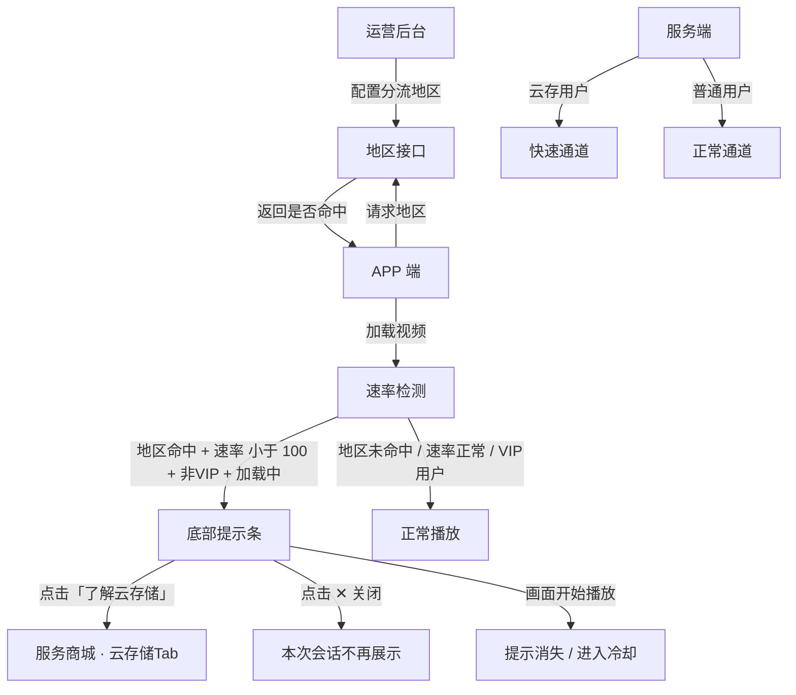
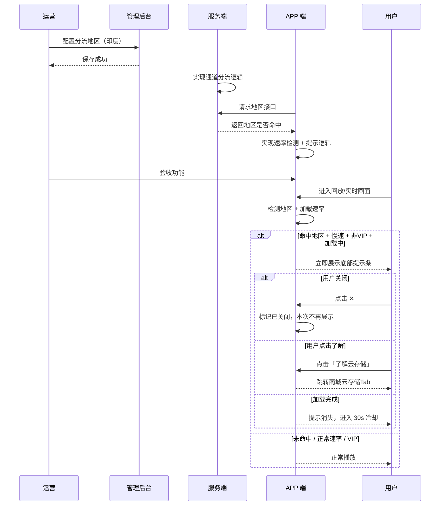
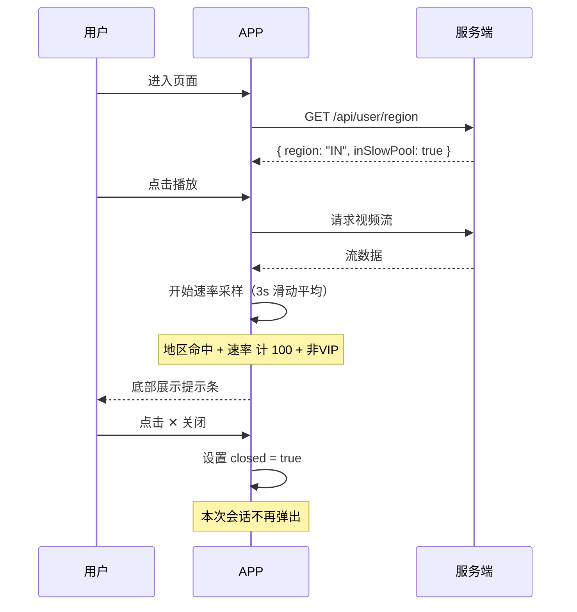
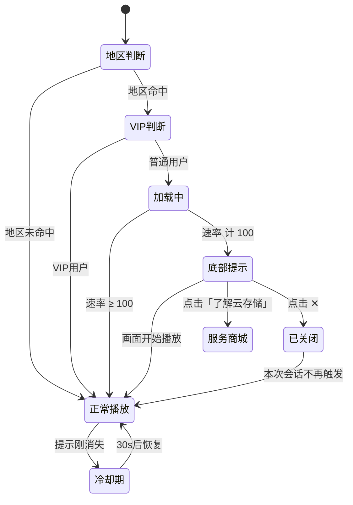

# 网络资源分配策略 — 完整业务 PRD

## 修订记录

| 修订时间 | 修订内容 | 修订人 |
|------|------|------|
| 2026-07-04 | 初稿 | Kiro |
| 2026-07-07 | 需求变更：速率阈值改为 100KB/s；新增后台地区分流接口；提示条移至页面底部、用户可关闭；文案优化 | Kiro |
| 2026-07-07 | 需求变更：移除 5s 触发延迟，速率低于 100KB/s 立即展示提示 | Kiro |

---

## 一、业务背景

部分地区（印度等）服务器带宽有限，高峰期点播/实时画面加载缓慢甚至失败。需引入网络资源分配策略：

1. 服务端优先保障付费用户（云存订阅用户）的带宽资源
2. **后台配置分流地区**（从印度开始），APP 调用接口获取用户所在地区是否命中分流策略
3. APP 端检测加载速率，对命中地区 + 普通用户在慢速时展示引导文案，提升云存转化率

**痛点**：

1. 带宽有限地区播放频繁卡顿、失败，客诉高
2. 付费用户和免费用户共享同一通道，VIP 体验无差异（开通云存录像·事件+全天 算 VIP）
3. 普通用户不知道卡顿原因，也无改善途径
4. 用户已花钱购买设备，软件点播再付费容易引起排斥

**产品目标**：

- 服务端按用户类型分流：云存用户 → 快速通道，普通用户 → 正常通道
- 后台可配置分流地区，按地区灰度上线（首期：印度）
- APP 端检测加载速率，慢速时对命中地区的普通用户展示引导文案
- 文案温和自然，不强调「付费/开通」，强调云存储带来的流畅体验
- 用户可一次性关闭提示，本次会话不再展示

---

## 二、名词解释

| 术语 | 说明 |
|------|------|
| 快速通道 | 服务端优先分配带宽，保障流畅播放 |
| 正常通道 | 标准带宽分配，高峰期可能较慢 |
| VIP 用户 | 已购买任意云存套餐（事件云存或全天云存）的用户 |
| 普通用户 | 未购买云存套餐的用户 |
| 分流地区 | 后台配置的带宽受限地区列表（首期仅印度），APP 通过接口获取 |
| 速率检测 | APP 端测量视频流加载速率，单位 KB/s |
| 速率阈值 | 触发慢速提示的速率值，固定 100 KB/s |
| 即时触发 | 速率低于 100 KB/s 立即展示提示 |
| 冷却期 | 提示消失后 30 秒内不再触发，避免反复骚扰 |
| 慢速提示条 | APP 页面底部的常驻引导横幅，含关闭按钮，位于功能区上方 |
| 会话关闭 | 用户点击关闭后，本次 APP 会话（从进入页面到退出）不再弹出 |

---

## 三、功能架构



---

## 四、核心业务流程

### 4.1 全局时序图



### 4.2 局部队列（APP↔服务端）



### 4.3 状态流转图



---

## 五、业务规则

| 编号 | 规则 | 说明 |
|------|------|------|
| R01 | VIP 豁免 | 云存用户不检测速率，不展示提示条 |
| R02 | 仅加载/缓冲阶段触发 | 视频正常播放时不触发，避免干扰观看 |
| R03 | 即时触发 | 速率低于 100 KB/s 立即展示提示 |
| R04 | 画面播放即消失 | 加载完成、画面开始正常播放时提示条立即消失 |
| R05 | 30 秒冷却期 | 提示消失后 30 秒内不再触发，即使再次慢速 |
| R06 | 缓冲重判 | 冷却期外，播放中再次缓冲则重新计时判定 |
| R07 | 云回放源检测 | 仅在云回放源下检测，SD 卡回放不检测 |
| R08 | 速率阈值 100 KB/s | 固定值，不开放平台配置 |
| R09 | 后台配置分流地区 | 运营在后台配置地区白名单（首期印度），APP 调用接口获取 |
| R10 | 地区不命中不触发 | 用户所在地区不在分流白名单中时，不展示任何提示 |
| R11 | 用户关闭本次生效 | 点击 ✕ 关闭后，本次 APP 会话不再弹出；退出页面重新进入则重置 |
| R12 | 跳转商城 | 点击提示条跳转至服务商城云存储 Tab |

---

## 六、详细功能描述

### 6.1 管理后台 — 分流地区配置

**应用场景**：运营人员在后台配置带宽受限地区，按地区灰度上线分流策略。

**配置项**：
- 地区列表（多选）：印度、东南亚等
- 首期仅勾选印度
- 保存后实时生效，APP 调用接口获取

### 6.2 服务端 — 地区接口

**接口用途**：APP 调用获取当前用户所在地区是否命中分流策略。

**返回字段**：

| 字段 | 类型 | 说明 |
|------|------|------|
| region | string | 用户地区编码，如 "IN" |
| inSlowPool | boolean | 是否在分流地区白名单内 |

### 6.3 服务端 — 通道分流

**应用场景**：用户进入回放或实时画面，服务端根据用户云存订阅状态分配带宽通道。

**规则**：
- 云存订阅用户 → 快速通道（优先带宽）
- 普通用户 → 正常通道（标准带宽）
- APP 端不参与通道选择，仅接收流

### 6.4 APP 端 — 慢速提示条

**触发条件（全部满足）**：

1. `inSlowPool === true`（地区命中）
2. `hasCloudStorage === false`（非 VIP）
3. `loadSpeed < 100 KB/s`（速率低于阈值）
4. 处于视频加载/缓冲阶段（非正常播放）

**提示条样式**：

| 属性 | 值 |
|------|------|
| 位置 | APP 页面底部，工具栏/事件列表上方，全宽 |
| 背景 | 微蓝色渐变 `linear-gradient(90deg, rgba(26,115,232,0.12), rgba(26,115,232,0.04))` |
| 上下边框 | `rgba(26,115,232,0.1)` / `rgba(26,115,232,0.06)` |
| 高度 | 44px |
| 左侧 | info 图标 + 文案「当前网络较慢，云存储服务可提升流畅度」，12px，白色 78% 透明 |
| 右侧 | 浅蓝色「了解云存储」+ ✕ 关闭图标 |
| 点击 | 整行可点击，跳转服务商城云存储 Tab |
| 入场 | 从底部滑入，0.35s cubic-bezier 缓动 |
| 退场 | 向底部滑出，0.25s ease-in |

**适用页面**：
- 回放页（仅云回放源）
- 实时画面页

**状态说明**：

| 状态 | 触发条件 | 展示内容 |
|------|------|------|
| 不展示 | 地区未命中 / VIP 用户 / 速率正常 / 已关闭 | 无提示 |
| 展示中 | 命中地区 + 普通用户 + 加载/缓冲中 + 速率 < 100 | 底部提示条 |
| 已关闭 | 用户点击 ✕ | 本次会话不再展示，退出页面重置 |
| 冷却期 | 提示自然消失后 30s 内 | 不触发提示 |
| 无网络 | 完全无网络 | 由播放器错误态处理，不触发提示 |

**交互说明**：

| 行为 | 触发 | 效果 |
|------|------|------|
| 展示 | 满足全部条件立即展示 | 提示条从底部滑入（0.35s） |
| 自然消失 | 画面开始播放 | 提示条滑出（0.25s），进入 30s 冷却 |
| 跳转 | 点击提示条主体 | 跳转服务商城，锚定云存储 Tab |
| 关闭 | 点击右侧 ✕ 图标 | 提示条滑出，标记已关闭，本次会话不再弹出 |
| 切换源 | 云回放 → SD 卡回放 | 提示条立即消失 |

---

## 七、页面信息架构

```
回放页                             实时画面页
├── 视频播放区                      ├── 视频播放区
│   └── 画面                        │   └── 画面
├── 回放源切换                      ├── 慢速提示条 ★新增（工具栏上方）
├── 时间轴                          └── 底部工具栏
├── 慢速提示条 ★新增（事件列表上方）
└── 事件列表

                        点击提示条 / 「了解云存储」
                             ↓
                        服务商城
                        └── 云存储 Tab
```

---

## 八、异常说明

| 场景 | 处理方式 |
|------|------|
| 无网络连接 | 由播放器自身错误态处理，不展示速率提示 |
| 地区接口调用失败 | 按未命中地区处理，不展示提示 |
| 速率检测异常 | 不展示提示，正常播放 |
| 云存状态未知 | 按普通用户处理（宁可多提示，不漏提示） |
| 切换视频源 | 提示条立即消失，新源重新判定；关闭状态保留 |
| 切换设备 | 重新检测速率 + 地区，按新设备状态判定 |
| 退出再进入页面 | 重置关闭状态，重新走触发逻辑 |
| VIP 过期 | 过期后按普通用户处理，正常触发检测 |

---

## 九、测试要点

### 功能回归

| 编号 | 测试点 | 前置条件 | 操作步骤 | 预期结果 |
|------|------|------|------|------|
| T-001 | 地区未命中不展示 | 账号所在地区不在分流白名单 | 进入实时画面，模拟慢速 | 不出现提示条 |
| T-002 | VIP 用户不展示 | 已开通云存的账号，命中地区 | 进入实时画面，模拟慢速 | 不出现提示条 |
| T-003 | 正常速率不展示 | 命中地区 + 普通用户 | 正常速率加载 | 不出现提示条 |
| T-004 | SD 卡回放不展示 | 回放页切换至 SD 卡源 | 模拟慢速 | 不出现提示条 |

### 核心场景

| 编号 | 测试点 | 前置条件 | 操作步骤 | 预期结果 |
|------|------|------|------|------|
| T-101 | 命中地区慢速触发 | 印度用户 + 普通用户 | 进入实时画面，模拟速度 < 100KB/s | 立即底部滑入提示条 |
| T-102 | 点击跳转商城 | 提示条已展示 | 点击提示条主体区域 | 跳转服务商城云存储 Tab |
| T-103 | 点击 ✕ 关闭 | 提示条已展示 | 点击右侧 ✕ 图标 | 提示条滑出，本次不再弹出 |
| T-104 | 关闭后切换源 | 已关闭提示条 | 切换视频源再切回 | 提示条不出现 |
| T-105 | 退出重进重置 | 已关闭提示条 | 退出页面再进入，模拟慢速 | 提示条重新出现 |

### 异常场景

| 编号 | 测试点 | 前置条件 | 操作步骤 | 预期结果 |
|------|------|------|------|------|
| T-201 | 地区接口失败 | 断网或接口返回异常 | 进入页面 | 按未命中处理，不展示提示 |
| T-202 | 速率检测异常 | 检测模块返回 NaN/null | 加载视频 | 不展示提示，正常播放 |
| T-203 | VIP 状态未知 | 云存接口超时 | 加载视频 | 按普通用户处理 |
| T-204 | 快速切换页面 | 提示条展示中 | 快速退出再进入 | 新页面重置关闭状态 |

### 状态切换

| 编号 | 测试点 | 前置条件 | 操作步骤 | 预期结果 |
|------|------|------|------|------|
| T-301 | 冷却期不重复触发 | 提示条自然消失后 | 30s 内再次慢速 | 不触发提示 |
| T-302 | 冷却期后重新触发 | 提示条自然消失超过 30s | 再次慢速 | 重新触发提示 |
| T-303 | 关闭后切换设备 | 已关闭提示条 | 切换到另一台设备 | 新设备重置，重新判定 |

### 兼容性

| 编号 | 测试点 | 前置条件 | 操作步骤 | 预期结果 |
|------|------|------|------|------|
| T-401 | 不同机型底部适配 | iPhone/Android 各主流机型 | 触发提示条 | 不遮挡底部工具栏 |
| T-402 | 不同网络环境 | WiFi/4G/5G | 触发提示条 | 速率检测准确 |

---

*文档版本: v1.2 | 最后更新: 2026-07-07*
