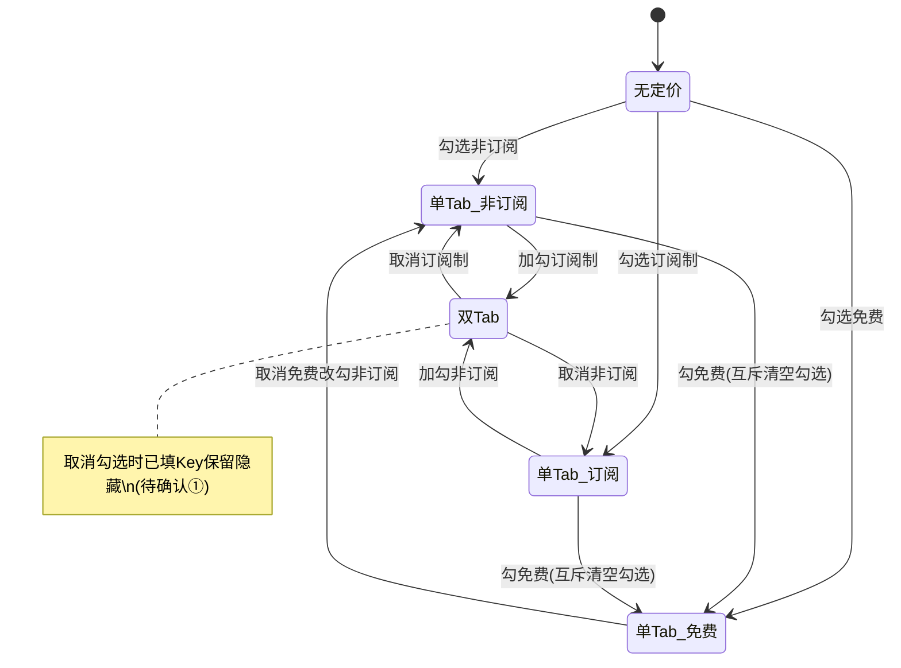

# 订阅/非订阅定价独立配置内购Key — 需求分析文档

## 修订记录

| 修订时间 | 修订内容 | 修订人 |
|----------|----------|--------|
| 2026-07-10 | 初稿 | 需求分析AI工程师 |
| 2026-07-13 | 新增功能点 7：未配置对应内购 Key 时，APP 端隐藏对应支付方式（Google Pay / Apple Pay） | 需求分析AI工程师 |

---

## 一、业务背景

### 业务场景
iot-platform「套餐配置」在新增/编辑套餐时，可为套餐勾选多种定价方式（非订阅、订阅制、免费），其中**非订阅与订阅制可同时勾选**，免费与二者互斥。同时，套餐需针对不同代运营 APP（牵心PRO、鹤梦之家）配置内购 Key（Google / Apple），用于对接应用商店的内购商品。

现状：内购 Key 区块每个 APP 只提供**一组** Google + Apple Key，**不区分定价类型**。

### 用户痛点
在 Google Play / App Store 中，「订阅商品（auto-renewable subscription）」与「一次性商品（非订阅）」属于**不同的商品类型、不同的 product ID**，内购凭证天然不同。当一个套餐同时提供订阅与非订阅两种购买方式时，现有「一组 Key」无法承载两套不同的商品凭证，导致下单无法对接到正确的商店商品。

### 产品目标
当套餐勾选了多种定价类型时，内购 Key 支持**按定价类型分别配置**，确保每种购买方式都能对接到正确的商店内购商品。

---

## 二、名词解释

| 术语 | 说明 |
|------|------|
| 定价类型 | 套餐的收费方式，枚举：`非订阅`、`订阅制`、`免费`。非订阅与订阅制可同时勾选；免费与二者互斥 |
| 内购Key | 对接应用商店内购商品的凭证/商品标识，分 `Google 内购 Key` 与 `Apple 内购 Key`，按 APP 区分 |
| 代运营APP | 平台代运营的应用，本次固定为「牵心PRO（APPID: QX_PRO_001）」「鹤梦之家（APPID: HM_HOME_001）」 |
| 定价Tab | 内购 Key 配置区块内，按已勾选定价类型划分的切换标签页 |
| 内购Key区块 | 套餐配置抽屉中「内购Key配置」这一整块表单区域 |

---

## 三、功能范围

### 3.1 功能列表总览

| 序号 | 模块 | 功能 | 优先级 | 说明 |
|------|------|------|--------|------|
| 1 | 套餐配置-内购Key | 内购 Key 区块按定价类型分 Tab | P0 | 已勾选的每种定价类型对应一个 Tab |
| 2 | 套餐配置-内购Key | 每个 Tab 下列出全部代运营 APP，各配 Google + Apple Key | P0 | APP 固定两个 |
| 3 | 套餐配置-内购Key | Tab 随定价勾选状态联动增减 | P0 | 勾选/取消定价类型时同步 |
| 4 | 套餐配置-内购Key | 编辑套餐时按定价类型回填各自 Key | P0 | 依赖表单完整存储 |
| 5 | 套餐配置-内购Key | Key 选填，可留空 | P0 | 维持现状 |
| 6 | 套餐配置-内购Key | 免费套餐仍保留一组 Key 配置 | P1 | 免费上下文单独呈现 |
| 7 | APP端-支付方式联动 | 未配置对应内购 Key，则该套餐不展示对应支付方式 | P0 | 缺 Google Key 隐藏 Google Pay，缺 Apple Key 隐藏 Apple Pay；按 当前APP × 定价类型 × 平台 判断 |

### 3.2 不做/暂不做的功能（明确边界）

| 功能 | 原因 | 后续计划 |
|------|------|----------|
| 内购 Key 跟随「投放APP」联动 | 本次不扩大范围，APP 固定两个（用户已确认） | 后续按需 |
| 内购 Key 格式/合法性强校验 | 商店 Key 格式多样，不做强约束 | 后续按需 |
| 内购 Key 与商店实时校验（拉取真实商品） | 超出本需求范围 | 后续 |
| 后端存储结构与接口 | 本需求聚焦前端配置形态 | 由后端对齐字段后落地 |

---

## 四、场景穷举分析

### 4.1 内购 Key 按定价类型配置

#### 4.1.1 功能概述
- **功能目的**：同一套餐提供多种购买方式时，分别配置对应商店的内购凭证。
- **前置条件**：进入「套餐配置」抽屉（新增或编辑），已在「套餐定价」区做出勾选。

#### 4.1.2 正常场景

| 场景编号 | 场景名称 | 前置条件 | 操作步骤 | 预期结果 | 状态变化 |
|----------|----------|----------|----------|----------|----------|
| N-001 | 仅勾非订阅 | 定价仅勾「非订阅」 | 查看内购 Key 区块 | 显示单一（非订阅）配置，列出全部 APP 的 Google/Apple Key 输入 | Tab 数=1 |
| N-002 | 仅勾订阅制 | 仅勾「订阅制」 | 同上 | 显示订阅制配置 | Tab 数=1 |
| N-003 | 订阅+非订阅同勾 | 二者均勾 | 查看内购 Key 区块 | 显示「订阅制」「非订阅」两个 Tab，切换分别配置全部 APP 的 Key | Tab 数=2 |
| N-004 | 仅勾免费 | 仅勾「免费套餐」 | 查看内购 Key 区块 | 显示免费上下文的一组 Key 配置（全部 APP） | Tab 数=1（免费） |
| N-005 | 编辑回填 | 编辑已有套餐 | 打开抽屉 | 各定价类型下的 Key 按已保存值回填到对应 Tab | — |
| N-006 | 部分留空保存 | 任意勾选 | 只填部分 Key 后提交 | 允许保存（Key 选填） | 保存成功 |
| N-007 | 双 Tab 独立填写 | 订阅+非订阅 | 订阅 Tab 填一组、非订阅 Tab 填另一组 | 两类型数据各自独立，互不覆盖 | — |

#### 4.1.3 异常场景

| 场景编号 | 异常类型 | 触发条件 | 系统行为 | 用户感知 |
|----------|----------|----------|----------|----------|
| E-001 | 操作异常-取消勾选 | 已填订阅 Key 后取消勾选「订阅制」 | 建议：**保留已填数据、仅隐藏该 Tab**，再次勾选可恢复（见待确认①） | 对应 Tab 消失 |
| E-002 | 数据异常-无定价 | 三种定价都不勾选即提交 | 复用现有校验「请至少选择一种定价方式」 | Toast 提示 |
| E-003 | 状态异常-免费互斥 | 已填订阅/非订阅 Key 后勾「免费」 | 订阅/非订阅 Tab 隐藏、切到免费上下文；原数据保留隐藏（见待确认①） | Tab 切换 |
| E-004 | 网络异常 | 保存请求超时/失败 | 保持抽屉不关闭，Toast 报错，可重试 | Toast + 重试 |
| E-005 | 兼容异常-老数据 | 编辑改造前保存的套餐（单组 Key 字段） | 建议：老 Key 按套餐原定价类型迁移至对应 Tab（见待确认③） | 正常回填、无丢失 |
| E-006 | 数据异常-Key 重复 | 同一 APP 的订阅与非订阅填了相同 Key | 建议不强制拦截，最多弱提示（见待确认④） | 无 / 弱提示 |

#### 4.1.4 边界条件

| 条件项 | 最小值 | 最大值 | 默认值 | 超限行为 |
|--------|--------|--------|--------|----------|
| 定价 Tab 数 | 1 | 2（订阅制 + 非订阅） | 依勾选而定 | 免费独占时为 1 |
| 单 Tab 内 APP 数 | 2（固定） | 2 | 2 | — |
| 单 APP Key 数 | 0（可全空） | Google/Apple 各 1 | 空 | — |
| Key 字符长度 | 空 | 不限 | 空 | 建议仅去除首尾空格 |

#### 4.1.5 状态流转

内购 Key 区块的 Tab 结构由「套餐定价」勾选状态驱动：

---

## 五、跨模块联动分析

- **定价勾选 → 内购 Key 区块**：`priceNonSub` / `priceSub` / `priceFree` 三个勾选状态直接驱动内购 Key 区块的 Tab 数量与呈现。
- **编辑回填机制**：现有通过 `_formData` 完整保存表单以供编辑回填，需扩展为按定价类型分层存储各 APP 的 Key。
- **保存输出（output）**：提交时的 output 结构需新增「分定价类型的内购 Key」字段，供套餐列表/详情/后端消费。
- **投放 APP（shelfApp）**：本次**不与内购 Key 的 APP 列表联动**（用户已确认固定两个 APP）。
- **免费套餐语义**：免费与订阅/非订阅互斥，因此免费上下文下不会与订阅/非订阅 Tab 并存。
- **内购 Key → APP 端支付方式（跨端联动）**：某定价类型下某平台的内购 Key 是否配置，决定 APP 端该套餐是否展示对应支付方式（Google Pay / Apple Pay）。判断维度为「当前 APP × 当前定价类型 × 平台」；Google/Apple 两平台各自独立；两平台均未配置则该套餐在对应端无购买入口。目的：避免用户看到缺 Key、下单必失败（并被商店自动退款）的支付方式。

---

## 六、待确认问题

| 序号 | 问题 | 建议方案 | 待用户确认 |
|------|------|----------|:---:|
| ① | 取消勾选某定价类型时，该类型下**已填 Key** 如何处理？ | **保留数据、仅隐藏 Tab**，再次勾选可恢复，避免误清空 | ☐ |
| ② | 免费套餐的 Key 如何呈现？ | 免费与订阅/非订阅互斥，故免费时显示**单个免费上下文**（不与其他并列 Tab） | ☐ |
| ③ | 老套餐（改造前单组 Key）编辑回填的**数据兼容**策略？ | 老 Key 按套餐原定价类型归入对应 Tab（订阅→订阅 Tab，否则→非订阅 Tab） | ☐ |
| ④ | 同一 APP 的订阅与非订阅 Key 是否允许相同？ | **不强制拦截**，最多给弱提示 | ☐ |
| ⑤ | 内购 Key 是否需要格式校验？ | 仅去首尾空格，**不校验格式** | ☐ |

> 说明：以上待确认项均已给出建议默认方案，若无异议将按建议推进；如需调整请指出。
