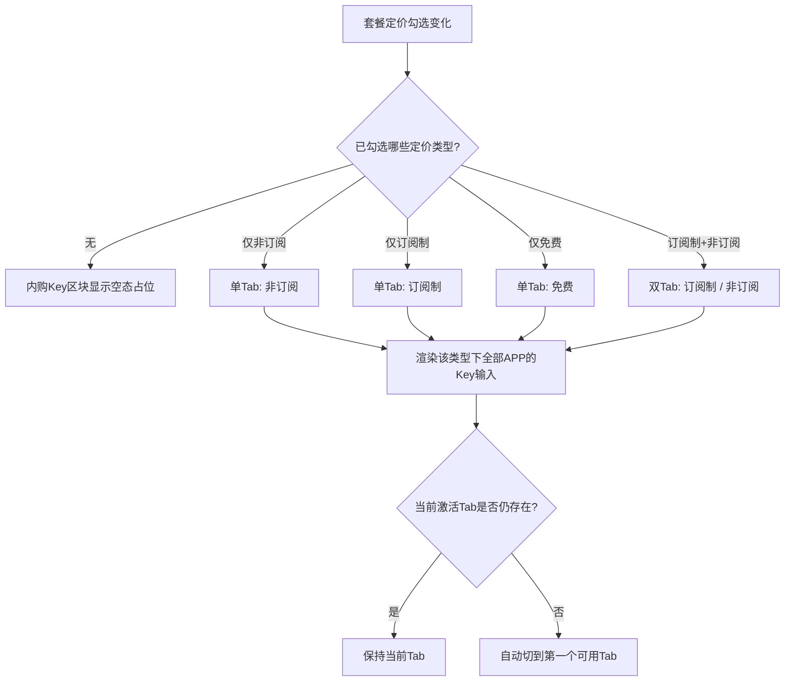

# 订阅/非订阅定价独立配置内购Key — UI设计说明

## 修订记录

| 修订时间 | 修订内容 | 修订人 |
|----------|----------|--------|
| 2026-07-10 | 初稿 | UI/UE设计AI工程师 |

> 本次改动仅涉及 iot-platform「套餐配置」抽屉内的**「内购Key配置」区块**，其余区块（基础信息、套餐定价、上架配置等）保持不变。视觉风格沿用现有 Element Plus 抽屉与 `.iap-app-row` 系列样式。

---

## 页面结构

改动点定位（套餐配置抽屉自上而下）：

```
套餐配置抽屉 (el-drawer, size 640px)
├── 基础信息
├── 选择套餐服务
├── 可绑定设备数
├── 限制产品购买
├── 套餐定价 ────────────── 勾选状态驱动 ↓
├── 套餐介绍
├── 【内购Key配置】★本次改造★ ← 由「单组Key」改为「定价类型Tab + 各APP Key」
├── 标签配置
└── 上架配置
```

`套餐定价`区的三个勾选（非订阅 / 订阅制 / 免费）→ 决定`内购Key配置`区块内的 **Tab 数量与内容**。

---

## 布局详述

### 区域：内购Key配置（改造后）

#### 结构
```
┌─ 内购Key配置   选填，针对每个APP配置 ───────────────────┐
│                                                          │
│   ┌────────┬────────┐                                    │
│   │ 订阅制 │ 非订阅 │   ← el-tabs（仅渲染已勾选的定价类型）  │
│   └────────┴────────┘                                    │
│                                                          │
│   ┌ 牵心PRO        APPID: QX_PRO_001 ─────────────────┐  │
│   │   [ Google 内购 Key                              ] │  │
│   │   [ Apple 内购 Key                               ] │  │
│   └────────────────────────────────────────────────────┘ │
│                                                          │
│   ┌ 鹤梦之家       APPID: HM_HOME_001 ─────────────────┐ │
│   │   [ Google 内购 Key                              ] │  │
│   │   [ Apple 内购 Key                               ] │  │
│   └────────────────────────────────────────────────────┘ │
│                                                          │
└──────────────────────────────────────────────────────────┘
```

#### 位置/尺寸
- 位于「套餐介绍」与「标签配置」之间，沿用 `.section-label` + `.section-block` 容器。
- Tab 栏：Element Plus `el-tabs` 默认 line 风格，置于区块顶部，宽度自适应。
- 每个 APP 行沿用现有 `.iap-app-row`（左侧 APP 信息 `.iap-app-info`，右侧 `.iap-keys` 两个纵向排列的 `el-input`）。

#### 包含元素
| 元素 | 说明 |
|------|------|
| 区块标题 | 「内购Key配置」+ 右侧灰色小字「选填，针对每个APP配置」（沿用现有） |
| 定价 Tab | `el-tabs`，Tab 项 = 已勾选定价类型的子集，标签文案：`订阅制` / `非订阅` / `免费` |
| APP 行 × 2 | 牵心PRO、鹤梦之家，每行含 APP 名 + APPID + Google Key 输入 + Apple Key 输入 |

#### 交互行为
1. **Tab 联动增减**：在「套餐定价」勾选/取消某类型时，内购Key区块的对应 Tab **实时增减**。
   - 勾选 → 新增该类型 Tab（默认停留在当前激活 Tab；若当前 Tab 被移除则自动切到第一个可用 Tab）。
   - 取消 → 移除该 Tab，**已填数据保留在内存中隐藏**（待确认①方案），再次勾选后原样恢复。
2. **Tab 切换**：点击不同 Tab，下方 APP 行展示**该定价类型下**的 Key（各类型数据相互独立）。
3. **Key 输入**：`el-input`，`placeholder` 分别为「Google 内购 Key」「Apple 内购 Key」，选填、无格式校验，仅保存时对首尾空格 trim。
4. **免费上下文**（待确认②方案）：勾选「免费」时（与订阅/非订阅互斥），仅渲染单个「免费」Tab，APP 行结构一致。

---

## 状态说明

| 状态 | 触发条件 | 展示内容 |
|------|----------|----------|
| 正常态-单类型 | 仅勾选一种定价（非订阅 / 订阅制 / 免费之一） | 单个 Tab + 该类型下全部 APP 的 Key 输入 |
| 正常态-多类型 | 同时勾选订阅制 + 非订阅 | 两个 Tab（订阅制、非订阅），切换分别配置 |
| 免费态 | 勾选免费套餐 | 单个「免费」Tab + 全部 APP 的 Key |
| 空态 | 三种定价均未勾选 | 区块内占位提示：「请先在『套餐定价』中勾选定价类型」（沿用 `.section-block` 内灰色占位文案风格，参考现有「仅设备套餐支持绑定设备数配置」） |
| 加载态 | 点击「确定」保存中 | 抽屉底部「确定」按钮 `loading`（沿用现有 `saving`） |
| 错误态 | 保存请求失败 | Toast 报错，抽屉保持打开，可重试（沿用现有交互） |
| 编辑回填态 | 编辑已有套餐 | 各定价类型 Key 按保存值回填至对应 Tab；老数据（改造前单组 Key）按原定价类型归入对应 Tab（待确认③方案） |

---

## 交互流程（Tab 渲染逻辑）



---

## 组件清单

| 组件 | 用途 | 所在区域 | 备注 |
|------|------|----------|------|
| `el-tabs` / `el-tab-pane` | 定价类型切换 | 内购Key配置区块 | line 风格，`v-model` 绑激活 Tab；仅渲染已勾选类型 |
| `.iap-app-row`（现有） | 单个 APP 的 Key 容器 | 每个 Tab 内 | 复用现有样式 |
| `el-input`（现有） | Google / Apple Key 输入 | 每个 APP 行 | 选填 |
| 占位提示 `div`（现有风格） | 空态 | 内购Key配置区块 | 复用灰色占位文案样式 |

---

## 视觉与规范要点（对齐 iot-platform 前端规范）

1. **样式穿透**：如需覆盖 `el-tabs` 默认样式（如缩小间距、调整 Tab 内边距），必须使用**非 scoped** `<style>` 块或 `:deep()`，否则无法穿透 Element Plus（见 iot-platform/CLAUDE.md）。
2. **描述文字位置**：区块的「选填，针对每个APP配置」沿用现有 section-label 右侧内联小字模式，与其他区块（如「套餐介绍-非必填」）保持一致。
3. **间距**：Tab 栏与下方首个 APP 行之间保留约 12px 间距，APP 行之间沿用现有 `.iap-app-row` 的 `margin-bottom`；末行 `margin-bottom:0`。
4. **一致性**：APP 行、输入框、圆角、字号完全复用现有 `.iap-*` 样式，不新增视觉语言。
5. **渐进呈现**：未勾选定价时不堆砌空输入框，仅显示占位提示，避免信息过载。

---

## 数据结构建议（供阶段3前端实现参考，非最终）

将现有扁平字段（`iapQxproGoogle` / `iapQxproApple` / `iapHmhomeGoogle` / `iapHmhomeApple`）重构为按「定价类型 → APP → 平台」分层：

```
form.iapKeys = {
  nonSub: { qxpro: { google: '', apple: '' }, hmhome: { google: '', apple: '' } },
  sub:    { qxpro: { google: '', apple: '' }, hmhome: { google: '', apple: '' } },
  free:   { qxpro: { google: '', apple: '' }, hmhome: { google: '', apple: '' } }
}
```

- APP 列表固定：`qxpro`（牵心PRO / QX_PRO_001）、`hmhome`（鹤梦之家 / HM_HOME_001）。
- 老数据兼容：编辑改造前套餐时，将 `iapXxxGoogle/Apple` 映射到套餐原定价类型对应的 `iapKeys[type]` 下（待确认③方案）。
```
