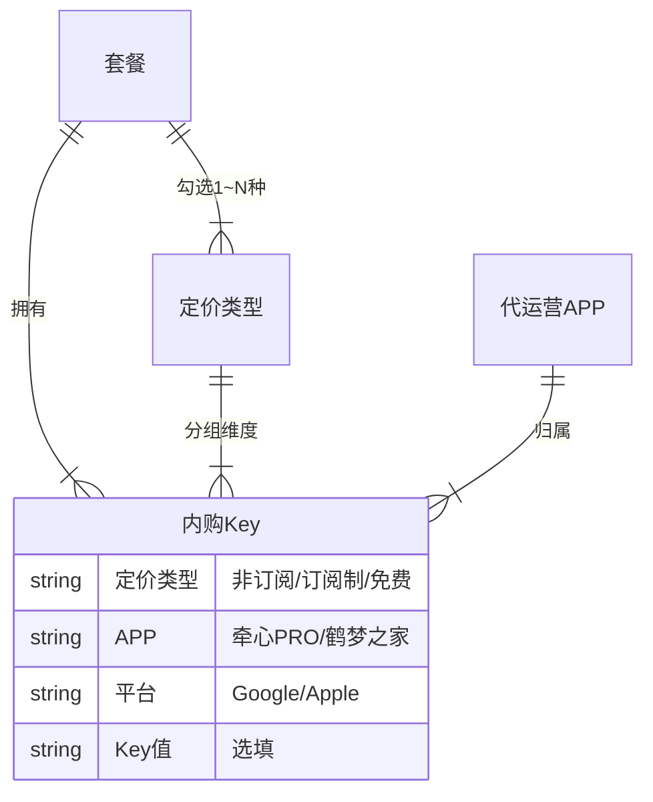
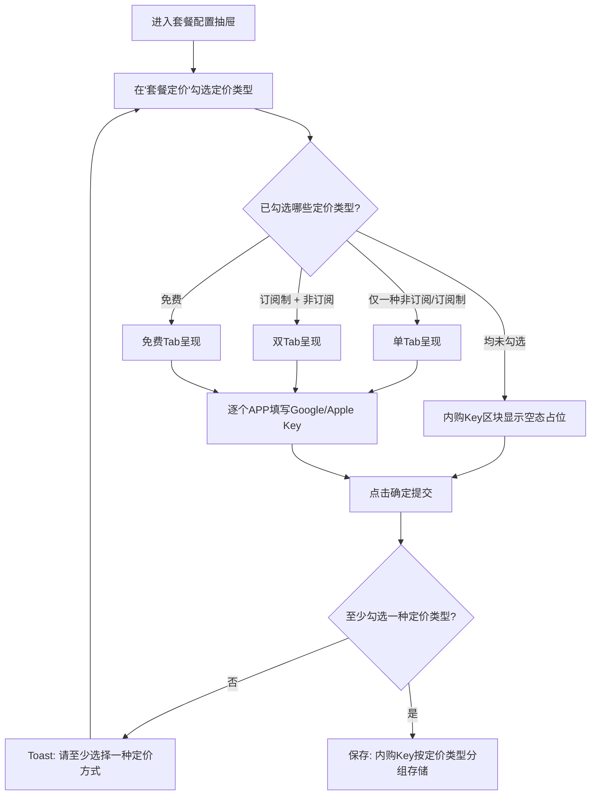
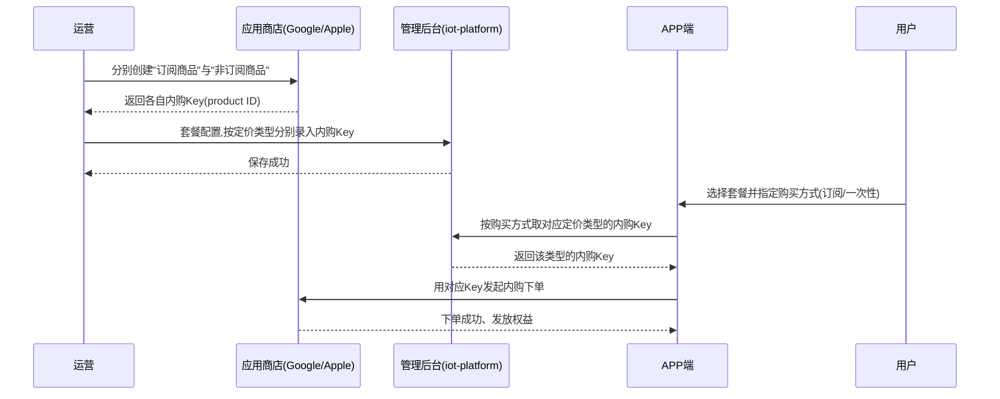
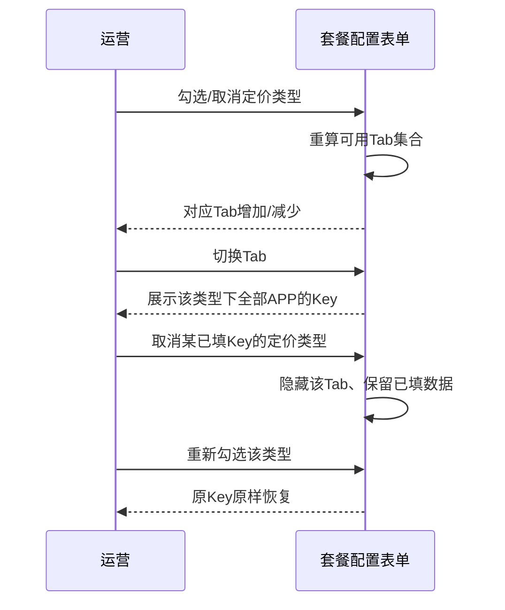

# 订阅/非订阅定价独立配置内购Key — 完整业务 PRD

## 修订记录

| 修订时间 | 修订内容 | 修订人 |
|----------|----------|--------|
| 2026-07-10 | 初稿（汇总需求分析 01、UI设计 02） | AI-PRD生成工程师 |
| 2026-07-13 | 新增业务规则 BR-13：未配置对应内购 Key 时，APP 端隐藏对应支付方式（Google Pay / Apple Pay） | AI-PRD生成工程师 |

> 说明：本需求主体为 iot-platform 运营后台的**配置功能**，且经确认跳过运营阶段，故省略「APP埋点与运营数据看板」章节。除后台配置外，新增一条**跨端联动规则（BR-13）**：APP 端根据内购 Key 是否配置，动态显隐对应支付方式。

---

## 一、业务背景

### 业务场景
运营在 iot-platform「套餐配置」中新增/编辑套餐时，可为套餐勾选多种定价方式（非订阅、订阅制、免费），其中**非订阅与订阅制可同时勾选**（免费与二者互斥）。套餐还需针对不同代运营 APP（牵心PRO、鹤梦之家）配置内购 Key（Google / Apple），用于对接应用商店的内购商品。

### 用户痛点
在 Google Play / App Store 中，「订阅商品（auto-renewable subscription）」与「一次性商品（非订阅）」属于**不同的商品类型、不同的 product ID**，内购凭证天然不同。改造前，内购 Key 区块每个 APP 只提供**一组** Google + Apple Key，无法区分定价类型。当一个套餐同时提供订阅与非订阅两种购买方式时，一组 Key 无法承载两套不同的商品凭证，导致用户下单无法对接到正确的商店商品。

### 产品目标
当套餐勾选了多种定价类型时，内购 Key 支持**按定价类型分别配置**，确保每种购买方式都能对接到正确的商店内购商品，从源头避免下单错配。

---

## 二、名词解释

| 术语 | 说明 |
|------|------|
| 定价类型 | 套餐的收费方式，枚举：`非订阅`、`订阅制`、`免费`。非订阅与订阅制可同时勾选；免费与二者互斥 |
| 内购Key | 对接应用商店内购商品的凭证/商品标识，分 `Google 内购 Key` 与 `Apple 内购 Key`，按 APP 区分 |
| 代运营APP | 平台代运营的应用，本次固定为「牵心PRO（APPID: QX_PRO_001）」「鹤梦之家（APPID: HM_HOME_001）」 |
| 定价Tab | 内购 Key 配置区块内，按已勾选定价类型划分的切换标签页 |
| 内购Key区块 | 套餐配置抽屉中「内购Key配置」这一整块表单区域 |
| 老套餐/老数据 | 本次改造前保存的、内购 Key 为「单组（不分定价类型）」结构的套餐 |

---

## 三、业务实体说明

### 核心实体
| 实体 | 关键属性 | 说明 |
|------|----------|------|
| 套餐 | 名称、应用方向、生效时长、服务、定价类型集合、内购Key集合、上架配置 | 配置与售卖的基本单位 |
| 定价类型 | 非订阅 / 订阅制 / 免费 | 决定套餐的收费方式与内购Key的分组维度 |
| 代运营APP | key、名称、APPID | 承载套餐售卖的应用，固定两个 |
| 内购Key | 定价类型、APP、平台（Google/Apple）、Key值 | 对接商店内购商品的凭证 |

### 实体关系


一条内购 Key 由「定价类型 × APP × 平台」三个维度唯一确定。一个同时勾选订阅制与非订阅的套餐，理论上最多可配置 `2(类型) × 2(APP) × 2(平台) = 8` 个内购 Key。

---

## 四、核心业务流程

### 流程图：运营配置内购Key


### 全局时序图：从商店建品到用户下单


### 局部时序图：定价勾选与Tab联动


---

## 五、业务规则

| 编号 | 规则 | 触发/条件 | 结果 |
|------|------|-----------|------|
| BR-01 | 定价类型可选性 | 非订阅、订阅制可同时勾选；免费与二者互斥 | 勾选免费时自动取消订阅/非订阅；勾选订阅或非订阅时自动取消免费 |
| BR-02 | Tab 来源 | 内购Key区块的 Tab = 已勾选定价类型的集合 | 勾选状态变化时 Tab 实时增减 |
| BR-03 | Tab 数量 | 单类型→1；订阅+非订阅→2；免费→1；无勾选→0 | 无勾选时显示空态占位「请先在『套餐定价』中勾选定价类型」 |
| BR-04 | APP 列表 | 每个 Tab 下固定列出全部代运营 APP | 牵心PRO、鹤梦之家各含 Google Key + Apple Key |
| BR-05 | 是否必填 | 内购 Key 选填 | 允许全部留空即保存 |
| BR-06 | 取消勾选的数据保留 | 取消某定价类型 | 该类型已填 Key **保留（隐藏）**，重新勾选后原样恢复，不清空 |
| BR-07 | 保存去空格 | 点击确定保存 | 对每个 Key 值做首尾空格去除 |
| BR-08 | 定价必选校验 | 三种定价均未勾选即提交 | Toast「请至少选择一种定价方式」，阻断保存 |
| BR-09 | 老数据兼容 | 编辑改造前的套餐（单组 Key） | 老 Key 按套餐原定价类型迁移：订阅→订阅 Tab，否则→非订阅 Tab |
| BR-10 | 同 APP 跨类型 Key | 同一 APP 的订阅 Key 与非订阅 Key | 相互独立，允许相同，不强制校验不同 |
| BR-11 | 格式校验 | Key 输入内容 | 不做格式合法性校验（仅去首尾空格） |
| BR-12 | APP 列表固定 | 内购 Key 的 APP 列表 | 固定两个 APP，不随「投放APP」勾选变化 |
| BR-13 | 支付方式按 Key 显示 | APP 端展示某套餐的购买入口时 | 某定价类型下、某平台（Google/Apple）的内购 Key 为空 → APP 端**不展示**该平台对应的支付方式（Google Pay / Apple Pay） |

优先级说明：BR-01（互斥/共存）优先于 BR-02/03（Tab 生成）；BR-08（必选校验）在保存动作时最先触发。

### BR-13 细化：内购 Key 与 APP 端支付方式的联动

内购 Key 的配置直接决定 APP 端支付方式的显隐。判断维度：**当前 APP × 当前定价类型 × 平台**。

| 该定价类型下的 Key 配置 | Android 端（Google Pay） | iOS 端（Apple Pay） |
|-------------------------|:---:|:---:|
| Google 有 + Apple 有 | 显示 | 显示 |
| Google 有 + Apple 空 | 显示 | 不显示 |
| Google 空 + Apple 有 | 不显示 | 显示 |
| Google 空 + Apple 空 | 不显示 | 不显示（该套餐在对应端无购买入口） |

- **按当前 APP 的 Key 判断**：牵心PRO、鹤梦之家各自的 Key 相互独立。
- **按当前定价类型的 Key 判断**：如订阅制 Key 已配、非订阅 Key 未配，则用户选择订阅制时展示对应支付方式，选择非订阅时不展示。
- **目的**：避免用户看到无法完成下单的支付方式——缺少内购 Key 会导致该支付方式下单失败（或购买后被商店自动退款），因此从入口层面直接隐藏。

---

## 六、功能架构

```
套餐配置抽屉
└── 内购Key配置区块（本次改造）
    ├── 定价类型 Tab 切换   ← 由「套餐定价」勾选驱动
    │   ├── 订阅制 Tab
    │   ├── 非订阅 Tab
    │   └── 免费 Tab
    ├── 每个 Tab 内：代运营 APP 列表
    │   ├── 牵心PRO：Google Key / Apple Key
    │   └── 鹤梦之家：Google Key / Apple Key
    └── 空态占位（无定价勾选时）
```

模块职责：
- **定价类型 Tab 切换**：根据已勾选定价类型渲染对应 Tab，管理激活 Tab 的有效性。
- **APP 列表**：在当前 Tab 上下文下，提供各 APP 的 Google/Apple Key 录入。
- **空态占位**：在无定价勾选时引导运营先选定价类型。

---

## 七、详细功能描述

### 7.1 内购Key按定价类型配置

#### 功能应用场景
运营为一个套餐配置了多种购买方式（如同时支持订阅续费与一次性买断）时，需要为每种购买方式分别录入对应商店的内购凭证，确保用户按不同方式下单都能命中正确的商店商品。

#### 功能详述
- **区域位置**：位于套餐配置抽屉「套餐介绍」与「标签配置」之间。
- **顶部 Tab**：仅渲染已勾选定价类型对应的 Tab，标签文案为「订阅制」「非订阅」「免费」。
- **Tab 内容**：固定列出全部代运营 APP，每个 APP 展示名称、APPID，以及 Google 内购 Key、Apple 内购 Key 两个输入框。
- **数据独立**：不同 Tab（定价类型）下的 Key 相互独立存储，切换 Tab 不影响其他类型已填内容。

#### 状态说明
| 状态 | 触发条件 | 展示内容 |
|------|----------|----------|
| 正常态-单类型 | 仅勾选一种定价（非订阅 / 订阅制 / 免费之一） | 单个 Tab + 该类型下全部 APP 的 Key 输入 |
| 正常态-多类型 | 同时勾选订阅制 + 非订阅 | 两个 Tab（订阅制、非订阅），切换分别配置 |
| 免费态 | 勾选免费套餐 | 单个「免费」Tab + 全部 APP 的 Key |
| 空态 | 三种定价均未勾选 | 占位提示：「请先在『套餐定价』中勾选定价类型」 |
| 加载态 | 点击「确定」保存中 | 抽屉底部「确定」按钮为加载中态 |
| 错误态 | 保存请求失败 | Toast 报错，抽屉保持打开，可重试 |
| 编辑回填态 | 编辑已有套餐 | 各定价类型 Key 按保存值回填至对应 Tab；老数据按原定价类型迁移 |

#### 交互说明
1. 在「套餐定价」勾选/取消某定价类型 → 内购 Key 区块对应 Tab 实时增减。
2. 取消勾选某类型时，其已填 Key **保留隐藏**；再次勾选后恢复。
3. 若当前激活的 Tab 因取消勾选而消失，自动切换到第一个仍可用的 Tab。
4. 点击不同 Tab → 下方展示该定价类型下全部 APP 的 Key。
5. Key 输入选填、无格式校验；保存时去除首尾空格。

---

## 八、页面信息架构

本需求为**单页（抽屉内）改动**，无新增页面与跳转。信息层级：

```
套餐列表页
└── [新增/编辑] → 套餐配置抽屉
        └── 内购Key配置区块
                └── 定价Tab → APP行 → Google/Apple Key 输入
```

- 入口：套餐列表页点击「新增套餐」或某套餐「编辑」，打开配置抽屉。
- 出口：点击「确定」保存后关闭抽屉、回到列表；点击「取消」或关闭直接退出。

---

## 九、异常说明

| 异常场景 | 触发条件 | 系统行为 | 用户感知 |
|----------|----------|----------|----------|
| 无定价即保存 | 三种定价均未勾选 | 阻断保存 | Toast「请至少选择一种定价方式」 |
| 取消勾选丢失担忧 | 已填 Key 后取消对应定价类型 | 数据保留隐藏，不清空 | 重新勾选后 Key 仍在 |
| 免费互斥切换 | 已填订阅/非订阅 Key 后勾免费 | 订阅/非订阅 Tab 隐藏、切到免费；原数据保留 | Tab 切换、数据不丢 |
| 网络异常 | 保存请求超时/失败 | 抽屉不关闭，可重试 | Toast 报错 + 重试 |
| 老数据兼容 | 编辑改造前的套餐 | 老单组 Key 按原定价类型迁移回填 | 正常回填、无丢失 |
| Key 重复 | 同一 APP 订阅与非订阅填了相同 Key | 不拦截 | 无强制提示（最多弱提示） |

---

## 十、测试要点

### 功能回归
| 编号 | 测试点 | 前置条件 | 操作步骤 | 预期结果 |
|------|--------|----------|----------|----------|
| T-001 | 其余区块不受影响 | 打开套餐配置抽屉 | 检查基础信息、套餐服务、定价、上架等区块 | 均正常展示与交互，无异常 |
| T-002 | 免费提示与互斥不受影响 | 勾选免费 | 观察免费提示与订阅/非订阅勾选 | 免费提示出现，订阅/非订阅被取消 |

### 核心场景
| 编号 | 测试点 | 前置条件 | 操作步骤 | 预期结果 |
|------|--------|----------|----------|----------|
| T-101 | 单类型-订阅 | 新增套餐 | 仅勾订阅制 | 内购Key显示单个「订阅制」Tab，含两个 APP 各 2 个输入框 |
| T-102 | 单类型-非订阅 | 新增套餐 | 仅勾非订阅 | 显示单个「非订阅」Tab |
| T-103 | 多类型双Tab | 新增套餐 | 同时勾订阅制+非订阅 | 显示两个 Tab，切换分别录入，数据互不覆盖 |
| T-104 | 免费Tab | 新增套餐 | 勾免费 | 显示单个「免费」Tab，含全部 APP |
| T-105 | 保存分组存储 | 双Tab各填Key | 点击确定 | 保存成功，Key 按定价类型分组 |
| T-106 | 编辑回填 | 已保存的多类型套餐 | 重新编辑打开 | 各 Tab 的 Key 正确回填到对应类型 |
| T-107 | 老数据迁移 | 改造前的老套餐 | 编辑打开 | 老 Key 按原定价类型出现在对应 Tab，无丢失 |

### 异常场景
| 编号 | 测试点 | 前置条件 | 操作步骤 | 预期结果 |
|------|--------|----------|----------|----------|
| T-201 | 无定价保存 | 三种定价均取消 | 点击确定 | Toast「请至少选择一种定价方式」，不保存 |
| T-202 | 空态占位 | 三种定价均未勾选 | 查看内购Key区块 | 显示「请先在『套餐定价』中勾选定价类型」 |
| T-203 | 保存失败重试 | 模拟网络失败 | 点击确定 | Toast 报错，抽屉不关，可重试 |
| T-204 | 首尾空格 | Key 前后带空格 | 保存后再编辑 | 回填值已去除首尾空格 |

### 状态切换
| 编号 | 测试点 | 前置条件 | 操作步骤 | 预期结果 |
|------|--------|----------|----------|----------|
| T-301 | 取消再勾恢复 | 双类型且均已填 Key | 取消非订阅→再勾回 | 非订阅 Key 原样恢复 |
| T-302 | 激活Tab失效自动切换 | 当前停在非订阅 Tab | 取消非订阅 | 自动切到订阅 Tab，不报错 |
| T-303 | 免费互斥切换 | 已填订阅 Key | 勾免费再取消改勾订阅 | Tab 切换正确，订阅 Key 仍在 |
| T-304 | 连续快速勾选 | 反复勾选/取消定价 | 快速多次操作 | Tab 增减稳定，无残留/错乱 |

### 兼容性
| 编号 | 测试点 | 前置条件 | 操作步骤 | 预期结果 |
|------|--------|----------|----------|----------|
| T-401 | 不同分辨率抽屉布局 | 桌面端不同屏宽 | 打开抽屉查看内购Key区块 | Tab 与 APP 行布局正常、不错位 |
| T-402 | 抽屉滚动 | 内容超出可视高度 | 上下滚动抽屉 | Tab 与输入框可正常滚动查看 |

---

> 备注：本 PRD 与需求分析文档（01ReqAnalysis）、UI 设计说明（02UIDesign）术语与业务定义一致。5 个待确认项均已采纳建议方案并落入上文业务规则（BR-06/09/10/11 及空态、免费呈现）。
