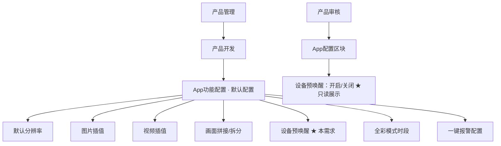

# 设备预唤醒 — 设计说明

## 修订记录

| 修订时间 | 修订内容 | 修订人 |
|---|---|---|
| 2026-11-24 | 初稿 | UI/UE AI 设计师 |

---

## 页面结构

不新增页面，在现有两处各加一个展示位：

---

## 布局详述

### 区域 1：配置项（App功能配置 · 默认配置）

| 项 | 规格 |
|---|---|
| 位置 | 默认配置 tab 内，位于「画面拼接/拆分」之后、「全彩模式时段」之前 |
| 表单标签 | `设备预唤醒`，右对齐，标签宽 140px，字号 14px |
| 控件 | Switch 开关（小号）+ 状态文字「开启 / 关闭」，字号 13px |
| 分隔 | 上下各一条 1px 分割线，与其他配置项一致 |

**说明文案（配置项底部）**

> 开启后，APP 进入首页时会自动唤醒该产品下的设备，减少打开时的等待时间。频繁唤醒会增加设备耗电与流量消耗。

- 字号 13px，占位灰，行高 1.6
- 位置：配置项下方，不放在标签旁边（避免一行过长）

### 区域 2：审核页展示（产品审核 · App配置）

| 项 | 规格 |
|---|---|
| 位置 | App配置卡片的 status 行内 |
| 形式 | `设备预唤醒：开启 / 关闭`，与其他摘要项用 `|` 分隔 |
| 交互 | 无，只读；点击「前往查看/修改」跳转到配置页 |

---

## 状态说明

| 状态 | 触发条件 | 展示内容 |
|---|---|---|
| 正常态 | 产品支持远程唤醒 + 电池供电机型 | 开关可操作 |
| 关闭态（默认） | 未配置 | 开关关闭 |
| 置灰态 | 产品未开启「远程唤醒」能力 | 开关禁用 + 提示「当前产品不支持远程唤醒，请先在设备能力中开启」 |
| 不适用态 | 长电机型 | 整项隐藏 |
| 保存成功态 | 保存请求成功 | Toast「保存成功」 |
| 保存失败态 | 保存请求失败 | Toast「网络异常，请重试」，内容保留 |

---

## 交互说明

| 交互 | 触发 | 效果 |
|---|---|---|
| 切换开关 | 点击 Switch | 立即反映状态，随页面底部「保存配置」统一提交 |
| 置灰态点击 | 点击禁用开关 | 不可操作；鼠标悬停显示提示文案 |
| 能力变更联动 | 在设备能力中开启「远程唤醒」 | 回到本页时开关自动解除置灰 |

---

## 组件清单

Web 后台使用 **Element Plus**，与现有页面保持一致。

| 组件 | 用途 | 所在区域 |
|---|---|---|
| `el-form-item` | 配置项容器，复用 140px 标签列 | 区域 1 |
| `el-switch` | 开关（`disabled` 控制置灰态） | 区域 1 |
| `el-tooltip` | 置灰原因提示 | 区域 1 |
| `el-message` | 保存成功 / 失败 | 全局 |

---

## 视觉规范

沿用 `默认配置` Tab 现有规范，不引入新样式变量：

| 项 | 取值 |
|---|---|
| 配置项分割线 | `var(--border-lighter)` |
| 次级文字色 | `var(--text-secondary)` |
| 说明文字色 | `var(--text-placeholder)` |
| 主按钮 | 项目主色，沿用底部「保存配置」 |
