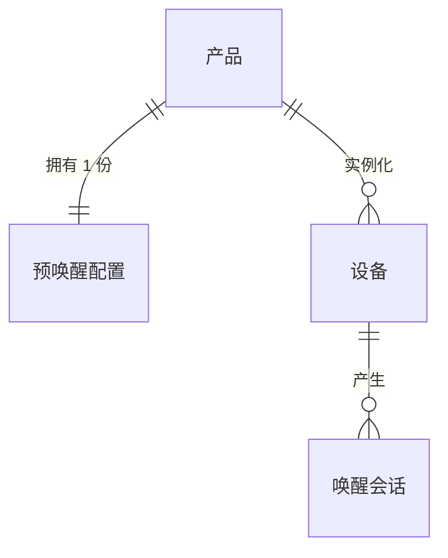
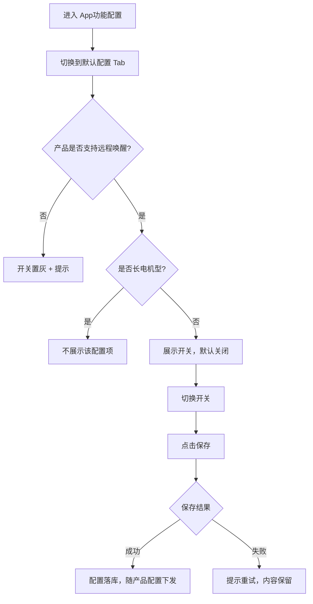
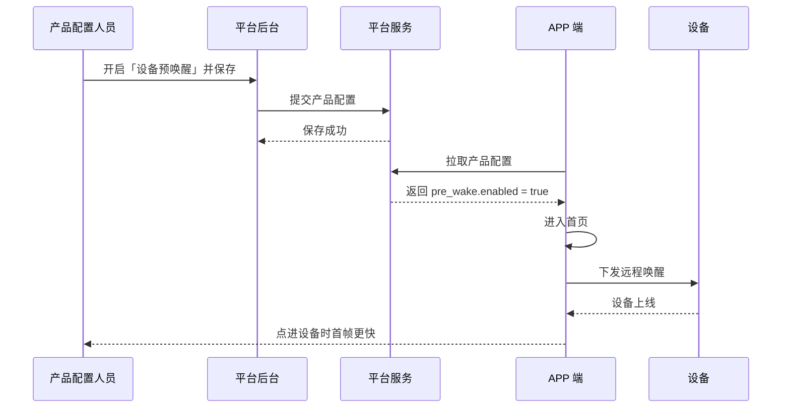
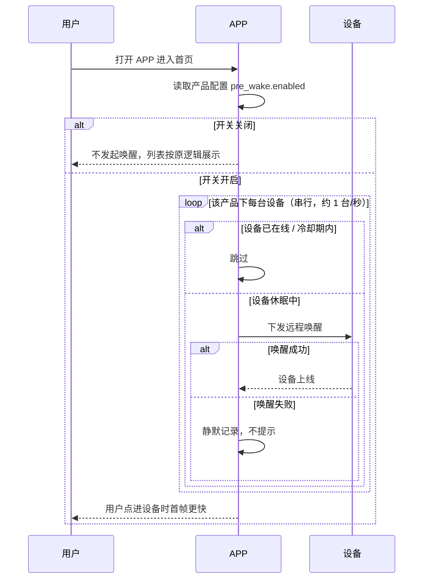
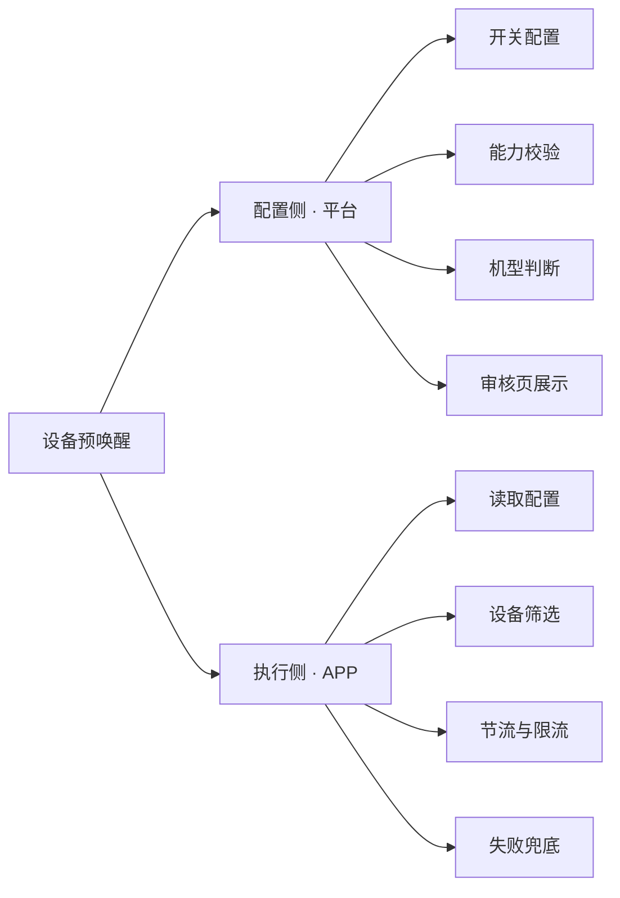
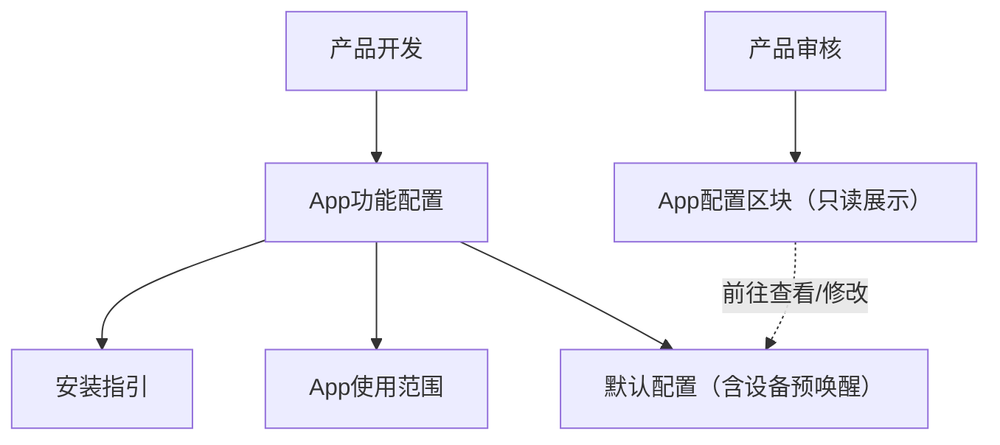

# 设备预唤醒 — 完整业务 PRD

## 修订记录

| 修订时间 | 修订内容 | 修订人 |
|---|---|---|
| 2026-11-24 | 初稿：汇总需求分析、UI 设计、运营分析产出 | PRD 生成 AI 工程师 |

---

## 一、业务背景

低功耗摄像机平时休眠，用户从 APP 首页点进设备时需等待唤醒 + 建连 + 出首帧，典型 5~15 秒。

本需求在产品维度提供一个开关：开启后，APP 进入首页时自动唤醒该产品下的设备，把等待提前到用户浏览列表阶段，从而缩短点进设备后的首帧时间。

> **范围**：只调整 APP 侧唤醒时机，不改变固件休眠策略，不新增物模型能力。

---

## 二、名词解释

| 术语 | 说明 |
|---|---|
| 预唤醒 | APP 进入首页时主动唤醒该产品下处于休眠的设备 |
| 休眠 | 设备为省电进入的低功耗状态，需指令唤醒后才能推流 |
| 远程唤醒 | 由 APP / 平台发起、经网络下发到设备的唤醒指令 |
| 冷却期 | 同一设备两次预唤醒的最小间隔（APP 侧固定 5 分钟） |
| 产品级配置 | 挂在产品维度、对该产品下所有设备生效的配置 |

---

## 三、业务实体说明

| 实体 | 说明 | 关键属性 |
|---|---|---|
| 产品 | 配置的载体 | 产品ID、设备类型、唤醒能力 |
| 设备 | 产品的实例 | 设备ID、在线/休眠状态、电量 |
| 预唤醒配置 | 产品级开关 | 开关状态 |
| 唤醒会话 | APP 一次首页进入触发的唤醒行为 | 设备ID、触发时间、结果 |

---

## 四、核心业务流程

### 4.1 配置流程

### 4.2 全局时序图

### 4.3 局部时序图：首页预唤醒执行

---

## 五、业务规则

### 5.1 配置规则

| 编号 | 规则 | 说明 |
|---|---|---|
| R-01 | 产品级配置 | 同产品下所有设备共用一个开关值，不支持单台覆盖 |
| R-02 | 默认关闭 | 新建产品默认不预唤醒 |
| R-03 | 前置能力校验 | 产品「唤醒能力」须包含 `远程唤醒`，否则开关置灰 |
| R-04 | 机型适用性 | 长电机型不展示该配置项 |
| R-05 | 说明文案常驻 | 配置项下方固定展示耗电与流量提示 |
| R-06 | 审核页只读 | 产品审核页仅展示状态，修改需跳转配置页 |

### 5.2 APP 执行规则

| 编号 | 规则 | 说明 |
|---|---|---|
| R-07 | 按开关执行 | 关闭时不发起任何唤醒指令 |
| R-08 | 跳过在线设备 | 设备已在线或唤醒中，不重复唤醒 |
| R-09 | 冷却期 5 分钟 | 同一设备 5 分钟内只预唤醒一次 |
| R-10 | 串行限流 | 按约 1 台/秒串行下发，避免并发建连 |
| R-11 | 静默失败 | 唤醒失败不弹提示，用户点进设备时走原有等待流程 |
| R-12 | 后台返回不触发 | APP 从后台切回前台不触发预唤醒，只在进入首页时触发 |

---

## 六、功能架构

---

## 七、详细功能描述

### 7.1 平台配置项

**位置**：App功能配置 → 默认配置，位于「画面拼接/拆分」与「全彩模式时段」之间。

| 元素 | 说明 |
|---|---|
| 标签 | `设备预唤醒` |
| 控件 | 开关 + 状态文字「开启 / 关闭」 |
| 说明文案 | 开启后，APP 进入首页时会自动唤醒该产品下的设备，减少打开时的等待时间。频繁唤醒会增加设备耗电与流量消耗。 |

**状态**

| 状态 | 条件 | 表现 |
|---|---|---|
| 正常态 | 支持远程唤醒 + 电池供电机型 | 可开关 |
| 置灰态 | 不支持远程唤醒 | 禁用 + 悬停提示 |
| 不适用态 | 长电机型 | 整项隐藏 |

### 7.2 APP 执行

| 条件 | 行为 |
|---|---|
| 开关关闭 | 不唤醒 |
| 开关开启 + 设备休眠 + 超出冷却期 | 下发远程唤醒 |
| 开关开启 + 设备已在线 / 冷却期内 | 跳过 |
| APP 从后台切回前台 | 不触发 |

### 7.3 审核页展示

App配置区块内以 `设备预唤醒：开启 / 关闭` 形式只读展示，与其他摘要项以 `|` 分隔。

---

## 八、页面信息架构

---

## 九、异常说明

| 场景 | 表现 |
|---|---|
| 产品不支持远程唤醒 | 开关置灰，提示需先在设备能力中开启 |
| 长电机型 | 配置项不出现 |
| 保存网络异常 | Toast「网络异常，请重试」，页面内容保留 |
| 并发编辑冲突 | Toast「配置已被他人修改，请刷新」 |
| 设备唤醒失败 | 静默，无提示 |
| 首页设备较多 | 串行限流，用户无感知 |

---

## 十、测试要点

### 功能回归

| 编号 | 测试点 | 前置条件 | 操作步骤 | 预期结果 |
|---|---|---|---|---|
| T-001 | 其他配置项不受影响 | 默认配置已有多项 | 逐项检查原有配置项 | 功能与样式无变化 |
| T-002 | 审核页展示正确 | 配置为开启 | 进入产品审核页 | 展示「设备预唤醒：开启」 |
| T-003 | 保存行为一致 | 修改开关 | 点击保存 | 与其他配置项一同提交 |

### 核心场景

| 编号 | 测试点 | 前置条件 | 操作步骤 | 预期结果 |
|---|---|---|---|---|
| T-101 | 开启后唤醒 | 配置开启，设备休眠 | 进入 APP 首页 | 设备被唤醒并上线 |
| T-102 | 关闭不唤醒 | 配置关闭 | 进入 APP 首页 | 无唤醒指令 |
| T-103 | 跳过在线设备 | 配置开启，设备在线 | 进入首页 | 不重复唤醒 |
| T-104 | 冷却期生效 | 5 分钟内已唤醒过 | 再次进入首页 | 跳过 |
| T-105 | 串行限流 | 首页 5 台休眠设备 | 进入首页 | 依次唤醒，非同时 |

### 异常场景

| 编号 | 测试点 | 前置条件 | 操作步骤 | 预期结果 |
|---|---|---|---|---|
| T-201 | 不支持远程唤醒 | 产品未开启远程唤醒 | 查看配置项 | 开关置灰 + 提示 |
| T-202 | 长电机型 | `device_type` 为长电 | 查看配置项 | 不展示 |
| T-203 | 唤醒失败 | 设备离线 | 进入首页 | 静默无提示 |
| T-204 | 保存断网 | 断网状态 | 修改后保存 | Toast 提示，内容保留 |

### 状态切换

| 编号 | 测试点 | 前置条件 | 操作步骤 | 预期结果 |
|---|---|---|---|---|
| T-301 | 后台切回不触发 | 配置开启 | APP 切后台再回前台 | 不发起预唤醒 |
| T-302 | 能力变更联动 | 开关置灰 | 开启远程唤醒能力后返回 | 开关解除置灰 |

### 兼容性

| 编号 | 测试点 | 前置条件 | 操作步骤 | 预期结果 |
|---|---|---|---|---|
| T-401 | 4G / WiFi 机型 | 配置开启 | 分别进入首页 | 均能唤醒，无异常 |
| T-402 | 旧版 APP | 配置开启，APP 未支持该字段 | 进入首页 | 忽略未知字段，不崩溃 |

---

## 十一、APP 埋点与运营数据看板

> 完整方案见 `设备预唤醒04bp.md`，此处为摘要。

| 指标 | 说明 |
|---|---|
| 配置开启率 | 已开启预唤醒的产品数 ÷ 适用产品数 |
| 单设备日均唤醒次数 | 判断耗电影响的核心指标 |
| 预唤醒成功率 | 唤醒成功 ÷ 发起次数 |
| 首帧耗时 | 开启前后对比，验证是否真的改善了体验 |

关键埋点：`pre_wake_toggle`、`pre_wake_trigger`、`pre_wake_result`、`pre_wake_skip`。

---

## 附录：本期不做

| 功能 | 原因 |
|---|---|
| 用户级开关 | 本期为产品级配置 |
| 唤醒范围 / 并发上限开放配置 | 由 APP 固定策略控制 |
| 修改固件休眠策略 | 超出本需求范围 |
| 首页封面刷新 | 本期只解决首帧等待 |

---

**文档结束**
