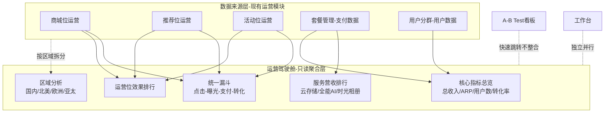

# 运营驾驶舱 — 需求分析文档

## 修订记录

| 修订时间 | 修订内容 | 修订人 |
|------|------|------|
| 2026-07-09 | 初稿 | Kiro |

---

## 一、业务背景

### 业务场景

公司运营团队当前通过多个独立页面（商城位运营、推荐位运营、活动位运营、A/B Test 看板等）管理各运营位，每个页面的数据分散、不互通。管理层（老板视角）希望有一个**一站式运营驾驶舱**，能在一个页面上同时看到所有运营项目和服务的核心数据指标，掌握全局运营健康度，支持按区域对比分析、漏斗转化诊断、服务营收排行等决策场景。

### 用户痛点

- **数据碎片化**：商城位/推荐位/活动位的指标各自独立，无法横向对比哪个运营位效果更好
- **缺乏全局视角**：缺少一个聚合页面回答「公司运营总收入和各项分布的现状/趋势是怎样的」
- **区域对比盲区**：目前仅区分国内/海外，无法看到北美、欧洲、亚太等细分市场的差异
- **漏斗断层**：各运营位缺少统一的漏斗模型来量化「触达→转化」的每个环节流失情况
- **缺乏时间对比**：没有同比/环比数据，难以判断指标是上升还是下降

### 产品目标

- **老板视角**：一个页面覆盖所有运营位核心指标，5 分钟内掌握公司运营全局
- **区域拆分**：按 国内 / 北美 / 欧洲 / 亚太 四个区域分别统计和对比
- **统一漏斗**：所有运营位使用统一的 点击→曝光→支付→转化 四层漏斗
- **服务排行**：按服务大类（云存储 / 全能AI / 时光相册）展示收入排行
- **时间对比**：支持同比、环比、ARP 值等关键财务/运营指标
- **独立项目**：驾驶舱作为独立项目，不与现有工作台耦合

### 目标用户

| 角色 | 使用场景 | 核心诉求 |
|------|---------|---------|
| 老板/高管 | 日常查看公司运营全局 | 快速掌握总收入、趋势变化、区域对比 |
| 运营负责人 | 分析各运营位效果 | 漏斗转化率、策略ROI、用户分群表现 |
| 区域负责人 | 查看所辖区域数据 | 区域单独筛选、区域间横向对标 |

---

## 二、名词解释

| 术语 | 说明 |
|------|------|
| 运营驾驶舱 | 面向管理层的运营数据看板，聚合所有运营项目和服务的核心指标，独立于现有工作台 |
| 运营位 | 公司运营投放的三个核心位置类型：商城位（套餐销售）、推荐位（套餐推荐漏斗）、活动位（营销活动弹窗/Banner） |
| 商城位 | 运营位之一，用户主动进入商城页浏览和购买套餐，包含商城首页位和商城 Banner 位 |
| 推荐位 | 运营位之一，系统主动向用户推荐套餐的运营位，包含首页推荐位和活动推荐位，通过条件漏斗匹配用户 |
| 活动位 | 运营位之一，通过弹窗/悬浮按钮/Banner 等形式向用户推送营销活动，包含限时活动、节日大促等 |
| 服务大类 | 面向用户的付费服务分类，当前含：云存储（设备录像云端存储）、全能AI（AI智能检测等功能）、时光相册（图片汇聚+视频生成） |
| 云存储 | 服务大类之一，设备录像上传至云端存储的订阅服务。套餐维度含 7天/15天/30天/365天事件云存及全时云存 |
| 全能AI | 服务大类之一，AI 智能检测/识别类功能的服务。业务模型为按月订阅或年付买断，按设备激活 |
| 时光相册 | 服务大类之一，设备抓拍图片自动汇聚+AI分类+一键生成短视频的服务。运营看板上将其建模为订阅制服务展示收入指标 |
| ARP 值 | Average Revenue Per User，单个用户的平均收入（总收入 / 总用户数） |
| 同比 | 与去年同期相比的增长/下降百分比（Year-over-Year, YoY） |
| 环比 | 与上一周期相比的增长/下降百分比（Month-over-Month / Week-over-Week, MoM） |
| 漏斗 | 统一的四层转化模型：**点击→曝光→支付→转化**（用户定义口径） |
| 点击 | 漏斗第1层：用户点击运营内容（套餐卡片 / 活动弹窗 / 推荐卡片等）的次数 |
| 曝光 | 漏斗第2层：运营内容进入用户可视区域的次数（展示/触达） |
| 支付 | 漏斗第3层：用户发起支付操作的次数 |
| 转化 | 漏斗第4层：用户成功完成购买/开通的终态次数 |
| 转化率 | 转化数 / 点击数 × 100%（整体转化率）；层间转化率 = 下层数 / 上层数 × 100% |
| 区域 | 运营数据的统计维度之一，本期驾驶舱按四个区域拆分：国内（中国大陆）、北美（美国+加拿大）、欧洲（欧盟+英国等）、亚太（日本/韩国/东南亚/澳洲等） |
| 模拟数据 | 当前海外区域细分数据尚未接入真实埋点，驾驶舱初期使用模拟数据展示完整布局，数据接口预留接入路径 |

---

## 三、功能范围

### 3.1 功能列表总览

| 序号 | 模块 | 功能 | 优先级 | 说明 |
|------|------|------|:--:|------|
| F1 | 核心指标总览 | 总收入卡片 | P0 | 展示选定时间范围内的平台总收入（含同比/环比），支持按区域筛选 |
| F2 | 核心指标总览 | ARP 值卡片 | P0 | 展示 ARPU（总收入/活跃用户数），含趋势箭头 |
| F3 | 核心指标总览 | 总用户数卡片 | P0 | 展示活跃用户总数，含同比/环比 |
| F4 | 核心指标总览 | 总转化率卡片 | P0 | 展示整体转化率（所有运营位加权），含趋势 |
| F5 | 区域分析 | 按区域拆分指标 | P0 | 四大区域（国内/北美/欧洲/亚太）的收入、用户数、转化率并列展示 |
| F6 | 区域分析 | 区域收入占比图 | P0 | 环形图/饼图展示各区域收入占总收入的比例 |
| F7 | 转化漏斗 | 统一漏斗模型 | P0 | 所有运营位汇总后的 点击→曝光→支付→转化 四层漏斗，展示每层数值和层间转化率 |
| F8 | 转化漏斗 | 按运营位漏斗拆分 | P0 | 分别展示商城位、推荐位、活动位的独立漏斗，支持切换 |
| F9 | 转化漏斗 | 按区域漏斗拆分 | P1 | 各区域的独立漏斗对比（如国内vs北美的漏斗形态差异） |
| F10 | 运营位效果 | 各运营位收入排行 | P0 | 商城位/推荐位/活动位的收入柱状图排行 |
| F11 | 运营位效果 | 各运营位转化率对比 | P0 | 三个运营位的转化率横向对比 |
| F12 | 运营位效果 | 运营位趋势图 | P1 | 选定运营位的收入/转化率时间趋势折线图 |
| F13 | 服务营收 | 服务大类收入排行 | P0 | 云存储/全能AI/时光相册的收入排行（横向柱状图/Top N），含占比 |
| F14 | 服务营收 | 服务收入趋势 | P1 | 各服务大类的收入时间趋势图 |
| F15 | 时间对比 | 同比/环比切换 | P0 | 指标卡片支持切换显示同比或环比数据 |
| F16 | 时间对比 | 时间范围选择 | P0 | 支持日/周/月/季/年粒度切换，支持自定义时间区间 |
| F17 | 全局筛选 | 区域筛选器 | P0 | 顶部全局区域筛选（全部/国内/北美/欧洲/亚太），所有卡片和图表联动 |
| F18 | 全局筛选 | APP 筛选器 | P1 | 按 APP（牵心PRO/鹤梦之家）筛选数据 |
| F19 | 数据刷新 | 手动刷新 | P0 | 提供刷新按钮，重新加载最新数据 |
| F20 | 数据刷新 | 数据更新时间提示 | P1 | 显示数据最后更新时间 |

### 3.2 不做/暂不做的功能

| 功能 | 原因 | 后续计划 |
|------|------|---------|
| 策略级数据下钻 | 一期聚焦全局视角，策略细粒度分析归属各运营位页面 | 二期评估 |
| 用户分群维度分析 | 用户分群数据在运营位页面已有展示，驾驶舱先做区域和服务维度 | 二期评估 |
| A/B Test 数据集成 | A/B 看板已独立存在，暂不合并，避免看板过重 | 可加快速跳转链接 |
| 设备/产品维度指标 | 驾驶舱聚焦运营和服务，设备数据归属工作台 | — |
| 实时数据流 | 一期使用准实时（T+1小时刷新），不做 WebSocket 实时推送 | 有需求再评估 |
| 数据导出/报表下载 | 一期仅展示，不提供 PDF/Excel 导出 | 二期评估 |
| 自定义仪表盘布局 | 一期提供固定布局，不做拖拽自定义 | — |
| 告警/预警规则 | 一期不做智能告警（如「北美转化率跌破阈值」推送） | 二期评估 |
| 套餐级收入拆解 | 用户明确只展示服务大类，不下钻套餐维度 | — |

---

## 四、场景穷举分析

### 4.1 核心指标总览

#### 4.1.1 功能概述

驾驶舱顶部区域展示四个核心指标卡片：总收入、ARP 值、总用户数、总转化率。每个卡片包含当前值、同比/环比变化百分比、趋势箭头（↑/↓）。数据随全局区域筛选和时间范围选择联动更新。

- **前置条件**：用户进入驾驶舱页面，数据源有可用数据

#### 4.1.2 正常场景

| 场景编号 | 场景名称 | 前置条件 | 操作步骤 | 预期结果 | 状态变化 |
|------|------|------|------|------|------|
| N-001 | 查看默认核心指标 | 进入驾驶舱 | 页面加载完成 | 显示四个指标卡片，默认为「全部区域」「本月」数据，同比模式 | — |
| N-002 | 切换同比/环比 | 指标卡片已展示 | 点击卡片上的同比/环比切换按钮 | 卡片上的变化百分比更新为环比数据，标签文字变为「环比」 | 同比↔环比切换 |
| N-003 | 切换时间粒度 | 默认月度视图 | 点击时间粒度选择器，选择「季度」 | 所有卡片和图表数据切换为季度汇总数据 | — |
| N-004 | 筛选区域后指标联动 | 默认全部区域 | 顶部区域筛选选择「国内」 | 四个指标卡片更新为仅国内数据 | — |
| N-005 | 自定义时间区间 | 默认显示本月 | 选择自定义日期范围（如 2026-05-01 ~ 2026-06-30） | 数据更新为自定义区间汇总 | — |

#### 4.1.3 异常场景

| 场景编号 | 异常类型 | 触发条件 | 系统行为 | 用户感知 |
|------|------|------|------|------|
| E-001 | 数据加载失败 | API 请求超时或返回错误 | 卡片显示「数据加载失败」占位文字 + 重试按钮 | 看到错误提示，点击重试重新加载 |
| E-002 | 数据为空 | 所有数据源的指标均为 0 | 卡片正常显示，值为 0，同比/环比显示「—」 | 看到全零数据，无趋势箭头 |
| E-003 | 部分指标为空 | 某区域暂无收入数据但用户数 > 0 | 该区域收入显示 0，ARP 值显示 0，其他正常 | 卡片显示 0 值，不报错 |
| E-004 | 同比数据缺失 | 去年同期无数据（新业务/新区域） | 同比栏显示「暂无数据」 | 不显示假数据 |
| E-005 | 网络恢复后重试 | 用户在加载失败后点击重试 | 重新请求数据接口 | 数据正常展示或保持错误状态 |

#### 4.1.4 边界条件

| 条件项 | 最小值 | 最大值 | 默认值 | 超限行为 |
|------|------|------|------|------|
| 时间范围 | 1 天 | 365 天 | 本月（自然月） | 超过 365 天仍允许请求，但可能出现性能下降，加 loading 提示 |
| 区域选择 | 全部（不选） | 4 个全选 | 全部 | — |
| 数值显示 | 0 | 99,999,999 | — | 超过 1 亿时显示为「1.0亿」格式，精确到小数点后 1 位 |

---

### 4.2 区域分析

#### 4.2.1 功能概述

展示四个区域（国内/北美/欧洲/亚太）的收入、用户数、转化率横向对比，以并列卡片 + 环形图（收入占比）形式呈现。当前海外细分数据使用模拟数据兜底。

- **前置条件**：驾驶舱页面已加载

#### 4.2.2 正常场景

| 场景编号 | 场景名称 | 前置条件 | 操作步骤 | 预期结果 | 状态变化 |
|------|------|------|------|------|------|
| N-006 | 查看区域收入分布 | 驾驶舱已加载，选择「全部区域」 | 页面滚动至区域分析区域 | 环形图展示四区域收入占比，国内占最大份额，四区域卡片并列 | — |
| N-007 | 点击区域卡片筛选 | 区域分析区域已展示 | 点击「北美」区域卡片 | 驾驶舱所有图表切换为仅北美数据，区域卡片高亮「北美」 | 全局区域筛选联动 |
| N-008 | 查看区域转化率对比 | 区域分析区域已展示 | 查看转化率排行 | 按转化率从高到低排列四个区域，显示数值和与均值的对比 | — |

#### 4.2.3 异常场景

| 场景编号 | 异常类型 | 触发条件 | 系统行为 | 用户感知 |
|------|------|------|------|------|
| E-006 | 某区域无数据 | 欧洲暂无用户/收入 | 该区域收入、转化率显示 0，环形图占比 0% | 区域卡片仍展示但数值为 0 |
| E-007 | 模拟数据标记 | 海外区域使用模拟数据 | 区域卡片上显示「模拟数据」徽标 | 用户知道该区域数据非真实，但看板布局完整可见 |

#### 4.2.4 边界条件

| 条件项 | 最小值 | 最大值 | 默认值 | 说明 |
|------|------|------|------|------|
| 区域数量 | 1 个 | 4 个 | 全部 4 个 | 未来可扩展更多区域 |
| 环形图占比 | 0% | 100% | — | 占比 < 3% 时文字标注移到外部以防遮挡 |

---

### 4.3 转化漏斗

#### 4.3.1 功能概述

驾驶舱核心模块之一。展示统一的 点击→曝光→支付→转化 四层漏斗，支持汇总视图（所有运营位合并）和拆分视图（商城位/推荐位/活动位分别展示），每层显示绝对数值和层间转化率。支持按区域筛选联动。

- **前置条件**：驾驶舱页面已加载

#### 4.3.2 正常场景

| 场景编号 | 场景名称 | 前置条件 | 操作步骤 | 预期结果 | 状态变化 |
|------|------|------|------|------|------|
| N-009 | 查看整体漏斗 | 驾驶舱已加载 | 页面滚动至漏斗区域 | 展示汇总漏斗：点击(总)→曝光→支付→转化，每层标注数值和层间转化率 | — |
| N-010 | 切换运营位漏斗 | 整体漏斗已展示 | 点击「商城位」标签 | 漏斗切换为商城位专属数据，标签高亮 | 运营位标签切换 |
| N-011 | 对比各运营位漏斗 | 漏斗区域已展示 | 选择「推荐位」，再切到「活动位」 | 每个运营位显示独立漏斗，操作流畅切换，数据更新 | — |
| N-012 | 区域筛选联动漏斗 | 漏斗区域已展示 | 顶部选择「北美」 | 漏斗数据更新为仅北美区域的点击/曝光/支付/转化 | — |

#### 4.3.3 异常场景

| 场景编号 | 异常类型 | 触发条件 | 系统行为 | 用户感知 |
|------|------|------|------|------|
| E-008 | 漏斗某层为 0 | 某运营位无支付数据 | 漏斗展示到有数据那层为止，后续层显示「—」和 0% | 漏斗图在断层层截断，视觉上清晰显示断层位置 |
| E-009 | 漏斗倒挂 | 曝光 > 点击（数据异常，正常应点击 ≤ 曝光 ≤ 支付 ≤ 转化） | 按实际数据显示，不校正数据 | 看到异常漏斗形态，需运营排查数据质量 |
| E-010 | 所有层为 0 | 选中的运营位+区域组合无任何数据 | 漏斗骨架保留，每层显示 0，底部提示「该条件下暂无数据」 | 看到空漏斗骨架 + 空态提示 |

#### 4.3.4 漏斗层定义（用户指定口径）

| 层序 | 层名 | 定义 | 商城位示例 | 推荐位示例 | 活动位示例 |
|:--:|------|------|------|------|------|
| 1 | 点击 | 用户点击运营内容的次数 | 点击商城套餐卡片 | 点击推荐位套餐卡片 | 点击活动弹窗/Banner |
| 2 | 曝光 | 运营内容进入用户可视区域的次数 | 商城页面曝光 | 推荐内容展示 | 活动弹窗展示 |
| 3 | 支付 | 用户发起支付操作的次数 | 点击「立即购买」发起支付 | 点击套餐进入支付页 | 点击活动套餐发起支付 |
| 4 | 转化 | 用户成功完成购买/开通的终态次数 | 支付成功 | 订阅/购买成功 | 活动套餐购买成功 |

#### 4.3.5 边界条件

| 条件项 | 说明 |
|------|------|
| 漏斗最大层级 | 4 层（固定） |
| 每层数值上限 | 无限制，100 万以上显示为「100万+」简写格式 |

---

### 4.4 运营位效果

#### 4.4.1 功能概述

展示商城位、推荐位、活动位的收入排行（柱状图）和转化率对比（横向对比图），支持按时间范围和区域筛选，支持时间趋势折线图。

- **前置条件**：驾驶舱页面已加载

#### 4.4.2 正常场景

| 场景编号 | 场景名称 | 前置条件 | 操作步骤 | 预期结果 | 状态变化 |
|------|------|------|------|------|------|
| N-013 | 查看运营位收入排行 | 驾驶舱已加载 | 页面滚动至运营位效果区域 | 柱状图展示商城位/推荐位/活动位收入排行（从高到低），每个柱体标数值 | — |
| N-014 | 查看转化率对比 | 运营位效果区域已展示 | 查看转化率横向对比图 | 三个运营位转化率并列，高亮最高值，显示与均值差距 | — |
| N-015 | 查看运营位趋势 | 运营位效果区域已展示 | 选择「推荐位」，选择时间粒度「周」 | 折线图展示推荐位近 7 周的周收入/转化率趋势 | — |
| N-016 | 悬浮查看详情 | 图表已展示 | 鼠标悬浮在柱状图某柱体上 | 弹出 tooltip 显示该运营位的详细数据（收入、转化率、同比增长） | — |

#### 4.4.3 异常场景

| 场景编号 | 异常类型 | 触发条件 | 系统行为 | 用户感知 |
|------|------|------|------|------|
| E-011 | 某运营位无数据 | 活动位在当前时间范围无收入 | 该运营位柱体高度为 0，tooltip 显示「暂无数据」 | 图表中该位置为空柱或极短柱 |
| E-012 | 趋势数据点不足 | 仅 1 个数据点 | 折线图仅显示 1 个点，不连线 | 看到单个点而非折线 |

---

### 4.5 服务营收

#### 4.5.1 功能概述

展示三大服务大类（云存储/全能AI/时光相册）的收入排行和占比。用户已明确只展示服务大类级别，不下钻到套餐（7天版/30天版等）。

- **前置条件**：驾驶舱页面已加载

#### 4.5.2 正常场景

| 场景编号 | 场景名称 | 前置条件 | 操作步骤 | 预期结果 | 状态变化 |
|------|------|------|------|------|------|
| N-017 | 查看服务收入排行 | 驾驶舱已加载 | 页面滚动至服务营收区域 | 横向柱状图展示云存储(最高)>全能AI>时光相册的收入排行，每个含占比 | — |
| N-018 | 查看服务收入趋势 | 服务营收区域已展示 | 切换时间粒度查看各服务趋势 | 折线图展示三个服务的收入时间趋势，不同颜色区分 | — |
| N-019 | 区域筛选联动 | 服务营收区域已展示 | 选择「亚太」 | 服务收入排行和趋势更新为仅亚太数据 | — |

#### 4.5.3 异常场景

| 场景编号 | 异常类型 | 触发条件 | 系统行为 | 用户感知 |
|------|------|------|------|------|
| E-013 | 某服务无收入 | 时光相册暂无收入数据 | 该服务柱体高度为 0，占比 0% | 柱体消失或极短 |
| E-014 | 所有服务无收入 | 极早期数据或全新区域 | 柱状图区域显示空态提示「该区域/时间暂无服务收入数据」 | 空态占位 |

---

### 4.6 全局交互

#### 4.6.1 时间范围选择

| 场景编号 | 场景名称 | 前置条件 | 操作步骤 | 预期结果 |
|------|------|------|------|------|
| N-020 | 快速选择预设时间 | 驾驶舱已加载 | 点击时间快捷按钮「本月」 | 所有图表数据更新为本月 |
| N-021 | 自定义日期范围 | 预设时间不足以满足需求 | 打开日期选择器，选择起止日期 | 所有图表数据更新为自定义区间 |
| N-022 | 切换时间粒度 | 默认显示月 | 点击粒度切换为「周」 | 图表切换为按周聚合的数据 |

#### 4.6.2 数据刷新

| 场景编号 | 场景名称 | 前置条件 | 操作步骤 | 预期结果 |
|------|------|------|------|------|
| N-023 | 手动刷新数据 | 驾驶舱已加载 | 点击刷新按钮 | 显示加载动画，数据更新为最新 |
| N-024 | 查看数据更新时间 | 驾驶舱已加载 | 查看页面底部时间戳 | 显示「数据更新于 2026-07-09 10:30」 |

#### 4.6.3 异常场景汇总（全局）

| 场景编号 | 异常类型 | 触发条件 | 系统行为 | 用户感知 |
|------|------|------|------|------|
| E-015 | 页面首屏加载超时 | 接口响应超过 15 秒 | 显示骨架屏（skeleton loading），各图表区域为灰色占位块 | 看到骨架屏脉动动画，不显示报错 |
| E-016 | 部分模块加载失败 | 总收入加载成功但漏斗加载失败 | 成功模块正常展示，失败模块显示错误占位 + 单独的重试按钮 | 正常模块可用，仅失败模块需要重试 |
| E-017 | 权限不足 | 无运营驾驶舱访问权限的用户访问 | 显示 403 提示或跳转至无权限页面 | 无法看到驾驶舱数据 |

---

## 五、跨模块联动分析

### 5.1 与现有模块的关系

| 现有模块 | 关联方式 | 联动说明 |
|---------|---------|---------|
| 商城位运营 (`/ops/mall`) | 数据源 | 驾驶舱读取商城的策略/套餐/转化数据汇总后展示 |
| 推荐位运营 (`/ops/recommend`) | 数据源 | 驾驶舱读取推荐位的漏斗/转化数据汇总 |
| 活动位运营 (`/ops/activity`) | 数据源 | 驾驶舱读取活动位的曝光/点击/转化数据汇总 |
| A/B Test 看板 (`/abtest/:id`) | 同级看板 | 驾驶舱不整合 A/B 数据，但可提供快速跳转链接 |
| 套餐管理 (`/pkg/list`) | 数据源 | 套餐销售数据（支付金额、购买次数）被驾驶舱汇总为服务收入 |
| 用户分群 (`/ops/usergroup`) | 间接关联 | 驾驶舱一期不做用户分群维度，但用户数指标依赖于分群数据源 |
| 工作台 (`/dashboard`) | 独立并行 | 驾驶舱独立于工作台，不替代不覆盖 |

### 5.2 数据刷新策略

- 驾驶舱修改数据筛选条件（区域/时间）时，**仅影响驾驶舱内部展示**，不回写原始运营位数据
- 原始运营位页面的操作（如新增活动策略、修改商城套餐）产生的数据变更，驾驶舱通过接口轮询或手动刷新获取最新数据
- 驾驶舱不修改任何运营数据，纯只读

### 5.3 需要通知/刷新的场景

| 场景 | 说明 |
|------|------|
| 用户手动点击刷新按钮 | 触发全量数据重新加载 |
| 用户切换全局筛选条件 | 区域内所有图表联动刷新 |
| 页面初次加载 | 全量加载默认条件（全部区域、本月、同比模式） |

---

## 六、需求分析总结

### 6.1 核心设计原则

1. **老板视角优先**：每个图表回答一个决策问题，不堆砌无效指标
2. **数据真实可信**：模拟数据区域有明确标识，真伪分明
3. **区域四象限**：四大区域平等展示，支持全局筛选和独立对比
4. **漏斗统一标准**：所有运营位共享统一的 点击→曝光→支付→转化 口径
5. **只读看板**：纯展示，不涉及任何 CUD 操作

### 6.2 功能优先级排序

**P0（一期必做）**：F1~F7、F10、F11、F13、F15~F17、F19
**P1（一期可做）**：F8、F9、F12、F14、F18、F20

### 6.3 待确认问题

| 问题编号 | 问题描述 | 建议 | 状态 |
|------|------|------|:--:|
| Q1 | 海外三区域的真实数据何时接入？ | 先全用模拟数据，预留 API 接口，真实数据就绪后切换。模拟数据的合理分布需确认（如国内占 60~70%，北美 15~20%，欧洲 5~10%，亚太 5~10%） | 待确认 |
| Q2 | 时光相册的服务收入模型是什么？ | 一期假设为订阅制，按月/年收费，使用模拟数据。真实定价和模式需产品确认 | 待确认 |
| Q3 | ARP 值的「用户数」口径？ | 建议使用「活跃用户数」（近30天有交互），而非注册用户总数 | 待确认 |
| Q4 | 同比数据最早需要追溯到多久？ | 若当前为 2026-07，去年数据需从 2025-07 起。如历史数据未覆盖，同比显示「暂无数据」 | 待确认 |
